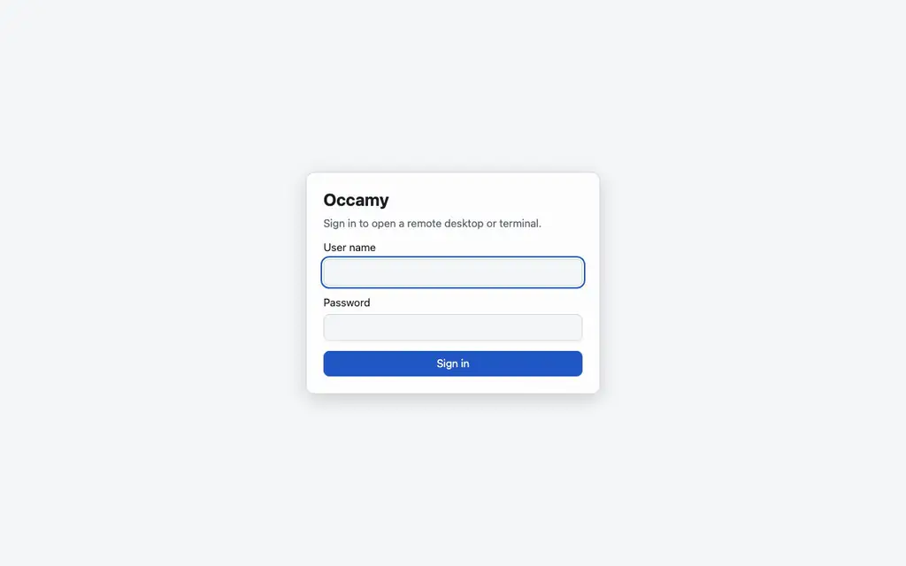

<div align="center">


# Occamy

[](https://github.com/changkun/occamy/actions/workflows/dockerimage.yml)
[](https://pkg.go.dev/changkun.de/x/occamy)
[](https://github.com/changkun/occamy/releases)
[](./go.mod)
[](./LICENSE)

</div>

Occamy is a remote desktop gateway: it connects to your computers over
VNC, RDP and SSH, and to your Kubernetes pods, and shows each desktop or
terminal in a web browser or in a Mac app. It does the job of Apache
Guacamole as a single Go program with a protocol of its own, designed
so that what you type appears on the remote screen as soon as the
network allows.



Measured against Guacamole on the same remotes, a key press over VNC
shows in 4.6 ms instead of 16.4 ms, long output over SSH finishes in
20 ms instead of 930 ms, and a full-screen photograph takes 122 KiB
instead of 2.2 MiB ([benchmarks](./docs/benchmarks.md)).

## What you can connect to

| Protocol | What you get |
|----------|--------------|
| VNC | A desktop served by x11vnc, TigerVNC or macOS Screen Sharing, also over VeNCrypt's TLS |
| RDP | A desktop served by xrdp or Windows. A Windows host needs one setting, `disable_gfx: true`; see [Windows hosts](./docs/configuration.md#windows-hosts) |
| SSH | A shell in a terminal that is drawn as text, so you can select and copy it |
| Kubernetes | A shell in a pod's container, through the cluster's API server |

You can share any session with a link that lets someone watch or take
part, and copy and paste between your computer and the remote. Your
users sign in with a password or through your OIDC provider, and the
credentials of your remotes stay on the server.

## Try it

You need Podman with a compose provider, or Docker with Compose, and
`make`. This command builds Occamy and starts a demo with a Linux
desktop, over VNC and over RDP, and an SSH server:

```sh
git clone https://github.com/changkun/occamy.git && cd occamy && make build run
```

The first run takes several minutes, because it builds the demo's
images. Then open <http://localhost:5637/static/> and sign in as `demo`
with the password `occamy`. `make stop` stops the demo. With Docker,
add `CONTAINER_ENGINE=docker` to each `make` command.

## Where to go next

| To | Read |
|----|------|
| Open each protocol in the demo, step by step | [Try Occamy](./docs/try-it.md) |
| Run Occamy for your users, over HTTPS | [Deploy](./docs/deploy.md) |
| Open, share and resize sessions in the browser | [The web client](./docs/web-client.md) |
| Open your connections in windows on a Mac | [Occamy for macOS](./docs/macos-app.md) |
| Look up a key of the configuration file | [Configuration](./docs/configuration.md) |
| Write a client of your own | [HTTP API](./docs/api.md) and [Protocol](./docs/protocol.md) |
| Learn how `occamyd` is built | [Architecture](./docs/architecture.md) |
| Build Occamy from source and run its tests | [Development](./docs/development.md) |

Each [release](https://github.com/changkun/occamy/releases) publishes
the container image `ghcr.io/changkun/occamy`, `occamyd` for Linux,
macOS and Windows, the web client, and Occamy for macOS as a disk image
that Apple has notarized. The documentation is also at
<https://changkun.github.io/occamy/>.

## Contributing

Bug reports and pull requests are welcome. [CONTRIBUTING.md](./CONTRIBUTING.md)
describes how to send a change, and [SECURITY.md](./SECURITY.md) how to
report a vulnerability privately. Everyone who takes part follows the
[code of conduct](./CODE_OF_CONDUCT.md). [CHANGELOG.md](./CHANGELOG.md)
records every release.

## License

[MIT](./LICENSE) &copy; 2019-2026 [Ou Changkun](https://changkun.de)
