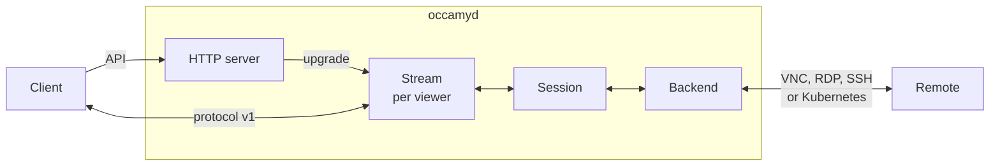
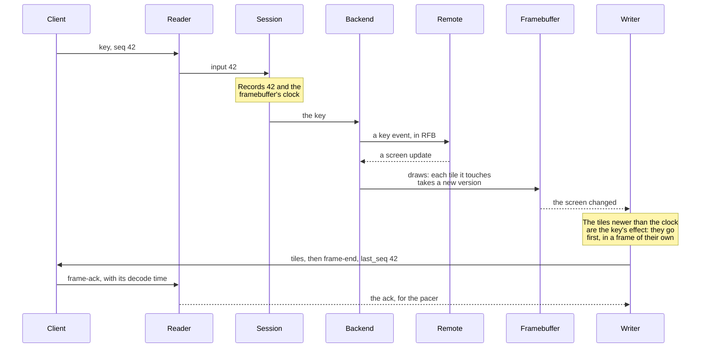
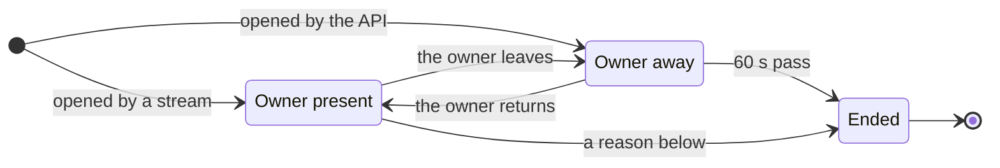

# Architecture

This page explains how `occamyd` is built: the parts it's made of, how a
key press travels from a client to the remote computer, and how the
remote's screen travels back. Read it to find your way around the code
before you change it, or to review a change.

## How occamyd works

`occamyd` is one Go program between your users and the computers they
reach. It has three jobs. Its HTTP server signs users in and serves the
[HTTP API](api.md). Each time a user opens a connection, it starts a
*session*, whose *backend* connects to the remote computer in that
computer's own protocol: VNC, RDP, SSH or the Kubernetes API. And for
each client that watches the session, a *viewer*, it runs a *stream*
that carries the session over [protocol v1](protocol.md).

A session owns the remote's screen: a *framebuffer* of pixels for a
desktop, or a terminal emulator for a shell. The backend draws into it
whatever the remote sends. A stream never forwards the remote's
messages. Instead, each viewer's *writer* compares the screen with what
that viewer was last sent, and sends only the difference, at the pace
of the viewer's own connection. Several viewers can share a session,
and each gets the screen at its own pace without holding up the others.

This is the path of a key press over VNC, from the moment you press the
key to the moment you see its effect:

The stream's *reader* decodes each message from the client. It hands
input to the session, which applies it in the order it arrives, if the
viewer's role allows input. Before the backend sees the key, the session
records the key's sequence number and the framebuffer's clock, so the
writer can tell the key's effect from other changes on the screen. The
backend sends the key to the remote, and when the remote draws, the
backend decodes the update into the framebuffer. The writer wakes, finds
the tiles that changed after the key, and sends them before anything
else, even when the viewer already has as many frames unacknowledged as
its frame window allows. The `frame-end` that closes the frame names
the key's sequence number, so the client knows exactly how long the key
took to show.

A terminal session works the same way with text. The backend feeds the
shell's output to the terminal emulator, and the writer sends each
viewer the escape sequences that turn the screen it was last sent into
the current one.

## Why it's built this way

Apache Guacamole, the best-known gateway of this kind, reaches remotes
through guacd, a daemon written in C, and talks to the browser in a
text protocol of drawing instructions. Occamy is built differently in
four ways, and each one shapes the code that this page describes:

- **A terminal travels as text.** guacd runs the terminal on the server
  and sends pictures of the rendered text. `occamyd` sends the changes
  to the terminal's screen, and the client draws the text itself, so
  traffic follows the characters rather than the pixels, and you can
  select the text. Bulk output costs only what changed on the screen,
  not every line that scrolled past.
- **A desktop travels as binary tiles.** Guacamole's instructions carry
  each image in base64, which is a third larger than the image itself.
  Protocol v1 is binary. `occamyd` sends only the tiles that changed,
  each in the codec that suits its content. It sends content in motion
  at half size until it stops, a scroll as a copy of pixels the client
  already has, and a tile the client has seen before by its slot in the
  client's cache.
- **Input comes first.** Small messages, such as the cursor or the
  clipboard, never queue behind tiles. The frame that shows an input's
  effect goes before any other. Each viewer has a writer of its own,
  paced to its own connection, so a large frame doesn't hold up a key's
  effect, and a slow viewer doesn't hold up the others.
- **One process.** The VNC, RDP, SSH and Kubernetes clients run inside
  `occamyd`, which is a static Go binary without C, for Linux, macOS
  and Windows. Nothing runs beside it.

## A session's life

A session starts when its owner opens a stream to a connection
([`GET /api/v1/connections/{id}/stream`](api.md#streams)). `occamyd`
checks the stream's token and the connection's `allow` list, starts the
session and its backend, and sends `welcome` at once, while the backend
connects to the remote. The first frame follows as soon as the backend
has drawn the remote's screen. When the configuration lacks a
credential that the remote asks for, such as a password, the backend
asks the owner through the stream, and waits for the answer.

A session can also start without a stream, from
[`POST /api/v1/sessions`](api.md#post-apiv1sessions). It then waits for
its owner's stream, as it does when its owner goes away:

While the owner is away, the other viewers keep watching, and the
owner can come back within 60 seconds. The other reasons a session
ends are that its owner ends it
([`DELETE /api/v1/sessions/{id}`](api.md#delete-apiv1sessionsid)), that
the remote ends it, that nobody gives input for 30 minutes, that the
backend fails, or that `occamyd` stops. Every viewer then receives
`close` with a [close code](protocol.md#close-codes) that says which.
`occamyd` keeps the reason for the length of the owner grace, so an
owner who comes back a moment too late still learns why the session
ended.

The owner can let others join with a *share*, a link for a viewer who
may give input or one who may only watch. Each viewer joins through
[`GET /api/v1/sessions/{id}/stream`](api.md#get-apiv1sessionsidstream)
and gets a stream of its own.

## The parts of occamyd

### The HTTP server

[`server`](../server) serves API v1 under `/api/v1/`, the health check
at `/healthz`, and the web client under `/static/` when the
configuration names its directory in `web_client`. It speaks HTTP/1.1
only, because a stream is a WebSocket that `occamyd` upgrades by taking
over an HTTP/1.1 connection. It terminates TLS 1.2 or later when the
configuration names a certificate.

Users sign in with a password, which `occamyd` checks against a bcrypt
hash, or through an OIDC provider, and receive an access token. The two
stream routes authenticate on their own, because a browser can't set
`Authorization` on a WebSocket. Each checks the request's `Origin`,
finds the token in `Sec-WebSocket-Protocol` or in `Authorization`, and
decodes the `hello` from the URL. It answers a refusal after the
upgrade, with `close`, because a browser can't read the status of a
refused upgrade.

The server enforces the limits of the configuration: the sessions it
runs at once, the sessions of each user, the viewers of each session,
and the shares of each session. On Linux, it asks the kernel for the
TCP congestion control that `congestion_control` names, BBR by default,
on its listener. The debug listener, which serves expvar and pprof, is
a separate server on its own address, so neither is ever reachable on
the public listener. On `SIGINT` or `SIGTERM`,
`occamyd` drains the requests in flight for up to five seconds, and a
second signal ends it at once.

### Tokens and the configuration

[`internal/auth`](../internal/auth) issues and checks tokens: JSON Web
Tokens signed with Ed25519, and no other algorithm, whatever a token's
header says. An *access token* names a user and the user's groups, and
a *session token* names a session and the role its holder joins with.
`occamyd` signs both with its own key, which it creates on its first
start, and also accepts tokens from the issuers that the configuration
trusts.

[`internal/config`](../internal/config) reads the configuration file.
It refuses unknown keys, fills in the defaults, and checks the whole
file before `occamyd` starts, including that the files and environment
variables it names exist, without reading any secret. It reports every
problem at once rather than the first.
[Configuration](configuration.md) describes every key.

### Sessions

[`internal/session`](../internal/session) turns a backend's connection
into a session that any number of viewers share. One goroutine owns
each session. It runs the backend, applies the viewers' input in the
order it arrives, drops the input of read-only viewers, tells the
backend whether anyone can see the screen, and ends the session.

The session also holds the small state that every viewer sees, such as
the cursor's image, the title and the clipboard. Each of these keeps
only its latest value, so a slow viewer receives the newest title once
instead of a queue of old ones. The session's registry holds the
running sessions by ID, and their shares by the hash of each share's
token, so a share dies with its session.

### Backends

A backend connects to the remote, draws into the session's framebuffer
or feeds its terminal emulator, and applies the viewers' input. It
never encodes anything for a viewer. Every backend implements the
interface in [`internal/backend`](../internal/backend): `Run` connects
and serves the remote, `Input` applies a viewer's input, and `Demand`
says whether any viewer can see the screen, so that a backend asks the
remote for updates only while someone is looking. The session gives
`Run` a *sink*, through which the backend reports what the remote does:
`Resize`, `Lock` and `Unlock` around the pixels it draws, `TermData`
for a terminal's output, the cursor, the clipboard, the title and the
bell, and `Prompt`, which asks the owner for a missing credential.

Each backend is a client written in Go, without C:

| Backend | What it speaks |
|---------|----------------|
| [`internal/backend/vnc`](../internal/backend/vnc) | RFB 3.3, 3.7 and 3.8, with the encodings Tight, ZRLE, Hextile, Raw and CopyRect. It also speaks VeNCrypt with TLS, Extended Desktop Size for resizing, Continuous Updates, QEMU's extended key events, the extended clipboard in UTF-8, and Apple Remote Desktop's sign-in when the connection allows it |
| [`internal/backend/rdp`](../internal/backend/rdp), on [`internal/rdp`](../internal/rdp) | RDP over TLS with NLA, bitmap updates in the interleaved RLE and planar codecs, the graphics pipeline with RemoteFX and RemoteFX Progressive, the clipboard's channel for text, and Display Control for resizing. It doesn't decode ClearCodec, AVC or the pipeline's cache. Windows draws most of its screen with ClearCodec and the cache, so a Windows host needs `disable_gfx: true`. Decoding takes at most the cores that `limits.decode_cores` gives all RDP sessions together |
| [`internal/backend/ssh`](../internal/backend/ssh) | SSH, with a shell in a pseudo-terminal. It accepts only a pinned host key unless the connection ignores host keys, and asks the owner for the answers its configuration lacks |
| [`internal/backend/kubernetes`](../internal/backend/kubernetes) | A command in a pod's container, or the container's main process, through the API server's `exec` and `attach` over WebSockets. It reaches the API server over TLS only, and checks the server's certificate before it sends anything |

The VNC and RDP backends share [`internal/keymap`](../internal/keymap),
which turns the physical key that a client reports, as a USB HID usage,
into the scan code that both protocols carry. Both check every length
that the remote sends against a limit before they read or allocate
anything for it.

### The screen

[`internal/framebuffer`](../internal/framebuffer) holds a desktop's
screen as RGBA pixels, divided into tiles of 64 by 64 pixels. Every
change to a tile gives it the next *version* of one counter for the
whole screen. A writer finds the tiles a viewer hasn't seen by
comparing their versions with the versions it last sent that viewer,
and finds an input's effect by comparing them with the counter's value
when the input arrived. Each row of tiles has a lock of its own, so a
backend that draws one part of the screen and writers that read another
don't wait for each other.

[`internal/terminal`](../internal/terminal) is a headless terminal
emulator that follows xterm. All of the shell's output goes into it,
and each writer takes a *snapshot* of the screen, which never changes
once taken. The writer sends a viewer the difference between the
snapshot it last sent and the current one, as escape sequences, so a
frame costs what changed on the screen rather than what the shell
printed. The emulator keeps no scrollback: lines that leave the top of
the screen go to the clients as scrolled lines, and the clients keep
them.

### A viewer's stream

[`internal/stream`](../internal/stream) serves one viewer, on two
goroutines. The reader decodes the client's messages and turns them
into input, the viewer's visibility, and frame acknowledgements. The
writer sends the session's screen as frames. This figure follows a
frame through a viewer's writer:

<picture>
  <source media="(prefers-color-scheme: dark)" srcset="figures/architecture-pipeline-dark.svg">
  
</picture>

Each time the screen changes, the writer takes these steps for its
viewer:

1. **It collects the dirty tiles,** those in the viewer's viewport whose
   version is newer than the one the viewer has. If an input's effect
   is among them, those tiles form a frame of their own, which goes
   first.
2. **It looks for scrolls.** The writer keeps a copy of the pixels its
   client shows. When dirty tiles hold rows that the client already
   shows elsewhere, moved up or down, the writer sends a `copy-rect`
   instead of the tiles.
3. **It checks the tile cache.** The writer mirrors the slots of the
   client's tile cache. A tile whose content a slot holds goes as a
   cached tile of a few bytes.
4. **It encodes the rest,** with the encoder that the next section
   describes. Adjacent tiles that go lossy are merged into one image, so
   the format's headers are paid once.
5. **It paces the frame,** and writes it, and ends it with `frame-end`.

The viewers of a session share an *encode cache*: a tile's encoding is
made once for every viewer whose client accepts the same codecs, by
whichever writer or worker gets there first. A session's encode
workers, two, or fewer on a machine with fewer than four cores, encode
the rows of a frame ahead of the writers.

When nothing changes, the writer *refines*. Tiles that went at a lower
quality or at half size, because they moved or because the network
held the quality down, go again, exactly or at the quality they need,
once they have been still for 300 ms. Refinement goes a little at a
time, and gives way at once to any input or change.

A viewer that leaves its frames unacknowledged, or takes no message,
for the viewer timeout, 30 seconds unless `streams.viewer_timeout` says
otherwise, receives `close` with `too-slow`, so a stalled client can't
hold its last screen forever.

### Encoding tiles

[`internal/encoder`](../internal/encoder) chooses each tile's codec by
counting its colours:

| A tile with | Goes |
|-------------|------|
| Up to 16 colours, such as text and flat interface elements | Exact, as deflate, or as raw pixels for a client without deflate |
| 17 to 256 colours, such as antialiased text and smooth gradients | Exact while it's still, and lossy while it moves |
| More than 256 colours, such as a photograph or a video | Lossy, as WebP, or as JPEG for a client without WebP |

A run of lossy tiles side by side, up to 16 tiles, goes as one image.
Its quality depends on what the tiles show:

- Tiles in motion go at the pacer's lowest quality, and at half their
  size for a client that accepts the scaled codec, because detail
  matters least while content moves.
- An input's effect goes at the pacer's current quality, without a
  search, so that it isn't delayed.
- Other still tiles go at the lowest quality, up to the pacer's
  current one, at which each tile reaches a structural similarity
  (SSIM) of 0.91 against its pixels.

Every encoder is pure Go and runs on the writer's goroutine, so one
viewer's encoding takes at most one core. [Codecs](benchmarks/codecs.md)
shows the measurements behind these choices.

[`internal/codec`](../internal/codec) holds the formats that Occamy
defines itself, raw pixels and the deflate container, both ways, and
the scaling of the scaled codec. It uses the standard library only, so
a client can decode with it without linking the server's lossy
encoders.

### Pacing

[`internal/pacer`](../internal/pacer) decides when a writer starts the
next frame, when it writes the next bytes, and at what lossy quality.
It models the viewer's network path from the frame acknowledgements, as
TCP's BBR does from its own: the delivery rate is the highest rate
measured recently, and the path's delay is the shortest round trip
measured recently. The pacer then:

- writes at about the delivery rate, so that data doesn't queue in the
  network;
- keeps the bytes in flight to about twice the product of that rate and
  delay;
- lets as many frames await an acknowledgement as cover the time an
  acknowledgement takes, up to the agreed frame window, so that an
  acknowledgement is a measurement rather than a barrier;
- sends the frame that carries an input's effect at once, unpaced, even
  beyond a full window;
- steps the lossy quality down, from 90 toward 30, while the writer
  spends most of its time waiting for the path, and back up while it
  doesn't, so motion loses detail before input loses responsiveness.

A pacer does no I/O and reads no clock: every method takes the current
time. Its tests therefore drive it on simulated networks.
[Frames and flow control](protocol.md#frames-and-flow-control) explains
what the client sees of this.

### The protocol package

[`protocol`](../protocol) implements protocol v1 as a public package:
each message as a Go type, the handshake, and the decoding rules.
[The protocol page](protocol.md) is the specification, and this package
is its reference implementation. The page's test vectors are checked
against the package.

### The clients

| Client | Where | How it's built |
|--------|-------|----------------|
| The web client | [`client/occamy-web`](../client/occamy-web) | TypeScript and React, built with Vite. It decodes tiles in a Web Worker, applies each frame to a framebuffer in memory, and draws the changed parts on a canvas at the next animation frame. Then it acknowledges the frame. xterm.js draws terminals |
| The Go client | [`client`](../client), with [`client/decoders`](../client/decoders) | A public package that opens a session, applies frames, and acknowledges them as the caller takes them. The end-to-end tests, the benchmark and Occamy for macOS use it |
| Occamy for macOS | [`client/occamy-swift`](../client/occamy-swift) | SwiftUI, on the Go client built as a C library, `liboccamy.a`. SwiftTerm draws terminals |

### Tests and tools

| Path | What it holds |
|------|---------------|
| [`tests`](../tests) | The end-to-end, pressure and soak tests, which run against the demo stack ([Development](development.md#end-to-end-tests)) |
| [`client/internal/webinterop`](../client/internal/webinterop) | A server of `occamyd`'s stream code, against which the web client's interop tests run |
| [`bench`](../bench) | The benchmark harness, with Guacamole as the baseline ([Benchmarks](benchmarks.md)) |
| [`bench/codecs`](../bench/codecs) | The measurement of the tile codecs, a Go module of its own ([Codecs](benchmarks/codecs.md)) |

## Design

The specs record how each part was designed, the options weighed, and
what was built:

- [The native architecture](../specs/008-native-architecture.md):
  `occamyd`, its protocol, backends and streaming, with a spec for each
  part:
  - [API v1 and the server](../specs/008-native-architecture/api-and-server-stack.md);
  - [sessions and the backend interface](../specs/008-native-architecture/session-core.md);
  - [the graphics pipeline](../specs/008-native-architecture/graphics-pipeline.md):
    the framebuffer, codecs, scroll detection, the tile cache, the
    encode cache and refinement;
  - [real-time pacing and transport](../specs/008-native-architecture/realtime-transport.md);
  - [protocol v1](../specs/008-native-architecture/protocol-v1.md);
  - [the Go client](../specs/008-native-architecture/client-core.md);
  - the backends for [VNC](../specs/008-native-architecture/native-vnc-backend.md),
    [RDP](../specs/008-native-architecture/native-rdp-backend.md),
    [SSH](../specs/008-native-architecture/native-ssh-backend.md) and
    [Kubernetes](../specs/008-native-architecture/native-kubernetes-backend.md).
- [The web client](../specs/009-react-web-client.md).
- [Occamy for macOS](../specs/010-native-swift-client.md).
- [Every spec](../specs/README.md).
