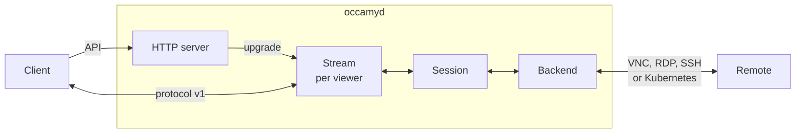
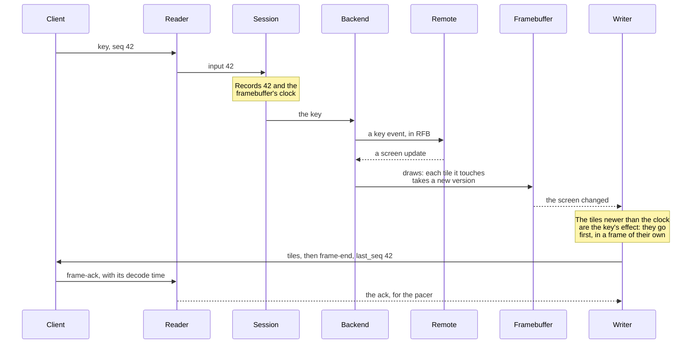
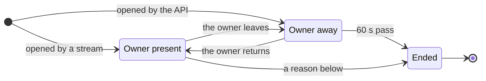

# Architecture

This page explains how `occamyd` is built: its parts, how a key press
travels from a client to the remote computer, and how the remote's
screen travels back. Read it to find your way around the code before
you change or review it.

## How occamyd works

`occamyd` is one Go program between your users and the computers they
reach. Its HTTP server signs users in and serves the
[HTTP API](api.md). Each connection that a user opens starts a
*session*, whose *backend* connects to the remote computer in its own
protocol: VNC, RDP, SSH or the Kubernetes API. For each client that
watches the session, a *viewer*, a *stream* carries the session over
[protocol v1](protocol.md).

A session owns the remote's screen, which the backend draws into: a
*framebuffer* of pixels for a desktop, or a terminal emulator for a
shell. A stream never forwards the remote's messages. Instead, each
viewer's *writer* sends only the difference between the screen and what
that viewer was last sent, at the pace of the viewer's own connection,
so viewers who share a session don't hold each other up.

This is the path of a key press over VNC:

The session records the key's sequence number and the framebuffer's
clock before the backend sees the key, which is how the writer tells
the key's effect from other changes. Those tiles go even when the
viewer's frame window is full.

## Why it's built this way

Apache Guacamole reaches remotes through guacd, a daemon written in C,
and talks to the browser in a text protocol of drawing instructions.
Occamy differs in four ways:

- **A terminal travels as text.** guacd sends pictures of the rendered
  text. `occamyd` sends the changes to the terminal's screen, and the
  client draws the text, so you can select it, and bulk output costs
  what changed on the screen rather than every line that scrolled past.
- **A desktop travels as binary tiles.** Guacamole carries each image
  in base64, a third larger than the image. `occamyd` sends only the
  tiles that changed, each in the codec that suits it: content in
  motion at half size, a scroll as a copy of pixels the client has, and
  a tile the client has seen by its cache slot.
- **Input comes first.** Small messages, such as the cursor or the
  clipboard, never queue behind tiles, and the frame that shows an
  input's effect goes before any other.
- **One process.** The VNC, RDP, SSH and Kubernetes clients run inside
  `occamyd`, a static Go binary without C for Linux, macOS and Windows.

## A session's life

A session starts when its owner opens
[a connection's stream](api.md#streams). `occamyd` checks the token and
the connection's `allow` list, starts the session and its backend, and
sends `welcome` at once, while the backend connects. The first frame
follows once the backend has drawn the remote's screen. When the remote
asks for a credential that the configuration lacks, the backend asks
the owner through the stream and waits for the answer.

A session that [`POST /api/v1/sessions`](api.md#post-apiv1sessions)
opens waits for its owner's stream, as it does when the owner goes
away:

A session also ends when its owner closes it, the remote ends it,
nobody gives input, the backend fails, or `occamyd` stops.
[The life of a session](api.md#the-life-of-a-session) gives the
[close code](protocol.md#close-codes) that each viewer then receives,
and [Lifetimes](api.md#lifetimes) the timeouts. Other viewers join with
a *share*, each through a stream of its own.

## The parts of occamyd

### The HTTP server

[`server`](../server) serves API v1 under `/api/v1/`, the health check
at `/healthz`, and the web client under `/static/` when `web_client`
names its directory. It speaks HTTP/1.1 only, because a stream is a
WebSocket that `occamyd` upgrades by taking over an HTTP/1.1
connection, and it terminates TLS when the configuration names a
certificate.

The two stream routes authenticate on their own, because a browser
can't set `Authorization` on a WebSocket, and refuse after the upgrade,
because a browser can't read the status of a refused upgrade
([Streams](api.md#streams)). The server enforces the configuration's
[limits](api.md#limits), and on Linux sets the TCP congestion control
that `congestion_control` names on its listener.

The debug listener, which serves expvar and pprof, is a separate server
on its own address. On `SIGINT` or `SIGTERM`, `occamyd` drains the
requests in flight for up to five seconds, and a second signal ends it
at once.

### Tokens and the configuration

[`internal/auth`](../internal/auth) issues and checks tokens: JSON Web
Tokens signed with Ed25519 and no other algorithm, whatever a token's
header says. An *access token* names a user and the user's groups, and
a *session token* names a session and its holder's role. `occamyd`
signs both with its own key, which it creates on its first start, and
accepts tokens from the issuers that the configuration trusts.

[`internal/config`](../internal/config) reads the configuration file.
It refuses unknown keys, fills in the defaults, and checks the whole
file before `occamyd` starts, including that the files and environment
variables it names exist, without reading any secret. It reports every
problem at once. [Configuration](configuration.md) describes every key.

### Sessions

[`internal/session`](../internal/session) turns a backend's connection
into a session that any number of viewers share. One goroutine owns
each session: it runs the backend, applies the viewers' input in the
order it arrives, drops a read-only viewer's input, tells the backend
whether anyone can see the screen, and ends the session.

The session holds the small state that every viewer sees, such as the
cursor's image, the title and the clipboard, and keeps only the latest
value of each, so a slow viewer receives the newest title once instead
of a queue of old ones. Its registry holds the running sessions by ID,
and their shares by the hash of each share's token, so a share dies
with its session.

### Backends

A backend connects to the remote, draws into the session's framebuffer
or feeds its terminal emulator, and applies the viewers' input; it
never encodes anything for a viewer. Every backend implements the
interface in [`internal/backend`](../internal/backend):

| Method | What it does |
|--------|--------------|
| `Run` | Connects and serves the remote. It reports what the remote does through the *sink* that the session gives it: `Resize`, `Lock` and `Unlock` around the pixels it draws, `TermData` for a terminal's output, the cursor, the clipboard, the title, the bell, and `Prompt` for a missing credential |
| `Input` | Applies a viewer's input |
| `Demand` | Says whether any viewer can see the screen, so that the backend asks the remote for updates only while someone looks |

Each backend is a client written in Go, without C:

| Backend | What it speaks |
|---------|----------------|
| [`internal/backend/vnc`](../internal/backend/vnc) | RFB 3.3, 3.7 and 3.8, with the encodings Tight, ZRLE, Hextile, Raw and CopyRect. It also speaks VeNCrypt with TLS, Extended Desktop Size for resizing, Continuous Updates, QEMU's extended key events, the extended clipboard in UTF-8, and Apple Remote Desktop's sign-in when the connection allows it |
| [`internal/backend/rdp`](../internal/backend/rdp), on [`internal/rdp`](../internal/rdp) | RDP over TLS with NLA, bitmap updates in the interleaved RLE and planar codecs, the graphics pipeline with RemoteFX and RemoteFX Progressive, the clipboard's channel for text, and Display Control for resizing. It doesn't decode ClearCodec, AVC or the pipeline's cache. Windows draws most of its screen with ClearCodec and the cache, so a Windows host needs `disable_gfx: true`. Decoding takes at most the cores that `limits.decode_cores` gives all RDP sessions together |
| [`internal/backend/ssh`](../internal/backend/ssh) | SSH, with a shell in a pseudo-terminal. It accepts only a pinned host key unless the connection ignores host keys, and asks the owner for the answers its configuration lacks |
| [`internal/backend/kubernetes`](../internal/backend/kubernetes) | A command in a pod's container, or the container's main process, through the API server's `exec` and `attach` over WebSockets. It reaches the API server over TLS only, and checks the server's certificate before it sends anything |

The VNC and RDP backends share [`internal/keymap`](../internal/keymap),
which turns the USB HID usage of the physical key that a client reports
into the scan code that both protocols carry. Both check every length
that the remote sends against a limit before they read or allocate
anything for it.

### The screen

[`internal/framebuffer`](../internal/framebuffer) holds a desktop's
screen as RGBA pixels in tiles of 64 by 64. Every change to a tile
gives it the next *version* of one counter for the whole screen. A
writer finds the tiles a viewer hasn't seen by comparing their versions
with those it last sent that viewer, and an input's effect by comparing
them with the counter's value when the input arrived. Each row of tiles
has a lock of its own, so a backend that draws one part of the screen
and writers that read another don't wait for each other.

[`internal/terminal`](../internal/terminal) is a headless terminal
emulator that follows xterm. Each writer takes a *snapshot* of its
screen, which never changes once taken, and sends the viewer the
difference from the snapshot it last sent, as escape sequences. The
emulator keeps no scrollback: lines that leave the top of the screen go
to the clients as scrolled lines, and the clients keep them.

### A viewer's stream

[`internal/stream`](../internal/stream) serves one viewer on two
goroutines. The reader turns the client's messages into input, the
viewer's visibility, and frame acknowledgements. The writer sends the
session's screen as frames, through the stages that this figure shows:

<picture>
  <source media="(prefers-color-scheme: dark)" srcset="figures/architecture-pipeline-dark.svg">
  
</picture>

Only the dirty tiles in the viewer's viewport count. To find scrolls,
the writer keeps a copy of the pixels its client shows, and it mirrors
the slots of the client's tile cache.

The viewers of a session share an *encode cache*: a tile's encoding is
made once for every viewer whose client accepts the same codecs, by
whichever writer or worker gets there first. A session's two encode
workers, fewer on a machine with fewer than four cores, encode the rows
of a frame ahead of the writers.

When nothing changes, the writer *refines*: tiles that went at a lower
quality or at half size go again, exactly or at the quality they need,
once they have been still for 300 ms. Refinement goes a little at a
time, and gives way at once to any input or change.

A viewer that stalls for the [viewer timeout](api.md#lifetimes) is
closed with `too-slow`, so that it can't hold its last screen forever.

### Encoding tiles

[`internal/encoder`](../internal/encoder) chooses each tile's codec by
counting its colours, by the rules of
[What occamyd sends](protocol.md#what-occamyd-sends). It sends a run of
up to 16 lossy tiles side by side as one image, at a quality that
depends on what the tiles show:

| Lossy tiles | Quality |
|-------------|---------|
| In motion | The pacer's lowest, and at half size for a client that accepts the scaled codec |
| An input's effect | The pacer's current, without a search, so that the effect isn't delayed |
| Other still tiles | The lowest, up to the pacer's current, at which each tile reaches a structural similarity (SSIM) of 0.91 against its pixels |

Every encoder is pure Go and runs on the writer's goroutine, so one
viewer's encoding takes at most one core. [Codecs](benchmarks/codecs.md)
shows the measurements behind these choices.

[`internal/codec`](../internal/codec) holds the formats that Occamy
defines, raw pixels and the deflate container, both ways, and the
scaling of the scaled codec. It uses the standard library only, so a
client can decode with it without linking the server's lossy encoders.

### Pacing

[`internal/pacer`](../internal/pacer) decides when a writer starts the
next frame, when it writes the next bytes, and at what lossy quality.
It models the viewer's network path from the frame acknowledgements, as
TCP's BBR does from its own: the delivery rate is the highest rate
measured recently, and the path's delay the shortest recent round trip.
The pacer then:

- writes at about the delivery rate, so that data doesn't queue in the
  network;
- keeps the bytes in flight to about twice the product of that rate and
  delay;
- lets as many frames await an acknowledgement as cover the time an
  acknowledgement takes, up to the agreed frame window;
- sends the frame that carries an input's effect at once, unpaced, even
  beyond a full window;
- steps the lossy quality down from 90 toward 30 while the writer
  spends most of its time waiting for the path, and back up while it
  doesn't, so motion loses detail before input loses responsiveness.

A pacer does no I/O and reads no clock: every method takes the current
time, so its tests drive it on simulated networks.
[Frames and flow control](protocol.md#frames-and-flow-control) explains
what the client sees of this.

### The protocol package

[`protocol`](../protocol) implements protocol v1 as a public package:
each message as a Go type, the handshake, and the decoding rules. It is
the reference implementation of [the protocol page](protocol.md), whose
test vectors are checked against it.

### The clients

| Client | Where | How it's built |
|--------|-------|----------------|
| The web client | [`client/occamy-web`](../client/occamy-web) | TypeScript and React, built with Vite. It decodes tiles in a Web Worker, applies each frame to a framebuffer in memory, and draws the changed parts on a canvas at the next animation frame. Then it acknowledges the frame. xterm.js draws terminals |
| The Go client | [`client`](../client), with [`client/decoders`](../client/decoders) | A public package that opens a session, applies frames, and acknowledges them as the caller takes them. The end-to-end tests, the benchmark and Occamy for macOS use it |
| Occamy for macOS | [`client/occamy-swift`](../client/occamy-swift) | SwiftUI, on the Go client built as a C library, `liboccamy.a`. SwiftTerm draws terminals |

### Tests and tools

| Path | What it holds |
|------|---------------|
| [`tests`](../tests) | The end-to-end, pressure and soak tests, which run against the demo stack ([Development](development.md#end-to-end-tests)) |
| [`client/internal/webinterop`](../client/internal/webinterop) | A server of `occamyd`'s stream code, against which the web client's interop tests run |
| [`bench`](../bench) | The benchmark harness, with Guacamole as the baseline ([Benchmarks](benchmarks.md)) |
| [`bench/codecs`](../bench/codecs) | The measurement of the tile codecs, a Go module of its own ([Codecs](benchmarks/codecs.md)) |

## Design

The specs record how each part was designed, the options weighed, and
what was built. [The native architecture](../specs/008-native-architecture.md)
covers `occamyd` as a whole, and [the index](../specs/README.md) lists
every spec:

| Part | Spec |
|------|------|
| API v1 and the server | [API v1 and server stack](../specs/008-native-architecture/api-and-server-stack.md) |
| Sessions and the backend interface | [Session core and backend interface](../specs/008-native-architecture/session-core.md) |
| The framebuffer, codecs, scroll detection, the tile cache, the encode cache and refinement | [Graphics pipeline](../specs/008-native-architecture/graphics-pipeline.md) |
| Pacing and the frame window | [Real-time pacing and transport](../specs/008-native-architecture/realtime-transport.md) |
| Protocol v1 | [Occamy protocol v1](../specs/008-native-architecture/protocol-v1.md) |
| The Go client | [Go client core](../specs/008-native-architecture/client-core.md) |
| The backends | [VNC](../specs/008-native-architecture/native-vnc-backend.md), [RDP](../specs/008-native-architecture/native-rdp-backend.md), [SSH](../specs/008-native-architecture/native-ssh-backend.md) and [Kubernetes](../specs/008-native-architecture/native-kubernetes-backend.md) |
| The web client | [React web client](../specs/009-react-web-client.md) |
| Occamy for macOS | [Native Swift client on a Go core](../specs/010-native-swift-client.md) |
