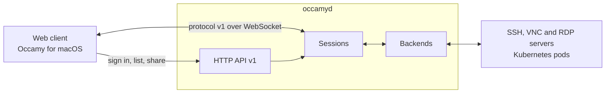
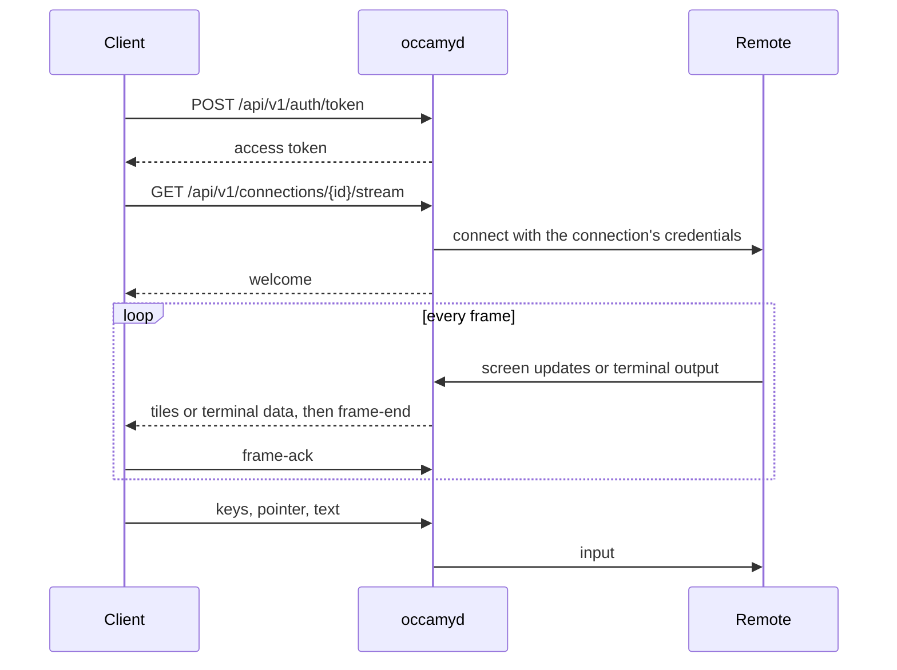

# Architecture

Occamy is one Go program, `occamyd`, between your users and the machines
they reach. It signs users in, connects to each remote desktop or shell
with a client of its own for that protocol, and streams the session to
the web client or the macOS app over a WebSocket.

One `occamyd` serves the API, the web client and every session. There
is nothing else to run.

## A session

1. **Sign in.** The client signs in with a password or through OIDC, and
   gets an access token ([HTTP API](api.md#sign-in)).
2. **Open the stream.** The client opens a connection's stream, a
   WebSocket that carries [protocol v1](protocol.md). `occamyd` checks
   that the connection admits the user.
3. **Connect.** The session's backend connects to the remote with the
   credentials the configuration names. When the configuration lacks one,
   such as a password, `occamyd` asks the user on the stream.
4. **Stream.** The remote's screen or terminal flows to the client one
   frame at a time. The client acknowledges each frame, and `occamyd`
   sends no faster than those acknowledgements return.
5. **Share.** The owner can hand out a link that lets others join, with
   control or view only. Each viewer gets the stream at its own pace.
6. **End.** The session ends when its owner ends it, when the remote
   does, when the owner has been away for a minute, or after 30 minutes
   without input.

## How a desktop reaches a viewer

A backend draws the remote's screen into the session's framebuffer, a
grid of tiles. Each tile carries the version in which it last changed.
For each viewer, `occamyd` then:

- sends only the tiles that viewer has not seen yet;
- sends a region that moved, such as a scrolled page, as a copy of
  pixels the viewer already shows;
- sends a tile the viewer has cached by its slot, not its pixels;
- encodes the rest by content: few colours losslessly, photographs as
  WebP or JPEG, and tiles in motion at a lower quality, refined once
  they stop;
- paces frames by the viewer's acknowledgements, with as many in flight
  as cover the round trip, and adapts the quality to the bandwidth.

A terminal session works the same way with text. A headless terminal
emulator keeps the screen, and each viewer gets the changes it has not
seen.

## Components

Each directory is a Go package unless it says otherwise.

**The server**

| Path | What it does |
|------|--------------|
| [server/](../server) | The HTTP server: API v1, sign-in, the streams' WebSocket upgrades, TLS and the debug listener |
| [internal/auth/](../internal/auth) | Access and session tokens: Ed25519 JWTs, from `occamyd` or a trusted issuer |
| [internal/config/](../internal/config) | Reads the configuration file and validates it as a whole |

**Sessions and streaming**

| Path | What it does |
|------|--------------|
| [internal/session/](../internal/session) | Runs each session: its backend, its viewers' input by role, its shares |
| [internal/framebuffer/](../internal/framebuffer) | A desktop's screen as versioned tiles |
| [internal/terminal/](../internal/terminal) | The headless terminal emulator of a terminal session |
| [internal/stream/](../internal/stream) | One viewer's connection: reads its input, writes its frames |
| [internal/encoder/](../internal/encoder) | Chooses each tile's codec and quality |
| [internal/codec/](../internal/codec) | The lossless codecs, and the scaling of tiles in motion |
| [internal/pacer/](../internal/pacer) | Paces a viewer's frames and sets their quality |
| [protocol/](../protocol) | Protocol v1's messages, handshake and framing, as a public package |

**Backends**

| Path | What it does |
|------|--------------|
| [internal/backend/](../internal/backend) | The interface every backend implements |
| [internal/backend/ssh/](../internal/backend/ssh) | SSH: a shell in the session's terminal |
| [internal/backend/vnc/](../internal/backend/vnc) | VNC, with VeNCrypt and Apple Remote Desktop sign-in |
| [internal/backend/rdp/](../internal/backend/rdp) | RDP, on the client in [internal/rdp/](../internal/rdp): NLA, the graphics pipeline, the clipboard and resizing |
| [internal/backend/kubernetes/](../internal/backend/kubernetes) | A command in a pod's container, through the Kubernetes API server |
| [internal/keymap/](../internal/keymap) | The key code table that VNC and RDP share |

**Clients**

| Path | What it does |
|------|--------------|
| [client/occamy-web/](../client/occamy-web) | The web client, in TypeScript and React |
| [client/](../client) | The Go client of protocol v1, a public package, for tools, tests and the macOS app |
| [client/decoders/](../client/decoders) | The Go client's decoders of the codecs `occamyd` sends |
| [client/occamy-swift/](../client/occamy-swift) | Occamy for macOS, in SwiftUI, on the Go client built as a C library |

**Tools**

| Path | What it does |
|------|--------------|
| [bench/](../bench) | The benchmark harness, with Guacamole as the baseline ([Benchmarks](benchmarks.md)) |
| [tests/](../tests) | End-to-end, pressure and soak tests ([Development](development.md)) |

## Design

The design of each part, with the options weighed and the decisions
made, is in the specs:

- [The native architecture](../specs/008-native-architecture.md):
  `occamyd`, its protocol, backends and streaming;
- [The web client](../specs/009-react-web-client.md);
- [Occamy for macOS](../specs/010-native-swift-client.md);
- [every spec](../specs/README.md).
