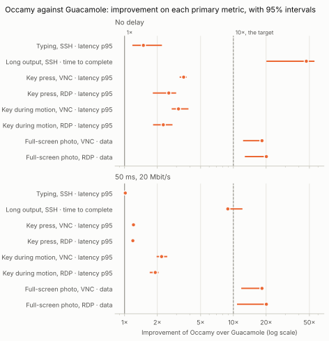
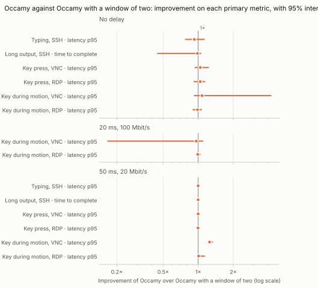
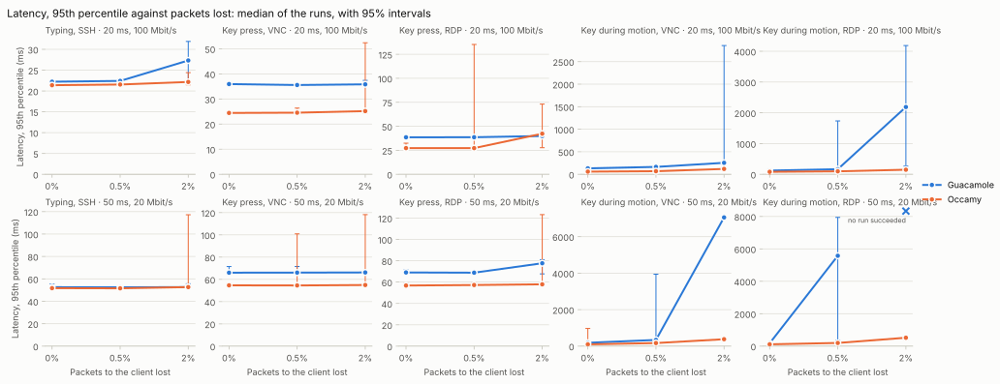
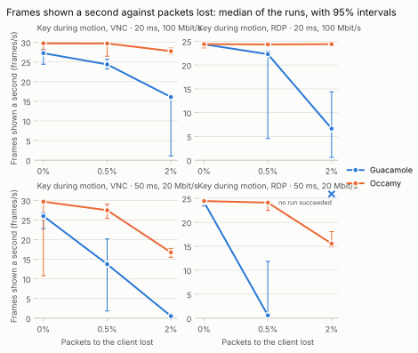
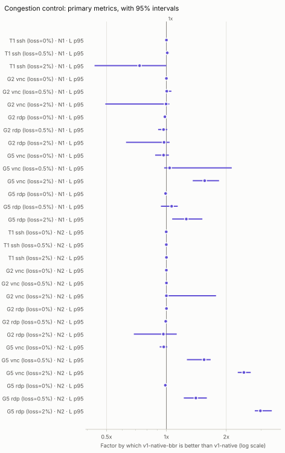

# Benchmarks

Protocol v1 is designed against measurements of what Occamy costs today,
and it is proven with the same harness. Its two targets are a 10x
improvement over the Guacamole baseline on each scenario's primary metric,
and input-to-update latency under 50 ms for desktop interactions.
[specs/008-native-architecture/benchmark.md](../specs/008-native-architecture/benchmark.md)
defines the metrics, the scenarios and how the targets are judged. This
page covers how to run the harness and what it measured.

## Running

```sh
make bench
```

This builds occamyd's image from the working tree, then builds and starts
the demo stack with `docker/docker-compose.bench.yaml` on top, which adds
guacd, published on `127.0.0.1:4822`, for the baseline: occamyd no
longer uses guacd. Then it runs every scenario in the `guacd` and
`v1-native` series under every network condition. Results go to
`bench-results.json`, and a Markdown table goes to standard output. The
other v1 series run on the same stack when `-series` names them; see
[The v1 series](#the-v1-series).

On a host shared with another stack, `COMPOSE_PROJECT_NAME`,
`OCCAMY_V1_PORT`, `OCCAMY_V1_CUBIC_PORT`, `GUACD_PORT`,
`OCCAMY_V1_DEBUG_PORT` and `OCCAMY_V1_CUBIC_DEBUG_PORT` start this one
under its own project name and ports, and `make bench` points the harness
at them. `OCCAMY_IMAGE` tags occamyd's image under another name, so that
the build does not retag the image another stack runs.

The harness and the stack share the host, so anything else that uses the
CPU shows up in the numbers. A compile during a run more than doubled
some latencies. Keep the host idle, and use `-runs 3`: the table then
shows the median of each number over three runs, so one disturbed run
does not move it. The JSON keeps every run.

To pass flags to the harness, use `BENCH_FLAGS`:

```sh
make bench BENCH_FLAGS="-scenarios T1 -net N1 -series v1-native"
```

| Flag | Default | Meaning |
|------|---------|---------|
| `-scenarios` | `all` | Comma-separated scenario IDs |
| `-net` | `N0,N1,N2` | Network conditions |
| `-series` | `guacd,v1-native` | `guacd` speaks the Guacamole protocol to guacd directly, the baseline; `v1-native`, `v1-native-w2`, `v1-native-cubic` and `v1-native-nogfx` speak protocol v1 to occamyd ([The v1 series](#the-v1-series)) |
| `-runs` | `1` | How many times to run everything; the table shows medians |
| `-failfast` | off | Stop at the first measurement with an error, and exit non-zero; CI's runs set it |
| `-quick` | off | A tenth of the samples and a sixth of the durations, to check the setup |
| `-ack-hz` | `60` | v1: the screen refresh on whose ticks the harness acknowledges a graphical frame, as a browser does; the gate's numbers use 60, and `0`, which acknowledges at once, is a diagnostic ([The v1 series](#the-v1-series)) |
| `-engine` | `podman` | Container engine for CPU time, or `none` |
| `-project` | `occamy` | The stack's compose project, whose containers CPU time is read from |
| `-v1`, `-v1-cubic`, `-guacd` | `localhost:5637`, `localhost:5642`, `localhost:4822` | occamy-v1 for the v1 series, occamy-v1-cubic for `v1-native-cubic`, and guacd for the `guacd` series |
| `-out` | `bench-results.json` | JSON output, saved after each series and network condition |
| `-plan` | none | A plan file, such as `bench/plans/compare.yaml`, in place of `-series`, `-net`, `-scenarios` and `-runs` ([The comparison](#the-comparison)) |
| `-resume` | off | Continue `-out`, if it exists and measures the same plan: keep its blocks that are complete and without errors, and measure the rest |
| `-max-load`, `-load-wait` | `0`, `2h` | Before each result, wait until the host's 1-minute load is below `-max-load`, for up to `-load-wait`; then save and exit with status 2. Set, they override a plan file's |
| `-runtime` | none | occamyd debug listeners, as `service=address` pairs, to read occamyd's runtime from; `make bench BENCH_RUNTIME=1` turns on the v1 services' listeners and passes them |

Server CPU needs podman: its container statistics report cumulative CPU
time, and docker's do not. With docker, pass `-engine none`. CI runs a
quick smoke variant on every push, with `-failfast`, and does not
compare numbers, because shared runners are too noisy. When the job
fails or times out, it prints the stack's logs.

## The comparison

```sh
make bench-compare
```

collects the comparison of Guacamole and Occamy that
[comparison-benchmark](../specs/008-native-architecture/comparison-benchmark.md)
designs, in one go: the plan in `bench/plans/compare.yaml`, into
`bench-compare.json` (`BENCH_OUT`), with occamyd's runtime. It measures in
**blocks**, a series under a network condition in a study, and every run
measures every block once, in an order drawn from the plan's seed and the
run, so that drift on the host favours no series. Before each result it
waits until the host's 1-minute load is below 8, so that the load one
result leaves, as a scene's does, does not carry into the next; if the
load stays above for 2 hours, it saves and exits, and the same command
resumes. It saves after every block, so an interrupted collection loses
one block at most: a block that it left part-way is measured again
whole.

Every result records, besides what a single run does:

- `study` and `factor`: its block's study and the study's setting;
- `at` and `load_1m`: when it started, and the host's load then;
- `mem_mib` and `pids`: each container's memory, at its peak over samples
  every 2 s and at the end, and its processes;
- `runtime`: occamyd's goroutines, open files and heap in use at the end,
  and the GC cycles, GC pause time and bytes allocated during it, from
  the v1 services' debug listeners;
- `client_cpu_ms`: the harness's own CPU time, network emulation
  included, which every series pays alike.

The network ladder adds two conditions to the three of the baseline:

| ID | RTT | Bandwidth |
|----|-----|-----------|
| N3 | 100 ms | 5 Mbit/s |
| N4 | 250 ms | 1 Mbit/s |

On them a sample may take longer before it fails: 4 times as long at N3
and 20 times at N4, and a scenario up to three times as long.

```sh
make bench-essential
```

collects the essential comparison, about an hour of measuring, into
`bench-essential.json`: `guacd` against `v1-native` under N0 and N2, on
T1, T2, and G2, G5 and G6 over VNC and RDP, 6 runs of 100 probe keys,
without G7 (`bench/plans/essential.yaml`). A plan file's `keys` sets how
many probe keys a latency scenario presses (200 by default), and
`connects` how many sessions G7 opens (20), or none at 0. `BENCH_PLAN`
runs `make bench-compare` with another plan file.

```sh
make bench-realtime-1
```

collects step 1 of the
[real-time transport](../specs/008-native-architecture/realtime-transport.md),
about two hours of measuring, into `bench-realtime-1.json`: `v1-native`
beside `v1-native-w2`, which differ only in the frame window their
client offers ([The v1 series](#the-v1-series)), on G5 over VNC and RDP
under N0, N1 and N2, and on T1, T2 and G2 under N0 and N2, 6 runs of 100
probe keys, without G7 (`bench/plans/realtime-1.yaml`).

```sh
make bench-realtime-2
```

collects step 2, loss, about three and a half hours of measuring, into
`bench-realtime-2.json`: `v1-native` and `guacd` on T1, and G2 and G5
over VNC and RDP, under N1 and N2, each with none, 0.5% and 2% of the
packets to the client lost, 6 runs of 100 probe keys, without G7
(`bench/plans/realtime-2.yaml`). It is a **loss study**: a proxy carries
a byte stream, which has no packets to drop, so the study emulates the
whole link in the kernel instead, with `tc netem` in the network
namespace of the series' server, which the image `occamy-bench-netem`
(`docker/bench/netem`) sets up and clears around each block; the target
builds the image first. Delay, bandwidth and loss act on the one TCP
connection that loses the packet and waits for it again. On a
container engine whose port forwarding ends the client's connection,
as podman's on macOS does, that is the connection inside the engine,
which the forwarder reads and passes on in order; the proxy, with
nothing to emulate, only counts the bytes. The link is the proxy's, half
the RTT each way, the bandwidth and a queue of twice the
bandwidth-delay product, with these differences:

- **Loss** is random, and on the way to the client only, where the
  frames are: what a transport without TCP's ordering would save. A
  key or acknowledgement lost on the way to the server costs a
  retransmission that such a transport would still pay.
- **Connections** take a round trip to open, which the proxy does not
  add; G7, which measures connecting, is not in the plan.
- **Bytes** are still those the client receives; a retransmitted
  packet is not counted again.
- Only the series' own port is shaped, so a server's backends, and
  occamyd's debug listener, are not. Segmentation offload is off while
  it shapes, so that a loss drops one packet rather than a whole
  segment.

Its 0% is the control, measured on the same link in the kernel, not
the matrix's N1 and N2. `make bench-realtime-2-report` analyses it into
`docs/benchmarks/realtime/2`, with what each loss added to each metric
over the same cell without loss, the Hodges–Lehmann estimate of the
shift with its exact 95% interval, beside the round trip. Its results
are in [Step 2](#step-2-what-loss-costs).

```sh
make bench-realtime-3a
```

collects step 3a, the congestion control, about two hours of measuring,
into `bench-realtime-3a.json`: step 2's loss study with
`v1-native-cubic`, whose server asks for CUBIC, in `guacd`'s place
beside `v1-native`, whose server asks for BBR, as occamyd does by
default, 8 runs of 100 probe keys (`bench/plans/realtime-3a.yaml`). The
host's kernel must have BBR loaded, or `v1-native`'s occamyd keeps the
kernel's choice and the harness warns; on podman's virtual machine:

```sh
podman machine ssh sudo modprobe tcp_bbr
```

Each v1 result read with `-runtime`, as those of `make bench-compare`
are, records the congestion control its server's connections use as
`congestion`, from occamyd's `tcp_congestion`.
`make bench-realtime-3a-report` analyses it into
`docs/benchmarks/realtime/3a`, with the family **Congestion control**,
`v1-native-cubic` to `v1-native`, beside what each loss added. Its
results are in [Step 3a](#step-3a-the-congestion-control).

### Analysis

```sh
make bench-report             # bench-compare.json into docs/benchmarks/comparison/
make bench-essential-report   # bench-essential.json into docs/benchmarks/essential/
make bench-realtime-1-report  # bench-realtime-1.json into docs/benchmarks/realtime/1/
make bench-realtime-2-report  # bench-realtime-2.json into docs/benchmarks/realtime/2/
```

analyses the results with `bench/report.py`, which
[uv](https://docs.astral.sh/uv/) runs with its own numpy, scipy and
matplotlib, as the spec's Analysis fixed it before any data. It compares
each family of series whose two series are both in the results:
**Guacamole to Occamy**, `guacd` to `v1-native`, which the 10x and 50 ms
targets judge, and **Frame window**, `v1-native-w2` to `v1-native`, the
window of two frames against the window from the path, with the same
tests and Holm's correction and without targets, since both are
Occamy's. When the runs are too few for any difference to be
significant after Holm's correction, because the exact test's smallest
p times the number of tests is at least 0.05, the report says so.
Besides the frame rate, a scene that stamps its frames (G3 to
G5) reports the share of them never shown, 1 − frames ÷ (the scene's
rate × seconds), and the 95th percentile of the interval between those
shown, as secondary metrics. It writes:

- `results.csv`: one row per run, cell and metric;
- `summary.csv`: per series, cell and metric, the median of the runs with
  an exact 95% interval from order statistics;
- `comparisons.csv`: per pair of series, cell and metric, the factor by
  which the second is better, `times_better` (the Hodges–Lehmann
  estimate of their ratio, with its exact 95% interval), the exact
  permutation p-value of the rank sum, and on primary metrics the
  p-value corrected over the family;
- `report.md`: the tables, the 10x and 50 ms targets, occamyd's runtime,
  the conclusions that change without the results measured above the
  load gate, and the figures: each metric's medians as bars with their
  intervals, and the factors on a log axis, as SVG in light and dark.

`uv run bench/report.py results.json -o dir` analyses any results file,
and `uv run bench/report_test.py` tests the analysis on synthetic results
with known answers.

## What is measured

The harness is a client. It decodes every image into a framebuffer,
answers each `sync` once the frame is applied, and sends a `nop` every
5 seconds, as the web client does. Each scenario runs on a fresh session.

- **Series.** `guacd` performs the Guacamole handshake with guacd
  directly, as a Guacamole deployment's web application does, with
  guacd's defaults and `ignore-cert` for RDP: the baseline. The v1
  series speak protocol v1 to occamyd ([The v1 series](#the-v1-series)).
  Results recorded before v1.0.0-beta.2 also have `occamy`, which
  logged in to occamyd's v0 routes and went through guacd.
- **Networks.** A proxy inside the harness carries every connection. It
  adds half the RTT in each direction and serializes at the bandwidth,
  with a queue of twice the bandwidth-delay product. It does not emulate
  loss, which a loss study emulates in the kernel instead
  ([The comparison](#the-comparison)).

  | ID | RTT | Bandwidth |
  |----|-----|-----------|
  | N0 | none added | unlimited |
  | N1 | 20 ms | 100 Mbit/s |
  | N2 | 50 ms | 20 Mbit/s |

- **Bytes** are the TCP payload through the proxy. In the v1 series they
  include the WebSocket frame headers, which the `guacd` series does not
  have.
- **Frames.** In an animated scene (G3 to G5), frames are the scene's
  frames that reached the client, in either protocol: each carries a
  numbered stamp (below), and the harness counts the distinct stamps it
  was shown, whole. A server may cut a frame of the scene into several
  of its own, or put several into one, so the JSON keeps its own count
  apart, as `server_frames`. In any other scenario, frames are the
  complete frames that drew.
- **Cadence.** A frame rate cannot tell frames that arrive evenly from
  frames that arrive in bursts with stalls between them. So the harness
  also records when each of a scene's stamps was first shown, at the
  time its frame counts from, and the JSON gives the time between
  consecutive ones in the measured part as `frame_interval_ms`: its
  percentiles in milliseconds, as `latency_ms` gives a latency's. A
  scene shown whole and evenly at 30 fps has every interval at 33 ms; a
  frame that never showed doubles one. The table notes the 95th
  percentile on a scene's row.
- **Server CPU** is the CPU time of the container that serves the
  series during the measured part of a scenario: guacd's for `guacd`,
  occamyd's for the v1 series. guacd forks a process per connection,
  and the container's CPU time includes it.
- **Decode** is the harness's time spent applying drawing and compositing
  frames. A browser decodes natively, so only ratios between series mean
  anything.

The scenarios:

| ID | Protocol | Scenario | Primary metric |
|----|----------|----------|----------------|
| T1 | SSH | Type 200 characters, 10 per second, into an idle shell; latency is from each key to the first frame that draws | latency |
| T2 | SSH | `seq 1 100000`, then a magenta end marker; completion is from Return until the marker is visible | bytes, completion, server CPU |
| T3 | SSH | `top -d 0.5` for 30 s | bytes per second |
| G1 | VNC, RDP | A still desktop for 30 s | bytes per second, server CPU |
| G2 | VNC, RDP | Probe keys, 10 per second on average, on a still desktop | latency |
| G3 | VNC, RDP | A page of text scrolling one line every 16 ms, for 10 s | bytes, server CPU, frame rate |
| G4 | VNC, RDP | A 400×300 textured window dragged at 60 Hz, for 10 s | bytes, server CPU, frame rate |
| G5 | VNC, RDP | Full-screen motion at 30 fps, with probe keys during it | frame rate, bytes, latency under load |
| G6 | VNC, RDP | One photographic full-screen image; completion is from the key until the last update | bytes, completion |
| G7 | all | Connect; the first frame is the first that shows known content of the remote: the wallpaper, or the shell's prompt | time to the first frame |

### The bench desktop

`make bench` replaces the demo's VNC and RDP servers with the bench
desktop (`docker/bench/desktop`). The service names, hosts and
credentials stay the same. In both, the session is the scene program
(`bench/scene`), with no window manager. It covers the screen with one
window, draws content generated from fixed seeds, and switches scenes on
function keys: F1 is idle, F2 the probe, F3 the scroll, F4 the drag, F5
the motion, F6 the photo, and Escape goes back to idle.

Every letter paints a 32×32 swatch near the top left corner in a colour
of its own (`bench/internal/probe`). Latency is from writing the key
until the harness's framebuffer shows that colour at the swatch's
centre, within a tolerance for lossy encoding and 16-bit colour. Every
scene starts with a grey swatch, so the first probe key always changes
it. The keys are 100 ms apart on average, each up to one period of a
60 Hz screen either way from its slot, with offsets drawn from the run's
index, so that every series of a run presses its keys at the same times.
Keys exactly 100 ms apart would be 6 periods of a 60 Hz screen and 3 of
the motion scene, and every key of a run would meet both at one phase.
T1's keys stay 100 ms apart, since a terminal's frames wait for no tick.

Every frame of the scroll, the drag and the motion carries a stamp in
the left margin, below the swatch (`probe.StampArea`): 24 black and
white cells of 24×32 pixels, big enough to survive lossy encoding, that
hold the frame's number and a check of it. The wallpaper's margin never
animates, so nothing else draws there. A frame of a server's that drew
part of a stamp reads as none, and the next one that completes it
counts. So the count is of scene frames that reached the viewer whole at
the stamp, not of what the server sent: in a 6 s scroll on a loaded host,
4 to 44% of the v1 frames that touched the stamp showed no whole one, on
every path. The ones looked at were real screens, torn between two scene
frames or still partly drawn, rather than misread stamps.

The VNC server is x11vnc on Xvfb. With its defaults, x11vnc alone takes
27 ms at the median and 125 ms at p95 from a key to the update that
shows it, which would hide everything after it. In the bench desktop it
runs threaded, polls every millisecond, and skips its naps and its
detection of window moves and scrolls, which brings it to 2.9 ms and
3.5 ms. The price is about one of the VM's CPUs, with or without a
client, since it polls the screen every millisecond. `bench/vncprobe`
measures this: a VNC client that runs inside the container, so the
numbers include no network and no guacd. It presses keys in any scene
and counts the updates a second, and its doc comment shows how to run
it. The RDP server is xrdp with xorgxrdp, as configured by Debian.

## The v1 series

Four series measure protocol v1 with the same scenarios, metrics,
network conditions and bench desktop as the baseline:

```sh
make bench BENCH_FLAGS="-series v1-native,v1-native-w2,v1-native-cubic,v1-native-nogfx -runs 3"
```

Their results so far are in [The essential comparison](#the-essential-comparison)
and [The real-time steps](#the-real-time-steps). `v1-native` measures
[native RDP](../specs/008-native-architecture/native-rdp-backend.md),
rdp's default, with RDP's graphics pipeline (GFX), without its
ClearCodec and cache yet.

| Series | Protocols | RDP's GFX | Connections |
|---|---|---|---|
| `v1-native` | SSH, VNC, RDP | on, as shipped | `ssh`, `vnc-native`, `rdp-native` |
| `v1-native-w2` | SSH, VNC, RDP | on | `ssh`, `vnc-native`, `rdp-native` |
| `v1-native-cubic` | SSH, VNC, RDP | on | `ssh`, `vnc-native`, `rdp-native` |
| `v1-native-nogfx` | RDP | off | `rdp-native-nogfx` |

Results recorded before v1.0.0-beta.2 also have `v1-guacd` and
`v1-guacd-gfx`, which went through occamyd's guacd bridge, with GFX
off, as the bridge shipped, and on.

`v1-native-w2` is `v1-native` with a client that offers a frame window
of 2, where `v1-native`'s offers the client core's default, 16, within
which the server sizes the window from the path. Two frames is the window every client agreed
on before the server sized it from the path
([real-time transport](../specs/008-native-architecture/realtime-transport.md),
step 1), so the two series measure that step's window against the one
before it, on one image in one run. Its rows sit beside the verdict
rather than count for the targets.

`v1-native-cubic` is `v1-native` on another service, `occamy-v1-cubic`,
whose file, `docker/bench/occamy-v1-cubic.yaml`, has the same
connections and asks for CUBIC, the kernel's usual default, as its TCP
congestion control, where occamyd asks for BBR (step 3a). Its rows, too,
sit beside the verdict.

The row of what occamyd ships is the verdict, and `v1-native-nogfx`
sits beside it, so that RDP's rows compare like with like: the table
notes which each RDP row is, and the JSON gives `gfx` on every RDP row
of a v1 series and `verdict` on those that count for the targets. The
connections are in `docker/bench/occamy-v1.yaml`.

A v1 session runs as follows:

- **Client.** The harness drives the Go client core (`client/`) through
  the stack's `occamy-v1` service, whose file
  `docker-compose.bench.yaml` replaces with `docker/bench/occamy-v1.yaml`.
  It signs in at `POST /api/v1/auth/token`, opens
  `GET /api/v1/connections/{id}/stream`, and afterwards ends the session
  with `DELETE /api/v1/sessions/{id}`, since an owner who leaves keeps
  the session for the 60 s owner grace. A session whose welcome the
  client refuses, as when they have no codec in common, is ended the
  same way: it dials with `client.Dial`, whose `*client.RefusedError`
  names the session the server made. A desktop's key carries its
  physical key, a USB HID usage on a US layout, as the web client's
  carries `KeyboardEvent.code`, which native RDP sends as a scancode.
- **Codecs.** It offers what occamy's web client offers when the browser
  decodes them all: deflate, WebP, JPEG and raw, in that order. The
  client core decodes tiles in parallel as they arrive, with deflate
  from `internal/codec`, WebP from `github.com/gen2brain/vpx/webp` and
  JPEG from `image/jpeg` plugged in, and applies a frame to its
  framebuffer when `Next` delivers it.
- **Frames.** A frame draws if it changed a rectangle. A v1 frame is the
  server's, not the scene's: occamyd ends a frame whenever its window
  allows and the screen has changed, and through the native VNC backend
  it ends several for each frame of the scene, as x11vnc's updates come
  in. The stamps count the scene's frames instead, in v1 as in v0, so
  frames a second, the share of the scene, and bytes and CPU per frame
  compare across protocols.
- **When a frame counts.** A v1 frame counts from when the client
  core's `Next` delivers it applied, as a v0 frame counts from when the
  harness applied it, before it answers `sync`. Neither is on the
  screen yet: a browser shows either client's canvas at the display's
  next refresh, which both pay alike and the 50 ms budget allows for.
- **Acknowledgement.** occamyd paces its frames by the client's
  acknowledgements, with two frames in flight. occamy's web client
  presents a graphical frame at the browser's next animation frame and
  acknowledges it then, by asking for the next event (`Display.run` in
  `client/occamy-web/src/protocol/display.ts`); a terminal's frame it
  acknowledges without waiting for a refresh. The harness does the
  same: it acknowledges a graphical frame, drawing or not, on the next
  tick of a 60 Hz screen (`-ack-hz`), and a terminal's at once.
  guacamole-common-js answers `sync` as soon as it applied a frame,
  with no animation frame, and the `guacd` series does the same. **These
  defaults produce the gate's numbers;** the JSON records them as
  `ack_hz` and `frame_stamp`, and the table's header states them.
  `-ack-hz 0` acknowledges a graphical frame at once as well: a
  diagnostic of what the cadence costs, not a setting for the gate. How
  the cadence moves each metric:
  - *Latency (G2, G5), completion (G6) and a desktop's G7* do not end
    on a tick. A frame that comes while the reader waits for a tick
    counts as if the reader had been there, from `Frame.Ready` and the
    time `Next` took to apply it, as v0's reader and the web client's
    decoder take a frame as it comes. But a frame that occamyd holds
    while two are unacknowledged goes out at the tick that acknowledges
    one, up to 16.7 ms later than at once. That happens in moving
    scenes, and when a change reaches the client in several frames, as
    the native VNC backend's updates do. The ticks keep one phase for
    the whole process, and the probe's jittered keys meet them at every
    phase, so what the cadence adds is in each run's percentiles.
    Terminals (T1, T2, an SSH G7) do not wait for ticks.
  - *Frame rates* reach at most 60 a second at 60 Hz, as in a browser
    on a 60 Hz screen; at once, they count every frame the server can
    end.
  - *Bytes, server CPU and decode time* in moving scenes (G3 to G5)
    should be lower at 60 Hz than at once: when acknowledgements come
    slower, occamyd coalesces more of the scene into each frame. Acking
    at once models a client faster than a browser.
- **The probe** is the baseline's: a key's latency ends when the client
  core's framebuffer, after the frame is applied, shows the key's colour
  at the swatch's centre.
- **Terminals.** The SSH backend takes the bytes a terminal emulator
  sends, not keys, so a key goes as the bytes xterm.js sends for it. The
  client core passes a terminal's bytes through untouched, and the
  harness writes them to occamyd's own terminal emulator
  (`internal/terminal`), as a browser writes them to xterm.js. A
  terminal frame draws if it carried bytes, and is acknowledged at
  once; T2's end marker is a cell with the magenta background. The
  terminal is 99 × 39 cells, the size of guacd's at 1024 × 768 pixels
  and 96 DPI, so that the shell prints the same screens in both
  protocols.
- **Decode** is the wall time of each tile's decode, summed over the
  client core's decoding goroutines, which run in parallel, or the
  terminal emulator's time; copying decoded tiles into the framebuffer
  is not in it. The `guacd` series' includes compositing, so the column
  compares v1's series with each other, not v1 with v0, and a table with
  v1 rows says so under it.
- **Server CPU** is that of the `occamy-v1` container or, for
  `v1-native-cubic`, of `occamy-v1-cubic`. guacd serves nothing of the
  v1 series, so its CPU there is left out and given in a note.
- **G7** starts at the stream's upgrade and ends at the first frame that
  shows known content of the remote, which is what the remote shows
  anyway, so that G7 changes nothing that T1 to T3 or the scenes
  measure. For a desktop, that is the wallpaper, at the middle of the
  screen, where nothing else of the idle scene draws: every scenario
  leaves the wallpaper showing, and a frame that sizes the screen
  before the first image does not show it. For a terminal, it is the
  shell's prompt, which comes after everything the shell prints at
  login: a line of the emulated terminal that starts with `occamy@` and
  ends in `$`, and in v0, whose terminal guacd draws in pixels, guacd's
  solid cursor waiting after the prompt's `$ `. Neither the blank
  terminal that the session core serves before the backend has
  connected, nor the clear screen that the SSH backend's resize of it
  sends, nor the screen that guacd clears, nor the message of the day
  ends G7. The sign-in before the upgrade checks a bcrypt
  hash and is done once for many sessions, so G7 leaves it out: the
  JSON records it as `sign_in_ms`, and the table notes it on the row.
  The `guacd` series' G7 includes its handshake, which the Guacamole
  protocol needs for every session.
- **The bench desktop restarts xrdp's channel server,** because every
  RDP path of a series shares one X session. xrdp 0.10.1's
  `xrdp-chansrv` can exit as a connection closes, and sesman starts it
  only with the X session
  ([the backend's notes](../specs/008-native-architecture/native-rdp-backend.md#implementation-notes-registration)).
  Every later connection to that X session, native or through guacd,
  would then stay black for the 10 s that xrdp spends trying to reach
  it, so G7 would measure the wait, in a row that depends on which path
  ran before it: with `-runs 3`, v0's second and third runs come after
  native's first. The bench desktop now has the demo's `reconnectwm.sh`,
  which starts the channel server again when a connection finds none.
  Without it, on one X session of a loaded host, `rdp-guacd` showed the
  wallpaper in 2627 and 3230 ms, `rdp-native-nogfx` in 2149 ms and
  `rdp-guacd` then in 11152 ms, and v0's `occamy` and `guacd` took 3070
  and 3302 ms before any native session and 12345 and 12997 ms after one.
  With it, `-quick` runs in that order took 1317, 143 and 1134 ms, and
  4353 and 4486 ms for v0 straight after native, and xrdp logged no
  failure to reach the channel server. Those are smokes on a loaded host,
  so they show that the wait is gone and compare nothing else.
- **Bounds.** A sample that the stack does not answer fails rather than
  holding the run: 30 s to sign in and open the stream and, in G7, for
  the first frame; 10 s for a key's update and for an input to be
  queued; 30 s for T2's end marker. CI's bench job stops at 30 minutes,
  and the harness exits non-zero when a chosen series ran no scenario.
- **Native RDP** (`rdp-native`) reaches the same xrdp with the same
  credentials and size. It sets `security: tls`, since xrdp speaks no
  NLA, and checks no certificate, since xrdp signs its own when the
  image is built; occamyd warns of that at start. It asks for GFX by
  default, so xrdp draws its sessions in RemoteFX Progressive;
  `rdp-native-nogfx` sets `disable_gfx`, and gets plain bitmaps.
- **Colour depth** is 32 bits per pixel on every path to RDP: native
  RDP's default, and what the baseline's guacd asks for with GFX on, as
  guacd 1.6 has it by default. xrdp may keep an X session, and a scene
  program, for each depth, so one depth keeps one X session.
- **Native RDP's decoding rate** holds a session's decoding to about a
  core of the benchmarks' host (an Apple M5 Pro), whatever the server
  sends
  ([native-rdp-backend](../specs/008-native-architecture/native-rdp-backend.md)'s
  phase 3 notes). It caps full-screen RemoteFX and RemoteFX
  Progressive at about 97 frames a second at the harness's 1024 × 768,
  37 at 1920 × 1080 and 9 at 3840 × 2160, about what the decoder
  manages on one core of that host anyway. No scene reaches it: the
  fastest, G3's 62.5 frames a second, would take 64% of the rate if
  every frame were a full screen of tiles. The rate and the decoder
  are both Occamy's, so neither justifies a miss.
- **G5 over native RDP with GFX is an expected miss.** G5's scene
  redraws every pixel in every frame (`bench/scene/content.go`'s
  plasma), so with GFX on, `rdp-native` decodes a full screen of
  RemoteFX Progressive tiles for each delivered frame: 10.3 ms of CPU
  at 1024 × 768 on the benchmarks' host (`BenchmarkGFXProgressive`,
  13.1 ns a pixel), and 10.4 to 11.9 ms as the review measured it,
  against G5's RDP target of 5.5 ms a frame for occamyd in all.
  Decoding alone misses the target, before anything is encoded for the
  viewer. With `disable_gfx`, xrdp sends bitmap updates instead, which
  cost about 1 to 2.4 ms a frame to decode (the review's 1 to 1.6;
  here 1.8 to 2.4 for planar, which xrdp sends at 32 bits per pixel,
  `BenchmarkGFXPlanar`). So `v1-native` measures G5 with GFX, which is
  the verdict, and `v1-native-nogfx` without it, and the decoder is not
  made faster first. The decode cost is Occamy's own, so a miss in the
  verdict's row is not a justified one: decoder work then comes before
  v1.0, and the measurement shows where.

CI runs every v1 series quickly under N1, after the smoke run of
`guacd` and `v1-native`, on the same stack.

### What to measure again

The stamp, the jitter and G7's end change what some scenarios measure,
so those baselines below are out of date until they run again, and only
new numbers compare with v1's. The rule: anything that changes what the
remote shows, or how a scenario measures it, measures that baseline
again. [The essential comparison](#the-essential-comparison) measured
G2 and G5 again at N0 and N2, as `guacd`, and the [targets](#targets)
of G2 and G5 come from those numbers; the rest of this list waits for
the full comparison.

| Scenarios | Measured again | Why |
|---|---|---|
| G2 | VNC and RDP, all networks | The probe's keys are jittered |
| G3, G4 | VNC and RDP, all networks | The scene stamps its frames, and frames are counted by stamp |
| G5 | VNC and RDP, all networks | The stamp and the jitter |
| G7 | SSH, VNC and RDP, all networks | It ends on known content, and RDP's rows no longer carry [the channel server's 10 s wait](#the-v1-series) |
| G1, G6 | No | The idle scene and the photo change no pixel, and the wallpaper's code moved without changing one |
| T1, T2, T3 | No | The shell shows what it showed: G7 ends on the prompt that was already there, so the stack needs no banner, and T1's keys are not jittered |

The colour depth changes no baseline, since the baseline's guacd already
drew RDP at 32 bits per pixel. The [targets](#targets) that come from a baseline in
this list move with its new numbers.

G7 is no scenario of its own: it follows a protocol's chosen scenarios,
so that the list above runs as `-scenarios T1,G2,G3,G4,G5`, where T1 is
there for SSH's G7. `bench` refuses an ID it does not know, `G7`
included, rather than leave it out of the run.

## Terminal baseline

Measured on 2026-10-29 with `make bench BENCH_FLAGS="-runs 3"`, on an
Apple M5 Pro (18 cores) with macOS 26.6 and podman 6.0.2, whose VM has 8
CPUs and 3.7 GiB. guacd is the `guacamole/guacd:1.6.0` image and occamyd
is built from master. Every number is the median of three runs, and
[terminal-baseline.json](./benchmarks/terminal-baseline.json) holds each
run.

**T1, typing echo:** latency in ms, p50 / p95 / p99.

| Network | occamy | guacd direct |
|---|---|---|
| N0 | 2.0 / 3.1 / 4.2 | 1.8 / 3.2 / 6.3 |
| N1 | 25.5 / 27.8 / 33.9 | 25.7 / 27.2 / 27.7 |
| N2 | 55.0 / 57.2 / 65.2 | 55.2 / 59.1 / 64.9 |

**T2, `seq 1 100000`:** the command prints 575 KiB.

| Network | Series | Completion ms | Down KiB | Frames/s | occamy + guacd CPU ms | ssh CPU ms |
|---|---|---|---|---|---|---|
| N0 | occamy | 897 | 86 | 23 | 881 | 34 |
| N0 | guacd direct | 946 | 104 | 28 | 922 | 28 |
| N1 | occamy | 1261 | 115 | 21 | 1188 | 78 |
| N1 | guacd direct | 966 | 104 | 20 | 904 | 32 |
| N2 | occamy | 943 | 82 | 20 | 865 | 32 |
| N2 | guacd direct | 958 | 84 | 20 | 873 | 31 |

**T3, `top -d 0.5`:**

| Network | Series | Down KiB/s | Up KiB/s | Frames/s | occamy + guacd CPU ms/s |
|---|---|---|---|---|---|
| N0 | occamy | 10.9 | 0.06 | 2.0 | 8.9 |
| N0 | guacd direct | 10.7 | 0.05 | 2.0 | 7.5 |
| N1 | occamy | 14.3 | 0.06 | 2.0 | 16.6 |
| N1 | guacd direct | 12.4 | 0.05 | 2.0 | 12.2 |
| N2 | occamy | 11.0 | 0.06 | 2.0 | 8.2 |
| N2 | guacd direct | 12.7 | 0.05 | 2.0 | 10.0 |

**G7, connecting over SSH:** time to the first frame in ms, p50 / p95.

| Network | occamy | guacd direct |
|---|---|---|
| N0 | 115 / 133 | 114 / 128 |
| N1 | 193 / 291 | 162 / 209 |
| N2 | 227 / 285 | 224 / 265 |

### Findings

- **occamyd costs nothing measurable.** The two series agree within the
  spread between runs in every scenario. What a terminal session costs
  is guacd's and the protocol's.
- **Typing is already near its floor.** At N0 an echo takes 2 ms at the
  median and 3 ms at p95, including the remote shell. With a network,
  latency is the RTT plus about 5 ms at the median and 7–9 ms at p95.
  10x faster at N0 is 0.3 ms, which the remote shell's own echo may not
  allow; see [Targets](#targets).
- **guacd coalesces bulk output into screen frames.** 575 KiB of text
  reaches the client as 82–115 KiB in about 20 frames per second: guacd
  keeps the terminal's state and draws only the screens it has time
  for. A protocol that streamed the shell's raw output would send 5–7x
  more. Protocol v1 has to keep terminal state on the server and send
  the screen, as mosh does, to beat this.
- **Bulk output is bound by guacd's CPU.** T2 takes about a second under
  every network condition, and occamyd and guacd use as much CPU time as
  the command takes to complete: one core is busy throughout. The remote
  shell needs only about 30 ms. The time goes into guacd's terminal
  emulator and into rendering the text as images.
- **`top` costs about 5.5 KiB per refresh**, at two refreshes a second,
  because guacd sends the changed parts of the screen as images. Sending
  changed characters instead is where v1 can save.
- **Connecting takes about 115 ms before any network delay**, and 2–4
  RTTs more with one. The SSH handshake and guacd's per-connection
  process are inside this, so its bound needs a measurement of the SSH
  handshake alone.

The CPU numbers come from the podman VM, which counts time that the
host takes its CPUs away as CPU time. A disturbed run therefore shows
more CPU as well as more time, which is one more reason for medians.

## Desktop baseline

Measured on 2026-10-30 with `bench -runs 3 -scenarios G1,G2,G3,G4,G5,G6`,
which runs G7 for VNC and RDP as well, on the same host as the terminal
baseline. occamyd is v0.6.0 and guacd the `guacamole/guacd:1.6.0` image.
The run took 1 h 52 min. The host's load average over one minute, logged
every minute, had a median of 5 and passed 10 in 20 of 113 minutes, at
most 34: some of the peaks came from G7's RDP connects, others from other
work on the host. Every number is the median of three runs, which
absorbs the one visibly disturbed run: G5 over RDP at N1 in the second
run, with a p95 of 354 ms against 110 ms in the other two.
[desktop-baseline.json](./benchmarks/desktop-baseline.json) holds each
run.

**G1, a still desktop:** over 30 s a VNC session receives 150–170 bytes
and sends 60–100, and an RDP session 18–32 and 36–72, under every
network condition. occamyd and guacd use 1–4 ms of CPU a second,
which is the spread between runs. x11vnc uses about one CPU throughout,
as described above, and xrdp nothing measurable.

**G2, key latency on a still desktop:** p50 / p95 / p99 in ms.

| Protocol | Network | occamy | guacd direct |
|---|---|---|---|
| VNC | N0 | 14.6 / 15.6 / 16.7 | 14.5 / 15.5 / 16.2 |
| VNC | N1 | 37.7 / 39.4 / 39.5 | 37.3 / 39.1 / 39.5 |
| VNC | N2 | 67.7 / 69.4 / 69.8 | 67.6 / 69.3 / 69.6 |
| RDP | N0 | 17.1 / 17.6 / 18.9 | 16.9 / 17.8 / 19.0 |
| RDP | N1 | 40.6 / 41.5 / 43.2 | 40.0 / 41.2 / 43.0 |
| RDP | N2 | 70.6 / 71.7 / 73.8 | 70.2 / 71.2 / 71.5 |

**G3, scrolling text:** the scene scrolls at 62.5 frames a second.

| Protocol | Network | Series | Down MiB/s | Frames/s | Share of scene | occamy + guacd CPU ms/s | x11vnc or xrdp CPU ms/s | Decode ms/s |
|---|---|---|---|---|---|---|---|---|
| VNC | N0 | occamy | 2.88 | 41.4 | 66% | 1590 | 1745 | 294 |
| VNC | N0 | guacd direct | 3.00 | 42.3 | 68% | 1548 | 1750 | 301 |
| VNC | N1 | occamy | 2.98 | 41.9 | 67% | 1582 | 1724 | 292 |
| VNC | N1 | guacd direct | 2.84 | 41.1 | 66% | 1552 | 1753 | 296 |
| VNC | N2 | occamy | 1.73 | 25.5 | 41% | 1139 | 1759 | 178 |
| VNC | N2 | guacd direct | 1.70 | 25.0 | 40% | 1083 | 1757 | 179 |
| RDP | N0 | occamy | 9.89 | 19.6 | 31% | 2065 | 301 | 823 |
| RDP | N0 | guacd direct | 9.95 | 19.6 | 31% | 2020 | 312 | 815 |
| RDP | N1 | occamy | 8.68 | 17.8 | 28% | 1900 | 301 | 726 |
| RDP | N1 | guacd direct | 8.69 | 17.9 | 29% | 1820 | 300 | 714 |
| RDP | N2 | occamy | 2.38 | 1.5 | 2% | 937 | 285 | 46 |
| RDP | N2 | guacd direct | 2.38 | 1.4 | 2% | 844 | 294 | 46 |

**G4, a dragged window:** the scene moves the window 60 times a second.

| Protocol | Network | Series | Down MiB/s | Frames/s | Share of scene | occamy + guacd CPU ms/s | x11vnc or xrdp CPU ms/s | Decode ms/s |
|---|---|---|---|---|---|---|---|---|
| VNC | N0 | occamy | 2.29 | 59.7 | 99% | 660 | 1630 | 225 |
| VNC | N0 | guacd direct | 2.28 | 59.5 | 99% | 638 | 1625 | 223 |
| VNC | N1 | occamy | 2.29 | 59.7 | 99% | 670 | 1628 | 225 |
| VNC | N1 | guacd direct | 2.25 | 58.7 | 98% | 641 | 1620 | 224 |
| VNC | N2 | occamy | 1.86 | 48.6 | 81% | 577 | 1641 | 184 |
| VNC | N2 | guacd direct | 1.95 | 50.8 | 85% | 578 | 1640 | 194 |
| RDP | N0 | occamy | 0.94 | 24.2 | 40% | 342 | 76 | 92 |
| RDP | N0 | guacd direct | 0.95 | 24.6 | 41% | 329 | 76 | 94 |
| RDP | N1 | occamy | 0.95 | 24.5 | 41% | 354 | 83 | 94 |
| RDP | N1 | guacd direct | 0.95 | 24.6 | 41% | 330 | 76 | 93 |
| RDP | N2 | occamy | 0.94 | 24.1 | 40% | 340 | 76 | 93 |
| RDP | N2 | guacd direct | 0.95 | 24.4 | 41% | 332 | 77 | 93 |

**G5, full-screen motion:** the scene draws 30 frames a second, and the
latency is that of probe keys during it.

| Protocol | Network | Series | Down MiB/s | Frames/s | Share of scene | occamy + guacd CPU ms/s | x11vnc or xrdp CPU ms/s | Decode ms/s | Latency p50 / p95 / p99 ms |
|---|---|---|---|---|---|---|---|---|---|
| VNC | N0 | occamy | 1.43 | 29.8 | 99% | 1212 | 1769 | 307 | 66.3 / 84.4 / 95.8 |
| VNC | N0 | guacd direct | 1.42 | 29.8 | 99% | 1203 | 1769 | 309 | 65.6 / 89.5 / 116.5 |
| VNC | N1 | occamy | 1.42 | 29.8 | 99% | 1221 | 1776 | 309 | 66.7 / 112.7 / 118.5 |
| VNC | N1 | guacd direct | 1.42 | 29.8 | 99% | 1242 | 1793 | 327 | 64.3 / 124.7 / 145.8 |
| VNC | N2 | occamy | 1.34 | 29.6 | 99% | 1167 | 1762 | 304 | 128.7 / 154.1 / 176.5 |
| VNC | N2 | guacd direct | 1.34 | 29.4 | 98% | 1184 | 1777 | 321 | 129.8 / 161.2 / 177.7 |
| RDP | N0 | occamy | 1.60 | 24.8 | 83% | 1357 | 232 | 332 | 68.4 / 88.1 / 97.3 |
| RDP | N0 | guacd direct | 1.60 | 24.6 | 82% | 1386 | 243 | 343 | 70.5 / 90.2 / 103.2 |
| RDP | N1 | occamy | 1.61 | 24.8 | 83% | 1368 | 235 | 333 | 84.2 / 109.8 / 124.2 |
| RDP | N1 | guacd direct | 1.60 | 24.8 | 83% | 1352 | 238 | 336 | 84.1 / 110.6 / 120.7 |
| RDP | N2 | occamy | 1.36 | 24.8 | 83% | 1276 | 234 | 325 | 134.7 / 167.2 / 174.3 |
| RDP | N2 | guacd direct | 1.39 | 24.7 | 82% | 1265 | 236 | 326 | 134.5 / 168.0 / 176.8 |

**G6, a photograph:** completion is from the key until the last update.

| Protocol | Network | Series | Completion ms | Down KiB | occamy + guacd CPU ms | x11vnc or xrdp CPU ms |
|---|---|---|---|---|---|---|
| VNC | N0 | occamy | 173 | 2236 | 264 | 2325 |
| VNC | N0 | guacd direct | 147 | 1441 | 177 | 2299 |
| VNC | N1 | occamy | 302 | 2236 | 281 | 2459 |
| VNC | N1 | guacd direct | 298 | 2235 | 255 | 2441 |
| VNC | N2 | occamy | 707 | 1498 | 189 | 2869 |
| VNC | N2 | guacd direct | 720 | 1515 | 191 | 2890 |
| RDP | N0 | occamy | 131 | 1400 | 308 | 19 |
| RDP | N0 | guacd direct | 131 | 1399 | 196 | 20 |
| RDP | N1 | occamy | 173 | 1380 | 198 | 29 |
| RDP | N1 | guacd direct | 147 | 447 | 285 | 22 |
| RDP | N2 | occamy | 271 | 423 | 1167 | 25 |
| RDP | N2 | guacd direct | 281 | 431 | 175 | 22 |

**G7, connecting:** time to the first frame in ms, p50 / p95.

| Protocol | Network | occamy | guacd direct |
|---|---|---|---|
| VNC | N0 | 110 / 113 | 110 / 114 |
| VNC | N1 | 156 / 162 | 154 / 158 |
| VNC | N2 | 216 / 220 | 215 / 217 |
| RDP | N0 | 2190 / 2198 | 2188 / 2196 |
| RDP | N1 | 2237 / 2242 | 2235 / 2238 |
| RDP | N2 | 2297 / 2305 | 2296 / 2303 |

### The remote server

`bench/vncprobe` measured x11vnc on its own in each scene after the
run, 200 keys each, with the host idle:

| Scene | p50 ms | p95 ms | p99 ms | Updates/s |
|---|---|---|---|---|
| F2, still | 2.9 | 3.5 | 4.1 | 10.0 |
| F3, scroll at 62.5 fps | 12.2 | 42.3 | 51.9 | 61.2 |
| F4, drag at 60 fps | 8.6 | 13.5 | 14.9 | 63.2 |
| F5, motion at 30 fps | 4.3 | 5.6 | 22.6 | 40.3 |

The probe asks for raw pixels over loopback. guacd negotiates compressed
encodings, which cost x11vnc more, so these are lower bounds on its
share. The update rates include the probe keys' own updates where the
scene does not redraw the swatch anyway: F2's are only those, and F5's
are 30 a second from the scene and 10 from the keys. There is no RDP
counterpart yet.

### Findings

- **occamyd costs nothing measurable** on a desktop either. The two
  series agree within the spread between runs in every scenario.
- **On a still desktop a key takes the RTT plus 16–19 ms over VNC** at
  p95, of which x11vnc's own reaction is 3.5 ms: guacd and the protocol
  take 12 ms at N0 and 16 ms with a network. Over RDP it is the RTT plus
  18–22 ms, with xrdp's share unmeasured. All of G2 is within the 50 ms
  budget at N1.
- **Under load a key waits behind the frames.** In the motion scene
  x11vnc shows a key within 5.6 ms, but the harness sees it after 84 ms
  at N0 and 113 ms at N1 over VNC, and 88 and 110 ms over RDP: twice the
  50 ms budget at N1. A Guacamole connection is one ordered stream, so a
  key's update waits for the frames queued before it. This is the main
  thing protocol v1 has to fix.
- **The scroll loses a third of its frames on the way.** x11vnc sends
  the probe 61 of the scene's 62.5 updates a second, and the harness
  receives 41 through guacd, which uses 1.6 CPUs meanwhile. The probe
  asks for raw pixels, which cost x11vnc less than guacd's compressed
  encodings, so this does not yet show which of the two drops them. The
  drag and the motion reach 99% of the scene over VNC at N0 and N1.
- **RDP stops at 24–25 frames a second.** G4 delivers that under every
  network condition with a third of a CPU and under 1 MiB/s, G5 reaches
  the same 24.8, and G3 delivers 20. Whether xrdp or guacd's RDP client sets this ceiling
  needs an RDP counterpart of `bench/vncprobe` to tell.
- **RDP's scroll is the most expensive scene:** about 516 KiB a frame
  against 71 KiB over VNC, 10 MiB/s at N0. At N2 it fills the 20 Mbit/s
  link and delivers 1.5 frames a second.
- **guacd chooses the photograph's encoding by timing, not content.**
  guacd 1.6 encodes a region as JPEG or WebP only if it changed recently
  enough (`src/libguac/display-worker.c`), so the same photograph
  arrived as 2.2 MiB of PNG in 10 of 36 runs, and as 0.4–1.5 MiB with
  lossy parts in the others. As PNG it also took longer: 1069 ms against
  about 707 ms over VNC at N2. The harness does not score image quality,
  so G6's bytes compare at whatever quality guacd chose.
- **Connecting over RDP takes 2.2 s,** against 110 ms over VNC. A network
  adds about two RTTs to either: the occamy series logs in and then opens
  the WebSocket, and guacd's handshake has two exchanges. The harness's
  proxy does not delay TCP handshakes, which a real network adds on top.

## Targets

[The spec](../specs/008-native-architecture/benchmark.md#targets) sets
each scenario's target at 10x better than the occamy series' baseline
under the same network condition, at p95 for latencies. Where the
baseline shows a bound that Occamy cannot beat, the target is that bound
plus a margin instead. The tables below apply this to the medians above,
and for G2 and G5 to `guacd`'s medians in
[the essential comparison](#the-essential-comparison), which measured
them again with the jitter and the stamp; occamyd adds nothing
measurable to guacd ([Findings](#findings)). The number before each
arrow is the baseline, and the bold one the target. G2 and G5 have no
new baseline at N1 yet, which changes none of their targets there: each
is the N0 target plus the RTT.

The targets gate the release (owner, 2026-10-31): v1.0 waits until the
benchmark shows native at least 10x better than guacd. Since
v1.0.0-beta.2, occamyd has no guacd fallback for any protocol: guacd runs
only as the benchmark's baseline.

The gate is each scenario's target as defined here, not a flat 10x
(owner, 2026-10-31). A scenario may miss 10x only where a documented
bound outside Occamy, such as the network condition or the remote
server's own time, makes 10x impossible, as the bounds below do for
some targets; this page must justify each such miss.

- **Latency and completion.** At N0 a target is no lower than the remote
  server's own time, where `bench/vncprobe` measured it, plus 2 ms. A
  network cannot make the endpoints faster, so at N1 and N2 a target is
  no lower than the N0 target plus one RTT, for the input out and its
  update back, plus the time the link takes to carry the target's bytes.
- **Frame rates** are 95% of the scene's rate, or as many frames of the
  target size as the link carries, whichever is fewer. Where the
  baseline already does better, as G4 over VNC does, the target is
  a floor not to fall below.
- **Continuous scenes.** For G3 to G5, bytes and CPU are per delivered
  frame, so that dropping frames does not count as saving them, and the
  target comes from N0, since a frame's content does not depend on the
  network. Where the baseline dropped frames, this allows more bytes a
  second at the target frame rate than 10x fewer would: over RDP,
  3.0 MiB/s against 1.0 in G3 and 226 KiB/s against 96 in G4, and over
  VNC 420 KiB/s against 295 in G3.
- **Bounds not yet measured leave the target in place.** The shell's
  echo for T1, xrdp's reaction for G2 and G5 over RDP, xrdp's frame rate
  for G3 to G5, and each server's connect time for G7 have not been
  measured on their own. If one alone exceeds its target, the target
  becomes that bound plus 2 ms, or 95% of it for a frame rate.

**Latency,** p95 in ms:

| Scenario | N0 | N1 | N2 | Bound |
|---|---|---|---|---|
| T1 typing | 3.1 → **0.3** | 27.8 → **20.3** | 57.2 → **50.3** | the shell's echo, unmeasured |
| G2 key, VNC | 16.1 → **5.5** | — → **25.5** | 69.5 → **55.5** | x11vnc: 3.5 ms |
| G2 key, RDP | 19.0 → **1.9** | — → **21.9** | 72.3 → **51.9** | xrdp, unmeasured |
| G5 key under load, VNC | 134 → **13.4** | — → **33.4** | 207 → **63.4** | x11vnc in the motion scene: 5.6 ms |
| G5 key under load, RDP | 120 → **12.0** | — → **32.0** | 197 → **62.0** | xrdp, unmeasured |

**Completion,** in ms:

| Scenario | N0 | N1 | N2 | Bound |
|---|---|---|---|---|
| G6 photo, VNC | 173 → **17.3** | 302 → **48.6** | 707 → **124** | RTT and the target bytes |
| G6 photo, RDP | 131 → **13.1** | 173 → **44.5** | 271 → **120** | RTT and the target bytes |
| T2 `seq` | 897 → **89.7** | 1261 → **126** | 943 → **143** | RTT and the target bytes |

**Connecting,** time to the first frame at p95 in ms:

| Scenario | N0 | N1 | N2 | Bound |
|---|---|---|---|---|
| G7 SSH | 133 → **13.3** | 291 → **33.3** | 285 → **63.3** | sshd, unmeasured |
| G7 VNC | 113 → **11.3** | 162 → **31.3** | 220 → **61.3** | x11vnc, unmeasured |
| G7 RDP | 2198 → **220** | 2242 → **240** | 2305 → **270** | xrdp, unmeasured |

**Bytes and CPU:**

| Scenario | Metric | N0 | N1 | N2 |
|---|---|---|---|---|
| T2 `seq` | KiB down | 86 → **8.6** | 115 → **12** | 82 → **8.2** |
| T2 `seq` | occamy + guacd CPU ms | 881 → **88** | 1188 → **119** | 865 → **86** |
| T3 `top` | KiB/s down | 10.9 → **1.1** | 14.3 → **1.4** | 11.0 → **1.1** |
| G3 scroll, VNC | KiB per frame | 71 → **7.1** | 72 → **7.1** | 70 → **7.1** |
| G3 scroll, VNC | occamy + guacd CPU ms per frame | 38.4 → **3.8** | 38.4 → **3.8** | 45.6 → **3.8** |
| G3 scroll, RDP | KiB per frame | 516 → **52** | 499 → **52** | 1628 → **52** |
| G3 scroll, RDP | occamy + guacd CPU ms per frame | 104.2 → **10** | 106.3 → **10** | 624.8 → **10** |
| G4 drag, VNC | KiB per frame | 39 → **3.9** | 39 → **3.9** | 39 → **3.9** |
| G4 drag, VNC | occamy + guacd CPU ms per frame | 11.1 → **1.1** | 11.2 → **1.1** | 11.8 → **1.1** |
| G4 drag, RDP | KiB per frame | 40 → **4.0** | 40 → **4.0** | 40 → **4.0** |
| G4 drag, RDP | occamy + guacd CPU ms per frame | 14.2 → **1.4** | 14.5 → **1.4** | 14.0 → **1.4** |
| G5 motion, VNC | KiB per frame | 50.5 → **5.0** | — → **5.0** | 47.1 → **5.0** |
| G5 motion, VNC | guacd CPU ms per frame | 52.4 → **5.2** | — → **5.2** | 52.6 → **5.2** |
| G5 motion, RDP | KiB per frame | 66.2 → **6.6** | — → **6.6** | 51.9 → **6.6** |
| G5 motion, RDP | guacd CPU ms per frame | 63.8 → **6.4** | — → **6.4** | 58.7 → **6.4** |

**Frame rate,** in frames a second:

| Scenario | Scene | N0 | N1 | N2 |
|---|---|---|---|---|
| G3 scroll, VNC | 62.5 | 41.4 → **59** | 41.9 → **59** | 25.5 → **59** |
| G3 scroll, RDP | 62.5 | 19.6 → **59** | 17.8 → **59** | 1.5 → **47** |
| G4 drag, VNC | 60 | 59.7 → **57** | 59.7 → **57** | 48.6 → **57** |
| G4 drag, RDP | 60 | 24.2 → **57** | 24.5 → **57** | 24.1 → **57** |
| G5 motion, VNC | 30 | 25.7 → **28** | — → **28** | 23.4 → **28** |
| G5 motion, RDP | 30 | 23.5 → **28** | — → **28** | 23.5 → **28** |

**G6's bytes** have one target for the photograph, 139 KiB: 10x below
the median of the 26 runs in which guacd encoded it at least partly
lossy, 1.4 MiB. The 10 runs that sent it all as PNG are left out,
because v1's encoder competes with guacd's lossy output rather than its
fallback. guacd's smallest was 382 KiB.

**G1 is at its floor.** An idle session costs a keepalive every few
seconds, 1–6 bytes a second each way, and occamyd's and guacd's CPU is
within the spread between runs. The target is to stay there: keepalives
only, and no CPU the harness can tell from that spread.

**The 50 ms budget.** At N1 the baseline of 2026-10-30 met it for T1
(27.8 ms) and G2 (39.4 ms over VNC, 41.5 ms over RDP), and missed it by
more than twice for G5 (113 ms over VNC, 110 ms over RDP). Every target
above meets it at N1.

The graphics pipeline's codecs, tile size and pixel layout were chosen
by a separate measurement on frames recorded from the bench desktop:
[benchmarks/codecs.md](./benchmarks/codecs.md). It also bears on G5's
bytes, which no pure-Go codec measured there brings near 4.9 KiB a
frame. Scroll detection, measured on the same frames in
[benchmarks/scroll.md](./benchmarks/scroll.md), sends the recorded
scrolling text in 5.0 KiB a frame against 58.5, under G3's target of
7.1 over VNC.

Four measurements would replace assumptions here: an RDP counterpart of
`bench/vncprobe`, for xrdp's reaction and its frame-rate ceiling; each
server's connect time on its own; the shell's echo over SSH on its own;
and an image-quality score for G6, so that its bytes compare at equal
quality.

## The essential comparison

Measured on 2026-11-02 with `make bench-essential`: `guacd` against
`v1-native`, under N0 and N2, on T1, T2, and G2, G5 and G6 over VNC and
RDP, 6 runs of 100 probe keys, on an Apple M5 Pro with 18 CPUs and
podman 6.0.2. guacd is the `guacamole/guacd:1.6.0` image, and occamyd
was built from `3df7564`, RDP with GFX on as it ships. The collection
took 2 h 18 min, much of it waiting at the load gate, and all 192
results succeeded.
[essential/report.md](./benchmarks/essential/report.md) holds every
table and figure, and
[essential/bench-essential.json](./benchmarks/essential/bench-essential.json)
each run;

```sh
uv run bench/report.py docs/benchmarks/essential/bench-essential.json -o docs/benchmarks/essential
```

analyses it again.

<picture>
  <source media="(prefers-color-scheme: dark)" srcset="benchmarks/essential/factors-guacamole-to-occamy-dark.svg">
  
</picture>

14 of the 16 primary differences are significant after Holm's
correction, each at the smallest p-value 6 runs allow. The two that are
not are T1 at N0 and at N2: typing is as fast as guacd within the
spread between runs.

- **Bulk output (T2)** finishes in 18 ms instead of 985 at N0, 56x
  [30, 66], and in 107 ms instead of 1043 at N2, 9.7x [9.3, 10.2], where
  the RTT and the link take most of it. occamyd spends 18–21 ms of CPU
  on it, where guacd spends about 950, and sends 5.7 KiB, or 0.7 at N2,
  where guacd sends about 108.
- **The photograph (G6)** costs 108–122 KiB instead of 2.1–2.2 MiB,
  18–20x. guacd sent it all as PNG in 20 of its 24 runs, and partly
  lossy, in 1.1–1.4 MiB, in the other 4; against its lossy median of
  1.4 MiB in the [desktop baseline](#desktop-baseline) the factor is
  about 11x. It
  arrives 1.7–2.4x sooner at N0 and 5.6x at N2.
- **A key on a still desktop (G2)** shows in 4.7 ms instead of 16.1
  over VNC and in 7.3 ms instead of 19.0 over RDP at N0, 3.4x and 2.6x,
  and 1.2x at N2, where the RTT is 50 of about 60 ms.
- **A key during full-screen motion (G5)** shows in 46 ms instead of
  134 over VNC and in 65 instead of 120 over RDP at N0, 3.0x and 1.9x,
  and 1.7x at N2. occamyd sends 14 KiB a frame, against guacd's 47–66,
  and spends 22–27 ms of CPU on a frame, against guacd's 52–64.

### Against the targets

Each cell is `v1-native`'s median with its 95% interval, against the
[target](#targets). A target is met where the whole interval is on the
right side of it.

| Scenario | Metric | N0 | Target | N2 | Target |
|---|---|---|---|---|---|
| T1 typing | `L` p95 ms | 1.42 [1.28, 4.39] | 0.3, missed | 55.2 [53.4, 55.6] | 50.3, missed |
| G2 key, VNC | `L` p95 ms | 4.73 [4.45, 7.44] | 5.5, missed | 58.3 [56.4, 58.5] | 55.5, missed |
| G2 key, RDP | `L` p95 ms | 7.29 [6.70, 9.52] | 1.9, missed | 60.4 [60.3, 64.0] | 51.9, missed |
| G5 key under load, VNC | `L` p95 ms | 46.1 [40.7, 50.0] | 13.4, missed | 128 [120, 149] | 63.4, missed |
| G5 key under load, RDP | `L` p95 ms | 64.6 [62.1, 69.6] | 12.0, missed | 118 [116, 139] | 62.0, missed |
| T2 `seq` | completion ms | 17.9 [16.2, 42.0] | 89.7, **met** | 107 [106, 109] | 143, **met** |
| T2 `seq` | KiB down | 5.67 [4.21, 6.73] | 8.6, **met** | 0.70 [0.70, 0.70] | 8.2, **met** |
| T2 `seq` | occamyd CPU ms | 20.5 [19.1, 25.2] | 88, **met** | 18.3 [17.2, 24.3] | 86, **met** |
| G5 motion, VNC | KiB per frame | 14.2 [14.1, 14.4] | 5.0, missed | 14.9 [14.0, 17.3] | 5.0, missed |
| G5 motion, RDP | KiB per frame | 14.2 [14.1, 14.3] | 6.6, missed | 14.1 [14.0, 14.4] | 6.6, missed |
| G5 motion, VNC | occamyd CPU ms per frame | 22.0 [21.8, 23.5] | 5.2, missed | 26.9 [23.2, 35.7] | 5.2, missed |
| G5 motion, RDP | occamyd CPU ms per frame | 22.3 [22.0, 24.9] | 6.4, missed | 22.1 [21.7, 24.9] | 6.4, missed |
| G5 motion, VNC | frames/s | 29.2 [28.6, 29.4] | 28, **met** | 20.5 [15.3, 23.8] | 28, missed |
| G5 motion, RDP | frames/s | 24.4 [23.9, 24.6] | 28, missed | 24.0 [23.2, 24.5] | 28, missed |
| G6 photo, VNC | completion ms | 86.6 [75.7, 137] | 17.3, missed | 191 [173, 201] | 124, missed |
| G6 photo, RDP | completion ms | 94.8 [88.8, 98.1] | 13.1, missed | 158 [149, 186] | 120, missed |
| G6 photo, VNC | KiB down | 122 [122, 122] | 139, **met** | 122 [122, 132] | 139, **met** |
| G6 photo, RDP | KiB down | 108 [108, 111] | 139, **met** | 110 [108, 115] | 139, **met** |

11 of the 36 targets are met: all of T2's, G6's bytes, and G5's frame
rate over VNC at N0. No miss is justified yet, so the gate is not met
and guacd stays:

- **T1, and G2 and G5 over RDP,** have bounds that are not measured: the
  shell's echo and xrdp's reaction. Until they are, their targets stand.
  At N0 both series answer a typed key within 1.3–4.4 ms, which leaves
  little but the shell's echo; at N2 both sit about 5 ms above the RTT.
- **G5** is Occamy's own: occamyd's encoding, which is not a bound that
  justifies a miss ([decision 1](../specs/008-native-architecture/benchmark.md#decisions-of-2026-11-01)).
  It is where the work goes next: 14 KiB and 22–27 ms of CPU a frame,
  two to five times the targets, and the latency that follows them.
- **G5's frame rate over RDP** is about 24 frames a second for both
  series, as it was under every network in the baseline, which points
  at xrdp's own rate; an RDP counterpart of `bench/vncprobe` would show
  it. Over VNC at N2, `v1-native` delivers fewer frames than the link
  allows: the frame window of two frames was the limit, which
  [step 1](#step-1-the-frame-window-from-the-path) of the real-time
  steps removes.
- **G6's completion** includes x11vnc's and xrdp's time to send the
  photograph, which is not measured on its own.

**The 50 ms budget,** judged at N0 because the plan has no N1, is met
for T1 (upper bound 4.39 ms) and G2 (7.44 over VNC, 9.52 over RDP). G5
misses it: over VNC the upper bound is 50.001 ms, with a median of 46.1,
and over RDP 69.6.

**The load gate.** 52 of the 192 results started with the host's load
above 8. All are in the first four runs, and none at the start of a
block: the gate then held each block until the load fell below 8, and
the load rose within it, most often after G5, which keeps several cores
busy. Without them, 2–4 runs remain on a side, too few for an exact
test to reach 5% after the correction, so 11 of the 14 significant
differences lose significance; their factors move by at most 6%. The
harness now holds each result instead.

## The real-time steps

[Real-time pacing and transport](../specs/008-native-architecture/realtime-transport.md)
changes how frames are paced, acknowledged and carried, one step at a
time, and each step is measured against the one before under the same
conditions, with Guacamole's number beside it from the
[essential comparison](#the-essential-comparison).

### Step 1: the frame window from the path

Measured on 2026-11-02 with `make bench-realtime-1`: `v1-native`, whose
client offers a window of 16 within which the server keeps as many
frames unacknowledged as cover the time an acknowledgement takes, beside
`v1-native-w2`, whose client offers 2, the window before this step. Both
ran on one image, built from `447525c`, in one run: G5 under N0, N1 and
N2, and T1, T2 and G2 under N0 and N2 as guards, 6 runs of 100 probe
keys, on the essential comparison's host. All 168 results succeeded.
The collection took 1 h 50 min, about 75 of them waiting at the load
gate while other work ran on the host.
[realtime/1/report.md](./benchmarks/realtime/1/report.md) holds every
table and figure, and
[realtime/1/bench-realtime-1.json](./benchmarks/realtime/1/bench-realtime-1.json)
each run;

```sh
uv run bench/report.py docs/benchmarks/realtime/1/bench-realtime-1.json -o docs/benchmarks/realtime/1
```

analyses it again.

<picture>
  <source media="(prefers-color-scheme: dark)" srcset="benchmarks/realtime/1/factors-frame-window-dark.svg">
  
</picture>

The window met the round trip over VNC under N2, where the desktop
changes about 59 times a second. A key during full-screen motion (G5),
medians with 95% intervals, guacd's from the essential comparison:

| G5 over VNC, N2 | guacd | window of 2 | step 1 |
|---|---:|---:|---:|
| Scene frames shown a second (of 30) | 23.4 [20.6, 24.3] | 18.8 [15.9, 28.3] | 29.6 [29.2, 29.9] |
| Scene frames never shown | 22% | 37% [6, 47] | 1.5% [0.4, 2.8] |
| Time between shown frames, p95 | | 76.7 ms [64.0, 98.9] | 49.1 ms [47.8, 52.8] |
| Key to screen, p95 | 207 ms [203, 255] | 119 ms [116, 133] | 95.7 ms [92.9, 99.4] |

- **Over VNC under N2** the server sends 56 frames a second instead of
  30, as many as the desktop changes, and the viewer sees every frame of
  the scene: 1.57x [1.06, 1.84] as many as with a window of two, which
  missed 37% of them. A key's effect shows 1.25x [1.21, 1.34] sooner at
  the 95th percentile, 96 ms instead of 119; it is the one primary
  difference that is significant after Holm's correction, and the only
  cell where the window was the limit. Shown frames come at an even
  pace: 49 ms apart at the 95th percentile instead of 77. A shown frame
  costs 14 KiB instead of 15.5, so the link carries 419 KiB a second
  instead of 290, and occamyd spends about a fifth more CPU, 601 ms a
  second instead of 493, on nearly twice the frames.
- **Over RDP** xrdp's own rate of about 24 frames a second holds under
  every network, so the frame rate and a key's latency do not change,
  but under N2 the frames come more evenly: 48 ms apart at the 95th
  percentile instead of 63, 1.33x [1.18, 1.45].
- **Under N0 and N1** the window of two already covered the round trip,
  and no primary metric changes significantly.
- **The guards**, typing, bulk output and a key on a still desktop under
  N0 and N2, are unchanged: factors from 0.93 to 1.04, none
  significant. Terminals keep the window of two.
- The simulation in `internal/pacer` predicted that more frames in
  flight would cost the frame after an input about 3.5 ms; on the real
  stack it gained 23. A likely reason, not measured: with a window of
  two, the VNC update that carried a key's effect often arrived after
  the input's own frame had gone, and then waited for the window like
  any other frame.

**The load gate** held each result until the host's 1-minute load was
below 8. Two results started below it and ran while the load rose far
above it: G5 over VNC with the window of two under N0 (16.8 frames a
second, 213 ms) and with step 1 under N1 (8.9 frames a second, 466 ms).
They widen the intervals of those two cells, where neither series
differs otherwise.

### Step 2: what loss costs

Measured on 2026-11-03 with `make bench-realtime-2`: `v1-native` beside
`guacd`, typing (T1), a key on a still desktop (G2) and a key during
full-screen motion (G5), over a link that each server's kernel emulates
at N1 (20 ms) and N2 (50 ms), with none, 0.5% and 2% of the packets to
the client lost at random. Both ran on one image, built from `e56b585`,
in one run of 6 runs of 100 probe keys, on the essential comparison's
host. 352 of the 360 results succeeded; the 8 that failed are
Guacamole's, below. The collection took 3 h 25 min, 21 of them waiting
at the load gate.
[realtime/2/report.md](./benchmarks/realtime/2/report.md) holds every
table and figure, and
[realtime/2/bench-realtime-2.json](./benchmarks/realtime/2/bench-realtime-2.json)
each run;

```sh
uv run bench/report.py docs/benchmarks/realtime/2/bench-realtime-2.json -o docs/benchmarks/realtime/2
```

analyses it again.

<picture>
  <source media="(prefers-color-scheme: dark)" srcset="benchmarks/realtime/2/loss-latency_p95-dark.svg">
  
</picture>

A key during full-screen motion (G5), from the key to its effect on
screen at the 95th percentile, in ms, medians with 95% intervals:

| Network, loss | guacd, VNC | v1-native, VNC | guacd, RDP | v1-native, RDP |
|---|---:|---:|---:|---:|
| N1, none | 132 [123, 172] | 59.1 [56.3, 93.6] | 121 [117, 130] | 80.6 [80.4, 118] |
| N1, 0.5% | 164 [152, 184] | 68.7 [63.8, 132] | 165 [153, 1,734] | 96.5 [92.5, 98.0] |
| N1, 2% | 255 [209, 2,857] | 119 [104, 153] | 2,188 [264, 4,186] | 149 [120, 171] |
| N2, none | 184 [169, 219] | 98.2 [90.7, 971] | 179 [172, 226] | 113 [111, 114] |
| N2, 0.5% | 339 [276, 3,942] | 169 [129, 249] | 5,575 [362, 7,941] | 196 [166, 273] |
| N2, 2% | 7,053, 4 of 6 runs | 379 [350, 430] | none of 6 runs | 519 [415, 585] |

<picture>
  <source media="(prefers-color-scheme: dark)" srcset="benchmarks/realtime/2/loss-fps-dark.svg">
  
</picture>

- **Loss of 2% costs a key during motion 3 to 8 round trips** over
  `v1-native`: the Hodges–Lehmann shift over the same cell without loss
  is 59.8 ms [44.2, 88.3] over VNC and 64.8 [39.0, 83.3] over RDP under
  N1, and 271 [-540, 316] over VNC and 407 [304, 471] over RDP under N2.
  0.5% costs it 10.0 and 15.4 ms under N1, and 60.4 and 83.7 [55.1, 159]
  under N2. That is more than the round trip that
  [the spec](../specs/008-native-architecture/realtime-transport.md#step-2-loss-in-the-benchmark)
  set as the limit, so step 3 is built. Over VNC under N2 the intervals
  are wide because one run without loss ran while the host's load rose
  (below).
- **There are two costs.** TCP's throughput under random loss is bounded
  at about 1.22 · MSS / (RTT · √p): with segments of 1,448 bytes, 1,225
  KiB a second under N1 with 0.5%, 612 with 2%, 490 under N2 with 0.5%
  and 245 with 2%. `v1-native`'s scene needs 350 to 420 KiB a second,
  under the bound everywhere but N2 with 2%. Where it fits, the frame
  rate holds, 27.5 to 29.7 frames a second over VNC and 24.1 to 24.4
  over RDP, and the cost is the wait for a retransmission, which holds
  back every frame behind the lost packet: up to 3 round trips. Under N2
  with 2% it does not fit: the link carries 244 KiB a second over VNC
  and 220 over RDP, at the bound, the server's window lets fewer frames
  out, 16.8 and 15.6 a second, so that 44% and 48% of the scene's frames
  are never shown, and a key waits 5 to 8 round trips. Delivery in any
  order removes the first cost. The second is TCP's congestion control
  reading a random loss as congestion, and a QUIC connection whose
  congestion control does the same has the same bound.
- **Guacamole needs 1,200 to 1,600 KiB a second** for the scene without
  loss, more than the bound in every cell with loss, and it queues
  frames behind the link, so a key waits behind them: over RDP under N1
  with 2%, 6.6 frames a second and a key in 2.2 s; under N2 with 0.5%,
  0.6 frames a second and 5.6 s.
  Under N2 with 2%, a key's effect did not show within the harness's
  10 s in any of 6 runs over RDP, and in 2 of 6 over VNC; the other 4
  showed 0.5 frames a second and a key in 7.1 s at the 95th percentile,
  which the 2 failed runs would only raise.
- **Typing and a key on a still desktop** send a packet or two a key, so
  2% loss touches about 2 keys in 100, fewer than the 95th percentile
  sees: over either series it adds at most 5.0 ms to typing and 12.9 ms
  [1.2, 40.7] to a key on a still desktop. The keys it touches wait far
  longer: with 2% loss the 99th percentile, the second slowest of 100
  keys, is 263 to 273 ms over `v1-native` under N1 in 13 of its 18 runs
  of these cells, and 354 to 363 under N2 in 8 of 18, against 22 to 59
  without loss. That is three round trips and 200 ms, the wait for
  Linux's tail loss probe when the lost packet is the only one in
  flight, which [step 3a](#step-3a-the-congestion-control) measured.
- **No difference is significant after Holm's correction, nor could
  one be:** at 6 runs a side the exact test's smallest p is 0.0022, and
  the correction asks the smallest of them to be below 0.05 divided by
  the number of tests: 0.0013 for the 39 tests of loss, 0.0017 for the
  29 of Guacamole against `v1-native`. The decision rests on the shifts
  and their intervals against the round trip, as the spec set it before
  the run. A later plan with as many tests takes more runs: at 8 a side
  the smallest p is 0.00016.

**The load gate** held each result until the host's 1-minute load was
below 8. Three results started below it and ran while the load rose
above it, each over `v1-native`: G5 over VNC under N2 without loss
(971 ms, 10.8 frames a second), G5 over RDP under N1 without loss
(118 ms against 80) and G2 over RDP under N1 with 0.5% (135 ms against
27). They widen those cells' intervals; the
first is why the shifts over VNC under N2 have intervals that reach
below zero.

### Step 3a: the congestion control

Measured on 2026-11-03 with `make bench-realtime-3a`, before occamyd
asked for BBR: `v1-native`, whose server's TCP used the kernel's default
congestion control, CUBIC, beside `v1-native-bbr`, a service whose
network namespace took BBR, over step 2's link: typing
(T1), a key on a still desktop (G2) and a key during full-screen motion
(G5), under N1 (20 ms) and N2 (50 ms), with none, 0.5% and 2% of the
packets to the client lost at random. Both ran on one image, the one
step 2 ran, built from `e56b585`, in one run of 8 runs of 100 probe
keys, on the essential comparison's host. All 480 results succeeded,
each with the congestion control its series names. The collection took
2 h 22 min, 29 of them waiting at the load gate. occamyd now asks for
BBR ([TCP congestion control](configuration.md#tcp-congestion-control)),
and the target measures the same two as `v1-native-cubic` and
`v1-native`.
[realtime/3a/report.md](./benchmarks/realtime/3a/report.md) holds every
table and figure, and
[realtime/3a/bench-realtime-3a.json](./benchmarks/realtime/3a/bench-realtime-3a.json)
each run;

```sh
uv run bench/report.py docs/benchmarks/realtime/3a/bench-realtime-3a.json -o docs/benchmarks/realtime/3a
```

analyses it again.

<picture>
  <source media="(prefers-color-scheme: dark)" srcset="benchmarks/realtime/3a/factors-congestion-control-dark.svg">
  
</picture>

A key during full-screen motion (G5), from the key to its effect on
screen at the 95th percentile, in ms, medians with 95% intervals:

| Network, loss | CUBIC, VNC | BBR, VNC | CUBIC, RDP | BBR, RDP |
|---|---:|---:|---:|---:|
| N1, none | 59.3 [55.1, 67.6] | 61.3 [58.0, 74.8] | 80.9 [79.2, 81.6] | 81.7 [79.8, 86.8] |
| N1, 0.5% | 71.9 [67.3, 264] | 68.6 [65.8, 76.8] | 94.9 [92.4, 96.8] | 89.3 [81.7, 104] |
| N1, 2% | 124 [99.3, 183] | 79.8 [72.4, 87.2] | 136 [109, 199] | 107 [91.3, 131] |
| N2, none | 93.7 [89.9, 98.6] | 95.2 [92.7, 106] | 112 [110, 115] | 114 [111, 114] |
| N2, 0.5% | 192 [125, 205] | 122 [94.8, 132] | 195 [151, 238] | 135 [127, 158] |
| N2, 2% | 360 [291, 409] | 149 [136, 167] | 471 [396, 682] | 163 [150, 173] |

- **With BBR, loss costs a key during motion about one round trip.** It
  shows 2.45x [2.29, 2.65] sooner over VNC and 2.97x [2.78, 3.39] over
  RDP under N2 with 2%, 1.55x [1.27, 1.67] and 1.41x [1.22, 1.60] under
  N2 with 0.5%, and 1.56x [1.36, 1.84] over VNC under N1 with 2%: the
  five differences significant after Holm's correction over the 30
  tests. What 2% adds over the same cell without loss is 17.3 ms
  [10.3, 21.9] over VNC and 24.2 [17.7, 47.3] over RDP under N1, and
  52.2 [43.3, 59.4] and 50.0 [38.7, 53.1] under N2, against 64.5, 55.7,
  266 and 359 with CUBIC. What remains is the wait for a retransmission,
  which holds back every frame behind the lost packet.
- **The frame rate holds.** Under N2 with 2%, over VNC the viewer sees
  27.6 [27.4, 28.9] of the scene's 30 frames a second instead of 16.4
  [13.9, 19.4], and misses 8% of them instead of 45%; over RDP 24.4
  [24.1, 24.7] instead of 17.6 [15.4, 18.9], xrdp's own rate without
  loss. The link carries 398 KiB a second over VNC instead of 240, and
  346 over RDP instead of 250, about what the scene needs without loss,
  416 and 348: BBR sets its rate from the path's bandwidth and round
  trip, so a random loss no longer holds it to TCP's bound of about
  1.22 · MSS / (RTT · √p). These are secondary metrics, whose p-values
  are not corrected; the decision rests on the key's latency.
- **Without loss, and for typing and a key on a still desktop, no
  difference is significant after the correction**, with factors from
  0.97 to 1.00 without loss. One cell leans the other way: typing under
  N1 with 2%, 30.2 ms [21.6, 85.3] with BBR against 21.7 [21.5, 22.0],
  0.73x, p 0.038 before the correction and 0.87 after it. Four of BBR's
  8 runs were above 35 ms there and none of CUBIC's, at loads of 2.3 to
  6.5. A check afterwards, three runs of that cell on each series and
  not a measurement, did not repeat it: 21.6 ms with BBR against 22.0,
  as many segments sent a key, about 6.4, and the same recovery, by
  fast retransmits and loss probes, with no timeout. It is not
  explained.
- **The slowest keys wait as long with either.** With 2% loss the 99th
  percentile of typing and of a key on a still desktop is 264 to 274 ms
  under N1 in 34 of the 48 runs of these cells, and 354 to 385 under N2
  in 24 of 48: three round trips and 200 ms. When the lost packet is
  the only one in flight, no later packet shows its loss, and Linux
  sends a tail loss probe after twice the smoothed round trip plus the
  minimum retransmission timeout, 200 ms by default, which allows for a
  delayed acknowledgement. Each server's namespace counted 124 and 164
  loss probes over the run, and 6 and 9 timeouts. The congestion control
  does not set this wait; since Linux 6.15 a process can lower the
  minimum for a socket, `TCP_RTO_MIN_US`.
- **CUBIC's numbers repeat step 2's**: G5 under N2 with 2%, 360 ms
  [291, 409] over VNC against step 2's 379 [350, 430], and 471
  [396, 682] over RDP against 519 [415, 585].
- **The cost** is the frames that now get through: occamyd spends 545 ms
  of CPU a second over VNC under N2 with 2% instead of 401, about what
  it spends without loss, 565. BBR's namespace retransmitted 3,890
  segments over the run, CUBIC's 3,666.

**The load gate** held five results, for 28.5 minutes in all, until the
host's 1-minute load was below 8; it was between 1.9 and 7.9 when each
result started. Of the 11 that started at 7 or more, one stands out, G5
over VNC with CUBIC under N1 with 2%, 183 ms, the slowest of its cell's
8 runs; the cell's median is 124.
