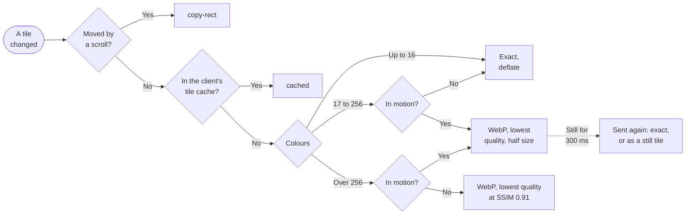

# Codecs

`occamyd` sends a desktop as tiles of 64 × 64 pixels, and it picks a
codec for each tile from what the tile shows and whether it's moving.
This page explains how it makes that choice, and the measurements on
frames recorded from a real desktop that decided each part of it.

## How occamyd sends a tile

When the screen changes, `occamyd` sends only the tiles that changed,
each in the cheapest form that still shows the screen as it is. It asks
four questions of every tile that changed, in this order:



1. **Did a scroll move it?** When text scrolls, most of what changed is
   text that the client already shows, a line higher up. `occamyd`
   finds the scroll and sends a `copy-rect`, which tells the client to
   move those pixels itself, and sends tiles only for the line that
   scrolled into view.
2. **Does the client have it already?** The client keeps tiles it was
   sent exactly in numbered slots, 1024 of them by default. A tile
   whose content is in a slot, such as part of a window that you switch
   back to, goes as a `cached` tile: the slot's number, and no pixels.
3. **How many colours does it have?** Text, window borders and flat
   gradients have few colours and compress well without loss, so a
   tile of up to 16 colours always goes exactly, as `deflate`. A
   photograph has thousands of colours, and a lossy codec sends it in a
   small part of the bytes, so a tile of more than 256 colours goes as
   WebP.
4. **Is it moving?** A tile of 17 to 256 colours, such as antialiased
   text or a smooth gradient, goes exactly while it's still and as WebP
   while it moves, because full-screen animation in that many colours
   costs 388 KiB a frame exactly and 26 KiB as WebP. Every lossy tile
   in motion goes at the lowest quality, 30 of 100, and at half its
   width and height to a client that lists the protocol's `scaled`
   codec, as Occamy's clients do.

A tile is *in motion* when it changed in each of the last few snapshots
of the screen, other than as the effect of your input. Once a tile in
motion has been still for 300 ms, `occamyd` sends it again: exactly if
it has up to 256 colours, and at full size, as a still lossy tile, if
it has more.
This is *refinement*. It runs only while nothing else waits to be sent,
so it never holds up your input by more than one of its messages.

A still lossy tile goes at the lowest quality at which it reaches an
SSIM of 0.91. *SSIM* (structural similarity) scores how alike two
images look, where 1 means identical. The quality is never higher than
the link allows, which `occamyd` judges from how fast each client
acknowledges its frames, and it ranges from 30 to 90.

Within each kind, the codec is the best that the client lists. An exact
tile goes as `deflate`, or as `raw` pixels to a client that lists `raw`
but not `deflate`. A lossy tile goes as WebP, or as JPEG to a client
that lists JPEG but not WebP. Up to 16 lossy tiles side by side in a row
go as one image, so that the image format's headers are paid only once.
[The protocol](../protocol.md#what-occamyd-sends) gives every rule.

### What each step saves

Each step was measured on the frames this page uses, by sending them
through `occamyd`'s encoder with the step and without it:

| What changes on the screen | Without the step | With the step |
|---|---|---|
| Text scrolls a line: a `copy-rect` and a line of tiles | 58.5 KiB and 3.59 ms of encoding a frame | 5.0 KiB and 0.54 ms |
| A browser page switched back and forth over the desktop: `cached` tiles | 79.7 KiB a frame | 9.4 KiB |
| A terminal switched back and forth over the desktop: `cached` tiles | 12.1 KiB a frame | 2.4 KiB |
| Full-screen motion: WebP at quality 30 while it moves | 392.4 KiB a frame, exactly | 13.8 KiB at full size, and 6.9 KiB at half size |
| A photograph shown once: the quality that reaches an SSIM of 0.91 | 150.8 KiB at quality 90 | 121.8 KiB, at quality 87 on most rows |

Refinement then costs a burst once motion stops: 391.0 KiB in 192
messages makes every tile of the full-screen motion exact again.
Encoding one message of it took at most 2.6 ms, which is the longest a
key can wait behind refinement. At half size, a tile in motion scores
an SSIM of 0.986 instead of 0.988 at full size.

The viewers of a session share what `occamyd` encodes, and two workers
for each session encode a frame's rows ahead of the viewers. A
photograph shown once is then ready in 44 ms instead of 96, and four
viewers of the session take 163 ms of CPU for it instead of 374.

## Why these codecs

| Choice | Instead of | Why |
|---|---|---|
| A palette with deflate at level 1 | PNG, QOI, lossless WebP | It takes 40 to 48 % of PNG's bytes on the desktop, a terminal's bitmap font and a dragged window, in no more than PNG's encode time. |
| Tiles of 64 pixels | Tiles of 128 pixels | A key costs 0.1 to 1.7 KiB instead of 0.2 to 2.9, and a scrolled line 4.6 KiB instead of 8.7. |
| Pixels in RGBA order | BGRX | Every Go encoder and the browser take RGBA, and x11vnc sends it when asked. |
| WebP for photographs | JPEG | It takes a third to a half of JPEG's bytes at the same quality, for about twice `image/jpeg`'s encode time. |
| WebP for 17 to 256 colours in motion | Exact pixels | It takes a fifteenth of the bytes on full-screen motion, at an SSIM of 0.989. |
| Lossy tiles side by side as one image | One image a tile | A JPEG tile carries about 650 bytes of headers, and a WebP tile 53. |

The sections below give the measurements behind each choice. Their
tables name each codec as the measurement did: `pal+flate1` is the
palette with deflate at level 1, `png1` is PNG at best speed, `jpeg q70`
is JPEG at quality 70, and `webp-vpx0` is WebP from `gen2brain/vpx` at
method 0. [The candidates](#the-candidates) lists every one. A cell
such as `15.1 · 1.4` holds two values, here KiB and milliseconds a
frame, in the order that the table's caption gives.

### A palette and deflate for exact tiles

An exact tile goes as the tile's palette and each pixel's index into it,
or as its raw pixels where it has more than 256 colours, compressed by
deflate at level 1, the fastest. On each scene's tiles of up to 256
colours, the ones that `occamyd` sends exactly, at 64 pixels: KiB a
frame · encode ms a frame.

| Codec | desktop | terminal | terminal-aa | browser | drag | scroll | motion |
|---|---|---|---|---|---|---|---|
| pal+flate1 | 15.1 · 1.4 | 17.4 · 1.5 | 103.2 · 3.9 | 125.5 · 4.5 | 12.3 · 1.2 | 55.4 · 3.6 | 388.1 · 8.0 |
| pal+flate6 | 14.4 · 1.9 | 16.4 · 1.8 | 99.5 · 5.0 | 121.6 · 5.9 | 11.8 · 1.6 | 53.6 · 3.7 | 319.4 · 10.8 |
| pal+kflate1 | 15.1 · 1.5 | 17.4 · 1.5 | 103.2 · 3.1 | 125.5 · 3.5 | 12.3 · 1.2 | 55.4 · 3.1 | 388.1 · 6.4 |
| pal+zstd1 | 18.5 · 1.7 | 20.3 · 1.8 | 104.4 · 2.9 | 126.5 · 3.1 | 15.1 · 1.4 | 57.2 · 3.1 | 403.8 · 5.6 |
| png1 | 37.0 · 3.5 | 36.0 · 3.7 | 115.0 · 4.8 | 132.2 · 4.6 | 30.3 · 2.9 | 71.9 · 5.7 | 375.7 · 7.0 |
| png6 | 34.8 · 3.9 | 33.8 · 3.9 | 110.8 · 5.6 | 128.1 · 5.5 | 28.4 · 3.2 | 69.4 · 5.7 | 318.6 · 9.5 |
| qoi | 21.1 · 0.7 | 64.0 · 0.8 | 156.1 · 1.2 | 180.8 · 1.2 | 17.3 · 0.6 | 215.9 · 1.4 | 895.9 · 3.5 |
| webpll-dt4 | 18.8 · 31.5 | 21.5 · 27.2 | 75.0 · 38.4 | 89.7 · 40.2 | 15.4 · 25.7 | 59.2 · 25.3 | 288.0 · 70.1 |
| webpll-vpx4 | 18.6 · 53.4 | 21.1 · 45.2 | 68.2 · 79.8 | 82.0 · 94.7 | 15.2 · 43.7 | 57.4 · 39.7 | 252.9 · 119.4 |

- **The palette is smaller than PNG on screen content.** It takes 40 %
  of PNG's bytes on the desktop and on the drag's wallpaper, 48 % on
  the bitmap terminal, 77 % on the scroll's bitmap text, and 91 % and
  95 % on antialiased text. A tile of one colour costs it 12 bytes,
  where PNG needs 88. It encodes in two fifths of PNG's time on simple
  tiles and in about the same time on text. Go decodes it in a quarter
  to two thirds of PNG's time on tiles of up to 16 colours, and in 70
  to 95 % of PNG's time on tiles of 17 to 256, with PNG's palette
  expanded through a table.
- **PNG is smaller on gradients.** On the plasma's gradients, PNG's
  filters make it 3 % smaller at best speed, which makes the whole
  class of 17 to 256 colours 2 % smaller as PNG: 3.28 bits a pixel
  instead of 3.35. Those tiles go lossy while they move and exactly
  only once still, through refinement, so 3 % there isn't worth a
  second exact codec. Above 256 colours, PNG is 30 % smaller, 13.6
  bits a pixel instead of 19.3, but `occamyd` doesn't send those tiles
  exactly.
- **Level 1 is enough.** Level 6 saves 3 to 6 % on screen content for
  30 % more encode time. Only the plasma gains 18 %, and in motion it
  goes lossy anyway. `klauspost/compress/flate` writes the same bytes
  at level 1 and encodes text a fifth faster, which isn't worth a
  dependency. zstd is larger at level 1 and at most 3 % smaller at
  level 3, and browsers would need a decoder for it.
- **Lossless WebP is the smallest on antialiased text,** 27 to 35 %
  smaller than the palette, but it takes 38 to 95 ms a frame there,
  where the palette takes about 4 ms. That's too slow for interactive
  updates on one core. Method 0 of `gen2brain/vpx` is unusable on
  gradients: it takes 168 KiB for the desktop, where method 4 takes 19.
- **QOI is the fastest,** but its output is 1.4 to 3.9 times the size
  of the palette's, the most on the scrolling text, and browsers would
  need a decoder written in JavaScript.

### Tiles of 64 pixels

Smaller tiles send fewer pixels for a small change, and larger ones
compress a whole screen better. Most of a session is small changes, so
`occamyd` uses tiles of 64 pixels and accepts what that costs on full
frames.

<picture>
  <source media="(prefers-color-scheme: dark)" srcset="../figures/codecs-tile-size-dark.svg">
  
</picture>

Each change sends the tiles it touches whole. With `pal+flate1` for
tiles of up to 256 colours and `webp-vpx0 q70` above, the tiles a
change sends and their KiB:

| Change | 64 pixels: tiles · KiB | 128 pixels: tiles · KiB |
|---|---|---|
| A key in the browser's text | 1 · 1.7 | 1 · 2.9, lossy |
| A key in either terminal, or the probe swatch | 1 · 0.1–0.2 | 1 · 0.2–0.3 |
| A scrolled line, after a copy-rect of 13 rows | 15 · 4.6 | 8 · 8.7 |
| The dragged window, one update | 35 · 12.0–12.3 | 12 · 10.5–10.7 |

The browser's key tile has 257 colours at 128 pixels, so it goes lossy,
as text, until refinement; at 64 pixels it goes exactly. With JPEG from
`jpegn` for the lossy tiles, the key costs 4.4 KiB at 128 pixels, and
the drag 36 KiB at 64 pixels instead of 23, because JPEG pays its
headers for each tile. The drag goes as tiles, as `occamyd` sends it:
its scroll detection finds vertical moves only, and the window moves
sideways too.

Larger tiles also mix more content, so more of the screen crosses 256
colours and goes lossy: 42 % of the browser page's area at 128 pixels,
against 6 % at 64, and 25 % of the drag's, against 18 %. At 128 pixels,
text next to a link or a code block would be blurred until refinement.

Full frames, such as the first one a viewer receives, cost more at 64
pixels. Each tile carries its own palette and starts deflate afresh, so
four 64-pixel tiles pay for four palettes and lose the context that one
128-pixel tile shares. The cost is in the exact tiles, not the lossy
ones: the desktop and both terminals have no lossy tile and gain the
most at 128, and merging lossy tiles into one image doesn't recover it.
Full frames, with `pal+flate1` for tiles of up to 256 colours and
`webp-vpx0 q70` above:

| Scene | 64 pixels: KiB · ms a frame | 128 pixels: KiB · ms a frame | KiB at 64 ÷ KiB at 128 |
|---|---|---|---|
| desktop | 15.1 · 1.4 | 6.9 · 0.6 | 2.2 |
| terminal | 17.4 · 1.5 | 11.6 · 0.7 | 1.5 |
| terminal-aa | 103.2 · 3.9 | 63.2 · 1.6 | 1.6 |
| browser | 140.1 · 6.1 | 93.1 · 8.2 | 1.5 |
| photo | 44.1 · 12.4 | 34.9 · 10.8 | 1.3 |
| drag | 24.5 · 3.7 | 15.9 · 3.2 | 1.5 |
| scroll | 55.4 · 3.6 | 52.2 · 1.9 | 1.06 |
| motion, exact | 388.1 · 8.0 | 343.9 · 4.5 | 1.13 |

So a full frame at 64 pixels takes 1.5 to 2.2 times the bytes it takes
at 128 on the desktop, the terminals, the browser and the drag, and 1.06
to 1.3 times on the scrolled text, the photograph and the plasma.

### Pixels in RGBA order

`occamyd` keeps every pixel as red, green, blue and alpha, from the
backend to the client, so no step in between reorders one:

- **The source.** x11vnc sends red, green, blue and a padding byte when
  a client asks for that order with SetPixelFormat. The recording
  checked that the photograph came identically in that order and in
  x11vnc's own blue-first order. Occamy's VNC backend asks for that
  order and makes the padding opaque alpha, so it never swaps channels.
  Its RDP backend decodes each bitmap into RGBA as it draws it.
- **The encoders.** `image/png`, `image/jpeg`, `jpegn` and both WebP
  libraries take `image.RGBA` or `image.NRGBA`. With BGRX, every lossy
  and PNG encode would first have to swap channels: 3.3 µs a 64-pixel
  tile and 12.7 µs at 128, about 0.6 ms a frame. That's 45 % of the
  1.4 ms that `pal+flate1` takes to encode the whole desktop.
- **The bytes.** Raw pixels deflate the same in either channel order:
  RGB and BGR are within 0.8 % of each other in every class. Dropping
  the padding byte matters more: four bytes a pixel deflate 1 to 14 %
  larger at 64 pixels, up to 31 % larger at 128, and up to 2.2 times as
  slowly above 256 colours, which is why the container stores three.
  The layouts took turns going first in the measurement, so that none
  always found the tile in the CPU's cache.
- **The clients.** A browser's `ImageData` and `createImageBitmap` are
  RGBA. Core Graphics draws either order natively, so Occamy for macOS
  gains nothing from BGRX.

RGBA is also the order of the protocol's [`raw` codec](../protocol.md#codecs)
and of `occamyd`'s framebuffer, which the measurement confirms.

### WebP for photographs

A lossy tile goes as WebP from `gen2brain/vpx/webp` at method 0. A
client that lists JPEG but not WebP gets JPEG from `jpegn`. On the tiles
of more than 256 colours at 64 pixels, over all scenes, at the same
quality setting: bits a pixel · SSIM · encode µs a tile · Go decode µs a
tile.

| Codec | q30 | q70 | q90 |
|---|---|---|---|
| jpeg | 1.51 · 0.850 · 42 · 26 | 1.95 · 0.890 · 40 · 28 | 3.03 · 0.934 · 54 · 38 |
| jpegn | 1.58 · 0.850 · 12 · 14 | 2.01 · 0.890 · 12 · 13 | 3.10 · 0.934 · 16 · 19 |
| webp-vpx0 | 0.37 · 0.845 · 66 · 32 | 0.62 · 0.867 · 70 · 35 | 1.91 · 0.959 · 123 · 65 |
| webp-vpx4 | 0.35 · 0.849 · 176 · 30 | 0.59 · 0.872 · 212 · 36 | 1.99 · 0.969 · 355 · 70 |
| webp-dt0 | 0.39 · 0.830 · 143 · 29 | 0.70 · 0.872 · 137 · 33 | 2.06 · 0.964 · 258 · 59 |

The same setting isn't the same quality: WebP scores lower than JPEG at
q30 and q70, and higher at q90. So the next table compares them at the
same SSIM, interpolated between the measured qualities: KiB a frame of
each scene's lossy tiles, the quality that reaches that SSIM, and encode
ms a frame there.

| Tiles | Codec | SSIM 0.85 | SSIM 0.90 | SSIM 0.95 |
|---|---|---|---|---|
| photo, 64 | jpeg | 149 (q50) · 7.0 | 233 (q84) · 9.2 | not reached |
| photo, 64 | jpegn | 155 (q50) · 2.0 | 239 (q84) · 2.7 | not reached |
| photo, 64 | webp-vpx0 | 52 (q72) · 13.1 | 110 (q83) · 18.2 | 170 (q90) · 22.9 |
| photo, 64 | webp-vpx4 | 47 (q71) · 39.2 | 105 (q82) · 52.6 | 171 (q88) · 65.1 |
| drag, 64 | jpeg | 27 or less (q30) · 1.5 | 30 (q50) · 1.3 | 53 (q90) · 1.9 |
| drag, 64 | jpegn | 29 or less (q30) · 0.4 | 31 (q50) · 0.4 | 54 (q90) · 0.6 |
| drag, 64 | webp-vpx0 | 7 or less (q30) · 2.4 | 13 (q71) · 2.7 | 28 (q86) · 3.9 |
| photo, 128 | jpeg | 66 (q50) · 7.6 | 150 (q84) · 9.6 | not reached |
| photo, 128 | webp-vpx0 | 43 (q72) · 11.5 | 98 (q83) · 16.4 | 157 (q90) · 21.1 |

Whole frames and rows of 16 tiles pay less for headers: KiB · SSIM ·
encode ms a frame.

| Scene | Unit | jpeg q30 | jpeg q70 | jpegn q70 | webp-vpx0 q30 | webp-vpx0 q70 |
|---|---|---|---|---|---|---|
| motion | 64-pixel tiles | 137 · 0.979 · 7.6 | 149 · 0.992 · 6.1 | 155 · 0.992 · 1.9 | 26 · 0.989 · 11.3 | 33 · 0.991 · 11.0 |
| motion | rows of tiles | 33 · 0.979 · 6.9 | 44 · 0.992 · 7.0 | 44 · 0.992 · 1.5 | 14 · 0.989 · 8.3 | 18 · 0.990 · 8.5 |
| motion | frame | 26 · 0.979 · 7.4 | 38 · 0.992 · 7.6 | 38 · 0.992 · 1.6 | 11 · 0.989 · 8.7 | 15 · 0.990 · 8.6 |
| photo | rows of tiles | 32 · 0.830 · 7.2 | 70 · 0.871 · 7.9 | 71 · 0.871 · 1.8 | 14 · 0.824 · 8.2 | 31 · 0.843 · 9.8 |
| photo | frame | 25 · 0.830 · 7.6 | 64 · 0.871 · 8.5 | 64 · 0.871 · 1.8 | 13 · 0.824 · 8.2 | 30 · 0.843 · 9.8 |

- **WebP takes fewer bytes at the same SSIM.** On the photograph's and
  the drag's 64-pixel tiles, JPEG takes 1.9 to 2.9 times WebP's bytes
  across the three scores, so WebP needs 0.35 to 0.54 of JPEG's bytes.
  JPEG takes 1.5 times WebP's bytes on the photograph's 128-pixel
  tiles, and 2.8 to 2.9 times on the plasma's rows and frames at 0.989.
  Whole rows of the grainy photograph narrow the gap: at JPEG q70's
  SSIM of 0.871, WebP takes about 62 KiB where JPEG takes 70 (61 and 64
  as one image), and at 0.92 about 117 KiB where JPEG takes 175.
- **WebP costs more CPU.** At the qualities that reach the same SSIM,
  `vpx` at method 0 takes about twice `image/jpeg`'s encode time (1.9
  to 2.1 times) and 6.5 to 7 times `jpegn`'s. For the photograph's full
  screen at 0.90, that's 18 ms of one core, where `image/jpeg` takes
  9.2 ms and `jpegn` 2.7 ms, or 4 to 5 ms spread over four cores. The
  per-tile table's 1.6 to 1.8 times compares the same settings at q30
  to q70, where WebP's quality is lower. Method 4 saves another 4 to
  20 % for three times the time. `deepteams/webp` is as small at method
  0 and twice as slow, and its method 4 is worse at the same SSIM.
- **`jpegn` writes JPEG of the same quality** as `image/jpeg` at the
  same setting, within 5 % of its bytes (34 more bytes of headers a
  tile), in a third of the time to encode and half the time to decode.
- **Headers decide how lossy tiles travel.** A JPEG tile carries about
  650 bytes of headers and a WebP tile 53, so the 192 JPEG tiles of a
  full-screen frame take 137 KiB, as 12 rows of 16 tiles 33 KiB, and as
  one image 26 KiB. That's why `occamyd` sends adjacent lossy tiles as
  one image.

WebP trades the server's CPU for bandwidth: JPEG from `jpegn` takes
about a seventh of WebP's encode time at the same SSIM, but two to
three times its bytes.

### Lossy tiles while they move

Full-screen motion in the benchmark is a plasma, which has 17 to 256
colours in every tile. Picking codecs by colours alone would send it
exactly. Lossy, by class, at 64 pixels: bits a pixel · SSIM.

| Tiles | pal+flate1 | webp-vpx0 q30 | webp-vpx0 q70 | jpegn q70 |
|---|---|---|---|---|
| motion, 17–256 colours | 4.04 · 1 | 0.27 · 0.989 | 0.35 · 0.991 | 1.62 · 0.992 |
| browser, 17–256 colours | 2.03 · 1 | 1.26 · 0.985 | 1.61 · 0.994 | 2.83 · 0.972 |
| terminal-aa, 17–256 colours | 2.16 · 1 | 1.25 · 0.984 | 1.61 · 0.993 | 2.84 · 0.948 |
| scroll, 2 colours | 0.60 · 1 | 2.76 · 0.992 | 3.32 · 0.997 | 5.17 · 0.976 |
| terminal, 2 colours | 0.23 · 1 | 1.98 · 0.994 | 2.31 · 0.997 | 4.02 · 0.973 |

On the plasma, lossy output is a fifteenth of the size of exact output.
On antialiased text it's a fifth to two fifths smaller, at a visible
loss, and on two-colour text it takes 5 to 10 times the bytes of exact
output. So `occamyd` sends a tile of 17 to 256 colours as WebP only
while it moves, and refinement makes it exact once it's still. A tile
of up to 16 colours always goes exactly.

**What full-screen motion costs.** The smallest measured is WebP at
quality 30: 11 KiB a frame as one image and 14 KiB as rows of tiles, at
an SSIM of 0.989. JPEG from `jpegn` takes 32 and 38 KiB at the same
SSIM. With tiles in motion at half their width and height as well,
Occamy sends 7.7 to 8.0 KiB a frame of the benchmark's full-screen
motion, where Guacamole sends 46 to 66 KiB
([Benchmarks](../benchmarks.md#occamy-against-guacamole)).

**What a photograph costs.** On the photograph's 64-pixel tiles, JPEG at
quality 70 scores an SSIM of 0.871 in 175 KiB. WebP reaches the same
SSIM at about quality 78, in about 75 KiB. As rows of tiles, JPEG takes
70 KiB and WebP about 62. In the benchmark, Occamy sends a full-screen
photograph in 108 to 122 KiB, where Guacamole sends 2.1 to 2.2 MiB.

## How it was measured

### The recorded frames

The measurement uses 13 frames of the bench desktop at 1024 × 768,
recorded over VNC by `make corpus` and described in
[bench/testdata/corpus](../../bench/testdata/corpus/README.md). They
take 2.5 MiB, and each scene is real content or a scene of the
benchmark:

| Scene | Frames | What it shows |
|---|---|---|
| desktop | 1 | The idle desktop: a gradient wallpaper |
| terminal | 1 | xterm with its bitmap font |
| terminal-aa | 1 | xterm with an antialiased font |
| browser | 1 | A documentation page in dillo |
| photo | 1 | The benchmark's photograph |
| drag | 3 | Consecutive updates of the benchmark's dragged window |
| scroll | 3 | Consecutive updates of the benchmark's scrolling text |
| motion | 2 | Consecutive updates of the benchmark's full-screen plasma |

### The tile classes

The measurement splits each frame into tiles of 64 and 128 pixels with
the framebuffer that `occamyd` uses, and sorts each tile by its colours,
as `occamyd` does, with the classes split finer. The tiles of each class
at 64 pixels:

| Scene | Frames | 1 colour | 2 | 3–16 | 17–256 | over 256 |
|---|---|---|---|---|---|---|
| desktop | 1 | 0 | 0 | 192 | 0 | 0 |
| terminal | 1 | 32 | 43 | 117 | 0 | 0 |
| terminal-aa | 1 | 27 | 0 | 76 | 89 | 0 |
| browser | 1 | 8 | 1 | 50 | 121 | 12 |
| photo | 1 | 0 | 0 | 0 | 0 | 192 |
| drag | 3 | 0 | 0 | 471 | 0 | 105 |
| scroll | 3 | 0 | 540 | 36 | 0 | 0 |
| motion | 2 | 0 | 0 | 0 | 384 | 0 |

The wallpaper's gradient changes every few rows, so its tiles have 3 to
16 colours. Antialiased text has 17 to 256, as does every tile of the
plasma, which draws from a palette of 256 colours. Counting a tile's
colours stops at 257 and takes 6 to 14 µs a 64-pixel tile, 1.2 to
2.7 ms a frame. The tables report that time apart, and leave it out of
the encode times of `pal+*` and `png*`.

### The run

`bench/codecs` encodes and decodes every tile with every candidate,
five times. A tile's time is the median of its five, and a table sums
those medians. Every exact result was checked against the original
pixels, and none differed. SSIM is luma SSIM, with BT.601 weights, 8 × 8
windows and the usual constants, averaged over tiles.

It ran on 2026-10-30 from 19:31 to 19:35 UTC on the Apple M5 Pro (18
cores) of [the benchmarks](../benchmarks.md), with Go 1.27.1 on arm64
and `GOMAXPROCS=1`. Every time is therefore one core's, including the
libraries' that would otherwise spread one image over several cores.
The measurement logs the host's load average every 30 seconds in
[codecs-load.log](./codecs-load.log): the one-minute average stayed
between 4.7 and 8.8, with other work on the host. An earlier run at
11:50 gave the same bytes and SSIM for every tile. Its times for each
codec and class were within 5 % of this run's for 95 % of the sums and
within 10 % for 98 %; the rest were the times of tiles of one colour,
which take less than a microsecond.

[codecs-tables.md](./codecs-tables.md) has every table the measurement
wrote, and [codecs.json](./codecs.json) every result.

### The candidates

| Name | What it is |
|------|------------|
| `pal+flate1`, `pal+flate6` | The palette container below, with `compress/flate` at levels 1 and 6 |
| `pal+kflate1` | The same, with `klauspost/compress/flate` at level 1 |
| `pal+zstd1`, `pal+zstd3` | The same, with `klauspost/compress/zstd` at its fastest and its default level; no browser decodes zstd natively |
| `png1`, `png6` | `image/png` at best speed and at its default, with a palette for up to 256 colours, which decoding expands through a table |
| `qoi` | QOI, written for the measurement |
| `webpll-dt0`, `webpll-dt4` | Lossless WebP from `deepteams/webp` v1.2.8: method 0 at effort 0, and method 4 at effort 75 |
| `webpll-vpx0`, `webpll-vpx4` | Lossless WebP from `gen2brain/vpx/webp` v0.2.1, methods 0 and 4 |
| `jpeg qN` | `image/jpeg` with 4:2:0 chroma subsampling, at qualities 30 to 90 |
| `jpegn qN` | `gen2brain/jpegn` v0.6.2: baseline, 4:2:0, with the standard tables |
| `webp-dtM qN` | Lossy WebP from `deepteams/webp`, methods 0 and 4 |
| `webp-vpxM qN` | Lossy WebP from `gen2brain/vpx/webp`, methods 0 and 4, on one goroutine |

All are pure Go, and the WebP and JPEG libraries use assembly on arm64.
The palette container is the protocol's
[deflate container](../protocol.md#the-deflate-container) without alpha
(`bench/codecs/palette.go`). It's either the form byte 0, the number of
colours minus one, three bytes of red, green and blue for each colour,
and then each pixel's index at 1, 2, 4 or 8 bits for up to 2, 4, 16 or
256 colours, with rows padded to a byte; or the form byte 1 and three
bytes a pixel.

### Measure again

```sh
make corpus   # records the frames in bench/testdata/corpus again
make codecs   # measures, and writes codecs.json, codecs-tables.md and codecs-load.log here
```

`make codecs` runs
`go test -tags measure -run TestMeasure -timeout 2h . -args -out ../../docs/benchmarks`
in `bench/codecs`. That directory is a Go module of its own, so that
`occamyd`'s module requires only the codecs that `occamyd` uses, `vpx`
and `jpegn`, and none of the other candidates.

## What the measurement doesn't cover

- SSIM is on luma, so it doesn't see chroma subsampling. Text in
  colour, such as a link, loses more under 4:2:0 than the scores show.
  Scoring chroma as well, as a review of this measurement did, doesn't
  favour WebP.
- Decode times are Go's, as Occamy for macOS decodes.
  Browsers decode PNG, JPEG and WebP natively and inflate with
  `DecompressionStream`, and then the web client expands the palette in
  JavaScript; none of that is measured here.
- The scenes are the bench desktop's. The two terminals and the page are
  real applications, while the photograph, the plasma and the scrolled
  text are generated. A real video or photograph has more detail than
  the plasma and less grain than the photograph.
- Encode times are one core's with `GOMAXPROCS=1`, sums of each tile's
  median, under a load average of 5 to 9 on 18 cores.
