# Occamy against Guacamole

The comparison benchmark's results in `bench-essential.json`, as `bench/report.py` analyses them: each series' median of every metric in each scenario and network, the improvement of one series over the other, and whether the difference is significant.
[How Occamy is measured](../../benchmarks.md#how-occamy-is-measured) describes the scenarios, the networks and the metrics, and [Analysis](../../benchmarks.md#analysis) the statistics, which were fixed before any data was collected.

## The run

- Started at 2026-11-03T20:47:56.02838Z, on Apple M5 Pro (18 CPUs, darwin), with podman version 6.0.2.
- 6 runs with seed 20261102; each scenario that measures a key's latency timed 100 keys a run.
- Before each result, the harness waited until the host's 1-minute load average was below 8.
- 192 results analysed, and 0 failed.
- The series are Guacamole and Occamy; [Run a comparison](../../benchmarks.md#run-a-comparison) gives each one's name in the results files.

## How to read this report

Each value is the median of the runs, followed by its 95% interval in brackets: an exact interval from order statistics, which assumes nothing about how the values are distributed.

*Improvement* is the baseline's value divided by the candidate's, or the candidate's divided by the baseline's for a metric where higher is better, such as frames shown a second. Above 1×, the candidate is better: 3× is a third of the baseline's latency, or three times its frames. It's the Hodges–Lehmann estimate of that ratio, with its exact 95% interval from the Mann–Whitney distribution.

*p* is the exact two-sided permutation test of the rank sum, over every split of the runs. Each scenario's *primary metric* is the one its comparison is judged on. *p (Holm)* corrects the primary metrics' p-values with Holm's method, and a difference is significant where it's below 0.05. The other metrics, the *secondary* ones, are exploratory, and their p-values aren't corrected.

## Primary metrics

Each scenario's primary metric for Guacamole and Occamy, and the improvement of Occamy over Guacamole: above 1×, Occamy is better. Holm's correction is over these 16 tests. *Target* says whether the improvement meets the target of 10×, which it does where its interval's lower bound is at least 10×.

| Scenario | Network | Metric | Guacamole | Occamy | Improvement | p | p (Holm) | Target |
|---|---|---|---:|---:|---:|---:|---:|:-:|
| Typing, SSH | No delay | Latency, 95th percentile (ms) | 2.48 [2.20, 5.39] | 1.73 [1.41, 2.63] | 1.49× [1.18, 2.21] | 0.0260 | 0.0519 | no |
| Long output, SSH | No delay | Time to complete (ms) | 930 [864, 978] | 19.7 [16.6, 48.6] | 46.8× [20.1, 55.7] | 0.0022 | 0.0346 | met |
| Key press, VNC | No delay | Latency, 95th percentile (ms) | 16.4 [15.7, 17.0] | 4.64 [4.28, 5.31] | 3.49× [3.21, 3.73] | 0.0022 | 0.0346 | no |
| Key press, RDP | No delay | Latency, 95th percentile (ms) | 20.6 [19.3, 22.4] | 8.10 [6.92, 12.3] | 2.55× [1.82, 2.98] | 0.0022 | 0.0346 | no |
| Key during motion, VNC | No delay | Latency, 95th percentile (ms) | 155 [132, 165] | 49.0 [39.6, 54.3] | 3.13× [2.71, 3.87] | 0.0022 | 0.0346 | no |
| Key during motion, RDP | No delay | Latency, 95th percentile (ms) | 150 [135, 191] | 66.8 [57.9, 92.3] | 2.27× [1.83, 2.76] | 0.0022 | 0.0346 | no |
| Full-screen photo, VNC | No delay | Data to the client (KiB) | 2,235 [1,497, 2,235] | 122 [122, 122] | 18.3× [12.3, 18.3] | 0.0022 | 0.0346 | met |
| Full-screen photo, RDP | No delay | Data to the client (KiB) | 2,175 [1,379, 2,175] | 108 [108, 115] | 20.1× [12.7, 20.1] | 0.0022 | 0.0346 | met |
| Typing, SSH | 50 ms, 20 Mbit/s | Latency, 95th percentile (ms) | 55.4 [54.3, 55.8] | 54.5 [53.4, 55.1] | 1.02× [0.999, 1.03] | 0.0649 | 0.0649 | no |
| Long output, SSH | 50 ms, 20 Mbit/s | Time to complete (ms) | 951 [917, 1,316] | 107 [105, 109] | 8.89× [8.54, 12.1] | 0.0022 | 0.0346 | no |
| Key press, VNC | 50 ms, 20 Mbit/s | Latency, 95th percentile (ms) | 69.4 [67.5, 73.3] | 57.5 [56.4, 59.0] | 1.21× [1.18, 1.24] | 0.0022 | 0.0346 | no |
| Key press, RDP | 50 ms, 20 Mbit/s | Latency, 95th percentile (ms) | 71.4 [70.2, 72.6] | 60.0 [59.3, 60.7] | 1.19× [1.18, 1.21] | 0.0022 | 0.0346 | no |
| Key during motion, VNC | 50 ms, 20 Mbit/s | Latency, 95th percentile (ms) | 214 [182, 229] | 93.2 [91.1, 113] | 2.19× [1.97, 2.47] | 0.0022 | 0.0346 | no |
| Key during motion, RDP | 50 ms, 20 Mbit/s | Latency, 95th percentile (ms) | 226 [201, 240] | 117 [111, 126] | 1.91× [1.70, 2.05] | 0.0022 | 0.0346 | no |
| Full-screen photo, VNC | 50 ms, 20 Mbit/s | Data to the client (KiB) | 2,235 [1,441, 2,235] | 122 [122, 122] | 18.3× [11.8, 18.3] | 0.0022 | 0.0346 | met |
| Full-screen photo, RDP | 50 ms, 20 Mbit/s | Data to the client (KiB) | 2,175 [1,169, 2,175] | 108 [108, 111] | 20.1× [10.8, 20.1] | 0.0022 | 0.0346 | met |

14 of the 16 differences are significant after the correction, and 5 of the 16 improvements meet the target of 10×.

<picture>
  <source media="(prefers-color-scheme: dark)" srcset="factors-guacamole-to-occamy-dark.svg">
  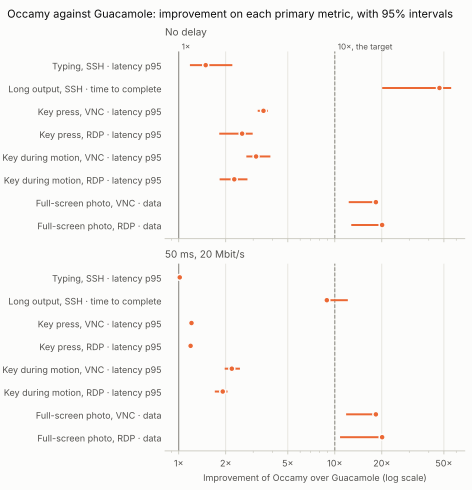
</picture>

## Secondary metrics

The other metrics that each scenario records, for Guacamole and Occamy. They're exploratory, and their p-values aren't corrected.

| Scenario | Network | Metric | Guacamole | Occamy | Improvement | p |
|---|---|---|---:|---:|---:|---:|
| Typing, SSH | No delay | Latency, median (ms) | 1.49 [1.28, 1.67] | 0.96 [0.77, 1.18] | 1.54× [1.22, 1.98] | 0.0022 |
| Typing, SSH | No delay | Server memory, peak (MiB) | 62.7 [43.6, 78.9] | 32.9 [6.32, 65.6] | 2.31× [0.787, 6.99] | 0.1797 |
| Typing, SSH | No delay | Client CPU time (ms) | 63.3 [51.6, 67.9] | 60.7 [53.9, 66.2] | 1.02× [0.852, 1.17] | 0.6991 |
| Long output, SSH | No delay | Data to the client (KiB) | 101 [60.4, 113] | 8.95 [5.64, 9.67] | 11.4× [7.60, 14.3] | 0.0022 |
| Long output, SSH | No delay | Server CPU time (ms) | 892 [838, 926] | 20.2 [15.7, 24.6] | 43.8× [37.6, 55.2] | 0.0022 |
| Long output, SSH | No delay | Server memory, peak (MiB) | 68.0 [63.2, 93.4] | 32.3 [8.30, 61.8] | 3.02× [1.21, 7.61] | 0.0022 |
| Long output, SSH | No delay | Client CPU time (ms) | 47.5 [34.1, 53.1] | 22.7 [20.3, 26.9] | 1.97× [1.45, 2.32] | 0.0022 |
| Key press, VNC | No delay | Latency, median (ms) | 14.6 [14.3, 14.6] | 3.47 [3.37, 3.66] | 4.18× [4.00, 4.24] | 0.0022 |
| Key press, VNC | No delay | Server memory, peak (MiB) | 75.8 [73.5, 76.8] | 34.6 [13.7, 62.1] | 2.49× [1.24, 5.35] | 0.0022 |
| Key press, VNC | No delay | Client CPU time (ms) | 67.2 [54.8, 70.6] | 76.4 [67.1, 90.7] | 0.833× [0.695, 1.01] | 0.0931 |
| Key press, RDP | No delay | Latency, median (ms) | 17.1 [16.7, 17.8] | 5.85 [5.46, 6.59] | 2.90× [2.70, 3.13] | 0.0022 |
| Key press, RDP | No delay | Server memory, peak (MiB) | 92.4 [58.3, 93.5] | 44.7 [39.7, 51.4] | 2.06× [1.47, 2.32] | 0.0022 |
| Key press, RDP | No delay | Client CPU time (ms) | 72.8 [63.6, 85.3] | 99.2 [82.1, 114] | 0.728× [0.62, 0.854] | 0.0043 |
| Key during motion, VNC | No delay | Frames shown a second (frames/s) | 25.2 [24.0, 26.6] | 29.1 [28.4, 29.7] | 1.15× [1.11, 1.22] | 0.0022 |
| Key during motion, VNC | No delay | Scene frames never shown (%) | 16.0 [11.5, 20.1] | 2.89 [1.03, 5.17] | 5.61× [2.95, 16.8] | 0.0022 |
| Key during motion, VNC | No delay | Gap between frames, 95th percentile (ms) | 70.3 [61.9, 83.6] | 50.6 [45.9, 60.5] | 1.40× [1.22, 1.64] | 0.0022 |
| Key during motion, VNC | No delay | Data per frame (KiB) | 50.4 [49.8, 51.9] | 8.02 [7.97, 8.10] | 6.27× [6.21, 6.45] | 0.0022 |
| Key during motion, VNC | No delay | Server CPU per frame (ms) | 49.3 [45.8, 54.3] | 12.9 [11.5, 13.3] | 3.89× [3.50, 4.32] | 0.0022 |
| Key during motion, VNC | No delay | Server CPU time (ms) | 12,471 [11,923, 13,194] | 3,706 [3,407, 3,810] | 3.39× [3.24, 3.60] | 0.0022 |
| Key during motion, VNC | No delay | Server memory, peak (MiB) | 56.5 [54.7, 57.3] | 39.3 [36.4, 41.5] | 1.44× [1.36, 1.50] | 0.0022 |
| Key during motion, VNC | No delay | Client CPU time (ms) | 4,908 [4,644, 5,302] | 2,159 [2,095, 2,242] | 2.26× [2.16, 2.38] | 0.0022 |
| Key during motion, RDP | No delay | Frames shown a second (frames/s) | 23.3 [21.5, 23.7] | 24.3 [24.1, 24.6] | 1.04× [1.03, 1.12] | 0.0022 |
| Key during motion, RDP | No delay | Scene frames never shown (%) | 22.2 [20.9, 28.2] | 19.0 [18.1, 19.8] | 1.17× [1.10, 1.42] | 0.0022 |
| Key during motion, RDP | No delay | Gap between frames, 95th percentile (ms) | 74.2 [52.9, 89.4] | 50.8 [50.0, 57.1] | 1.38× [1.06, 1.68] | 0.0043 |
| Key during motion, RDP | No delay | Data per frame (KiB) | 66.0 [64.9, 66.7] | 7.73 [7.71, 7.84] | 8.53× [8.41, 8.63] | 0.0022 |
| Key during motion, RDP | No delay | Server CPU per frame (ms) | 58.9 [55.3, 71.2] | 15.8 [14.2, 20.2] | 3.83× [3.31, 4.48] | 0.0022 |
| Key during motion, RDP | No delay | Server CPU time (ms) | 13,938 [13,059, 15,869] | 3,855 [3,414, 4,855] | 3.70× [3.20, 4.13] | 0.0022 |
| Key during motion, RDP | No delay | Server memory, peak (MiB) | 77.9 [67.3, 90.1] | 68.4 [64.9, 74.2] | 1.15× [1.04, 1.31] | 0.0411 |
| Key during motion, RDP | No delay | Client CPU time (ms) | 5,808 [5,334, 6,410] | 1,897 [1,680, 2,138] | 3.13× [2.74, 3.49] | 0.0022 |
| Full-screen photo, VNC | No delay | Time to complete (ms) | 186 [176, 218] | 86.8 [73.4, 135] | 2.23× [1.61, 2.51] | 0.0022 |
| Full-screen photo, VNC | No delay | Server CPU time (ms) | 328 [200, 371] | 102 [92.9, 119] | 3.23× [2.15, 3.55] | 0.0022 |
| Full-screen photo, VNC | No delay | Server memory, peak (MiB) | 61.5 [37.2, 63.0] | 41.8 [38.4, 46.6] | 1.46× [0.968, 1.57] | 0.0649 |
| Full-screen photo, VNC | No delay | Client CPU time (ms) | 85.3 [81.2, 94.2] | 51.2 [47.3, 55.2] | 1.68× [1.57, 1.82] | 0.0022 |
| Full-screen photo, RDP | No delay | Time to complete (ms) | 177 [131, 266] | 158 [79.4, 188] | 1.39× [0.815, 2.23] | 0.3939 |
| Full-screen photo, RDP | No delay | Server CPU time (ms) | 296 [239, 326] | 139 [117, 163] | 2.06× [1.76, 2.40] | 0.0022 |
| Full-screen photo, RDP | No delay | Server memory, peak (MiB) | 70.4 [57.8, 70.9] | 67.5 [62.6, 71.4] | 1.03× [0.924, 1.09] | 0.3095 |
| Full-screen photo, RDP | No delay | Client CPU time (ms) | 93.8 [89.4, 105] | 67.5 [53.5, 71.6] | 1.47× [1.29, 1.69] | 0.0022 |
| Typing, SSH | 50 ms, 20 Mbit/s | Latency, median (ms) | 54.1 [53.6, 55.0] | 53.5 [53.0, 54.2] | 1.01× [0.994, 1.03] | 0.0931 |
| Typing, SSH | 50 ms, 20 Mbit/s | Server memory, peak (MiB) | 47.3 [46.7, 78.5] | 56.6 [11.3, 63.5] | 0.845× [0.749, 4.13] | 0.3095 |
| Typing, SSH | 50 ms, 20 Mbit/s | Client CPU time (ms) | 79.5 [63.6, 95.5] | 80.4 [61.4, 97.1] | 1.00× [0.76, 1.36] | 1.0000 |
| Long output, SSH | 50 ms, 20 Mbit/s | Data to the client (KiB) | 82.7 [59.6, 148] | 0.849 [0.699, 1.04] | 96.1× [66.3, 182] | 0.0022 |
| Long output, SSH | 50 ms, 20 Mbit/s | Server CPU time (ms) | 870 [836, 1,216] | 17.7 [14.3, 21.2] | 52.5× [43.5, 66.9] | 0.0022 |
| Long output, SSH | 50 ms, 20 Mbit/s | Server memory, peak (MiB) | 67.1 [66.4, 68.0] | 56.7 [12.4, 64.8] | 1.18× [1.04, 5.37] | 0.0022 |
| Long output, SSH | 50 ms, 20 Mbit/s | Client CPU time (ms) | 45.2 [35.2, 75.4] | 16.5 [12.7, 20.7] | 2.83× [1.94, 4.27] | 0.0022 |
| Key press, VNC | 50 ms, 20 Mbit/s | Latency, median (ms) | 67.3 [66.3, 67.6] | 55.9 [55.2, 56.7] | 1.20× [1.18, 1.22] | 0.0022 |
| Key press, VNC | 50 ms, 20 Mbit/s | Server memory, peak (MiB) | 75.3 [74.5, 76.7] | 61.4 [18.9, 70.5] | 1.23× [1.09, 3.95] | 0.0022 |
| Key press, VNC | 50 ms, 20 Mbit/s | Client CPU time (ms) | 86.4 [69.0, 109] | 105 [74.9, 123] | 0.839× [0.666, 1.11] | 0.2403 |
| Key press, RDP | 50 ms, 20 Mbit/s | Latency, median (ms) | 69.5 [68.7, 70.0] | 58.3 [57.9, 59.1] | 1.19× [1.18, 1.20] | 0.0022 |
| Key press, RDP | 50 ms, 20 Mbit/s | Server memory, peak (MiB) | 92.5 [67.0, 92.6] | 46.7 [34.1, 57.2] | 1.88× [1.61, 2.15] | 0.0022 |
| Key press, RDP | 50 ms, 20 Mbit/s | Client CPU time (ms) | 82.7 [76.8, 104] | 117 [93.6, 142] | 0.761× [0.593, 0.918] | 0.0260 |
| Key during motion, VNC | 50 ms, 20 Mbit/s | Frames shown a second (frames/s) | 25.3 [24.5, 26.0] | 29.2 [28.5, 29.6] | 1.15× [1.12, 1.19] | 0.0022 |
| Key during motion, VNC | 50 ms, 20 Mbit/s | Scene frames never shown (%) | 15.8 [13.5, 18.4] | 2.68 [1.19, 5.04] | 5.95× [3.65, 11.3] | 0.0022 |
| Key during motion, VNC | 50 ms, 20 Mbit/s | Gap between frames, 95th percentile (ms) | 69.0 [64.6, 72.0] | 49.8 [47.5, 51.5] | 1.37× [1.30, 1.45] | 0.0022 |
| Key during motion, VNC | 50 ms, 20 Mbit/s | Data per frame (KiB) | 46.3 [44.9, 46.9] | 7.90 [7.87, 7.97] | 5.86× [5.70, 5.93] | 0.0022 |
| Key during motion, VNC | 50 ms, 20 Mbit/s | Server CPU per frame (ms) | 46.7 [44.7, 49.2] | 12.4 [11.3, 13.8] | 3.77× [3.32, 4.10] | 0.0022 |
| Key during motion, VNC | 50 ms, 20 Mbit/s | Server CPU time (ms) | 17,164 [16,097, 18,395] | 3,603 [3,353, 3,999] | 4.76× [4.23, 5.24] | 0.0022 |
| Key during motion, VNC | 50 ms, 20 Mbit/s | Server memory, peak (MiB) | 56.3 [55.6, 57.1] | 60.2 [38.2, 70.9] | 0.936× [0.806, 1.47] | 0.3939 |
| Key during motion, VNC | 50 ms, 20 Mbit/s | Client CPU time (ms) | 6,644 [6,179, 7,121] | 2,206 [2,041, 2,355] | 3.01× [2.75, 3.26] | 0.0022 |
| Key during motion, RDP | 50 ms, 20 Mbit/s | Frames shown a second (frames/s) | 23.3 [22.4, 23.7] | 24.0 [23.7, 24.7] | 1.04× [1.01, 1.06] | 0.0022 |
| Key during motion, RDP | 50 ms, 20 Mbit/s | Scene frames never shown (%) | 22.4 [21.0, 25.2] | 20.0 [17.6, 20.8] | 1.14× [1.04, 1.27] | 0.0022 |
| Key during motion, RDP | 50 ms, 20 Mbit/s | Gap between frames, 95th percentile (ms) | 71.4 [60.0, 84.2] | 55.4 [44.5, 65.3] | 1.30× [1.09, 1.53] | 0.0043 |
| Key during motion, RDP | 50 ms, 20 Mbit/s | Data per frame (KiB) | 53.7 [48.8, 56.1] | 7.79 [7.64, 7.87] | 6.93× [6.39, 7.17] | 0.0022 |
| Key during motion, RDP | 50 ms, 20 Mbit/s | Server CPU per frame (ms) | 54.3 [52.1, 57.5] | 15.3 [14.3, 18.5] | 3.62× [3.10, 3.86] | 0.0022 |
| Key during motion, RDP | 50 ms, 20 Mbit/s | Server CPU time (ms) | 19,641 [18,438, 20,991] | 3,668 [3,422, 4,428] | 5.28× [4.74, 5.78] | 0.0022 |
| Key during motion, RDP | 50 ms, 20 Mbit/s | Server memory, peak (MiB) | 73.1 [67.9, 80.4] | 65.3 [63.2, 71.8] | 1.09× [1.03, 1.23] | 0.0152 |
| Key during motion, RDP | 50 ms, 20 Mbit/s | Client CPU time (ms) | 8,207 [7,608, 8,758] | 1,854 [1,713, 2,147] | 4.33× [3.98, 4.73] | 0.0022 |
| Full-screen photo, VNC | 50 ms, 20 Mbit/s | Time to complete (ms) | 1,064 [702, 1,127] | 208 [160, 230] | 5.09× [4.38, 5.76] | 0.0022 |
| Full-screen photo, VNC | 50 ms, 20 Mbit/s | Server CPU time (ms) | 320 [184, 334] | 121 [107, 136] | 2.54× [1.72, 2.91] | 0.0022 |
| Full-screen photo, VNC | 50 ms, 20 Mbit/s | Server memory, peak (MiB) | 61.8 [36.6, 62.8] | 46.0 [42.6, 51.3] | 1.32× [0.86, 1.44] | 0.0649 |
| Full-screen photo, VNC | 50 ms, 20 Mbit/s | Client CPU time (ms) | 87.3 [84.7, 93.3] | 50.4 [41.9, 64.2] | 1.74× [1.45, 2.02] | 0.0022 |
| Full-screen photo, RDP | 50 ms, 20 Mbit/s | Time to complete (ms) | 991 [606, 1,044] | 151 [145, 164] | 6.37× [4.17, 6.95] | 0.0022 |
| Full-screen photo, RDP | 50 ms, 20 Mbit/s | Server CPU time (ms) | 289 [183, 423] | 124 [121, 145] | 2.31× [1.49, 2.92] | 0.0022 |
| Full-screen photo, RDP | 50 ms, 20 Mbit/s | Server memory, peak (MiB) | 62.0 [61.6, 62.5] | 64.3 [62.9, 68.7] | 0.964× [0.91, 0.983] | 0.0022 |
| Full-screen photo, RDP | 50 ms, 20 Mbit/s | Client CPU time (ms) | 89.6 [69.3, 116] | 56.7 [49.1, 61.6] | 1.63× [1.41, 1.90] | 0.0022 |

## The 50 ms target

A key's effect should show within 50 ms on the network with no delay and on the one with a 20 ms round trip. The target is met where the upper bound of the 95% interval of the latency's 95th percentile is at most 50 ms. With no delay, the latency is the server's own processing; the other network adds its round trip.

| Series | Scenario | Network | Latency, 95th percentile (ms) | Met |
|---|---|---|---:|:-:|
| Occamy | Typing, SSH | No delay | 1.73 [1.41, 2.63] | met |
| Occamy | Key press, VNC | No delay | 4.64 [4.28, 5.31] | met |
| Occamy | Key press, RDP | No delay | 8.10 [6.92, 12.3] | met |
| Occamy | Key during motion, VNC | No delay | 49.0 [39.6, 54.3] | no |
| Occamy | Key during motion, RDP | No delay | 66.8 [57.9, 92.3] | no |

## occamyd's runtime

For each scenario and network, the median of the runs: the memory `occamyd` allocated and the garbage collection cycles it ran during the scenario, and its heap in use and its goroutines at the end.

| Series | Scenario | Network | Allocated (MiB) | GC cycles | Heap (MiB) | Goroutines |
|---|---|---|---:|---:|---:|---:|
| Occamy | Typing, SSH | No delay | 1.31 | 0 | 26.1 | 8.00 |
| Occamy | Long output, SSH | No delay | 4.28 | 1.50 | 8.45 | 8.00 |
| Occamy | Key press, VNC | No delay | 9.59 | 2.00 | 12.2 | 8.00 |
| Occamy | Key press, RDP | No delay | 22.6 | 2.00 | 24.5 | 8.00 |
| Occamy | Key during motion, VNC | No delay | 159 | 13.0 | 27.3 | 8.00 |
| Occamy | Key during motion, RDP | No delay | 87.7 | 5.00 | 37.8 | 8.00 |
| Occamy | Full-screen photo, VNC | No delay | 35.9 | 3.00 | 30.3 | 8.00 |
| Occamy | Full-screen photo, RDP | No delay | 57.4 | 2.00 | 51.2 | 8.00 |
| Occamy | Typing, SSH | 50 ms, 20 Mbit/s | 1.30 | 0 | 45.5 | 8.50 |
| Occamy | Long output, SSH | 50 ms, 20 Mbit/s | 1.68 | 0 | 47.5 | 8.50 |
| Occamy | Key press, VNC | 50 ms, 20 Mbit/s | 10.6 | 0.5 | 37.8 | 8.50 |
| Occamy | Key press, RDP | 50 ms, 20 Mbit/s | 22.4 | 2.00 | 25.4 | 8.00 |
| Occamy | Key during motion, VNC | 50 ms, 20 Mbit/s | 106 | 9.00 | 25.8 | 8.50 |
| Occamy | Key during motion, RDP | 50 ms, 20 Mbit/s | 93.2 | 5.00 | 53.3 | 8.00 |
| Occamy | Full-screen photo, VNC | 50 ms, 20 Mbit/s | 40.9 | 3.00 | 35.7 | 8.50 |
| Occamy | Full-screen photo, RDP | 50 ms, 20 Mbit/s | 54.5 | 3.50 | 46.7 | 8.00 |

## Sensitivity to the host's load

None of the 192 results started while the host's 1-minute load average was above the gate of 8, so no conclusion on a primary metric depends on the host's load.

## Figures

Each figure shows a metric's median for each series in each scenario, with its 95% interval, in a panel for each network. Where the values span more than a factor of ten, the axis is logarithmic.

### Latency, 95th percentile

<picture>
  <source media="(prefers-color-scheme: dark)" srcset="latency_p95-dark.svg">
  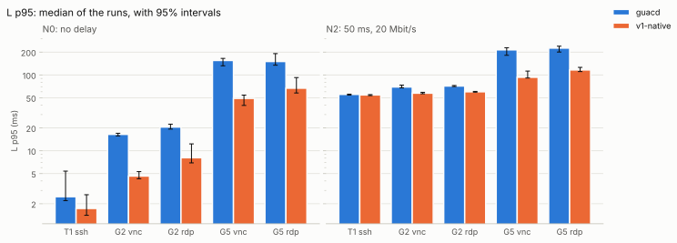
</picture>

### Latency, median

<picture>
  <source media="(prefers-color-scheme: dark)" srcset="latency_p50-dark.svg">
  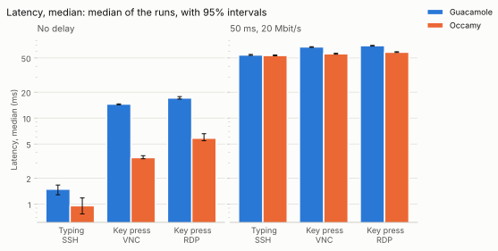
</picture>

### Time to complete

<picture>
  <source media="(prefers-color-scheme: dark)" srcset="completion-dark.svg">
  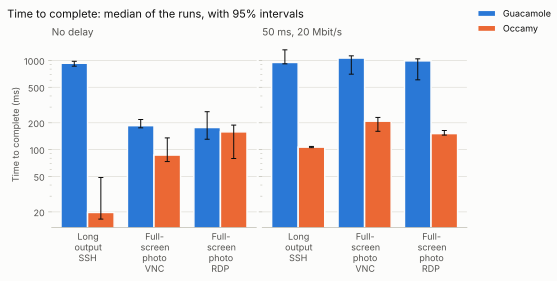
</picture>

### Data to the client

<picture>
  <source media="(prefers-color-scheme: dark)" srcset="bytes_down-dark.svg">
  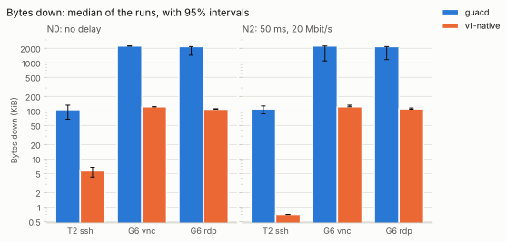
</picture>

### Frames shown a second

<picture>
  <source media="(prefers-color-scheme: dark)" srcset="fps-dark.svg">
  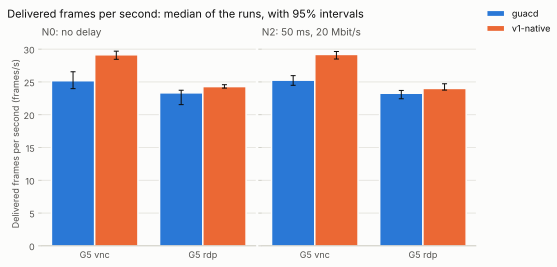
</picture>

### Scene frames never shown

<picture>
  <source media="(prefers-color-scheme: dark)" srcset="scene_missed-dark.svg">
  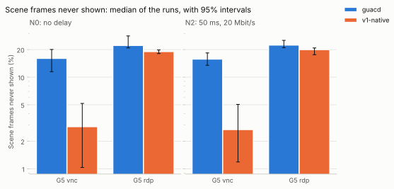
</picture>

### Gap between frames, 95th percentile

<picture>
  <source media="(prefers-color-scheme: dark)" srcset="frame_interval_p95-dark.svg">
  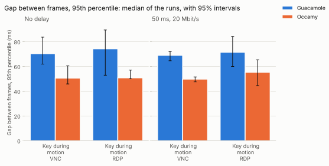
</picture>

### Data per frame

<picture>
  <source media="(prefers-color-scheme: dark)" srcset="bytes_per_frame-dark.svg">
  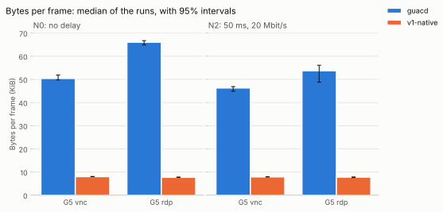
</picture>

### Server CPU per frame

<picture>
  <source media="(prefers-color-scheme: dark)" srcset="cpu_per_frame-dark.svg">
  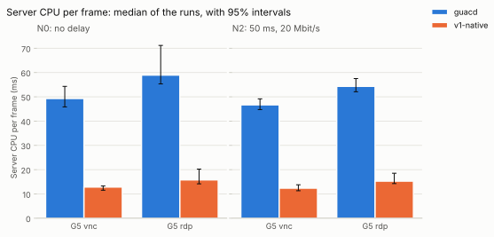
</picture>

### Server CPU time

<picture>
  <source media="(prefers-color-scheme: dark)" srcset="server_cpu-dark.svg">
  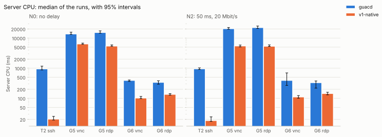
</picture>

### Server memory, peak

<picture>
  <source media="(prefers-color-scheme: dark)" srcset="server_mem-dark.svg">
  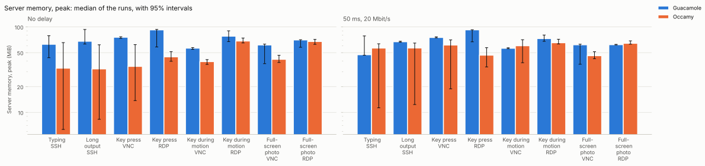
</picture>

### Client CPU time

<picture>
  <source media="(prefers-color-scheme: dark)" srcset="client_cpu-dark.svg">
  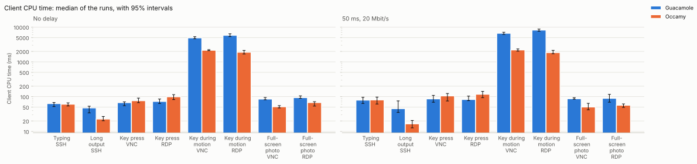
</picture>

### Memory occamyd allocated

<picture>
  <source media="(prefers-color-scheme: dark)" srcset="occamyd_alloc-dark.svg">
  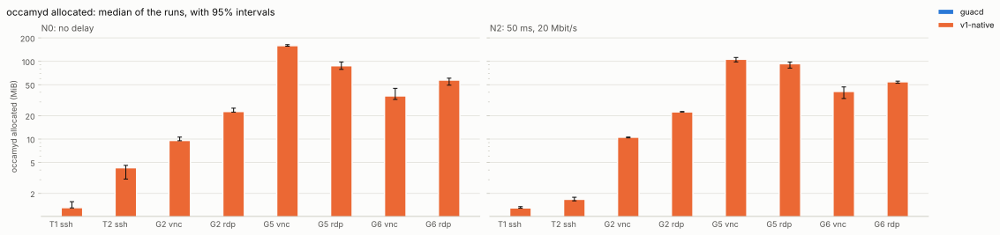
</picture>

### occamyd's garbage collection cycles

<picture>
  <source media="(prefers-color-scheme: dark)" srcset="occamyd_gc-dark.svg">
  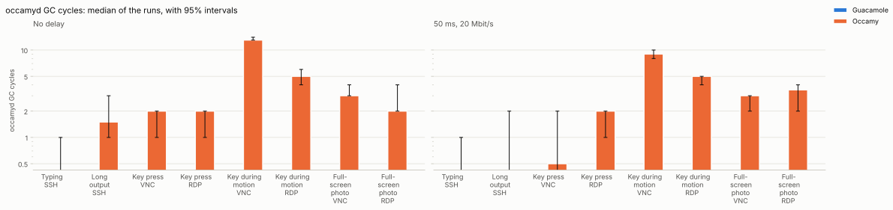
</picture>

### occamyd's heap in use

<picture>
  <source media="(prefers-color-scheme: dark)" srcset="occamyd_heap-dark.svg">
  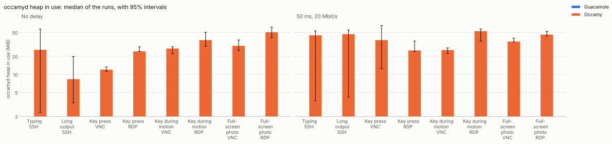
</picture>

### occamyd's goroutines

<picture>
  <source media="(prefers-color-scheme: dark)" srcset="occamyd_goroutines-dark.svg">
  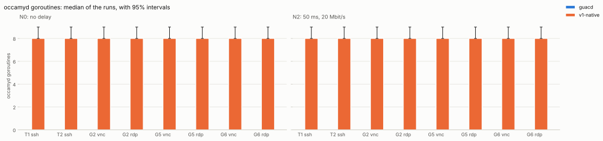
</picture>
