# Occamy against Occamy with a window of two

The comparison benchmark's results in `bench-realtime-1.json`, as `bench/report.py` analyses them: each series' median of every metric in each scenario and network, the improvement of one series over the other, and whether the difference is significant.
[How Occamy is measured](../../../benchmarks.md#how-occamy-is-measured) describes the scenarios, the networks and the metrics, and [Analysis](../../../benchmarks.md#analysis) the statistics, which were fixed before any data was collected.

## The run

- Started at 2026-11-02T21:56:08.578958Z, on Apple M5 Pro (18 CPUs, darwin), with podman version 6.0.2.
- 6 runs with seed 20261102, and 100 keys timed in each scenario of each run.
- Before each result, the harness waited until the host's 1-minute load average was below 8.
- 168 results analysed, and 0 failed.
- The results files name Occamy with a window of two `v1-native-w2` and Occamy `v1-native`.

## How to read this report

Each value is the median of the runs, followed by its 95% interval in brackets: an exact interval from order statistics, which assumes nothing about how the values are distributed.

*Improvement* is the baseline's value divided by the candidate's, or the candidate's divided by the baseline's for a metric where higher is better, such as frames shown a second. Above 1×, the candidate is better: 3× is a third of the baseline's latency, or three times its frames. It's the Hodges–Lehmann estimate of that ratio, with its exact 95% interval from the Mann–Whitney distribution.

*p* is the exact two-sided permutation test of the rank sum, over every split of the runs. Each scenario's *primary metric* is the one its comparison is judged on. *p (Holm)* corrects the primary metrics' p-values with Holm's method, and a difference is significant where it's below 0.05. The other metrics, the *secondary* ones, are exploratory, and their p-values aren't corrected.

## Primary metrics

Each scenario's primary metric for Occamy with a window of two and Occamy, and the improvement of Occamy over Occamy with a window of two: above 1×, Occamy is better. Holm's correction is over these 14 tests.

| Scenario | Network | Metric | Occamy with a window of two | Occamy | Improvement | p | p (Holm) |
|---|---|---|---:|---:|---:|---:|---:|
| Typing, SSH | No delay | Latency, 95th percentile (ms) | 1.45 [1.23, 1.67] | 1.44 [1.24, 1.88] | 0.926× [0.769, 1.14] | 0.6991 | 1.0000 |
| Long output, SSH | No delay | Time to complete (ms) | 17.4 [16.5, 17.9] | 17.6 [15.5, 40.2] | 0.986× [0.444, 1.06] | 0.6991 | 1.0000 |
| Key press, VNC | No delay | Latency, 95th percentile (ms) | 4.64 [4.09, 5.77] | 4.63 [4.11, 4.78] | 1.04× [0.934, 1.24] | 0.5887 | 1.0000 |
| Key press, RDP | No delay | Latency, 95th percentile (ms) | 7.53 [6.55, 8.55] | 7.31 [6.68, 8.27] | 1.04× [0.914, 1.15] | 0.5887 | 1.0000 |
| Key during motion, VNC | No delay | Latency, 95th percentile (ms) | 44.8 [38.2, 213] | 41.3 [38.7, 50.2] | 1.08× [0.92, 4.25] | 0.4848 | 1.0000 |
| Key during motion, RDP | No delay | Latency, 95th percentile (ms) | 63.1 [58.9, 68.7] | 61.9 [60.4, 72.3] | 0.986× [0.895, 1.08] | 0.6991 | 1.0000 |
| Key during motion, VNC | 20 ms, 100 Mbit/s | Latency, 95th percentile (ms) | 66.1 [61.6, 77.4] | 68.8 [59.9, 466] | 0.962× [0.166, 1.11] | 0.9372 | 1.0000 |
| Key during motion, RDP | 20 ms, 100 Mbit/s | Latency, 95th percentile (ms) | 81.1 [80.8, 87.0] | 82.1 [79.0, 85.8] | 0.991× [0.973, 1.05] | 0.6991 | 1.0000 |
| Typing, SSH | 50 ms, 20 Mbit/s | Latency, 95th percentile (ms) | 53.4 [53.1, 53.7] | 53.4 [53.2, 53.7] | 0.999× [0.992, 1.01] | 0.4848 | 1.0000 |
| Long output, SSH | 50 ms, 20 Mbit/s | Time to complete (ms) | 105 [105, 106] | 106 [104, 106] | 0.998× [0.99, 1.01] | 0.5887 | 1.0000 |
| Key press, VNC | 50 ms, 20 Mbit/s | Latency, 95th percentile (ms) | 56.1 [55.6, 57.5] | 56.4 [56.0, 56.7] | 0.998× [0.987, 1.01] | 0.3939 | 1.0000 |
| Key press, RDP | 50 ms, 20 Mbit/s | Latency, 95th percentile (ms) | 58.8 [58.2, 59.3] | 59.1 [58.3, 59.7] | 0.996× [0.986, 1.01] | 0.3095 | 1.0000 |
| Key during motion, VNC | 50 ms, 20 Mbit/s | Latency, 95th percentile (ms) | 119 [116, 133] | 95.7 [92.9, 99.4] | 1.25× [1.21, 1.34] | 0.0022 | 0.0303 |
| Key during motion, RDP | 50 ms, 20 Mbit/s | Latency, 95th percentile (ms) | 116 [113, 143] | 116 [113, 125] | 1.01× [0.973, 1.14] | 0.4848 | 1.0000 |

1 of the 14 differences are significant after the correction.

<picture>
  <source media="(prefers-color-scheme: dark)" srcset="factors-frame-window-dark.svg">
  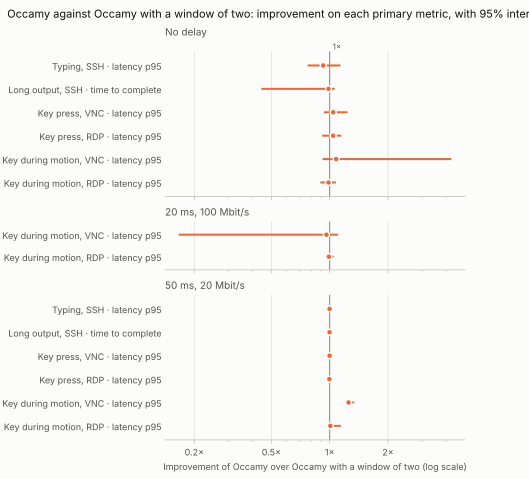
</picture>

## Secondary metrics

The other metrics that each scenario records, for Occamy with a window of two and Occamy. They're exploratory, and their p-values aren't corrected.

| Scenario | Network | Metric | Occamy with a window of two | Occamy | Improvement | p |
|---|---|---|---:|---:|---:|---:|
| Typing, SSH | No delay | Latency, median (ms) | 0.963 [0.849, 1.24] | 1.06 [0.887, 1.31] | 0.957× [0.75, 1.23] | 0.5887 |
| Typing, SSH | No delay | Server memory, peak (MiB) | 71.5 [65.3, 79.7] | 71.4 [61.1, 77.6] | 1.03× [0.918, 1.16] | 0.9372 |
| Typing, SSH | No delay | Client CPU time (ms) | 59.2 [54.1, 66.7] | 60.4 [55.0, 70.1] | 0.965× [0.855, 1.10] | 0.4848 |
| Long output, SSH | No delay | Data to the client (KiB) | 10.0 [6.91, 12.2] | 9.82 [4.85, 14.0] | 1.13× [0.74, 1.94] | 0.6991 |
| Long output, SSH | No delay | Server CPU time (ms) | 18.0 [17.4, 19.3] | 18.8 [16.8, 20.7] | 0.972× [0.882, 1.07] | 0.6991 |
| Long output, SSH | No delay | Server memory, peak (MiB) | 71.1 [65.6, 80.0] | 72.1 [60.7, 77.7] | 1.03× [0.91, 1.16] | 0.8182 |
| Long output, SSH | No delay | Client CPU time (ms) | 25.2 [21.0, 28.3] | 24.8 [18.8, 28.8] | 0.992× [0.865, 1.23] | 1.0000 |
| Key press, VNC | No delay | Latency, median (ms) | 3.52 [3.15, 3.83] | 3.40 [3.21, 3.91] | 1.00× [0.919, 1.14] | 1.0000 |
| Key press, VNC | No delay | Server memory, peak (MiB) | 71.1 [64.8, 80.0] | 72.3 [62.7, 79.1] | 1.02× [0.9, 1.14] | 0.6991 |
| Key press, VNC | No delay | Client CPU time (ms) | 85.0 [75.5, 102] | 81.1 [72.4, 99.1] | 1.04× [0.869, 1.25] | 0.6991 |
| Key press, RDP | No delay | Latency, median (ms) | 5.87 [5.51, 6.42] | 5.81 [5.57, 6.43] | 1.00× [0.913, 1.06] | 1.0000 |
| Key press, RDP | No delay | Server memory, peak (MiB) | 52.6 [29.4, 54.0] | 50.3 [48.0, 58.2] | 1.03× [0.613, 1.09] | 0.4848 |
| Key press, RDP | No delay | Client CPU time (ms) | 100 [81.4, 114] | 92.1 [90.5, 122] | 1.05× [0.821, 1.11] | 0.8182 |
| Key during motion, VNC | No delay | Frames shown a second (frames/s) | 29.6 [16.8, 30.1] | 29.9 [29.4, 30.2] | 1.01× [0.994, 1.75] | 0.3095 |
| Key during motion, VNC | No delay | Scene frames never shown (%) | 1.44 [-0.356, 43.9] | 0.346 [-0.736, 2.00] | –× | 0.3095 |
| Key during motion, VNC | No delay | Gap between frames, 95th percentile (ms) | 48.6 [42.2, 128] | 43.5 [37.8, 47.7] | 1.11× [0.954, 2.69] | 0.0649 |
| Key during motion, VNC | No delay | Data per frame (KiB) | 14.3 [14.1, 20.1] | 14.2 [14.1, 14.3] | 1.01× [0.993, 1.40] | 0.4848 |
| Key during motion, VNC | No delay | Server CPU per frame (ms) | 20.9 [19.4, 34.3] | 20.7 [19.6, 23.8] | 1.02× [0.87, 1.44] | 0.8182 |
| Key during motion, VNC | No delay | Server CPU time (ms) | 6,033 [5,720, 6,961] | 6,154 [5,857, 7,073] | 0.977× [0.857, 1.05] | 0.4848 |
| Key during motion, VNC | No delay | Server memory, peak (MiB) | 69.2 [58.1, 76.7] | 64.9 [50.6, 79.1] | 1.07× [0.885, 1.30] | 0.4848 |
| Key during motion, VNC | No delay | Client CPU time (ms) | 2,403 [1,793, 2,554] | 2,449 [2,347, 2,560] | 0.98× [0.764, 1.02] | 0.3939 |
| Key during motion, RDP | No delay | Frames shown a second (frames/s) | 24.4 [24.2, 24.7] | 24.6 [24.2, 24.7] | 1.01× [0.994, 1.01] | 0.4848 |
| Key during motion, RDP | No delay | Scene frames never shown (%) | 18.7 [17.7, 19.4] | 17.9 [17.6, 19.2] | 1.03× [0.974, 1.07] | 0.4848 |
| Key during motion, RDP | No delay | Gap between frames, 95th percentile (ms) | 52.0 [43.6, 53.2] | 45.6 [43.0, 50.3] | 1.11× [1.01, 1.21] | 0.0411 |
| Key during motion, RDP | No delay | Data per frame (KiB) | 14.3 [14.1, 14.4] | 14.1 [14.1, 14.4] | 1.01× [0.995, 1.02] | 0.3939 |
| Key during motion, RDP | No delay | Server CPU per frame (ms) | 22.5 [20.4, 24.9] | 20.7 [20.6, 25.4] | 1.01× [0.874, 1.13] | 0.9372 |
| Key during motion, RDP | No delay | Server CPU time (ms) | 5,460 [4,983, 5,983] | 5,058 [4,953, 6,245] | 1.00× [0.867, 1.14] | 0.9372 |
| Key during motion, RDP | No delay | Server memory, peak (MiB) | 69.1 [67.4, 77.4] | 71.2 [67.6, 74.3] | 0.986× [0.92, 1.06] | 0.5887 |
| Key during motion, RDP | No delay | Client CPU time (ms) | 2,073 [1,955, 2,197] | 1,999 [1,949, 2,244] | 1.01× [0.93, 1.08] | 0.9372 |
| Key during motion, VNC | 20 ms, 100 Mbit/s | Frames shown a second (frames/s) | 29.2 [28.4, 29.9] | 29.5 [8.92, 29.9] | 1.00× [0.314, 1.03] | 0.9372 |
| Key during motion, VNC | 20 ms, 100 Mbit/s | Scene frames never shown (%) | 2.82 [0.467, 5.24] | 1.77 [0.239, 70.3] | 1.23× [0.0708, 5.33] | 0.9372 |
| Key during motion, VNC | 20 ms, 100 Mbit/s | Gap between frames, 95th percentile (ms) | 51.2 [46.6, 53.8] | 48.4 [46.3, 350] | 1.00× [0.154, 1.10] | 0.9372 |
| Key during motion, VNC | 20 ms, 100 Mbit/s | Data per frame (KiB) | 14.2 [14.1, 14.3] | 14.2 [14.1, 16.9] | 0.998× [0.846, 1.01] | 0.8182 |
| Key during motion, VNC | 20 ms, 100 Mbit/s | Server CPU per frame (ms) | 21.2 [19.9, 24.4] | 21.5 [19.5, 48.3] | 1.02× [0.504, 1.20] | 0.6991 |
| Key during motion, VNC | 20 ms, 100 Mbit/s | Server CPU time (ms) | 6,157 [5,922, 7,064] | 6,278 [5,760, 8,646] | 1.01× [0.817, 1.15] | 0.6991 |
| Key during motion, VNC | 20 ms, 100 Mbit/s | Server memory, peak (MiB) | 71.0 [64.5, 76.4] | 72.8 [67.5, 75.8] | 0.987× [0.903, 1.07] | 0.8182 |
| Key during motion, VNC | 20 ms, 100 Mbit/s | Client CPU time (ms) | 2,383 [2,305, 2,645] | 2,347 [1,727, 2,545] | 1.03× [0.939, 1.34] | 0.3095 |
| Key during motion, RDP | 20 ms, 100 Mbit/s | Frames shown a second (frames/s) | 24.5 [24.2, 24.9] | 24.5 [24.3, 24.7] | 1.00× [0.989, 1.01] | 0.9372 |
| Key during motion, RDP | 20 ms, 100 Mbit/s | Scene frames never shown (%) | 18.4 [17.1, 19.3] | 18.2 [17.7, 18.9] | 1.01× [0.948, 1.06] | 0.9372 |
| Key during motion, RDP | 20 ms, 100 Mbit/s | Gap between frames, 95th percentile (ms) | 44.7 [43.0, 50.8] | 46.2 [43.9, 47.6] | 0.988× [0.932, 1.07] | 0.3939 |
| Key during motion, RDP | 20 ms, 100 Mbit/s | Data per frame (KiB) | 14.1 [14.0, 14.4] | 14.1 [14.1, 14.3] | 0.998× [0.988, 1.01] | 0.8182 |
| Key during motion, RDP | 20 ms, 100 Mbit/s | Server CPU per frame (ms) | 20.7 [20.5, 24.9] | 20.8 [20.5, 24.5] | 0.997× [0.958, 1.16] | 0.9372 |
| Key during motion, RDP | 20 ms, 100 Mbit/s | Server CPU time (ms) | 5,096 [5,002, 6,033] | 5,113 [4,966, 5,960] | 0.998× [0.954, 1.15] | 1.0000 |
| Key during motion, RDP | 20 ms, 100 Mbit/s | Server memory, peak (MiB) | 72.4 [65.9, 76.0] | 72.6 [62.5, 76.2] | 0.986× [0.93, 1.08] | 0.8182 |
| Key during motion, RDP | 20 ms, 100 Mbit/s | Client CPU time (ms) | 1,978 [1,914, 2,279] | 1,971 [1,903, 2,256] | 1.01× [0.958, 1.13] | 0.6991 |
| Typing, SSH | 50 ms, 20 Mbit/s | Latency, median (ms) | 52.8 [52.6, 53.2] | 52.8 [52.7, 53.1] | 0.999× [0.995, 1.00] | 0.6212 |
| Typing, SSH | 50 ms, 20 Mbit/s | Server memory, peak (MiB) | 70.4 [64.4, 74.2] | 70.9 [5.05, 74.7] | 1.00× [0.933, 12.7] | 1.0000 |
| Typing, SSH | 50 ms, 20 Mbit/s | Client CPU time (ms) | 75.1 [62.0, 100.0] | 78.6 [65.8, 94.6] | 0.963× [0.791, 1.25] | 0.5887 |
| Long output, SSH | 50 ms, 20 Mbit/s | Data to the client (KiB) | 0.704 [0.666, 0.736] | 0.699 [0.662, 0.704] | 1.01× [0.997, 1.06] | 0.1255 |
| Long output, SSH | 50 ms, 20 Mbit/s | Server CPU time (ms) | 16.9 [15.7, 18.8] | 17.6 [14.8, 22.8] | 0.959× [0.823, 1.11] | 0.6991 |
| Long output, SSH | 50 ms, 20 Mbit/s | Server memory, peak (MiB) | 71.2 [64.7, 74.2] | 70.8 [7.92, 74.7] | 1.01× [0.952, 8.17] | 0.8182 |
| Long output, SSH | 50 ms, 20 Mbit/s | Client CPU time (ms) | 15.4 [14.7, 19.8] | 15.0 [13.8, 19.5] | 1.07× [0.827, 1.36] | 0.4848 |
| Key press, VNC | 50 ms, 20 Mbit/s | Latency, median (ms) | 55.1 [54.6, 55.7] | 55.1 [55.0, 55.5] | 0.999× [0.992, 1.01] | 0.9372 |
| Key press, VNC | 50 ms, 20 Mbit/s | Server memory, peak (MiB) | 71.8 [67.7, 76.8] | 69.1 [14.4, 73.9] | 1.05× [0.974, 4.71] | 0.3939 |
| Key press, VNC | 50 ms, 20 Mbit/s | Client CPU time (ms) | 91.0 [82.0, 123] | 95.6 [84.1, 113] | 0.974× [0.845, 1.26] | 0.8182 |
| Key press, RDP | 50 ms, 20 Mbit/s | Latency, median (ms) | 57.6 [57.5, 58.3] | 57.7 [57.5, 58.4] | 0.999× [0.993, 1.00] | 0.6991 |
| Key press, RDP | 50 ms, 20 Mbit/s | Server memory, peak (MiB) | 50.3 [48.4, 52.5] | 50.6 [39.6, 52.8] | 0.996× [0.951, 1.22] | 0.8182 |
| Key press, RDP | 50 ms, 20 Mbit/s | Client CPU time (ms) | 103 [95.3, 147] | 115 [90.7, 148] | 0.988× [0.803, 1.24] | 0.8182 |
| Key during motion, VNC | 50 ms, 20 Mbit/s | Frames shown a second (frames/s) | 18.8 [15.9, 28.3] | 29.6 [29.2, 29.9] | 1.57× [1.06, 1.84] | 0.0022 |
| Key during motion, VNC | 50 ms, 20 Mbit/s | Scene frames never shown (%) | 37.2 [5.78, 47.1] | 1.47 [0.437, 2.81] | 20.5× [12.6, 47.4] | 0.0022 |
| Key during motion, VNC | 50 ms, 20 Mbit/s | Gap between frames, 95th percentile (ms) | 76.7 [64.0, 98.9] | 49.1 [47.8, 52.8] | 1.52× [1.32, 1.87] | 0.0022 |
| Key during motion, VNC | 50 ms, 20 Mbit/s | Data per frame (KiB) | 15.5 [13.4, 18.3] | 14.2 [14.1, 14.3] | 1.09× [0.947, 1.28] | 0.3939 |
| Key during motion, VNC | 50 ms, 20 Mbit/s | Server CPU per frame (ms) | 25.5 [18.6, 31.3] | 20.4 [19.3, 23.7] | 1.25× [0.947, 1.54] | 0.0931 |
| Key during motion, VNC | 50 ms, 20 Mbit/s | Server CPU time (ms) | 4,935 [4,348, 5,470] | 6,001 [5,768, 6,885] | 0.8× [0.726, 0.908] | 0.0022 |
| Key during motion, VNC | 50 ms, 20 Mbit/s | Server memory, peak (MiB) | 69.5 [64.6, 77.1] | 62.3 [45.5, 73.9] | 1.12× [0.969, 1.45] | 0.1320 |
| Key during motion, VNC | 50 ms, 20 Mbit/s | Client CPU time (ms) | 1,717 [1,612, 2,048] | 2,415 [2,333, 2,596] | 0.71× [0.662, 0.789] | 0.0022 |
| Key during motion, RDP | 50 ms, 20 Mbit/s | Frames shown a second (frames/s) | 24.0 [23.7, 24.3] | 24.3 [24.2, 24.8] | 1.02× [1.00, 1.02] | 0.0152 |
| Key during motion, RDP | 50 ms, 20 Mbit/s | Scene frames never shown (%) | 20.0 [19.0, 20.9] | 18.9 [17.4, 19.3] | 1.07× [1.01, 1.10] | 0.0152 |
| Key during motion, RDP | 50 ms, 20 Mbit/s | Gap between frames, 95th percentile (ms) | 63.3 [55.6, 69.4] | 47.6 [43.3, 51.4] | 1.33× [1.18, 1.45] | 0.0022 |
| Key during motion, RDP | 50 ms, 20 Mbit/s | Data per frame (KiB) | 14.1 [14.0, 14.2] | 14.1 [14.1, 14.3] | 0.996× [0.987, 1.00] | 0.3095 |
| Key during motion, RDP | 50 ms, 20 Mbit/s | Server CPU per frame (ms) | 21.2 [20.3, 24.8] | 21.0 [20.2, 24.0] | 1.00× [0.901, 1.11] | 0.9372 |
| Key during motion, RDP | 50 ms, 20 Mbit/s | Server CPU time (ms) | 5,081 [4,907, 5,932] | 5,107 [4,999, 5,816] | 0.995× [0.9, 1.09] | 0.9372 |
| Key during motion, RDP | 50 ms, 20 Mbit/s | Server memory, peak (MiB) | 71.1 [63.4, 79.4] | 71.0 [60.0, 77.4] | 1.00× [0.917, 1.17] | 0.8182 |
| Key during motion, RDP | 50 ms, 20 Mbit/s | Client CPU time (ms) | 1,987 [1,911, 2,197] | 2,020 [1,979, 2,143] | 0.981× [0.931, 1.03] | 0.3095 |

## The 50 ms target

A key's effect should show within 50 ms on the network with no delay and on the one with a 20 ms round trip. The target is met where the upper bound of the 95% interval of the latency's 95th percentile is at most 50 ms. With no delay, the latency is the server's own processing; the other network adds its round trip.

| Series | Scenario | Network | Latency, 95th percentile (ms) | Met |
|---|---|---|---:|:-:|
| Occamy | Typing, SSH | No delay | 1.44 [1.24, 1.88] | met |
| Occamy | Key press, VNC | No delay | 4.63 [4.11, 4.78] | met |
| Occamy | Key press, RDP | No delay | 7.31 [6.68, 8.27] | met |
| Occamy | Key during motion, VNC | No delay | 41.3 [38.7, 50.2] | no |
| Occamy | Key during motion, RDP | No delay | 61.9 [60.4, 72.3] | no |
| Occamy | Key during motion, VNC | 20 ms, 100 Mbit/s | 68.8 [59.9, 466] | no |
| Occamy | Key during motion, RDP | 20 ms, 100 Mbit/s | 82.1 [79.0, 85.8] | no |

## occamyd's runtime

For each scenario and network, the median of the runs: the memory `occamyd` allocated and the garbage collection cycles it ran during the scenario, and its heap in use and its goroutines at the end.

| Series | Scenario | Network | Allocated (MiB) | GC cycles | Heap (MiB) | Goroutines |
|---|---|---|---:|---:|---:|---:|
| Occamy | Typing, SSH | No delay | 1.36 | 0 | 44.3 | 10.0 |
| Occamy | Long output, SSH | No delay | 4.50 | 0 | 46.9 | 9.00 |
| Occamy | Key press, VNC | No delay | 10.5 | 1.00 | 20.6 | 9.00 |
| Occamy | Key press, RDP | No delay | 22.6 | 2.00 | 25.4 | 9.00 |
| Occamy | Key during motion, VNC | No delay | 251 | 16.0 | 32.0 | 9.00 |
| Occamy | Key during motion, RDP | No delay | 96.7 | 5.00 | 44.0 | 9.00 |
| Occamy | Key during motion, VNC | 20 ms, 100 Mbit/s | 191 | 11.0 | 29.3 | 10.0 |
| Occamy | Key during motion, RDP | 20 ms, 100 Mbit/s | 97.4 | 4.50 | 53.1 | 9.00 |
| Occamy | Typing, SSH | 50 ms, 20 Mbit/s | 1.36 | 0 | 49.4 | 10.0 |
| Occamy | Long output, SSH | 50 ms, 20 Mbit/s | 1.68 | 0 | 47.9 | 9.50 |
| Occamy | Key press, VNC | 50 ms, 20 Mbit/s | 10.5 | 1.00 | 20.7 | 9.00 |
| Occamy | Key press, RDP | 50 ms, 20 Mbit/s | 22.4 | 1.50 | 29.0 | 9.00 |
| Occamy | Key during motion, VNC | 50 ms, 20 Mbit/s | 178 | 12.0 | 30.9 | 9.00 |
| Occamy | Key during motion, RDP | 50 ms, 20 Mbit/s | 94.7 | 5.00 | 43.3 | 9.00 |
| Occamy with a window of two | Typing, SSH | No delay | 1.35 | 0 | 50.5 | 10.0 |
| Occamy with a window of two | Long output, SSH | No delay | 4.93 | 0 | 56.5 | 9.00 |
| Occamy with a window of two | Key press, VNC | No delay | 10.5 | 1.00 | 21.0 | 9.00 |
| Occamy with a window of two | Key press, RDP | No delay | 22.4 | 1.00 | 27.7 | 9.00 |
| Occamy with a window of two | Key during motion, VNC | No delay | 238 | 15.5 | 30.6 | 9.00 |
| Occamy with a window of two | Key during motion, RDP | No delay | 97.1 | 4.50 | 45.1 | 9.00 |
| Occamy with a window of two | Key during motion, VNC | 20 ms, 100 Mbit/s | 219 | 13.0 | 32.4 | 10.0 |
| Occamy with a window of two | Key during motion, RDP | 20 ms, 100 Mbit/s | 99.2 | 5.00 | 54.9 | 9.00 |
| Occamy with a window of two | Typing, SSH | 50 ms, 20 Mbit/s | 1.36 | 0 | 55.2 | 10.0 |
| Occamy with a window of two | Long output, SSH | 50 ms, 20 Mbit/s | 1.65 | 0 | 57.3 | 10.0 |
| Occamy with a window of two | Key press, VNC | 50 ms, 20 Mbit/s | 10.5 | 1.00 | 21.9 | 9.00 |
| Occamy with a window of two | Key press, RDP | 50 ms, 20 Mbit/s | 22.5 | 2.00 | 24.9 | 9.00 |
| Occamy with a window of two | Key during motion, VNC | 50 ms, 20 Mbit/s | 115 | 8.00 | 34.2 | 9.00 |
| Occamy with a window of two | Key during motion, RDP | 50 ms, 20 Mbit/s | 96.9 | 5.00 | 49.1 | 9.00 |

## Sensitivity to the host's load

None of the 168 results started while the host's 1-minute load average was above the gate of 8, so no conclusion on a primary metric depends on the host's load.

## Figures

Each figure shows a metric's median for each series in each scenario, with its 95% interval, in a panel for each network. Where the values span more than a factor of ten, the axis is logarithmic.

### Latency, 95th percentile

<picture>
  <source media="(prefers-color-scheme: dark)" srcset="latency_p95-dark.svg">
  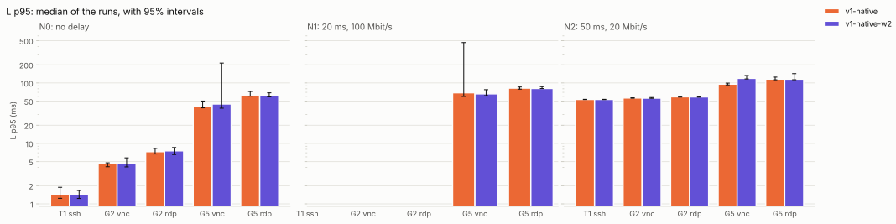
</picture>

### Latency, median

<picture>
  <source media="(prefers-color-scheme: dark)" srcset="latency_p50-dark.svg">
  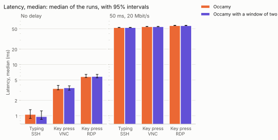
</picture>

### Time to complete

<picture>
  <source media="(prefers-color-scheme: dark)" srcset="completion-dark.svg">
  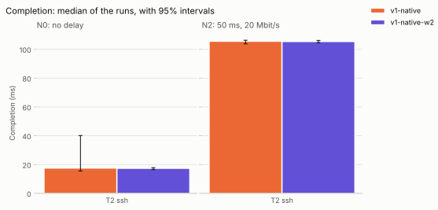
</picture>

### Data to the client

<picture>
  <source media="(prefers-color-scheme: dark)" srcset="bytes_down-dark.svg">
  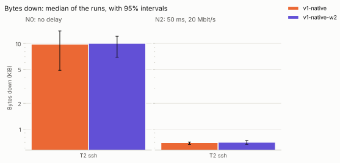
</picture>

### Frames shown a second

<picture>
  <source media="(prefers-color-scheme: dark)" srcset="fps-dark.svg">
  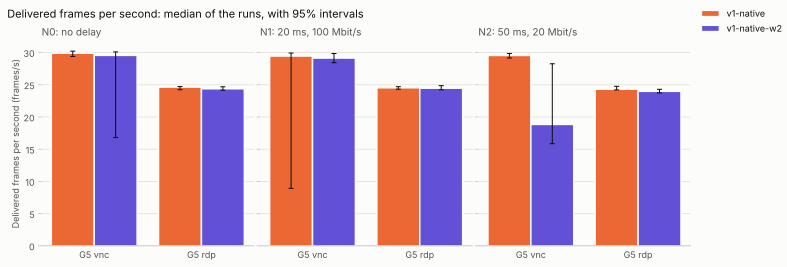
</picture>

### Scene frames never shown

<picture>
  <source media="(prefers-color-scheme: dark)" srcset="scene_missed-dark.svg">
  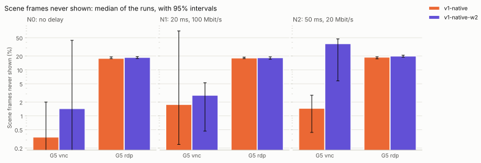
</picture>

### Gap between frames, 95th percentile

<picture>
  <source media="(prefers-color-scheme: dark)" srcset="frame_interval_p95-dark.svg">
  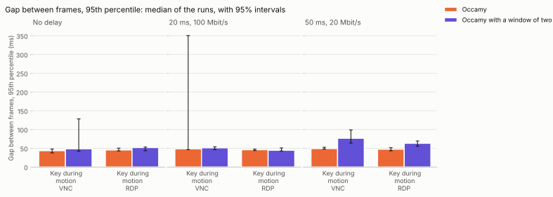
</picture>

### Data per frame

<picture>
  <source media="(prefers-color-scheme: dark)" srcset="bytes_per_frame-dark.svg">
  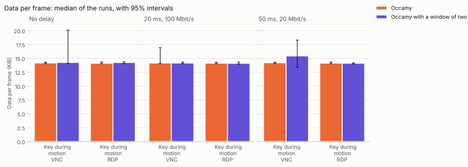
</picture>

### Server CPU per frame

<picture>
  <source media="(prefers-color-scheme: dark)" srcset="cpu_per_frame-dark.svg">
  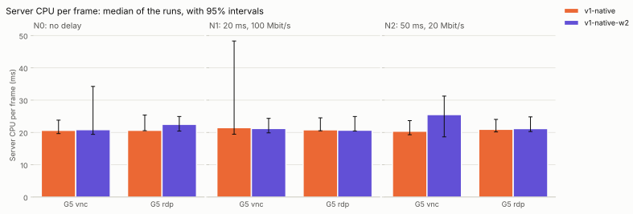
</picture>

### Server CPU time

<picture>
  <source media="(prefers-color-scheme: dark)" srcset="server_cpu-dark.svg">
  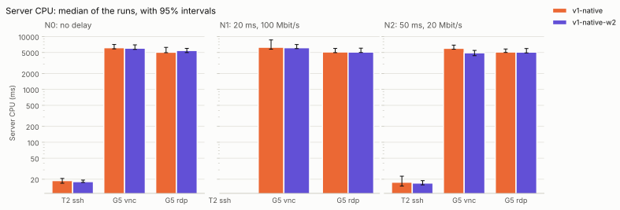
</picture>

### Server memory, peak

<picture>
  <source media="(prefers-color-scheme: dark)" srcset="server_mem-dark.svg">
  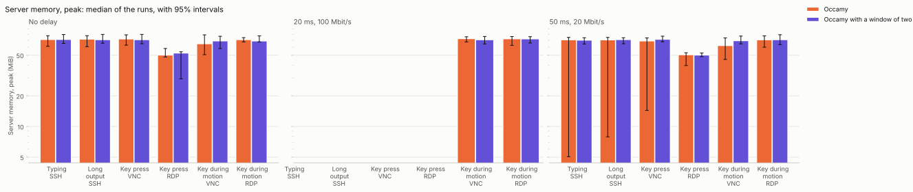
</picture>

### Client CPU time

<picture>
  <source media="(prefers-color-scheme: dark)" srcset="client_cpu-dark.svg">
  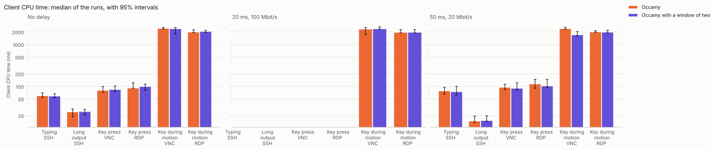
</picture>

### Memory occamyd allocated

<picture>
  <source media="(prefers-color-scheme: dark)" srcset="occamyd_alloc-dark.svg">
  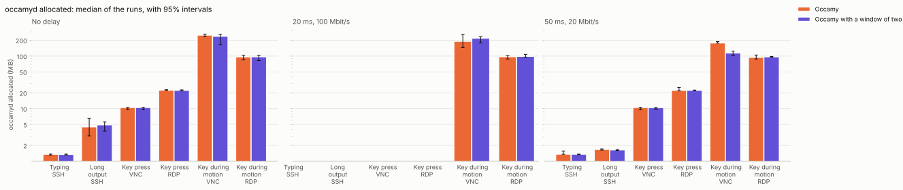
</picture>

### occamyd's garbage collection cycles

<picture>
  <source media="(prefers-color-scheme: dark)" srcset="occamyd_gc-dark.svg">
  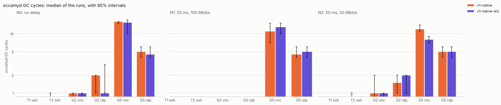
</picture>

### occamyd's heap in use

<picture>
  <source media="(prefers-color-scheme: dark)" srcset="occamyd_heap-dark.svg">
  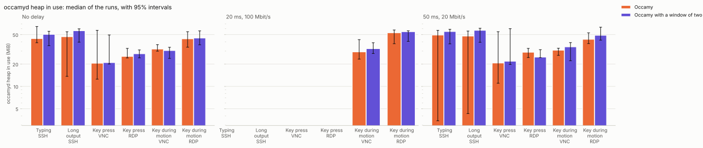
</picture>

### occamyd's goroutines

<picture>
  <source media="(prefers-color-scheme: dark)" srcset="occamyd_goroutines-dark.svg">
  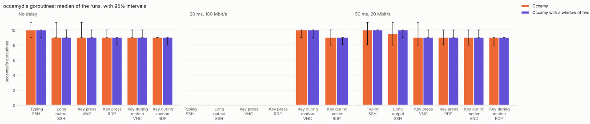
</picture>
