# Occamy against Guacamole

The results in `bench-realtime-2.json`, analysed by `bench/report.py` as [the comparison benchmark's spec](../../../../specs/008-native-architecture/comparison-benchmark.md) fixed before any data.

- Collected from 2026-11-03T00:42:45.33314Z, on Apple M5 Pro (18 CPUs, darwin), podman version 6.0.2.
- 6 runs, seed 20261103, 100 probe keys a scenario per run; load gate 8.
- 352 results analysed, 8 failed.

Values are the median of the runs, with an exact distribution-free 95% interval from order statistics. An improvement is the baseline's value divided by the candidate's, or the candidate's divided by the baseline's for a metric where higher is better, such as frames shown a second, so that above 1× the candidate is better: 3× is a third of the latency, or three times the frames. It is the Hodges–Lehmann estimate of that ratio, with its exact 95% interval from the Mann–Whitney distribution. p is the exact two-sided permutation test of the rank sum over every split of the runs.

## Failed results

| Series | Cell | Network | Run | Error |
|---|---|---|---|---|
| guacd | G5 rdp | N2 | 0 | probe key 2: context deadline exceeded |
| guacd | G5 vnc | N2 | 1 | probe key 58: context deadline exceeded |
| guacd | G5 rdp | N2 | 1 | probe key 10: context deadline exceeded |
| guacd | G5 rdp | N2 | 2 | probe key 5: context deadline exceeded |
| guacd | G5 vnc | N2 | 3 | probe key 20: context deadline exceeded |
| guacd | G5 rdp | N2 | 3 | probe key 10: context deadline exceeded |
| guacd | G5 rdp | N2 | 4 | probe key 2: context deadline exceeded |
| guacd | G5 rdp | N2 | 5 | probe key 47: context deadline exceeded |

## Guacamole to Occamy

The improvement of Occamy (`v1-native`) over Guacamole (`guacd`): above 1×, Occamy is better. Primary metrics, 29 tests, Holm-corrected at 0.05.

| Scenario | Network | Metric | Guacamole | Occamy | Improvement | p | p (Holm) |
|---|---|---|---:|---:|---:|---:|---:|
| Typing, SSH (loss=0%) (T1) | 20 ms, 100 Mbit/s (N1) | Latency, 95th percentile (ms) | 22.2 [22.2, 22.4] | 21.4 [21.3, 21.6] | 1.04× [1.03, 1.05] | 0.0022 | 0.0628 |
| Typing, SSH (loss=0.5%) (T1) | 20 ms, 100 Mbit/s (N1) | Latency, 95th percentile (ms) | 22.4 [22.0, 22.8] | 21.6 [21.4, 22.8] | 1.04× [1.00, 1.06] | 0.0411 | 0.4113 |
| Typing, SSH (loss=2%) (T1) | 20 ms, 100 Mbit/s (N1) | Latency, 95th percentile (ms) | 27.3 [22.3, 31.9] | 22.2 [21.5, 24.4] | 1.18× [0.998, 1.46] | 0.0649 | 0.5844 |
| Key press, VNC (loss=0%) (G2) | 20 ms, 100 Mbit/s (N1) | Latency, 95th percentile (ms) | 35.9 [35.7, 36.4] | 24.4 [24.4, 24.6] | 1.47× [1.46, 1.48] | 0.0022 | 0.0628 |
| Key press, VNC (loss=0.5%) (G2) | 20 ms, 100 Mbit/s (N1) | Latency, 95th percentile (ms) | 35.6 [35.5, 36.1] | 24.5 [24.4, 26.4] | 1.45× [1.37, 1.47] | 0.0022 | 0.0628 |
| Key press, VNC (loss=2%) (G2) | 20 ms, 100 Mbit/s (N1) | Latency, 95th percentile (ms) | 35.8 [35.6, 37.4] | 25.2 [24.4, 52.4] | 1.43× [0.703, 1.47] | 0.3939 | 1.0000 |
| Key press, RDP (loss=0%) (G2) | 20 ms, 100 Mbit/s (N1) | Latency, 95th percentile (ms) | 38.5 [38.2, 38.7] | 27.3 [26.4, 32.4] | 1.41× [1.19, 1.46] | 0.0022 | 0.0628 |
| Key press, RDP (loss=0.5%) (G2) | 20 ms, 100 Mbit/s (N1) | Latency, 95th percentile (ms) | 38.6 [38.0, 39.9] | 27.3 [26.4, 135] | 1.41× [0.295, 1.46] | 0.0649 | 0.5844 |
| Key press, RDP (loss=2%) (G2) | 20 ms, 100 Mbit/s (N1) | Latency, 95th percentile (ms) | 39.9 [38.1, 44.9] | 42.3 [27.7, 73.1] | 0.982× [0.615, 1.41] | 0.9372 | 1.0000 |
| Key during motion, VNC (loss=0%) (G5) | 20 ms, 100 Mbit/s (N1) | Latency, 95th percentile (ms) | 132 [123, 172] | 59.1 [56.3, 93.6] | 2.23× [1.84, 2.42] | 0.0022 | 0.0628 |
| Key during motion, VNC (loss=0.5%) (G5) | 20 ms, 100 Mbit/s (N1) | Latency, 95th percentile (ms) | 164 [152, 184] | 68.7 [63.8, 132] | 2.35× [1.40, 2.67] | 0.0022 | 0.0628 |
| Key during motion, VNC (loss=2%) (G5) | 20 ms, 100 Mbit/s (N1) | Latency, 95th percentile (ms) | 255 [209, 2,857] | 119 [104, 153] | 2.16× [1.69, 18.6] | 0.0022 | 0.0628 |
| Key during motion, RDP (loss=0%) (G5) | 20 ms, 100 Mbit/s (N1) | Latency, 95th percentile (ms) | 121 [117, 130] | 80.6 [80.4, 118] | 1.50× [1.10, 1.57] | 0.0043 | 0.0628 |
| Key during motion, RDP (loss=0.5%) (G5) | 20 ms, 100 Mbit/s (N1) | Latency, 95th percentile (ms) | 165 [153, 1,734] | 96.5 [92.5, 98.0] | 1.73× [1.60, 17.7] | 0.0022 | 0.0628 |
| Key during motion, RDP (loss=2%) (G5) | 20 ms, 100 Mbit/s (N1) | Latency, 95th percentile (ms) | 2,188 [264, 4,186] | 149 [120, 171] | 7.85× [1.82, 28.5] | 0.0022 | 0.0628 |
| Typing, SSH (loss=0%) (T1) | 50 ms, 20 Mbit/s (N2) | Latency, 95th percentile (ms) | 52.6 [52.3, 55.5] | 51.7 [51.5, 52.0] | 1.02× [1.01, 1.07] | 0.0022 | 0.0628 |
| Typing, SSH (loss=0.5%) (T1) | 50 ms, 20 Mbit/s (N2) | Latency, 95th percentile (ms) | 52.5 [52.4, 53.2] | 51.6 [51.5, 52.0] | 1.02× [1.01, 1.03] | 0.0022 | 0.0628 |
| Typing, SSH (loss=2%) (T1) | 50 ms, 20 Mbit/s (N2) | Latency, 95th percentile (ms) | 52.7 [52.4, 55.7] | 52.7 [51.7, 117] | 1.00× [0.475, 1.02] | 0.9372 | 1.0000 |
| Key press, VNC (loss=0%) (G2) | 50 ms, 20 Mbit/s (N2) | Latency, 95th percentile (ms) | 66.0 [65.7, 71.5] | 54.6 [54.4, 56.1] | 1.21× [1.20, 1.27] | 0.0022 | 0.0628 |
| Key press, VNC (loss=0.5%) (G2) | 50 ms, 20 Mbit/s (N2) | Latency, 95th percentile (ms) | 66.1 [65.7, 71.6] | 54.5 [54.4, 101] | 1.21× [0.71, 1.27] | 0.0649 | 0.5844 |
| Key press, VNC (loss=2%) (G2) | 50 ms, 20 Mbit/s (N2) | Latency, 95th percentile (ms) | 66.2 [66.1, 66.5] | 54.9 [54.4, 118] | 1.21× [0.563, 1.22] | 0.0649 | 0.5844 |
| Key press, RDP (loss=0%) (G2) | 50 ms, 20 Mbit/s (N2) | Latency, 95th percentile (ms) | 69.0 [68.3, 71.4] | 56.8 [56.7, 58.7] | 1.21× [1.20, 1.22] | 0.0022 | 0.0628 |
| Key press, RDP (loss=0.5%) (G2) | 50 ms, 20 Mbit/s (N2) | Latency, 95th percentile (ms) | 68.8 [68.0, 69.9] | 57.2 [56.5, 59.4] | 1.20× [1.16, 1.22] | 0.0022 | 0.0628 |
| Key press, RDP (loss=2%) (G2) | 50 ms, 20 Mbit/s (N2) | Latency, 95th percentile (ms) | 77.6 [67.7, 81.0] | 57.9 [56.9, 123] | 1.21× [0.658, 1.39] | 0.1320 | 0.5844 |
| Key during motion, VNC (loss=0%) (G5) | 50 ms, 20 Mbit/s (N2) | Latency, 95th percentile (ms) | 184 [169, 219] | 98.2 [90.7, 971] | 1.92× [0.226, 2.27] | 0.0649 | 0.5844 |
| Key during motion, VNC (loss=0.5%) (G5) | 50 ms, 20 Mbit/s (N2) | Latency, 95th percentile (ms) | 339 [276, 3,942] | 169 [129, 249] | 2.18× [1.43, 22.5] | 0.0022 | 0.0628 |
| Key during motion, VNC (loss=2%) (G5) | 50 ms, 20 Mbit/s (N2) | Latency, 95th percentile (ms) | 7,053 | 379 [350, 430] | 18.0× [14.5, 22.5] | 0.0095 | 0.1048 |
| Key during motion, RDP (loss=0%) (G5) | 50 ms, 20 Mbit/s (N2) | Latency, 95th percentile (ms) | 179 [172, 226] | 113 [111, 114] | 1.59× [1.55, 1.98] | 0.0022 | 0.0628 |
| Key during motion, RDP (loss=0.5%) (G5) | 50 ms, 20 Mbit/s (N2) | Latency, 95th percentile (ms) | 5,575 [362, 7,941] | 196 [166, 273] | 27.1× [2.18, 36.3] | 0.0022 | 0.0628 |

0 of 29 differences are significant after correction. With these runs the exact test's smallest p is 0.0022, so after the correction over 29 tests none could be; the intervals carry the evidence.

<picture>
  <source media="(prefers-color-scheme: dark)" srcset="factors-guacamole-to-occamy-dark.svg">
  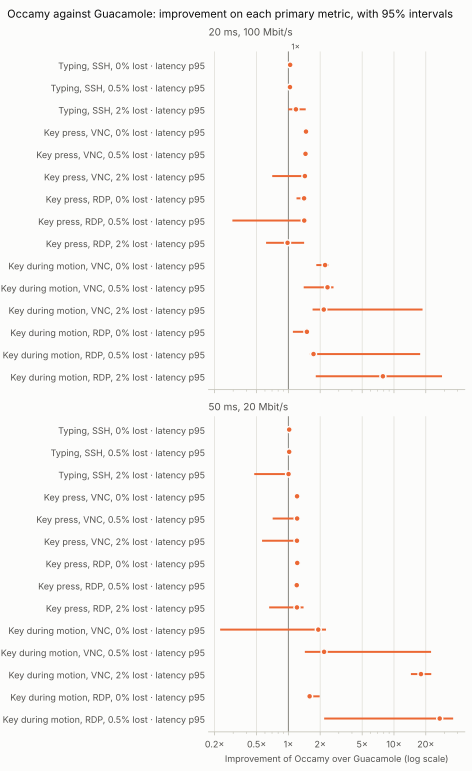
</picture>

### Guacamole to Occamy: secondary metrics

Exploratory: the p-values are not corrected.

| Scenario | Network | Metric | Guacamole | Occamy | Improvement | p |
|---|---|---|---:|---:|---:|---:|
| Typing, SSH (loss=0%) (T1) | 20 ms, 100 Mbit/s (N1) | Latency, median (ms) | 21.8 [21.6, 21.9] | 21.1 [21.0, 21.1] | 1.04× [1.03, 1.04] | 0.0022 |
| Typing, SSH (loss=0%) (T1) | 20 ms, 100 Mbit/s (N1) | Server memory, peak (MiB) | 93.2 [42.0, 147] | 67.3 [16.3, 78.5] | 1.67× [0.609, 6.05] | 0.1797 |
| Typing, SSH (loss=0%) (T1) | 20 ms, 100 Mbit/s (N1) | Client CPU time (ms) | 58.3 [52.3, 64.7] | 51.1 [43.8, 55.1] | 1.18× [1.03, 1.30] | 0.0043 |
| Typing, SSH (loss=0.5%) (T1) | 20 ms, 100 Mbit/s (N1) | Latency, median (ms) | 21.7 [21.5, 21.9] | 21.1 [21.0, 21.4] | 1.03× [1.02, 1.04] | 0.0022 |
| Typing, SSH (loss=0.5%) (T1) | 20 ms, 100 Mbit/s (N1) | Server memory, peak (MiB) | 95.0 [39.7, 124] | 71.0 [18.5, 73.2] | 1.59× [0.587, 2.18] | 0.2403 |
| Typing, SSH (loss=0.5%) (T1) | 20 ms, 100 Mbit/s (N1) | Client CPU time (ms) | 56.0 [53.2, 59.0] | 47.3 [43.8, 63.6] | 1.20× [0.928, 1.29] | 0.0649 |
| Typing, SSH (loss=2%) (T1) | 20 ms, 100 Mbit/s (N1) | Latency, median (ms) | 21.8 [21.7, 21.9] | 21.1 [21.0, 21.2] | 1.03× [1.03, 1.04] | 0.0022 |
| Typing, SSH (loss=2%) (T1) | 20 ms, 100 Mbit/s (N1) | Server memory, peak (MiB) | 94.8 [42.0, 148] | 68.6 [10.8, 75.2] | 1.99× [0.575, 3.89] | 0.6667 |
| Typing, SSH (loss=2%) (T1) | 20 ms, 100 Mbit/s (N1) | Client CPU time (ms) | 58.9 [54.1, 67.3] | 50.4 [45.6, 57.1] | 1.17× [1.04, 1.29] | 0.0260 |
| Key press, VNC (loss=0%) (G2) | 20 ms, 100 Mbit/s (N1) | Latency, median (ms) | 34.8 [34.7, 35.0] | 23.8 [23.7, 23.9] | 1.46× [1.46, 1.47] | 0.0022 |
| Key press, VNC (loss=0%) (G2) | 20 ms, 100 Mbit/s (N1) | Server memory, peak (MiB) | 85.9 [50.5, 123] | 70.6 [23.4, 78.5] | 1.65× [0.68, 4.88] | 0.3939 |
| Key press, VNC (loss=0%) (G2) | 20 ms, 100 Mbit/s (N1) | Client CPU time (ms) | 63.2 [58.2, 517] | 63.4 [52.5, 64.9] | 1.10× [0.948, 7.95] | 0.4848 |
| Key press, VNC (loss=0.5%) (G2) | 20 ms, 100 Mbit/s (N1) | Latency, median (ms) | 34.7 [34.7, 34.8] | 23.7 [23.7, 24.1] | 1.46× [1.44, 1.47] | 0.0022 |
| Key press, VNC (loss=0.5%) (G2) | 20 ms, 100 Mbit/s (N1) | Server memory, peak (MiB) | 86.3 [30.9, 123] | 71.5 [25.6, 73.8] | 1.66× [0.667, 2.17] | 0.6991 |
| Key press, VNC (loss=0.5%) (G2) | 20 ms, 100 Mbit/s (N1) | Client CPU time (ms) | 64.6 [60.6, 69.1] | 57.9 [53.2, 74.0] | 1.12× [0.934, 1.20] | 0.0649 |
| Key press, VNC (loss=2%) (G2) | 20 ms, 100 Mbit/s (N1) | Latency, median (ms) | 34.7 [34.7, 34.9] | 23.7 [23.6, 23.8] | 1.47× [1.46, 1.47] | 0.0022 |
| Key press, VNC (loss=2%) (G2) | 20 ms, 100 Mbit/s (N1) | Server memory, peak (MiB) | 86.4 [50.0, 123] | 68.5 [17.6, 78.8] | 1.61× [0.689, 2.84] | 0.3939 |
| Key press, VNC (loss=2%) (G2) | 20 ms, 100 Mbit/s (N1) | Client CPU time (ms) | 59.8 [58.5, 68.5] | 59.3 [52.7, 60.5] | 1.03× [0.987, 1.15] | 0.3095 |
| Key press, RDP (loss=0%) (G2) | 20 ms, 100 Mbit/s (N1) | Latency, median (ms) | 37.1 [37.0, 37.3] | 25.9 [25.8, 26.2] | 1.43× [1.42, 1.44] | 0.0022 |
| Key press, RDP (loss=0%) (G2) | 20 ms, 100 Mbit/s (N1) | Server memory, peak (MiB) | 110 [72.0, 145] | 52.7 [49.3, 68.7] | 1.80× [1.36, 2.89] | 0.0022 |
| Key press, RDP (loss=0%) (G2) | 20 ms, 100 Mbit/s (N1) | Client CPU time (ms) | 68.6 [64.0, 454] | 66.6 [59.7, 210] | 1.05× [0.884, 2.16] | 0.6991 |
| Key press, RDP (loss=0.5%) (G2) | 20 ms, 100 Mbit/s (N1) | Latency, median (ms) | 37.1 [37.0, 37.2] | 25.9 [25.9, 33.6] | 1.43× [1.11, 1.43] | 0.0022 |
| Key press, RDP (loss=0.5%) (G2) | 20 ms, 100 Mbit/s (N1) | Server memory, peak (MiB) | 108 [71.5, 145] | 52.8 [47.5, 54.1] | 2.01× [1.35, 2.89] | 0.0022 |
| Key press, RDP (loss=0.5%) (G2) | 20 ms, 100 Mbit/s (N1) | Client CPU time (ms) | 68.5 [66.4, 482] | 63.2 [57.5, 87.6] | 1.10× [1.01, 5.50] | 0.0411 |
| Key press, RDP (loss=2%) (G2) | 20 ms, 100 Mbit/s (N1) | Latency, median (ms) | 37.1 [37.0, 37.2] | 25.9 [25.9, 26.0] | 1.43× [1.43, 1.44] | 0.0022 |
| Key press, RDP (loss=2%) (G2) | 20 ms, 100 Mbit/s (N1) | Server memory, peak (MiB) | 99.0 [71.6, 144] | 55.2 [49.0, 60.8] | 1.75× [1.27, 2.65] | 0.0022 |
| Key press, RDP (loss=2%) (G2) | 20 ms, 100 Mbit/s (N1) | Client CPU time (ms) | 66.4 [65.0, 70.7] | 64.0 [58.5, 212] | 1.04× [0.334, 1.12] | 0.0649 |
| Key during motion, VNC (loss=0%) (G5) | 20 ms, 100 Mbit/s (N1) | Frames shown per second (frames/s) | 27.2 [24.4, 28.1] | 29.8 [28.1, 30.2] | 1.09× [1.06, 1.15] | 0.0043 |
| Key during motion, VNC (loss=0%) (G5) | 20 ms, 100 Mbit/s (N1) | Scene frames never shown (%) | 9.17 [6.24, 18.6] | 0.829 [-0.502, 6.25] | –× | 0.0043 |
| Key during motion, VNC (loss=0%) (G5) | 20 ms, 100 Mbit/s (N1) | Gap between frames, 95th percentile (ms) | 59.6 [55.5, 75.3] | 48.0 [47.2, 52.3] | 1.23× [1.15, 1.44] | 0.0022 |
| Key during motion, VNC (loss=0%) (G5) | 20 ms, 100 Mbit/s (N1) | Data per frame (KiB) | 49.8 [49.0, 51.2] | 14.2 [14.1, 14.4] | 3.51× [3.46, 3.57] | 0.0022 |
| Key during motion, VNC (loss=0%) (G5) | 20 ms, 100 Mbit/s (N1) | Server CPU per frame (ms) | 46.1 [45.4, 51.0] | 19.2 [18.8, 20.5] | 2.41× [2.30, 2.51] | 0.0022 |
| Key during motion, VNC (loss=0%) (G5) | 20 ms, 100 Mbit/s (N1) | Server CPU time (ms) | 12,714 [12,449, 14,333] | 5,674 [5,635, 5,854] | 2.24× [2.19, 2.45] | 0.0022 |
| Key during motion, VNC (loss=0%) (G5) | 20 ms, 100 Mbit/s (N1) | Server memory, peak (MiB) | 86.4 [50.2, 123] | 70.3 [53.3, 76.2] | 1.24× [0.682, 2.19] | 1.0000 |
| Key during motion, VNC (loss=0%) (G5) | 20 ms, 100 Mbit/s (N1) | Client CPU time (ms) | 5,019 [4,945, 5,650] | 2,121 [2,104, 2,227] | 2.35× [2.26, 2.54] | 0.0022 |
| Key during motion, VNC (loss=0.5%) (G5) | 20 ms, 100 Mbit/s (N1) | Frames shown per second (frames/s) | 24.4 [23.2, 25.7] | 29.7 [26.5, 29.8] | 1.21× [1.14, 1.25] | 0.0022 |
| Key during motion, VNC (loss=0.5%) (G5) | 20 ms, 100 Mbit/s (N1) | Scene frames never shown (%) | 18.7 [14.3, 22.6] | 0.941 [0.546, 11.8] | 19.9× [1.92, 32.6] | 0.0022 |
| Key during motion, VNC (loss=0.5%) (G5) | 20 ms, 100 Mbit/s (N1) | Gap between frames, 95th percentile (ms) | 74.6 [69.4, 83.3] | 58.5 [54.6, 71.7] | 1.28× [1.14, 1.41] | 0.0087 |
| Key during motion, VNC (loss=0.5%) (G5) | 20 ms, 100 Mbit/s (N1) | Data per frame (KiB) | 44.3 [40.6, 47.8] | 14.2 [14.1, 14.3] | 3.11× [2.87, 3.35] | 0.0022 |
| Key during motion, VNC (loss=0.5%) (G5) | 20 ms, 100 Mbit/s (N1) | Server CPU per frame (ms) | 45.5 [44.6, 46.4] | 19.1 [18.9, 27.0] | 2.39× [1.72, 2.43] | 0.0022 |
| Key during motion, VNC (loss=0.5%) (G5) | 20 ms, 100 Mbit/s (N1) | Server CPU time (ms) | 12,549 [12,276, 12,943] | 5,643 [5,607, 7,191] | 2.21× [1.80, 2.25] | 0.0022 |
| Key during motion, VNC (loss=0.5%) (G5) | 20 ms, 100 Mbit/s (N1) | Server memory, peak (MiB) | 86.5 [44.1, 123] | 66.1 [51.3, 73.3] | 1.29× [0.694, 2.24] | 1.0000 |
| Key during motion, VNC (loss=0.5%) (G5) | 20 ms, 100 Mbit/s (N1) | Client CPU time (ms) | 5,055 [4,971, 5,186] | 2,148 [2,076, 2,289] | 2.35× [2.26, 2.42] | 0.0022 |
| Key during motion, VNC (loss=2%) (G5) | 20 ms, 100 Mbit/s (N1) | Frames shown per second (frames/s) | 16.1 [1.08, 16.6] | 27.8 [27.0, 28.6] | 1.73× [1.67, 25.1] | 0.0022 |
| Key during motion, VNC (loss=2%) (G5) | 20 ms, 100 Mbit/s (N1) | Scene frames never shown (%) | 46.4 [44.7, 96.4] | 7.45 [4.82, 9.89] | 9.15× [5.49, 12.8] | 0.0022 |
| Key during motion, VNC (loss=2%) (G5) | 20 ms, 100 Mbit/s (N1) | Gap between frames, 95th percentile (ms) | 121 [108, 1,553] | 67.7 [62.8, 72.4] | 1.80× [1.62, 21.5] | 0.0022 |
| Key during motion, VNC (loss=2%) (G5) | 20 ms, 100 Mbit/s (N1) | Data per frame (KiB) | 32.9 [31.5, 551] | 14.3 [14.1, 14.4] | 2.31× [2.20, 38.3] | 0.0022 |
| Key during motion, VNC (loss=2%) (G5) | 20 ms, 100 Mbit/s (N1) | Server CPU per frame (ms) | 49.4 [48.6, 336] | 19.5 [19.1, 20.8] | 2.54× [2.47, 16.1] | 0.0022 |
| Key during motion, VNC (loss=2%) (G5) | 20 ms, 100 Mbit/s (N1) | Server CPU time (ms) | 12,714 [12,293, 67,251] | 5,486 [5,340, 5,789] | 2.32× [2.23, 11.6] | 0.0022 |
| Key during motion, VNC (loss=2%) (G5) | 20 ms, 100 Mbit/s (N1) | Server memory, peak (MiB) | 86.6 [50.3, 123] | 58.6 [49.5, 78.3] | 1.27× [0.751, 2.44] | 0.2403 |
| Key during motion, VNC (loss=2%) (G5) | 20 ms, 100 Mbit/s (N1) | Client CPU time (ms) | 4,933 [4,719, 7,602] | 2,044 [1,904, 2,283] | 2.45× [2.28, 3.33] | 0.0022 |
| Key during motion, RDP (loss=0%) (G5) | 20 ms, 100 Mbit/s (N1) | Frames shown per second (frames/s) | 24.3 [24.0, 24.6] | 24.4 [23.6, 24.9] | 1.01× [0.984, 1.02] | 0.6991 |
| Key during motion, RDP (loss=0%) (G5) | 20 ms, 100 Mbit/s (N1) | Scene frames never shown (%) | 18.8 [18.1, 20.0] | 18.7 [17.1, 21.3] | 1.02× [0.939, 1.10] | 0.6991 |
| Key during motion, RDP (loss=0%) (G5) | 20 ms, 100 Mbit/s (N1) | Gap between frames, 95th percentile (ms) | 48.7 [46.3, 53.8] | 43.5 [41.5, 69.5] | 1.11× [0.774, 1.17] | 0.0931 |
| Key during motion, RDP (loss=0%) (G5) | 20 ms, 100 Mbit/s (N1) | Data per frame (KiB) | 66.2 [66.1, 67.2] | 14.2 [14.0, 14.3] | 4.70× [4.63, 4.76] | 0.0022 |
| Key during motion, RDP (loss=0%) (G5) | 20 ms, 100 Mbit/s (N1) | Server CPU per frame (ms) | 55.4 [54.6, 56.1] | 19.9 [19.3, 25.7] | 2.77× [2.19, 2.84] | 0.0022 |
| Key during motion, RDP (loss=0%) (G5) | 20 ms, 100 Mbit/s (N1) | Server CPU time (ms) | 13,451 [13,357, 13,635] | 4,834 [4,789, 6,214] | 2.78× [2.19, 2.83] | 0.0022 |
| Key during motion, RDP (loss=0%) (G5) | 20 ms, 100 Mbit/s (N1) | Server memory, peak (MiB) | 107 [64.4, 141] | 73.1 [67.7, 77.4] | 1.40× [0.909, 2.01] | 0.6991 |
| Key during motion, RDP (loss=0%) (G5) | 20 ms, 100 Mbit/s (N1) | Client CPU time (ms) | 5,776 [5,583, 5,838] | 1,775 [1,679, 1,807] | 3.25× [3.17, 3.37] | 0.0022 |
| Key during motion, RDP (loss=0.5%) (G5) | 20 ms, 100 Mbit/s (N1) | Frames shown per second (frames/s) | 22.3 [4.58, 22.9] | 24.3 [24.1, 24.6] | 1.09× [1.06, 5.26] | 0.0022 |
| Key during motion, RDP (loss=0.5%) (G5) | 20 ms, 100 Mbit/s (N1) | Scene frames never shown (%) | 25.7 [23.5, 84.7] | 18.9 [18.1, 19.7] | 1.35× [1.23, 4.30] | 0.0022 |
| Key during motion, RDP (loss=0.5%) (G5) | 20 ms, 100 Mbit/s (N1) | Gap between frames, 95th percentile (ms) | 82.2 [73.5, 877] | 59.3 [55.9, 59.6] | 1.39× [1.29, 14.7] | 0.0022 |
| Key during motion, RDP (loss=0.5%) (G5) | 20 ms, 100 Mbit/s (N1) | Data per frame (KiB) | 50.1 [47.1, 300] | 14.2 [14.1, 14.3] | 3.52× [3.33, 20.9] | 0.0022 |
| Key during motion, RDP (loss=0.5%) (G5) | 20 ms, 100 Mbit/s (N1) | Server CPU per frame (ms) | 51.1 [50.7, 185] | 20.0 [19.7, 20.3] | 2.56× [2.52, 9.09] | 0.0022 |
| Key during motion, RDP (loss=0.5%) (G5) | 20 ms, 100 Mbit/s (N1) | Server CPU time (ms) | 14,467 [13,887, 48,582] | 4,833 [4,794, 4,938] | 2.98× [2.89, 9.84] | 0.0022 |
| Key during motion, RDP (loss=0.5%) (G5) | 20 ms, 100 Mbit/s (N1) | Server memory, peak (MiB) | 106 [62.8, 144] | 72.0 [67.9, 78.2] | 1.38× [0.907, 2.04] | 0.5887 |
| Key during motion, RDP (loss=0.5%) (G5) | 20 ms, 100 Mbit/s (N1) | Client CPU time (ms) | 6,487 [6,232, 9,133] | 1,807 [1,739, 1,833] | 3.59× [3.46, 4.98] | 0.0022 |
| Key during motion, RDP (loss=2%) (G5) | 20 ms, 100 Mbit/s (N1) | Frames shown per second (frames/s) | 6.64 [0.591, 14.4] | 24.4 [24.0, 24.8] | 8.78× [1.70, 40.7] | 0.0022 |
| Key during motion, RDP (loss=2%) (G5) | 20 ms, 100 Mbit/s (N1) | Scene frames never shown (%) | 77.9 [52.0, 98.0] | 18.7 [17.2, 20.0] | 4.06× [2.75, 5.49] | 0.0022 |
| Key during motion, RDP (loss=2%) (G5) | 20 ms, 100 Mbit/s (N1) | Gap between frames, 95th percentile (ms) | 1,211 [131, 2,426] | 64.8 [62.2, 72.1] | 9.09× [2.07, 38.1] | 0.0022 |
| Key during motion, RDP (loss=2%) (G5) | 20 ms, 100 Mbit/s (N1) | Data per frame (KiB) | 537 [33.8, 1,055] | 14.1 [14.1, 14.2] | 13.6× [2.40, 74.4] | 0.0022 |
| Key during motion, RDP (loss=2%) (G5) | 20 ms, 100 Mbit/s (N1) | Server CPU per frame (ms) | 378 [54.4, 721] | 19.8 [19.7, 19.9] | 10.0× [2.76, 36.3] | 0.0022 |
| Key during motion, RDP (loss=2%) (G5) | 20 ms, 100 Mbit/s (N1) | Server CPU time (ms) | 76,455 [13,653, 142,099] | 4,899 [4,865, 4,979] | 9.05× [2.81, 29.0] | 0.0022 |
| Key during motion, RDP (loss=2%) (G5) | 20 ms, 100 Mbit/s (N1) | Server memory, peak (MiB) | 103 [63.8, 143] | 73.7 [65.2, 81.4] | 1.35× [0.888, 1.99] | 0.5887 |
| Key during motion, RDP (loss=2%) (G5) | 20 ms, 100 Mbit/s (N1) | Client CPU time (ms) | 8,835 [5,608, 12,098] | 1,839 [1,812, 1,898] | 4.49× [3.05, 6.56] | 0.0022 |
| Typing, SSH (loss=0%) (T1) | 50 ms, 20 Mbit/s (N2) | Latency, median (ms) | 52.0 [52.0, 52.2] | 51.2 [51.1, 51.3] | 1.02× [1.01, 1.02] | 0.0022 |
| Typing, SSH (loss=0%) (T1) | 50 ms, 20 Mbit/s (N2) | Server memory, peak (MiB) | 95.0 [42.0, 124] | 65.1 [12.7, 70.2] | 1.64× [1.08, 3.30] | 0.0411 |
| Typing, SSH (loss=0%) (T1) | 50 ms, 20 Mbit/s (N2) | Client CPU time (ms) | 57.4 [51.4, 67.0] | 50.6 [46.1, 59.3] | 1.14× [0.995, 1.30] | 0.0931 |
| Typing, SSH (loss=0.5%) (T1) | 50 ms, 20 Mbit/s (N2) | Latency, median (ms) | 52.1 [52.0, 52.3] | 51.1 [51.1, 51.5] | 1.02× [1.02, 1.02] | 0.0022 |
| Typing, SSH (loss=0.5%) (T1) | 50 ms, 20 Mbit/s (N2) | Server memory, peak (MiB) | 95.0 [41.8, 148] | 68.3 [15.2, 81.2] | 1.63× [0.648, 2.76] | 0.3095 |
| Typing, SSH (loss=0.5%) (T1) | 50 ms, 20 Mbit/s (N2) | Client CPU time (ms) | 63.1 [56.2, 68.2] | 48.3 [42.1, 59.1] | 1.29× [1.11, 1.43] | 0.0087 |
| Typing, SSH (loss=2%) (T1) | 50 ms, 20 Mbit/s (N2) | Latency, median (ms) | 52.0 [51.9, 52.2] | 51.1 [51.0, 51.4] | 1.02× [1.02, 1.02] | 0.0022 |
| Typing, SSH (loss=2%) (T1) | 50 ms, 20 Mbit/s (N2) | Server memory, peak (MiB) | 112 [75.9, 148] | 68.4 [7.14, 70.8] | 2.13× [1.09, 10.6] | 0.0022 |
| Typing, SSH (loss=2%) (T1) | 50 ms, 20 Mbit/s (N2) | Client CPU time (ms) | 56.2 [50.2, 65.2] | 46.2 [45.1, 50.9] | 1.20× [1.10, 1.37] | 0.0043 |
| Key press, VNC (loss=0%) (G2) | 50 ms, 20 Mbit/s (N2) | Latency, median (ms) | 65.1 [64.9, 65.5] | 53.9 [53.8, 54.0] | 1.21× [1.20, 1.22] | 0.0022 |
| Key press, VNC (loss=0%) (G2) | 50 ms, 20 Mbit/s (N2) | Server memory, peak (MiB) | 86.5 [50.0, 123] | 67.4 [18.8, 73.2] | 1.69× [0.707, 2.65] | 0.6991 |
| Key press, VNC (loss=0%) (G2) | 50 ms, 20 Mbit/s (N2) | Client CPU time (ms) | 65.5 [59.6, 73.3] | 60.9 [58.2, 67.2] | 1.07× [0.964, 1.20] | 0.3095 |
| Key press, VNC (loss=0.5%) (G2) | 50 ms, 20 Mbit/s (N2) | Latency, median (ms) | 65.1 [64.8, 65.9] | 53.8 [53.7, 55.3] | 1.21× [1.19, 1.21] | 0.0022 |
| Key press, VNC (loss=0.5%) (G2) | 50 ms, 20 Mbit/s (N2) | Server memory, peak (MiB) | 86.9 [50.3, 123] | 60.2 [21.5, 82.2] | 1.71× [0.708, 4.70] | 0.1797 |
| Key press, VNC (loss=0.5%) (G2) | 50 ms, 20 Mbit/s (N2) | Client CPU time (ms) | 60.8 [59.1, 77.5] | 59.1 [57.3, 75.6] | 1.03× [0.984, 1.19] | 0.1320 |
| Key press, VNC (loss=2%) (G2) | 50 ms, 20 Mbit/s (N2) | Latency, median (ms) | 65.1 [65.0, 65.5] | 53.8 [53.8, 54.1] | 1.21× [1.21, 1.21] | 0.0022 |
| Key press, VNC (loss=2%) (G2) | 50 ms, 20 Mbit/s (N2) | Server memory, peak (MiB) | 86.5 [50.0, 123] | 70.3 [13.8, 73.4] | 1.71× [0.699, 4.82] | 0.3680 |
| Key press, VNC (loss=2%) (G2) | 50 ms, 20 Mbit/s (N2) | Client CPU time (ms) | 63.5 [57.4, 76.6] | 57.9 [53.6, 72.0] | 1.09× [0.925, 1.21] | 0.0931 |
| Key press, RDP (loss=0%) (G2) | 50 ms, 20 Mbit/s (N2) | Latency, median (ms) | 67.2 [67.1, 67.9] | 56.1 [56.0, 56.5] | 1.20× [1.19, 1.21] | 0.0022 |
| Key press, RDP (loss=0%) (G2) | 50 ms, 20 Mbit/s (N2) | Server memory, peak (MiB) | 109 [71.6, 146] | 51.4 [30.4, 53.9] | 2.53× [1.39, 3.11] | 0.0022 |
| Key press, RDP (loss=0%) (G2) | 50 ms, 20 Mbit/s (N2) | Client CPU time (ms) | 72.5 [68.0, 395] | 64.9 [61.4, 86.8] | 1.12× [0.956, 4.55] | 0.1320 |
| Key press, RDP (loss=0.5%) (G2) | 50 ms, 20 Mbit/s (N2) | Latency, median (ms) | 67.2 [67.1, 67.4] | 56.0 [55.9, 56.7] | 1.20× [1.19, 1.20] | 0.0022 |
| Key press, RDP (loss=0.5%) (G2) | 50 ms, 20 Mbit/s (N2) | Server memory, peak (MiB) | 111 [71.9, 145] | 52.7 [49.4, 56.2] | 2.01× [1.35, 2.86] | 0.0022 |
| Key press, RDP (loss=0.5%) (G2) | 50 ms, 20 Mbit/s (N2) | Client CPU time (ms) | 67.4 [63.4, 388] | 64.5 [58.0, 82.8] | 1.08× [0.947, 4.69] | 0.3095 |
| Key press, RDP (loss=2%) (G2) | 50 ms, 20 Mbit/s (N2) | Latency, median (ms) | 67.2 [67.1, 67.3] | 56.0 [56.0, 56.2] | 1.20× [1.20, 1.20] | 0.0022 |
| Key press, RDP (loss=2%) (G2) | 50 ms, 20 Mbit/s (N2) | Server memory, peak (MiB) | 98.3 [52.6, 144] | 51.7 [47.1, 55.5] | 1.85× [1.12, 2.84] | 0.0152 |
| Key press, RDP (loss=2%) (G2) | 50 ms, 20 Mbit/s (N2) | Client CPU time (ms) | 63.9 [61.1, 71.4] | 61.1 [59.3, 62.7] | 1.05× [1.00, 1.14] | 0.0411 |
| Key during motion, VNC (loss=0%) (G5) | 50 ms, 20 Mbit/s (N2) | Frames shown per second (frames/s) | 26.0 [22.8, 26.8] | 29.7 [10.8, 30.1] | 1.14× [0.475, 1.24] | 0.0649 |
| Key during motion, VNC (loss=0%) (G5) | 50 ms, 20 Mbit/s (N2) | Scene frames never shown (%) | 13.3 [10.6, 24.1] | 1.15 [-0.418, 63.9] | –× | 0.0649 |
| Key during motion, VNC (loss=0%) (G5) | 50 ms, 20 Mbit/s (N2) | Gap between frames, 95th percentile (ms) | 66.6 [60.6, 76.0] | 49.4 [47.2, 386] | 1.32× [0.197, 1.49] | 0.0649 |
| Key during motion, VNC (loss=0%) (G5) | 50 ms, 20 Mbit/s (N2) | Data per frame (KiB) | 46.1 [46.0, 47.5] | 14.2 [14.1, 19.9] | 3.26× [2.39, 3.31] | 0.0022 |
| Key during motion, VNC (loss=0%) (G5) | 50 ms, 20 Mbit/s (N2) | Server CPU per frame (ms) | 45.4 [44.5, 52.1] | 19.3 [18.7, 36.2] | 2.36× [1.44, 2.60] | 0.0022 |
| Key during motion, VNC (loss=0%) (G5) | 50 ms, 20 Mbit/s (N2) | Server CPU time (ms) | 16,652 [16,255, 19,031] | 5,752 [5,634, 8,653] | 2.89× [2.20, 3.24] | 0.0022 |
| Key during motion, VNC (loss=0%) (G5) | 50 ms, 20 Mbit/s (N2) | Server memory, peak (MiB) | 85.7 [49.1, 121] | 67.1 [48.5, 73.2] | 1.31× [0.707, 2.37] | 0.6991 |
| Key during motion, VNC (loss=0%) (G5) | 50 ms, 20 Mbit/s (N2) | Client CPU time (ms) | 6,779 [6,482, 7,940] | 2,236 [2,076, 2,412] | 3.06× [2.89, 3.51] | 0.0022 |
| Key during motion, VNC (loss=0.5%) (G5) | 50 ms, 20 Mbit/s (N2) | Frames shown per second (frames/s) | 13.8 [1.85, 20.2] | 27.5 [25.4, 29.0] | 2.01× [1.44, 13.7] | 0.0022 |
| Key during motion, VNC (loss=0.5%) (G5) | 50 ms, 20 Mbit/s (N2) | Scene frames never shown (%) | 54.2 [32.8, 93.8] | 8.40 [3.32, 15.3] | 6.74× [3.74, 16.0] | 0.0022 |
| Key during motion, VNC (loss=0.5%) (G5) | 50 ms, 20 Mbit/s (N2) | Gap between frames, 95th percentile (ms) | 154 [104, 1,395] | 73.6 [71.3, 83.3] | 2.08× [1.46, 17.9] | 0.0022 |
| Key during motion, VNC (loss=0.5%) (G5) | 50 ms, 20 Mbit/s (N2) | Data per frame (KiB) | 39.0 [33.9, 297] | 14.2 [14.1, 14.8] | 2.69× [2.40, 20.0] | 0.0022 |
| Key during motion, VNC (loss=0.5%) (G5) | 50 ms, 20 Mbit/s (N2) | Server CPU per frame (ms) | 53.3 [47.8, 204] | 19.6 [19.0, 23.6] | 2.72× [2.44, 8.66] | 0.0022 |
| Key during motion, VNC (loss=0.5%) (G5) | 50 ms, 20 Mbit/s (N2) | Server CPU time (ms) | 16,420 [16,051, 67,404] | 6,300 [5,761, 6,864] | 2.72× [2.41, 9.82] | 0.0022 |
| Key during motion, VNC (loss=0.5%) (G5) | 50 ms, 20 Mbit/s (N2) | Server memory, peak (MiB) | 86.3 [49.1, 122] | 62.2 [51.9, 81.5] | 1.21× [0.699, 2.31] | 1.0000 |
| Key during motion, VNC (loss=0.5%) (G5) | 50 ms, 20 Mbit/s (N2) | Client CPU time (ms) | 6,435 [5,793, 9,911] | 2,302 [2,243, 2,474] | 2.77× [2.54, 4.01] | 0.0022 |
| Key during motion, VNC (loss=2%) (G5) | 50 ms, 20 Mbit/s (N2) | Frames shown per second (frames/s) | 0.534 | 16.8 [15.5, 17.8] | 31.6× [24.9, 40.2] | 0.0095 |
| Key during motion, VNC (loss=2%) (G5) | 50 ms, 20 Mbit/s (N2) | Scene frames never shown (%) | 98.2 | 44.1 [40.8, 48.3] | 2.23× [2.04, 2.40] | 0.0095 |
| Key during motion, VNC (loss=2%) (G5) | 50 ms, 20 Mbit/s (N2) | Gap between frames, 95th percentile (ms) | 3,270 | 150 [138, 154] | 22.1× [20.0, 23.9] | 0.0095 |
| Key during motion, VNC (loss=2%) (G5) | 50 ms, 20 Mbit/s (N2) | Data per frame (KiB) | 473 | 14.6 [14.4, 15.4] | 31.3× [26.8, 38.4] | 0.0095 |
| Key during motion, VNC (loss=2%) (G5) | 50 ms, 20 Mbit/s (N2) | Server CPU per frame (ms) | 597 | 24.1 [23.6, 25.4] | 24.0× [19.6, 29.7] | 0.0095 |
| Key during motion, VNC (loss=2%) (G5) | 50 ms, 20 Mbit/s (N2) | Server CPU time (ms) | 146,271 | 8,630 [8,275, 9,358] | 16.7× [15.4, 17.9] | 0.0095 |
| Key during motion, VNC (loss=2%) (G5) | 50 ms, 20 Mbit/s (N2) | Server memory, peak (MiB) | 85.2 | 67.2 [45.3, 72.0] | 1.35× [0.701, 2.13] | 0.7619 |
| Key during motion, VNC (loss=2%) (G5) | 50 ms, 20 Mbit/s (N2) | Client CPU time (ms) | 9,987 | 2,614 [2,487, 2,810] | 3.75× [3.26, 4.46] | 0.0095 |
| Key during motion, RDP (loss=0%) (G5) | 50 ms, 20 Mbit/s (N2) | Frames shown per second (frames/s) | 24.2 [23.4, 24.5] | 24.4 [24.0, 24.7] | 1.01× [0.991, 1.03] | 0.1320 |
| Key during motion, RDP (loss=0%) (G5) | 50 ms, 20 Mbit/s (N2) | Scene frames never shown (%) | 19.3 [18.3, 21.9] | 18.6 [17.7, 20.2] | 1.06× [0.961, 1.14] | 0.1320 |
| Key during motion, RDP (loss=0%) (G5) | 50 ms, 20 Mbit/s (N2) | Gap between frames, 95th percentile (ms) | 59.6 [54.6, 70.3] | 45.0 [42.3, 54.2] | 1.30× [1.11, 1.42] | 0.0022 |
| Key during motion, RDP (loss=0%) (G5) | 50 ms, 20 Mbit/s (N2) | Data per frame (KiB) | 53.9 [50.8, 54.6] | 14.2 [14.1, 14.4] | 3.78× [3.60, 3.84] | 0.0022 |
| Key during motion, RDP (loss=0%) (G5) | 50 ms, 20 Mbit/s (N2) | Server CPU per frame (ms) | 52.1 [50.7, 59.5] | 20.0 [19.8, 21.4] | 2.61× [2.51, 2.78] | 0.0022 |
| Key during motion, RDP (loss=0%) (G5) | 50 ms, 20 Mbit/s (N2) | Server CPU time (ms) | 18,280 [17,675, 22,684] | 4,890 [4,836, 5,224] | 3.73× [3.61, 4.34] | 0.0022 |
| Key during motion, RDP (loss=0%) (G5) | 50 ms, 20 Mbit/s (N2) | Server memory, peak (MiB) | 99.6 [60.6, 136] | 69.5 [67.5, 76.2] | 1.30× [0.878, 1.96] | 1.0000 |
| Key during motion, RDP (loss=0%) (G5) | 50 ms, 20 Mbit/s (N2) | Client CPU time (ms) | 7,918 [7,445, 10,045] | 1,912 [1,867, 2,028] | 4.14× [3.91, 4.95] | 0.0022 |
| Key during motion, RDP (loss=0.5%) (G5) | 50 ms, 20 Mbit/s (N2) | Frames shown per second (frames/s) | 0.601 [0.521, 11.8] | 24.1 [22.5, 24.4] | 39.1× [2.06, 44.2] | 0.0022 |
| Key during motion, RDP (loss=0.5%) (G5) | 50 ms, 20 Mbit/s (N2) | Scene frames never shown (%) | 98.0 [60.5, 98.3] | 19.6 [18.8, 25.1] | 4.82× [3.22, 5.11] | 0.0022 |
| Key during motion, RDP (loss=0.5%) (G5) | 50 ms, 20 Mbit/s (N2) | Gap between frames, 95th percentile (ms) | 2,918 [167, 3,020] | 82.6 [73.8, 89.6] | 33.9× [2.27, 37.3] | 0.0022 |
| Key during motion, RDP (loss=0.5%) (G5) | 50 ms, 20 Mbit/s (N2) | Data per frame (KiB) | 923 [34.8, 1,050] | 14.2 [14.1, 14.3] | 64.8× [2.48, 74.0] | 0.0022 |
| Key during motion, RDP (loss=0.5%) (G5) | 50 ms, 20 Mbit/s (N2) | Server CPU per frame (ms) | 703 [58.4, 769] | 20.3 [19.8, 21.2] | 34.3× [2.95, 37.6] | 0.0022 |
| Key during motion, RDP (loss=0.5%) (G5) | 50 ms, 20 Mbit/s (N2) | Server CPU time (ms) | 149,871 [16,176, 217,332] | 5,945 [5,312, 6,555] | 25.1× [3.05, 33.2] | 0.0022 |
| Key during motion, RDP (loss=0.5%) (G5) | 50 ms, 20 Mbit/s (N2) | Server memory, peak (MiB) | 100 [60.7, 134] | 73.0 [68.3, 78.8] | 1.30× [0.844, 1.89] | 0.8182 |
| Key during motion, RDP (loss=0.5%) (G5) | 50 ms, 20 Mbit/s (N2) | Client CPU time (ms) | 12,898 [6,038, 19,024] | 2,212 [1,951, 2,389] | 5.83× [3.10, 7.96] | 0.0022 |

## Loss: what it adds

Per series, what each loss added to a metric over the same cell without loss, both on the link in the kernel: the Hodges–Lehmann estimate of the shift, with its exact 95% interval from the Mann–Whitney distribution, beside the condition's round trip. Primary metrics, 39 tests, Holm-corrected at 0.05.

| Series | Scenario | Network | Loss | Metric | Without loss | With loss | Added | Round trip | p | p (Holm) |
|---|---|---|---:|---|---:|---:|---:|---:|---:|---:|
| Guacamole | Typing, SSH (T1) | 20 ms, 100 Mbit/s (N1) | 0.5% | Latency, 95th percentile (ms) | 22.2 [22.2, 22.4] | 22.4 [22.0, 22.8] | 0.121 [-0.182, 0.45] | 20 ms | 0.4848 | 1.0000 |
| Occamy | Typing, SSH (T1) | 20 ms, 100 Mbit/s (N1) | 0.5% | Latency, 95th percentile (ms) | 21.4 [21.3, 21.6] | 21.6 [21.4, 22.8] | 0.15 [-0.028, 1.16] | 20 ms | 0.0649 | 1.0000 |
| Guacamole | Typing, SSH (T1) | 20 ms, 100 Mbit/s (N1) | 2% | Latency, 95th percentile (ms) | 22.2 [22.2, 22.4] | 27.3 [22.3, 31.9] | 5.02 [0.134, 9.51] | 20 ms | 0.0043 | 0.1299 |
| Occamy | Typing, SSH (T1) | 20 ms, 100 Mbit/s (N1) | 2% | Latency, 95th percentile (ms) | 21.4 [21.3, 21.6] | 22.2 [21.5, 24.4] | 0.71 [0.112, 2.77] | 20 ms | 0.0043 | 0.1299 |
| Guacamole | Key press, VNC (G2) | 20 ms, 100 Mbit/s (N1) | 0.5% | Latency, 95th percentile (ms) | 35.9 [35.7, 36.4] | 35.6 [35.5, 36.1] | -0.25 [-0.623, 0.194] | 20 ms | 0.0931 | 1.0000 |
| Occamy | Key press, VNC (G2) | 20 ms, 100 Mbit/s (N1) | 0.5% | Latency, 95th percentile (ms) | 24.4 [24.4, 24.6] | 24.5 [24.4, 26.4] | 0.0775 [-0.094, 1.72] | 20 ms | 0.4848 | 1.0000 |
| Guacamole | Key press, VNC (G2) | 20 ms, 100 Mbit/s (N1) | 2% | Latency, 95th percentile (ms) | 35.9 [35.7, 36.4] | 35.8 [35.6, 37.4] | -0.0775 [-0.468, 0.993] | 20 ms | 0.6991 | 1.0000 |
| Occamy | Key press, VNC (G2) | 20 ms, 100 Mbit/s (N1) | 2% | Latency, 95th percentile (ms) | 24.4 [24.4, 24.6] | 25.2 [24.4, 52.4] | 0.653 [0.014, 27.7] | 20 ms | 0.0411 | 1.0000 |
| Guacamole | Key press, RDP (G2) | 20 ms, 100 Mbit/s (N1) | 0.5% | Latency, 95th percentile (ms) | 38.5 [38.2, 38.7] | 38.6 [38.0, 39.9] | 0.0935 [-0.439, 1.18] | 20 ms | 0.6991 | 1.0000 |
| Occamy | Key press, RDP (G2) | 20 ms, 100 Mbit/s (N1) | 0.5% | Latency, 95th percentile (ms) | 27.3 [26.4, 32.4] | 27.3 [26.4, 135] | 0.207 [-1.31, 103] | 20 ms | 0.8182 | 1.0000 |
| Guacamole | Key press, RDP (G2) | 20 ms, 100 Mbit/s (N1) | 2% | Latency, 95th percentile (ms) | 38.5 [38.2, 38.7] | 39.9 [38.1, 44.9] | 1.44 [-0.07, 6.26] | 20 ms | 0.0649 | 1.0000 |
| Occamy | Key press, RDP (G2) | 20 ms, 100 Mbit/s (N1) | 2% | Latency, 95th percentile (ms) | 27.3 [26.4, 32.4] | 42.3 [27.7, 73.1] | 12.9 [1.20, 40.7] | 20 ms | 0.0087 | 0.2424 |
| Guacamole | Key during motion, VNC (G5) | 20 ms, 100 Mbit/s (N1) | 0.5% | Latency, 95th percentile (ms) | 132 [123, 172] | 164 [152, 184] | 27.9 [12.3, 50.4] | 20 ms | 0.0152 | 0.3939 |
| Occamy | Key during motion, VNC (G5) | 20 ms, 100 Mbit/s (N1) | 0.5% | Latency, 95th percentile (ms) | 59.1 [56.3, 93.6] | 68.7 [63.8, 132] | 9.96 [2.44, 38.4] | 20 ms | 0.0411 | 1.0000 |
| Guacamole | Key during motion, VNC (G5) | 20 ms, 100 Mbit/s (N1) | 2% | Latency, 95th percentile (ms) | 132 [123, 172] | 255 [209, 2,857] | 123 [77.9, 2,685] | 20 ms | 0.0022 | 0.0844 |
| Occamy | Key during motion, VNC (G5) | 20 ms, 100 Mbit/s (N1) | 2% | Latency, 95th percentile (ms) | 59.1 [56.3, 93.6] | 119 [104, 153] | 59.8 [44.2, 88.3] | 20 ms | 0.0022 | 0.0844 |
| Guacamole | Key during motion, RDP (G5) | 20 ms, 100 Mbit/s (N1) | 0.5% | Latency, 95th percentile (ms) | 121 [117, 130] | 165 [153, 1,734] | 41.8 [31.9, 1,605] | 20 ms | 0.0022 | 0.0844 |
| Occamy | Key during motion, RDP (G5) | 20 ms, 100 Mbit/s (N1) | 0.5% | Latency, 95th percentile (ms) | 80.6 [80.4, 118] | 96.5 [92.5, 98.0] | 15.4 [-19.6, 17.2] | 20 ms | 0.0649 | 1.0000 |
| Guacamole | Key during motion, RDP (G5) | 20 ms, 100 Mbit/s (N1) | 2% | Latency, 95th percentile (ms) | 121 [117, 130] | 2,188 [264, 4,186] | 2,065 [148, 4,057] | 20 ms | 0.0022 | 0.0844 |
| Occamy | Key during motion, RDP (G5) | 20 ms, 100 Mbit/s (N1) | 2% | Latency, 95th percentile (ms) | 80.6 [80.4, 118] | 149 [120, 171] | 64.8 [39.0, 83.3] | 20 ms | 0.0022 | 0.0844 |
| Guacamole | Typing, SSH (T1) | 50 ms, 20 Mbit/s (N2) | 0.5% | Latency, 95th percentile (ms) | 52.6 [52.3, 55.5] | 52.5 [52.4, 53.2] | -0.09 [-2.31, 0.595] | 50 ms | 0.6991 | 1.0000 |
| Occamy | Typing, SSH (T1) | 50 ms, 20 Mbit/s (N2) | 0.5% | Latency, 95th percentile (ms) | 51.7 [51.5, 52.0] | 51.6 [51.5, 52.0] | -0.0945 [-0.408, 0.082] | 50 ms | 0.3939 | 1.0000 |
| Guacamole | Typing, SSH (T1) | 50 ms, 20 Mbit/s (N2) | 2% | Latency, 95th percentile (ms) | 52.6 [52.3, 55.5] | 52.7 [52.4, 55.7] | 0.097 [-0.53, 0.938] | 50 ms | 0.5887 | 1.0000 |
| Occamy | Typing, SSH (T1) | 50 ms, 20 Mbit/s (N2) | 2% | Latency, 95th percentile (ms) | 51.7 [51.5, 52.0] | 52.7 [51.7, 117] | 0.911 [0.098, 65.2] | 50 ms | 0.0411 | 1.0000 |
| Guacamole | Key press, VNC (G2) | 50 ms, 20 Mbit/s (N2) | 0.5% | Latency, 95th percentile (ms) | 66.0 [65.7, 71.5] | 66.1 [65.7, 71.6] | 0.0525 [-1.34, 3.14] | 50 ms | 0.8182 | 1.0000 |
| Occamy | Key press, VNC (G2) | 50 ms, 20 Mbit/s (N2) | 0.5% | Latency, 95th percentile (ms) | 54.6 [54.4, 56.1] | 54.5 [54.4, 101] | -0.014 [-0.369, 44.7] | 50 ms | 0.9372 | 1.0000 |
| Guacamole | Key press, VNC (G2) | 50 ms, 20 Mbit/s (N2) | 2% | Latency, 95th percentile (ms) | 66.0 [65.7, 71.5] | 66.2 [66.1, 66.5] | 0.227 [-4.97, 0.66] | 50 ms | 0.5887 | 1.0000 |
| Occamy | Key press, VNC (G2) | 50 ms, 20 Mbit/s (N2) | 2% | Latency, 95th percentile (ms) | 54.6 [54.4, 56.1] | 54.9 [54.4, 118] | 0.269 [-0.303, 62.0] | 50 ms | 0.4848 | 1.0000 |
| Guacamole | Key press, RDP (G2) | 50 ms, 20 Mbit/s (N2) | 0.5% | Latency, 95th percentile (ms) | 69.0 [68.3, 71.4] | 68.8 [68.0, 69.9] | -0.208 [-1.45, 0.727] | 50 ms | 0.5887 | 1.0000 |
| Occamy | Key press, RDP (G2) | 50 ms, 20 Mbit/s (N2) | 0.5% | Latency, 95th percentile (ms) | 56.8 [56.7, 58.7] | 57.2 [56.5, 59.4] | 0.416 [-0.306, 2.36] | 50 ms | 0.3095 | 1.0000 |
| Guacamole | Key press, RDP (G2) | 50 ms, 20 Mbit/s (N2) | 2% | Latency, 95th percentile (ms) | 69.0 [68.3, 71.4] | 77.6 [67.7, 81.0] | 7.81 [-0.859, 11.6] | 50 ms | 0.0931 | 1.0000 |
| Occamy | Key press, RDP (G2) | 50 ms, 20 Mbit/s (N2) | 2% | Latency, 95th percentile (ms) | 56.8 [56.7, 58.7] | 57.9 [56.9, 123] | 1.12 [0.082, 64.4] | 50 ms | 0.0411 | 1.0000 |
| Guacamole | Key during motion, VNC (G5) | 50 ms, 20 Mbit/s (N2) | 0.5% | Latency, 95th percentile (ms) | 184 [169, 219] | 339 [276, 3,942] | 144 [93.7, 3,723] | 50 ms | 0.0022 | 0.0844 |
| Occamy | Key during motion, VNC (G5) | 50 ms, 20 Mbit/s (N2) | 0.5% | Latency, 95th percentile (ms) | 98.2 [90.7, 971] | 169 [129, 249] | 60.4 [-722, 110] | 50 ms | 0.0649 | 1.0000 |
| Guacamole | Key during motion, VNC (G5) | 50 ms, 20 Mbit/s (N2) | 2% | Latency, 95th percentile (ms) | 184 [169, 219] | 7,053 | 6,859 [5,701, 8,011] | 50 ms | 0.0095 | 0.2571 |
| Occamy | Key during motion, VNC (G5) | 50 ms, 20 Mbit/s (N2) | 2% | Latency, 95th percentile (ms) | 98.2 [90.7, 971] | 379 [350, 430] | 271 [-540, 316] | 50 ms | 0.0649 | 1.0000 |
| Guacamole | Key during motion, RDP (G5) | 50 ms, 20 Mbit/s (N2) | 0.5% | Latency, 95th percentile (ms) | 179 [172, 226] | 5,575 [362, 7,941] | 5,376 [190, 7,715] | 50 ms | 0.0022 | 0.0844 |
| Occamy | Key during motion, RDP (G5) | 50 ms, 20 Mbit/s (N2) | 0.5% | Latency, 95th percentile (ms) | 113 [111, 114] | 196 [166, 273] | 83.7 [55.1, 159] | 50 ms | 0.0022 | 0.0844 |
| Occamy | Key during motion, RDP (G5) | 50 ms, 20 Mbit/s (N2) | 2% | Latency, 95th percentile (ms) | 113 [111, 114] | 519 [415, 585] | 407 [304, 471] | 50 ms | 0.0022 | 0.0844 |

0 of 39 differences are significant after correction. With these runs the exact test's smallest p is 0.0022, so after the correction over 39 tests none could be; the intervals carry the evidence.

<picture>
  <source media="(prefers-color-scheme: dark)" srcset="loss-latency_p95-dark.svg">
  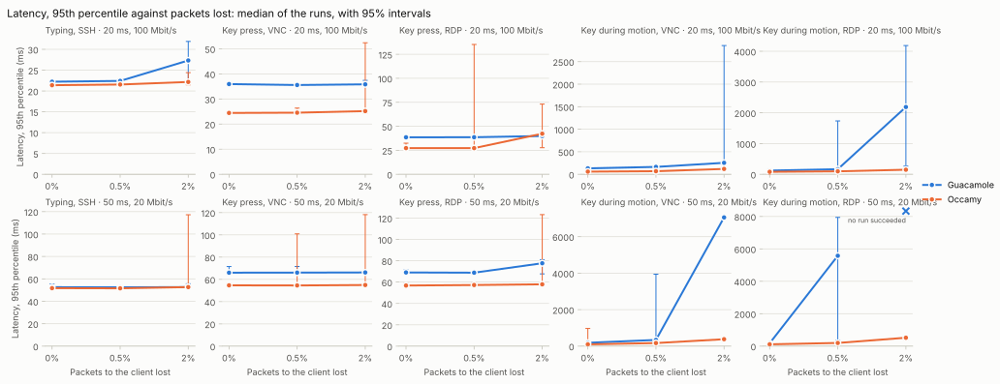
</picture>

<picture>
  <source media="(prefers-color-scheme: dark)" srcset="loss-fps-dark.svg">
  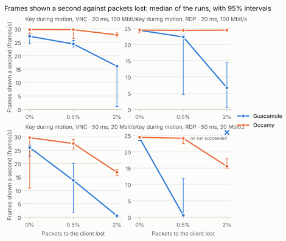
</picture>

<picture>
  <source media="(prefers-color-scheme: dark)" srcset="loss-frame_interval_p95-dark.svg">
  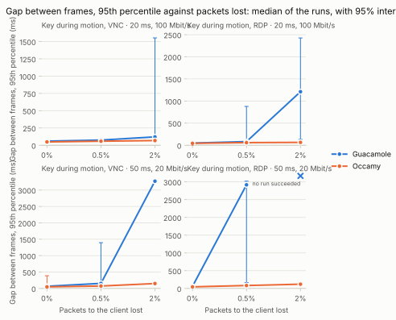
</picture>

### Secondary metrics: what the loss adds

Exploratory: the p-values are not corrected.

| Series | Scenario | Network | Loss | Metric | Without loss | With loss | Added | Round trip | p |
|---|---|---|---:|---|---:|---:|---:|---:|---:|
| Guacamole | Typing, SSH (T1) | 20 ms, 100 Mbit/s (N1) | 0.5% | Latency, median (ms) | 21.8 [21.6, 21.9] | 21.7 [21.5, 21.9] | -0.0855 [-0.238, 0.078] | 20 ms | 0.3095 |
| Guacamole | Typing, SSH (T1) | 20 ms, 100 Mbit/s (N1) | 0.5% | Server memory, peak (MiB) | 93.2 [42.0, 147] | 95.0 [39.7, 124] | 0.00477 [-70.6, 72.2] | 20 ms | 1.0000 |
| Guacamole | Typing, SSH (T1) | 20 ms, 100 Mbit/s (N1) | 0.5% | Client CPU time (ms) | 58.3 [52.3, 64.7] | 56.0 [53.2, 59.0] | -2.71 [-7.96, 2.08] | 20 ms | 0.3939 |
| Occamy | Typing, SSH (T1) | 20 ms, 100 Mbit/s (N1) | 0.5% | Latency, median (ms) | 21.1 [21.0, 21.1] | 21.1 [21.0, 21.4] | 0.035 [-0.054, 0.262] | 20 ms | 0.3939 |
| Occamy | Typing, SSH (T1) | 20 ms, 100 Mbit/s (N1) | 0.5% | Server memory, peak (MiB) | 67.3 [16.3, 78.5] | 71.0 [18.5, 73.2] | 1.64 [-15.1, 53.7] | 20 ms | 0.6991 |
| Occamy | Typing, SSH (T1) | 20 ms, 100 Mbit/s (N1) | 0.5% | Client CPU time (ms) | 51.1 [43.8, 55.1] | 47.3 [43.8, 63.6] | -2.63 [-7.31, 8.46] | 20 ms | 0.5887 |
| Guacamole | Typing, SSH (T1) | 20 ms, 100 Mbit/s (N1) | 2% | Latency, median (ms) | 21.8 [21.6, 21.9] | 21.8 [21.7, 21.9] | 0.0165 [-0.097, 0.139] | 20 ms | 0.8182 |
| Guacamole | Typing, SSH (T1) | 20 ms, 100 Mbit/s (N1) | 2% | Server memory, peak (MiB) | 93.2 [42.0, 147] | 94.8 [42.0, 148] | -0.0381 [-71.4, 105] | 20 ms | 0.9091 |
| Guacamole | Typing, SSH (T1) | 20 ms, 100 Mbit/s (N1) | 2% | Client CPU time (ms) | 58.3 [52.3, 64.7] | 58.9 [54.1, 67.3] | 0.085 [-5.66, 7.52] | 20 ms | 1.0000 |
| Occamy | Typing, SSH (T1) | 20 ms, 100 Mbit/s (N1) | 2% | Latency, median (ms) | 21.1 [21.0, 21.1] | 21.1 [21.0, 21.2] | 0.0385 [-0.072, 0.144] | 20 ms | 0.3290 |
| Occamy | Typing, SSH (T1) | 20 ms, 100 Mbit/s (N1) | 2% | Server memory, peak (MiB) | 67.3 [16.3, 78.5] | 68.6 [10.8, 75.2] | 0.348 [-23.8, 52.2] | 20 ms | 1.0000 |
| Occamy | Typing, SSH (T1) | 20 ms, 100 Mbit/s (N1) | 2% | Client CPU time (ms) | 51.1 [43.8, 55.1] | 50.4 [45.6, 57.1] | 1.55 [-4.97, 6.57] | 20 ms | 0.6991 |
| Guacamole | Key press, VNC (G2) | 20 ms, 100 Mbit/s (N1) | 0.5% | Latency, median (ms) | 34.8 [34.7, 35.0] | 34.7 [34.7, 34.8] | -0.113 [-0.192, -0.011] | 20 ms | 0.0152 |
| Guacamole | Key press, VNC (G2) | 20 ms, 100 Mbit/s (N1) | 0.5% | Server memory, peak (MiB) | 85.9 [50.5, 123] | 86.3 [30.9, 123] | -0.219 [-72.3, 71.8] | 20 ms | 0.8182 |
| Guacamole | Key press, VNC (G2) | 20 ms, 100 Mbit/s (N1) | 0.5% | Client CPU time (ms) | 63.2 [58.2, 517] | 64.6 [60.6, 69.1] | 0.468 [-447, 6.43] | 20 ms | 0.9372 |
| Occamy | Key press, VNC (G2) | 20 ms, 100 Mbit/s (N1) | 0.5% | Latency, median (ms) | 23.8 [23.7, 23.9] | 23.7 [23.7, 24.1] | -0.0505 [-0.14, 0.239] | 20 ms | 0.3290 |
| Occamy | Key press, VNC (G2) | 20 ms, 100 Mbit/s (N1) | 0.5% | Server memory, peak (MiB) | 70.6 [23.4, 78.5] | 71.5 [25.6, 73.8] | 0.0525 [-18.9, 48.1] | 20 ms | 1.0000 |
| Occamy | Key press, VNC (G2) | 20 ms, 100 Mbit/s (N1) | 0.5% | Client CPU time (ms) | 63.4 [52.5, 64.9] | 57.9 [53.2, 74.0] | -4.24 [-7.87, 9.08] | 20 ms | 0.6991 |
| Guacamole | Key press, VNC (G2) | 20 ms, 100 Mbit/s (N1) | 2% | Latency, median (ms) | 34.8 [34.7, 35.0] | 34.7 [34.7, 34.9] | -0.0875 [-0.139, 0.077] | 20 ms | 0.2229 |
| Guacamole | Key press, VNC (G2) | 20 ms, 100 Mbit/s (N1) | 2% | Server memory, peak (MiB) | 85.9 [50.5, 123] | 86.4 [50.0, 123] | -0.0429 [-71.7, 71.8] | 20 ms | 0.9372 |
| Guacamole | Key press, VNC (G2) | 20 ms, 100 Mbit/s (N1) | 2% | Client CPU time (ms) | 63.2 [58.2, 517] | 59.8 [58.5, 68.5] | -2.60 [-448, 2.21] | 20 ms | 0.3095 |
| Occamy | Key press, VNC (G2) | 20 ms, 100 Mbit/s (N1) | 2% | Latency, median (ms) | 23.8 [23.7, 23.9] | 23.7 [23.6, 23.8] | -0.048 [-0.183, 0.066] | 20 ms | 0.2403 |
| Occamy | Key press, VNC (G2) | 20 ms, 100 Mbit/s (N1) | 2% | Server memory, peak (MiB) | 70.6 [23.4, 78.5] | 68.5 [17.6, 78.8] | -1.25 [-27.3, 44.9] | 20 ms | 0.8485 |
| Occamy | Key press, VNC (G2) | 20 ms, 100 Mbit/s (N1) | 2% | Client CPU time (ms) | 63.4 [52.5, 64.9] | 59.3 [52.7, 60.5] | -4.14 [-6.51, 5.10] | 20 ms | 0.3095 |
| Guacamole | Key press, RDP (G2) | 20 ms, 100 Mbit/s (N1) | 0.5% | Latency, median (ms) | 37.1 [37.0, 37.3] | 37.1 [37.0, 37.2] | 0.014 [-0.114, 0.118] | 20 ms | 0.9372 |
| Guacamole | Key press, RDP (G2) | 20 ms, 100 Mbit/s (N1) | 0.5% | Server memory, peak (MiB) | 110 [72.0, 145] | 108 [71.5, 145] | -0.0954 [-71.6, 71.3] | 20 ms | 1.0000 |
| Guacamole | Key press, RDP (G2) | 20 ms, 100 Mbit/s (N1) | 0.5% | Client CPU time (ms) | 68.6 [64.0, 454] | 68.5 [66.4, 482] | 2.44 [-4.70, 28.0] | 20 ms | 0.5887 |
| Occamy | Key press, RDP (G2) | 20 ms, 100 Mbit/s (N1) | 0.5% | Latency, median (ms) | 25.9 [25.8, 26.2] | 25.9 [25.9, 33.6] | 0.0405 [-0.139, 7.33] | 20 ms | 0.4848 |
| Occamy | Key press, RDP (G2) | 20 ms, 100 Mbit/s (N1) | 0.5% | Server memory, peak (MiB) | 52.7 [49.3, 68.7] | 52.8 [47.5, 54.1] | -0.701 [-14.6, 4.10] | 20 ms | 0.8182 |
| Occamy | Key press, RDP (G2) | 20 ms, 100 Mbit/s (N1) | 0.5% | Client CPU time (ms) | 66.6 [59.7, 210] | 63.2 [57.5, 87.6] | -2.64 [-123, 6.05] | 20 ms | 0.5887 |
| Guacamole | Key press, RDP (G2) | 20 ms, 100 Mbit/s (N1) | 2% | Latency, median (ms) | 37.1 [37.0, 37.3] | 37.1 [37.0, 37.2] | 0.0625 [-0.084, 0.171] | 20 ms | 0.5887 |
| Guacamole | Key press, RDP (G2) | 20 ms, 100 Mbit/s (N1) | 2% | Server memory, peak (MiB) | 110 [72.0, 145] | 99.0 [71.6, 144] | -0.42 [-71.7, 67.1] | 20 ms | 0.8182 |
| Guacamole | Key press, RDP (G2) | 20 ms, 100 Mbit/s (N1) | 2% | Client CPU time (ms) | 68.6 [64.0, 454] | 66.4 [65.0, 70.7] | -0.427 [-383, 2.63] | 20 ms | 0.8182 |
| Occamy | Key press, RDP (G2) | 20 ms, 100 Mbit/s (N1) | 2% | Latency, median (ms) | 25.9 [25.8, 26.2] | 25.9 [25.9, 26.0] | 0.0105 [-0.269, 0.078] | 20 ms | 0.8182 |
| Occamy | Key press, RDP (G2) | 20 ms, 100 Mbit/s (N1) | 2% | Server memory, peak (MiB) | 52.7 [49.3, 68.7] | 55.2 [49.0, 60.8] | 1.33 [-7.88, 7.47] | 20 ms | 0.6991 |
| Occamy | Key press, RDP (G2) | 20 ms, 100 Mbit/s (N1) | 2% | Client CPU time (ms) | 66.6 [59.7, 210] | 64.0 [58.5, 212] | -1.38 [-13.8, 5.26] | 20 ms | 0.6991 |
| Guacamole | Key during motion, VNC (G5) | 20 ms, 100 Mbit/s (N1) | 0.5% | Frames shown per second (frames/s) | 27.2 [24.4, 28.1] | 24.4 [23.2, 25.7] | -2.51 [-4.02, -0.656] | 20 ms | 0.0152 |
| Guacamole | Key during motion, VNC (G5) | 20 ms, 100 Mbit/s (N1) | 0.5% | Scene frames never shown (%) | 9.17 [6.24, 18.6] | 18.7 [14.3, 22.6] | 8.37 [2.19, 13.4] | 20 ms | 0.0152 |
| Guacamole | Key during motion, VNC (G5) | 20 ms, 100 Mbit/s (N1) | 0.5% | Gap between frames, 95th percentile (ms) | 59.6 [55.5, 75.3] | 74.6 [69.4, 83.3] | 14.7 [8.05, 22.8] | 20 ms | 0.0152 |
| Guacamole | Key during motion, VNC (G5) | 20 ms, 100 Mbit/s (N1) | 0.5% | Data per frame (KiB) | 49.8 [49.0, 51.2] | 44.3 [40.6, 47.8] | -5.84 [-8.74, -3.17] | 20 ms | 0.0022 |
| Guacamole | Key during motion, VNC (G5) | 20 ms, 100 Mbit/s (N1) | 0.5% | Server CPU per frame (ms) | 46.1 [45.4, 51.0] | 45.5 [44.6, 46.4] | -0.741 [-4.57, 0.361] | 20 ms | 0.2403 |
| Guacamole | Key during motion, VNC (G5) | 20 ms, 100 Mbit/s (N1) | 0.5% | Server CPU time (ms) | 12,714 [12,449, 14,333] | 12,549 [12,276, 12,943] | -248 [-1,390, 110] | 20 ms | 0.1320 |
| Guacamole | Key during motion, VNC (G5) | 20 ms, 100 Mbit/s (N1) | 0.5% | Server memory, peak (MiB) | 86.4 [50.2, 123] | 86.5 [44.1, 123] | -0.11 [-71.8, 71.9] | 20 ms | 1.0000 |
| Guacamole | Key during motion, VNC (G5) | 20 ms, 100 Mbit/s (N1) | 0.5% | Client CPU time (ms) | 5,019 [4,945, 5,650] | 5,055 [4,971, 5,186] | 26.6 [-464, 137] | 20 ms | 0.3939 |
| Occamy | Key during motion, VNC (G5) | 20 ms, 100 Mbit/s (N1) | 0.5% | Frames shown per second (frames/s) | 29.8 [28.1, 30.2] | 29.7 [26.5, 29.8] | -0.198 [-1.65, 0.221] | 20 ms | 0.5887 |
| Occamy | Key during motion, VNC (G5) | 20 ms, 100 Mbit/s (N1) | 0.5% | Scene frames never shown (%) | 0.829 [-0.502, 6.25] | 0.941 [0.546, 11.8] | 0.66 [-0.737, 5.51] | 20 ms | 0.5887 |
| Occamy | Key during motion, VNC (G5) | 20 ms, 100 Mbit/s (N1) | 0.5% | Gap between frames, 95th percentile (ms) | 48.0 [47.2, 52.3] | 58.5 [54.6, 71.7] | 9.95 [6.52, 19.4] | 20 ms | 0.0022 |
| Occamy | Key during motion, VNC (G5) | 20 ms, 100 Mbit/s (N1) | 0.5% | Data per frame (KiB) | 14.2 [14.1, 14.4] | 14.2 [14.1, 14.3] | 0.0222 [-0.104, 0.128] | 20 ms | 0.6991 |
| Occamy | Key during motion, VNC (G5) | 20 ms, 100 Mbit/s (N1) | 0.5% | Server CPU per frame (ms) | 19.2 [18.8, 20.5] | 19.1 [18.9, 27.0] | 0.00576 [-0.896, 6.56] | 20 ms | 1.0000 |
| Occamy | Key during motion, VNC (G5) | 20 ms, 100 Mbit/s (N1) | 0.5% | Server CPU time (ms) | 5,674 [5,635, 5,854] | 5,643 [5,607, 7,191] | -27.2 [-126, 1,338] | 20 ms | 0.3939 |
| Occamy | Key during motion, VNC (G5) | 20 ms, 100 Mbit/s (N1) | 0.5% | Server memory, peak (MiB) | 70.3 [53.3, 76.2] | 66.1 [51.3, 73.3] | -2.91 [-17.7, 12.2] | 20 ms | 0.3939 |
| Occamy | Key during motion, VNC (G5) | 20 ms, 100 Mbit/s (N1) | 0.5% | Client CPU time (ms) | 2,121 [2,104, 2,227] | 2,148 [2,076, 2,289] | 19.4 [-78.7, 87.8] | 20 ms | 0.5887 |
| Guacamole | Key during motion, VNC (G5) | 20 ms, 100 Mbit/s (N1) | 2% | Frames shown per second (frames/s) | 27.2 [24.4, 28.1] | 16.1 [1.08, 16.6] | -11.5 [-23.8, -9.71] | 20 ms | 0.0022 |
| Guacamole | Key during motion, VNC (G5) | 20 ms, 100 Mbit/s (N1) | 2% | Scene frames never shown (%) | 9.17 [6.24, 18.6] | 46.4 [44.7, 96.4] | 38.2 [32.4, 79.4] | 20 ms | 0.0022 |
| Guacamole | Key during motion, VNC (G5) | 20 ms, 100 Mbit/s (N1) | 2% | Gap between frames, 95th percentile (ms) | 59.6 [55.5, 75.3] | 121 [108, 1,553] | 60.1 [49.3, 1,477] | 20 ms | 0.0022 |
| Guacamole | Key during motion, VNC (G5) | 20 ms, 100 Mbit/s (N1) | 2% | Data per frame (KiB) | 49.8 [49.0, 51.2] | 32.9 [31.5, 551] | -16.9 [-18.4, 500] | 20 ms | 0.3939 |
| Guacamole | Key during motion, VNC (G5) | 20 ms, 100 Mbit/s (N1) | 2% | Server CPU per frame (ms) | 46.1 [45.4, 51.0] | 49.4 [48.6, 336] | 3.39 [1.87, 285] | 20 ms | 0.0260 |
| Guacamole | Key during motion, VNC (G5) | 20 ms, 100 Mbit/s (N1) | 2% | Server CPU time (ms) | 12,714 [12,449, 14,333] | 12,714 [12,293, 67,251] | 0.036 [-531, 52,918] | 20 ms | 1.0000 |
| Guacamole | Key during motion, VNC (G5) | 20 ms, 100 Mbit/s (N1) | 2% | Server memory, peak (MiB) | 86.4 [50.2, 123] | 86.6 [50.3, 123] | -0.0715 [-71.7, 71.4] | 20 ms | 1.0000 |
| Guacamole | Key during motion, VNC (G5) | 20 ms, 100 Mbit/s (N1) | 2% | Client CPU time (ms) | 5,019 [4,945, 5,650] | 4,933 [4,719, 7,602] | -80.6 [-312, 1,952] | 20 ms | 0.5887 |
| Occamy | Key during motion, VNC (G5) | 20 ms, 100 Mbit/s (N1) | 2% | Frames shown per second (frames/s) | 29.8 [28.1, 30.2] | 27.8 [27.0, 28.6] | -1.90 [-2.59, -1.06] | 20 ms | 0.0087 |
| Occamy | Key during motion, VNC (G5) | 20 ms, 100 Mbit/s (N1) | 2% | Scene frames never shown (%) | 0.829 [-0.502, 6.25] | 7.45 [4.82, 9.89] | 6.34 [3.53, 8.64] | 20 ms | 0.0087 |
| Occamy | Key during motion, VNC (G5) | 20 ms, 100 Mbit/s (N1) | 2% | Gap between frames, 95th percentile (ms) | 48.0 [47.2, 52.3] | 67.7 [62.8, 72.4] | 19.1 [14.7, 24.0] | 20 ms | 0.0022 |
| Occamy | Key during motion, VNC (G5) | 20 ms, 100 Mbit/s (N1) | 2% | Data per frame (KiB) | 14.2 [14.1, 14.4] | 14.3 [14.1, 14.4] | 0.118 [-0.0249, 0.245] | 20 ms | 0.0931 |
| Occamy | Key during motion, VNC (G5) | 20 ms, 100 Mbit/s (N1) | 2% | Server CPU per frame (ms) | 19.2 [18.8, 20.5] | 19.5 [19.1, 20.8] | 0.328 [-0.72, 0.907] | 20 ms | 0.3939 |
| Occamy | Key during motion, VNC (G5) | 20 ms, 100 Mbit/s (N1) | 2% | Server CPU time (ms) | 5,674 [5,635, 5,854] | 5,486 [5,340, 5,789] | -215 [-340, -64.8] | 20 ms | 0.0411 |
| Occamy | Key during motion, VNC (G5) | 20 ms, 100 Mbit/s (N1) | 2% | Server memory, peak (MiB) | 70.3 [53.3, 76.2] | 58.6 [49.5, 78.3] | -5.38 [-24.7, 11.2] | 20 ms | 0.2403 |
| Occamy | Key during motion, VNC (G5) | 20 ms, 100 Mbit/s (N1) | 2% | Client CPU time (ms) | 2,121 [2,104, 2,227] | 2,044 [1,904, 2,283] | -85.4 [-206, 56.8] | 20 ms | 0.0649 |
| Guacamole | Key during motion, RDP (G5) | 20 ms, 100 Mbit/s (N1) | 0.5% | Frames shown per second (frames/s) | 24.3 [24.0, 24.6] | 22.3 [4.58, 22.9] | -1.97 [-19.4, -1.31] | 20 ms | 0.0022 |
| Guacamole | Key during motion, RDP (G5) | 20 ms, 100 Mbit/s (N1) | 0.5% | Scene frames never shown (%) | 18.8 [18.1, 20.0] | 25.7 [23.5, 84.7] | 6.57 [4.37, 64.7] | 20 ms | 0.0022 |
| Guacamole | Key during motion, RDP (G5) | 20 ms, 100 Mbit/s (N1) | 0.5% | Gap between frames, 95th percentile (ms) | 48.7 [46.3, 53.8] | 82.2 [73.5, 877] | 33.1 [24.9, 824] | 20 ms | 0.0022 |
| Guacamole | Key during motion, RDP (G5) | 20 ms, 100 Mbit/s (N1) | 0.5% | Data per frame (KiB) | 66.2 [66.1, 67.2] | 50.1 [47.1, 300] | -16.5 [-19.0, 233] | 20 ms | 0.0649 |
| Guacamole | Key during motion, RDP (G5) | 20 ms, 100 Mbit/s (N1) | 0.5% | Server CPU per frame (ms) | 55.4 [54.6, 56.1] | 51.1 [50.7, 185] | -4.12 [-4.76, 129] | 20 ms | 0.0649 |
| Guacamole | Key during motion, RDP (G5) | 20 ms, 100 Mbit/s (N1) | 0.5% | Server CPU time (ms) | 13,451 [13,357, 13,635] | 14,467 [13,887, 48,582] | 971 [530, 34,946] | 20 ms | 0.0022 |
| Guacamole | Key during motion, RDP (G5) | 20 ms, 100 Mbit/s (N1) | 0.5% | Server memory, peak (MiB) | 107 [64.4, 141] | 106 [62.8, 144] | 1.34 [-69.7, 72.2] | 20 ms | 0.5887 |
| Guacamole | Key during motion, RDP (G5) | 20 ms, 100 Mbit/s (N1) | 0.5% | Client CPU time (ms) | 5,776 [5,583, 5,838] | 6,487 [6,232, 9,133] | 730 [504, 3,295] | 20 ms | 0.0022 |
| Occamy | Key during motion, RDP (G5) | 20 ms, 100 Mbit/s (N1) | 0.5% | Frames shown per second (frames/s) | 24.4 [23.6, 24.9] | 24.3 [24.1, 24.6] | -0.122 [-0.503, 0.486] | 20 ms | 0.5887 |
| Occamy | Key during motion, RDP (G5) | 20 ms, 100 Mbit/s (N1) | 0.5% | Scene frames never shown (%) | 18.7 [17.1, 21.3] | 18.9 [18.1, 19.7] | 0.408 [-1.62, 1.68] | 20 ms | 0.5887 |
| Occamy | Key during motion, RDP (G5) | 20 ms, 100 Mbit/s (N1) | 0.5% | Gap between frames, 95th percentile (ms) | 43.5 [41.5, 69.5] | 59.3 [55.9, 59.6] | 14.7 [-9.82, 17.2] | 20 ms | 0.0649 |
| Occamy | Key during motion, RDP (G5) | 20 ms, 100 Mbit/s (N1) | 0.5% | Data per frame (KiB) | 14.2 [14.0, 14.3] | 14.2 [14.1, 14.3] | 0.0578 [-0.083, 0.233] | 20 ms | 0.3095 |
| Occamy | Key during motion, RDP (G5) | 20 ms, 100 Mbit/s (N1) | 0.5% | Server CPU per frame (ms) | 19.9 [19.3, 25.7] | 20.0 [19.7, 20.3] | 0.0114 [-5.36, 0.433] | 20 ms | 1.0000 |
| Occamy | Key during motion, RDP (G5) | 20 ms, 100 Mbit/s (N1) | 0.5% | Server CPU time (ms) | 4,834 [4,789, 6,214] | 4,833 [4,794, 4,938] | -1.98 [-1,276, 113] | 20 ms | 1.0000 |
| Occamy | Key during motion, RDP (G5) | 20 ms, 100 Mbit/s (N1) | 0.5% | Server memory, peak (MiB) | 73.1 [67.7, 77.4] | 72.0 [67.9, 78.2] | -0.839 [-5.43, 4.39] | 20 ms | 0.8182 |
| Occamy | Key during motion, RDP (G5) | 20 ms, 100 Mbit/s (N1) | 0.5% | Client CPU time (ms) | 1,775 [1,679, 1,807] | 1,807 [1,739, 1,833] | 29.4 [-3.14, 102] | 20 ms | 0.0931 |
| Guacamole | Key during motion, RDP (G5) | 20 ms, 100 Mbit/s (N1) | 2% | Frames shown per second (frames/s) | 24.3 [24.0, 24.6] | 6.64 [0.591, 14.4] | -17.6 [-23.9, -9.97] | 20 ms | 0.0022 |
| Guacamole | Key during motion, RDP (G5) | 20 ms, 100 Mbit/s (N1) | 2% | Scene frames never shown (%) | 18.8 [18.1, 20.0] | 77.9 [52.0, 98.0] | 58.8 [33.2, 79.5] | 20 ms | 0.0022 |
| Guacamole | Key during motion, RDP (G5) | 20 ms, 100 Mbit/s (N1) | 2% | Gap between frames, 95th percentile (ms) | 48.7 [46.3, 53.8] | 1,211 [131, 2,426] | 1,161 [84.3, 2,372] | 20 ms | 0.0022 |
| Guacamole | Key during motion, RDP (G5) | 20 ms, 100 Mbit/s (N1) | 2% | Data per frame (KiB) | 66.2 [66.1, 67.2] | 537 [33.8, 1,055] | 470 [-32.3, 988] | 20 ms | 1.0000 |
| Guacamole | Key during motion, RDP (G5) | 20 ms, 100 Mbit/s (N1) | 2% | Server CPU per frame (ms) | 55.4 [54.6, 56.1] | 378 [54.4, 721] | 323 [-0.448, 665] | 20 ms | 0.1320 |
| Guacamole | Key during motion, RDP (G5) | 20 ms, 100 Mbit/s (N1) | 2% | Server CPU time (ms) | 13,451 [13,357, 13,635] | 76,455 [13,653, 142,099] | 62,959 [296, 128,617] | 20 ms | 0.0022 |
| Guacamole | Key during motion, RDP (G5) | 20 ms, 100 Mbit/s (N1) | 2% | Server memory, peak (MiB) | 107 [64.4, 141] | 103 [63.8, 143] | 0.749 [-70.1, 70.7] | 20 ms | 0.9372 |
| Guacamole | Key during motion, RDP (G5) | 20 ms, 100 Mbit/s (N1) | 2% | Client CPU time (ms) | 5,776 [5,583, 5,838] | 8,835 [5,608, 12,098] | 3,125 [-120, 6,311] | 20 ms | 0.2403 |
| Occamy | Key during motion, RDP (G5) | 20 ms, 100 Mbit/s (N1) | 2% | Frames shown per second (frames/s) | 24.4 [23.6, 24.9] | 24.4 [24.0, 24.8] | -0.059 [-0.489, 0.499] | 20 ms | 0.9372 |
| Occamy | Key during motion, RDP (G5) | 20 ms, 100 Mbit/s (N1) | 2% | Scene frames never shown (%) | 18.7 [17.1, 21.3] | 18.7 [17.2, 20.0] | 0.197 [-1.66, 1.63] | 20 ms | 0.9372 |
| Occamy | Key during motion, RDP (G5) | 20 ms, 100 Mbit/s (N1) | 2% | Gap between frames, 95th percentile (ms) | 43.5 [41.5, 69.5] | 64.8 [62.2, 72.1] | 20.6 [2.67, 26.3] | 20 ms | 0.0411 |
| Occamy | Key during motion, RDP (G5) | 20 ms, 100 Mbit/s (N1) | 2% | Data per frame (KiB) | 14.2 [14.0, 14.3] | 14.1 [14.1, 14.2] | -0.0346 [-0.184, 0.101] | 20 ms | 0.9372 |
| Occamy | Key during motion, RDP (G5) | 20 ms, 100 Mbit/s (N1) | 2% | Server CPU per frame (ms) | 19.9 [19.3, 25.7] | 19.8 [19.7, 19.9] | -0.145 [-5.82, 0.434] | 20 ms | 0.1320 |
| Occamy | Key during motion, RDP (G5) | 20 ms, 100 Mbit/s (N1) | 2% | Server CPU time (ms) | 4,834 [4,789, 6,214] | 4,899 [4,865, 4,979] | 56.6 [-1,234, 130] | 20 ms | 0.3939 |
| Occamy | Key during motion, RDP (G5) | 20 ms, 100 Mbit/s (N1) | 2% | Server memory, peak (MiB) | 73.1 [67.7, 77.4] | 73.7 [65.2, 81.4] | 1.30 [-6.77, 8.13] | 20 ms | 0.8182 |
| Occamy | Key during motion, RDP (G5) | 20 ms, 100 Mbit/s (N1) | 2% | Client CPU time (ms) | 1,775 [1,679, 1,807] | 1,839 [1,812, 1,898] | 75.2 [31.6, 143] | 20 ms | 0.0022 |
| Guacamole | Typing, SSH (T1) | 50 ms, 20 Mbit/s (N2) | 0.5% | Latency, median (ms) | 52.0 [52.0, 52.2] | 52.1 [52.0, 52.3] | 0.0215 [-0.179, 0.215] | 50 ms | 0.3939 |
| Guacamole | Typing, SSH (T1) | 50 ms, 20 Mbit/s (N2) | 0.5% | Server memory, peak (MiB) | 95.0 [42.0, 124] | 95.0 [41.8, 148] | -0.0954 [-61.5, 38.7] | 50 ms | 0.9740 |
| Guacamole | Typing, SSH (T1) | 50 ms, 20 Mbit/s (N2) | 0.5% | Client CPU time (ms) | 57.4 [51.4, 67.0] | 63.1 [56.2, 68.2] | 4.14 [-3.37, 11.1] | 50 ms | 0.3939 |
| Occamy | Typing, SSH (T1) | 50 ms, 20 Mbit/s (N2) | 0.5% | Latency, median (ms) | 51.2 [51.1, 51.3] | 51.1 [51.1, 51.5] | -0.0655 [-0.185, 0.124] | 50 ms | 0.1797 |
| Occamy | Typing, SSH (T1) | 50 ms, 20 Mbit/s (N2) | 0.5% | Server memory, peak (MiB) | 65.1 [12.7, 70.2] | 68.3 [15.2, 81.2] | 4.01 [-2.74, 27.9] | 50 ms | 0.5887 |
| Occamy | Typing, SSH (T1) | 50 ms, 20 Mbit/s (N2) | 0.5% | Client CPU time (ms) | 50.6 [46.1, 59.3] | 48.3 [42.1, 59.1] | -2.33 [-9.30, 3.75] | 50 ms | 0.4848 |
| Guacamole | Typing, SSH (T1) | 50 ms, 20 Mbit/s (N2) | 2% | Latency, median (ms) | 52.0 [52.0, 52.2] | 52.0 [51.9, 52.2] | -0.054 [-0.23, 0.132] | 50 ms | 0.3095 |
| Guacamole | Typing, SSH (T1) | 50 ms, 20 Mbit/s (N2) | 2% | Server memory, peak (MiB) | 95.0 [42.0, 124] | 112 [75.9, 148] | 28.3 [-38.3, 71.9] | 50 ms | 0.1797 |
| Guacamole | Typing, SSH (T1) | 50 ms, 20 Mbit/s (N2) | 2% | Client CPU time (ms) | 57.4 [51.4, 67.0] | 56.2 [50.2, 65.2] | -1.66 [-9.90, 6.86] | 50 ms | 0.5887 |
| Occamy | Typing, SSH (T1) | 50 ms, 20 Mbit/s (N2) | 2% | Latency, median (ms) | 51.2 [51.1, 51.3] | 51.1 [51.0, 51.4] | -0.125 [-0.234, 0.046] | 50 ms | 0.0844 |
| Occamy | Typing, SSH (T1) | 50 ms, 20 Mbit/s (N2) | 2% | Server memory, peak (MiB) | 65.1 [12.7, 70.2] | 68.4 [7.14, 70.8] | 0.377 [-51.7, 16.3] | 50 ms | 0.9372 |
| Occamy | Typing, SSH (T1) | 50 ms, 20 Mbit/s (N2) | 2% | Client CPU time (ms) | 50.6 [46.1, 59.3] | 46.2 [45.1, 50.9] | -4.19 [-10.5, 0.537] | 50 ms | 0.0649 |
| Guacamole | Key press, VNC (G2) | 50 ms, 20 Mbit/s (N2) | 0.5% | Latency, median (ms) | 65.1 [64.9, 65.5] | 65.1 [64.8, 65.9] | 0.0165 [-0.356, 0.362] | 50 ms | 1.0000 |
| Guacamole | Key press, VNC (G2) | 50 ms, 20 Mbit/s (N2) | 0.5% | Server memory, peak (MiB) | 86.5 [50.0, 123] | 86.9 [50.3, 123] | 0.143 [-71.8, 72.0] | 50 ms | 0.7338 |
| Guacamole | Key press, VNC (G2) | 50 ms, 20 Mbit/s (N2) | 0.5% | Client CPU time (ms) | 65.5 [59.6, 73.3] | 60.8 [59.1, 77.5] | -1.75 [-11.9, 8.17] | 50 ms | 0.8182 |
| Occamy | Key press, VNC (G2) | 50 ms, 20 Mbit/s (N2) | 0.5% | Latency, median (ms) | 53.9 [53.8, 54.0] | 53.8 [53.7, 55.3] | -0.0375 [-0.149, 1.26] | 50 ms | 0.6991 |
| Occamy | Key press, VNC (G2) | 50 ms, 20 Mbit/s (N2) | 0.5% | Server memory, peak (MiB) | 67.4 [18.8, 73.2] | 60.2 [21.5, 82.2] | 0.186 [-43.9, 19.4] | 50 ms | 1.0000 |
| Occamy | Key press, VNC (G2) | 50 ms, 20 Mbit/s (N2) | 0.5% | Client CPU time (ms) | 60.9 [58.2, 67.2] | 59.1 [57.3, 75.6] | -1.17 [-7.13, 8.43] | 50 ms | 0.5887 |
| Guacamole | Key press, VNC (G2) | 50 ms, 20 Mbit/s (N2) | 2% | Latency, median (ms) | 65.1 [64.9, 65.5] | 65.1 [65.0, 65.5] | 0.022 [-0.396, 0.247] | 50 ms | 0.8182 |
| Guacamole | Key press, VNC (G2) | 50 ms, 20 Mbit/s (N2) | 2% | Server memory, peak (MiB) | 86.5 [50.0, 123] | 86.5 [50.0, 123] | -0.0954 [-72.0, 71.8] | 50 ms | 0.8420 |
| Guacamole | Key press, VNC (G2) | 50 ms, 20 Mbit/s (N2) | 2% | Client CPU time (ms) | 65.5 [59.6, 73.3] | 63.5 [57.4, 76.6] | -1.91 [-9.51, 5.31] | 50 ms | 0.8182 |
| Occamy | Key press, VNC (G2) | 50 ms, 20 Mbit/s (N2) | 2% | Latency, median (ms) | 53.9 [53.8, 54.0] | 53.8 [53.8, 54.1] | -0.028 [-0.122, 0.163] | 50 ms | 0.7013 |
| Occamy | Key press, VNC (G2) | 50 ms, 20 Mbit/s (N2) | 2% | Server memory, peak (MiB) | 67.4 [18.8, 73.2] | 70.3 [13.8, 73.4] | 0.463 [-46.2, 19.4] | 50 ms | 0.8182 |
| Occamy | Key press, VNC (G2) | 50 ms, 20 Mbit/s (N2) | 2% | Client CPU time (ms) | 60.9 [58.2, 67.2] | 57.9 [53.6, 72.0] | -3.30 [-8.22, 4.81] | 50 ms | 0.3939 |
| Guacamole | Key press, RDP (G2) | 50 ms, 20 Mbit/s (N2) | 0.5% | Latency, median (ms) | 67.2 [67.1, 67.9] | 67.2 [67.1, 67.4] | -0.0325 [-0.53, 0.208] | 50 ms | 0.6667 |
| Guacamole | Key press, RDP (G2) | 50 ms, 20 Mbit/s (N2) | 0.5% | Server memory, peak (MiB) | 109 [71.6, 146] | 111 [71.9, 145] | -0.296 [-72.0, 72.2] | 50 ms | 0.9372 |
| Guacamole | Key press, RDP (G2) | 50 ms, 20 Mbit/s (N2) | 0.5% | Client CPU time (ms) | 72.5 [68.0, 395] | 67.4 [63.4, 388] | -4.83 [-19.6, 5.33] | 50 ms | 0.2403 |
| Occamy | Key press, RDP (G2) | 50 ms, 20 Mbit/s (N2) | 0.5% | Latency, median (ms) | 56.1 [56.0, 56.5] | 56.0 [55.9, 56.7] | -0.0415 [-0.317, 0.16] | 50 ms | 0.4848 |
| Occamy | Key press, RDP (G2) | 50 ms, 20 Mbit/s (N2) | 0.5% | Server memory, peak (MiB) | 51.4 [30.4, 53.9] | 52.7 [49.4, 56.2] | 2.79 [-1.85, 19.0] | 50 ms | 0.3095 |
| Occamy | Key press, RDP (G2) | 50 ms, 20 Mbit/s (N2) | 0.5% | Client CPU time (ms) | 64.9 [61.4, 86.8] | 64.5 [58.0, 82.8] | -3.04 [-13.5, 5.55] | 50 ms | 0.6991 |
| Guacamole | Key press, RDP (G2) | 50 ms, 20 Mbit/s (N2) | 2% | Latency, median (ms) | 67.2 [67.1, 67.9] | 67.2 [67.1, 67.3] | -0.0435 [-0.628, 0.118] | 50 ms | 0.6991 |
| Guacamole | Key press, RDP (G2) | 50 ms, 20 Mbit/s (N2) | 2% | Server memory, peak (MiB) | 109 [71.6, 146] | 98.3 [52.6, 144] | -1.19 [-73.7, 71.9] | 50 ms | 0.3095 |
| Guacamole | Key press, RDP (G2) | 50 ms, 20 Mbit/s (N2) | 2% | Client CPU time (ms) | 72.5 [68.0, 395] | 63.9 [61.1, 71.4] | -8.64 [-324, -2.78] | 50 ms | 0.0152 |
| Occamy | Key press, RDP (G2) | 50 ms, 20 Mbit/s (N2) | 2% | Latency, median (ms) | 56.1 [56.0, 56.5] | 56.0 [56.0, 56.2] | -0.0565 [-0.307, 0.046] | 50 ms | 0.1797 |
| Occamy | Key press, RDP (G2) | 50 ms, 20 Mbit/s (N2) | 2% | Server memory, peak (MiB) | 51.4 [30.4, 53.9] | 51.7 [47.1, 55.5] | 1.27 [-4.12, 16.7] | 50 ms | 0.4848 |
| Occamy | Key press, RDP (G2) | 50 ms, 20 Mbit/s (N2) | 2% | Client CPU time (ms) | 64.9 [61.4, 86.8] | 61.1 [59.3, 62.7] | -3.95 [-24.2, -0.534] | 50 ms | 0.0152 |
| Guacamole | Key during motion, VNC (G5) | 50 ms, 20 Mbit/s (N2) | 0.5% | Frames shown per second (frames/s) | 26.0 [22.8, 26.8] | 13.8 [1.85, 20.2] | -12.2 [-23.1, -6.24] | 50 ms | 0.0022 |
| Guacamole | Key during motion, VNC (G5) | 50 ms, 20 Mbit/s (N2) | 0.5% | Scene frames never shown (%) | 13.3 [10.6, 24.1] | 54.2 [32.8, 93.8] | 40.6 [20.8, 76.9] | 50 ms | 0.0022 |
| Guacamole | Key during motion, VNC (G5) | 50 ms, 20 Mbit/s (N2) | 0.5% | Gap between frames, 95th percentile (ms) | 66.6 [60.6, 76.0] | 154 [104, 1,395] | 87.8 [43.6, 1,319] | 50 ms | 0.0022 |
| Guacamole | Key during motion, VNC (G5) | 50 ms, 20 Mbit/s (N2) | 0.5% | Data per frame (KiB) | 46.1 [46.0, 47.5] | 39.0 [33.9, 297] | -7.73 [-12.2, 250] | 50 ms | 0.3939 |
| Guacamole | Key during motion, VNC (G5) | 50 ms, 20 Mbit/s (N2) | 0.5% | Server CPU per frame (ms) | 45.4 [44.5, 52.1] | 53.3 [47.8, 204] | 7.86 [1.69, 152] | 50 ms | 0.0152 |
| Guacamole | Key during motion, VNC (G5) | 50 ms, 20 Mbit/s (N2) | 0.5% | Server CPU time (ms) | 16,652 [16,255, 19,031] | 16,420 [16,051, 67,404] | -154 [-2,168, 48,373] | 50 ms | 0.6991 |
| Guacamole | Key during motion, VNC (G5) | 50 ms, 20 Mbit/s (N2) | 0.5% | Server memory, peak (MiB) | 85.7 [49.1, 121] | 86.3 [49.1, 122] | 0.238 [-71.8, 71.1] | 50 ms | 0.6753 |
| Guacamole | Key during motion, VNC (G5) | 50 ms, 20 Mbit/s (N2) | 0.5% | Client CPU time (ms) | 6,779 [6,482, 7,940] | 6,435 [5,793, 9,911] | -392 [-1,403, 1,971] | 50 ms | 0.3095 |
| Occamy | Key during motion, VNC (G5) | 50 ms, 20 Mbit/s (N2) | 0.5% | Frames shown per second (frames/s) | 29.7 [10.8, 30.1] | 27.5 [25.4, 29.0] | -1.79 [-3.28, 14.6] | 50 ms | 0.0931 |
| Occamy | Key during motion, VNC (G5) | 50 ms, 20 Mbit/s (N2) | 0.5% | Scene frames never shown (%) | 1.15 [-0.418, 63.9] | 8.40 [3.32, 15.3] | 5.96 [-48.6, 10.9] | 50 ms | 0.0931 |
| Occamy | Key during motion, VNC (G5) | 50 ms, 20 Mbit/s (N2) | 0.5% | Gap between frames, 95th percentile (ms) | 49.4 [47.2, 386] | 73.6 [71.3, 83.3] | 24.6 [-303, 34.0] | 50 ms | 0.0649 |
| Occamy | Key during motion, VNC (G5) | 50 ms, 20 Mbit/s (N2) | 0.5% | Data per frame (KiB) | 14.2 [14.1, 19.9] | 14.2 [14.1, 14.8] | 0.0118 [-5.03, 0.396] | 50 ms | 0.9372 |
| Occamy | Key during motion, VNC (G5) | 50 ms, 20 Mbit/s (N2) | 0.5% | Server CPU per frame (ms) | 19.3 [18.7, 36.2] | 19.6 [19.0, 23.6] | 0.252 [-12.6, 1.89] | 50 ms | 0.6991 |
| Occamy | Key during motion, VNC (G5) | 50 ms, 20 Mbit/s (N2) | 0.5% | Server CPU time (ms) | 5,752 [5,634, 8,653] | 6,300 [5,761, 6,864] | 356 [-1,789, 1,052] | 50 ms | 0.1320 |
| Occamy | Key during motion, VNC (G5) | 50 ms, 20 Mbit/s (N2) | 0.5% | Server memory, peak (MiB) | 67.1 [48.5, 73.2] | 62.2 [51.9, 81.5] | 1.28 [-17.8, 19.3] | 50 ms | 0.6991 |
| Occamy | Key during motion, VNC (G5) | 50 ms, 20 Mbit/s (N2) | 0.5% | Client CPU time (ms) | 2,236 [2,076, 2,412] | 2,302 [2,243, 2,474] | 65.0 [-9.78, 230] | 50 ms | 0.1320 |
| Guacamole | Key during motion, VNC (G5) | 50 ms, 20 Mbit/s (N2) | 2% | Frames shown per second (frames/s) | 26.0 [22.8, 26.8] | 0.534 | -25.5 [-26.2, -22.3] | 50 ms | 0.0095 |
| Guacamole | Key during motion, VNC (G5) | 50 ms, 20 Mbit/s (N2) | 2% | Scene frames never shown (%) | 13.3 [10.6, 24.1] | 98.2 | 84.9 [74.4, 87.3] | 50 ms | 0.0095 |
| Guacamole | Key during motion, VNC (G5) | 50 ms, 20 Mbit/s (N2) | 2% | Gap between frames, 95th percentile (ms) | 66.6 [60.6, 76.0] | 3,270 | 3,202 [2,982, 3,309] | 50 ms | 0.0095 |
| Guacamole | Key during motion, VNC (G5) | 50 ms, 20 Mbit/s (N2) | 2% | Data per frame (KiB) | 46.1 [46.0, 47.5] | 473 | 426 [346, 511] | 50 ms | 0.0095 |
| Guacamole | Key during motion, VNC (G5) | 50 ms, 20 Mbit/s (N2) | 2% | Server CPU per frame (ms) | 45.4 [44.5, 52.1] | 597 | 549 [447, 666] | 50 ms | 0.0095 |
| Guacamole | Key during motion, VNC (G5) | 50 ms, 20 Mbit/s (N2) | 2% | Server CPU time (ms) | 16,652 [16,255, 19,031] | 146,271 | 128,627 [121,389, 134,931] | 50 ms | 0.0095 |
| Guacamole | Key during motion, VNC (G5) | 50 ms, 20 Mbit/s (N2) | 2% | Server memory, peak (MiB) | 85.7 [49.1, 121] | 85.2 | -0.0954 [-71.7, 71.0] | 50 ms | 0.8095 |
| Guacamole | Key during motion, VNC (G5) | 50 ms, 20 Mbit/s (N2) | 2% | Client CPU time (ms) | 6,779 [6,482, 7,940] | 9,987 | 2,776 [1,122, 4,638] | 50 ms | 0.0095 |
| Occamy | Key during motion, VNC (G5) | 50 ms, 20 Mbit/s (N2) | 2% | Frames shown per second (frames/s) | 29.7 [10.8, 30.1] | 16.8 [15.5, 17.8] | -12.6 [-14.1, 4.69] | 50 ms | 0.0649 |
| Occamy | Key during motion, VNC (G5) | 50 ms, 20 Mbit/s (N2) | 2% | Scene frames never shown (%) | 1.15 [-0.418, 63.9] | 44.1 [40.8, 48.3] | 41.9 [-15.6, 47.0] | 50 ms | 0.0649 |
| Occamy | Key during motion, VNC (G5) | 50 ms, 20 Mbit/s (N2) | 2% | Gap between frames, 95th percentile (ms) | 49.4 [47.2, 386] | 150 [138, 154] | 97.9 [-232, 105] | 50 ms | 0.0649 |
| Occamy | Key during motion, VNC (G5) | 50 ms, 20 Mbit/s (N2) | 2% | Data per frame (KiB) | 14.2 [14.1, 19.9] | 14.6 [14.4, 15.4] | 0.361 [-4.48, 0.554] | 50 ms | 0.0649 |
| Occamy | Key during motion, VNC (G5) | 50 ms, 20 Mbit/s (N2) | 2% | Server CPU per frame (ms) | 19.3 [18.7, 36.2] | 24.1 [23.6, 25.4] | 4.85 [-10.8, 6.29] | 50 ms | 0.0649 |
| Occamy | Key during motion, VNC (G5) | 50 ms, 20 Mbit/s (N2) | 2% | Server CPU time (ms) | 5,752 [5,634, 8,653] | 8,630 [8,275, 9,358] | 2,825 [705, 3,316] | 50 ms | 0.0260 |
| Occamy | Key during motion, VNC (G5) | 50 ms, 20 Mbit/s (N2) | 2% | Server memory, peak (MiB) | 67.1 [48.5, 73.2] | 67.2 [45.3, 72.0] | -0.238 [-13.9, 18.8] | 50 ms | 1.0000 |
| Occamy | Key during motion, VNC (G5) | 50 ms, 20 Mbit/s (N2) | 2% | Client CPU time (ms) | 2,236 [2,076, 2,412] | 2,614 [2,487, 2,810] | 401 [250, 567] | 50 ms | 0.0022 |
| Guacamole | Key during motion, RDP (G5) | 50 ms, 20 Mbit/s (N2) | 0.5% | Frames shown per second (frames/s) | 24.2 [23.4, 24.5] | 0.601 [0.521, 11.8] | -23.4 [-23.8, -12.7] | 50 ms | 0.0022 |
| Guacamole | Key during motion, RDP (G5) | 50 ms, 20 Mbit/s (N2) | 0.5% | Scene frames never shown (%) | 19.3 [18.3, 21.9] | 98.0 [60.5, 98.3] | 77.9 [42.2, 79.2] | 50 ms | 0.0022 |
| Guacamole | Key during motion, RDP (G5) | 50 ms, 20 Mbit/s (N2) | 0.5% | Gap between frames, 95th percentile (ms) | 59.6 [54.6, 70.3] | 2,918 [167, 3,020] | 2,855 [113, 2,949] | 50 ms | 0.0022 |
| Guacamole | Key during motion, RDP (G5) | 50 ms, 20 Mbit/s (N2) | 0.5% | Data per frame (KiB) | 53.9 [50.8, 54.6] | 923 [34.8, 1,050] | 870 [-15.9, 996] | 50 ms | 0.0649 |
| Guacamole | Key during motion, RDP (G5) | 50 ms, 20 Mbit/s (N2) | 0.5% | Server CPU per frame (ms) | 52.1 [50.7, 59.5] | 703 [58.4, 769] | 648 [7.72, 709] | 50 ms | 0.0043 |
| Guacamole | Key during motion, RDP (G5) | 50 ms, 20 Mbit/s (N2) | 0.5% | Server CPU time (ms) | 18,280 [17,675, 22,684] | 149,871 [16,176, 217,332] | 130,375 [-1,499, 194,648] | 50 ms | 0.0649 |
| Guacamole | Key during motion, RDP (G5) | 50 ms, 20 Mbit/s (N2) | 0.5% | Server memory, peak (MiB) | 99.6 [60.6, 136] | 100 [60.7, 134] | -1.31 [-72.6, 69.7] | 50 ms | 0.5887 |
| Guacamole | Key during motion, RDP (G5) | 50 ms, 20 Mbit/s (N2) | 0.5% | Client CPU time (ms) | 7,918 [7,445, 10,045] | 12,898 [6,038, 19,024] | 4,935 [-1,407, 8,979] | 50 ms | 0.0649 |
| Occamy | Key during motion, RDP (G5) | 50 ms, 20 Mbit/s (N2) | 0.5% | Frames shown per second (frames/s) | 24.4 [24.0, 24.7] | 24.1 [22.5, 24.4] | -0.448 [-1.79, 0.0967] | 50 ms | 0.0649 |
| Occamy | Key during motion, RDP (G5) | 50 ms, 20 Mbit/s (N2) | 0.5% | Scene frames never shown (%) | 18.6 [17.7, 20.2] | 19.6 [18.8, 25.1] | 1.49 [-0.322, 5.97] | 50 ms | 0.0649 |
| Occamy | Key during motion, RDP (G5) | 50 ms, 20 Mbit/s (N2) | 0.5% | Gap between frames, 95th percentile (ms) | 45.0 [42.3, 54.2] | 82.6 [73.8, 89.6] | 37.5 [29.9, 44.1] | 50 ms | 0.0022 |
| Occamy | Key during motion, RDP (G5) | 50 ms, 20 Mbit/s (N2) | 0.5% | Data per frame (KiB) | 14.2 [14.1, 14.4] | 14.2 [14.1, 14.3] | -0.053 [-0.207, 0.0801] | 50 ms | 0.5887 |
| Occamy | Key during motion, RDP (G5) | 50 ms, 20 Mbit/s (N2) | 0.5% | Server CPU per frame (ms) | 20.0 [19.8, 21.4] | 20.3 [19.8, 21.2] | 0.215 [-0.379, 0.909] | 50 ms | 0.3939 |
| Occamy | Key during motion, RDP (G5) | 50 ms, 20 Mbit/s (N2) | 0.5% | Server CPU time (ms) | 4,890 [4,836, 5,224] | 5,945 [5,312, 6,555] | 1,019 [476, 1,331] | 50 ms | 0.0022 |
| Occamy | Key during motion, RDP (G5) | 50 ms, 20 Mbit/s (N2) | 0.5% | Server memory, peak (MiB) | 69.5 [67.5, 76.2] | 73.0 [68.3, 78.8] | 2.76 [-2.16, 5.92] | 50 ms | 0.3095 |
| Occamy | Key during motion, RDP (G5) | 50 ms, 20 Mbit/s (N2) | 0.5% | Client CPU time (ms) | 1,912 [1,867, 2,028] | 2,212 [1,951, 2,389] | 307 [83.8, 376] | 50 ms | 0.0043 |
| Occamy | Key during motion, RDP (G5) | 50 ms, 20 Mbit/s (N2) | 2% | Frames shown per second (frames/s) | 24.4 [24.0, 24.7] | 15.6 [14.9, 18.1] | -8.83 [-9.32, -6.63] | 50 ms | 0.0022 |
| Occamy | Key during motion, RDP (G5) | 50 ms, 20 Mbit/s (N2) | 2% | Scene frames never shown (%) | 18.6 [17.7, 20.2] | 48.2 [39.8, 50.4] | 29.4 [22.1, 31.1] | 50 ms | 0.0022 |
| Occamy | Key during motion, RDP (G5) | 50 ms, 20 Mbit/s (N2) | 2% | Gap between frames, 95th percentile (ms) | 45.0 [42.3, 54.2] | 120 [104, 151] | 74.2 [61.3, 99.5] | 50 ms | 0.0022 |
| Occamy | Key during motion, RDP (G5) | 50 ms, 20 Mbit/s (N2) | 2% | Data per frame (KiB) | 14.2 [14.1, 14.4] | 14.1 [14.0, 14.2] | -0.101 [-0.252, 0.0345] | 50 ms | 0.2403 |
| Occamy | Key during motion, RDP (G5) | 50 ms, 20 Mbit/s (N2) | 2% | Server CPU per frame (ms) | 20.0 [19.8, 21.4] | 25.1 [23.1, 28.6] | 5.00 [3.31, 7.16] | 50 ms | 0.0022 |
| Occamy | Key during motion, RDP (G5) | 50 ms, 20 Mbit/s (N2) | 2% | Server CPU time (ms) | 4,890 [4,836, 5,224] | 11,145 [10,430, 13,228] | 6,263 [5,565, 8,003] | 50 ms | 0.0022 |
| Occamy | Key during motion, RDP (G5) | 50 ms, 20 Mbit/s (N2) | 2% | Server memory, peak (MiB) | 69.5 [67.5, 76.2] | 70.4 [62.4, 78.5] | 0.873 [-6.47, 7.93] | 50 ms | 0.5887 |
| Occamy | Key during motion, RDP (G5) | 50 ms, 20 Mbit/s (N2) | 2% | Client CPU time (ms) | 1,912 [1,867, 2,028] | 3,205 [3,085, 3,401] | 1,304 [1,182, 1,446] | 50 ms | 0.0022 |

## occamyd's runtime

Per result, the median of the runs: bytes allocated and GC cycles during it, and the heap in use and goroutines at its end.

| Series | Scenario | Network | Allocated (MiB) | GC cycles | Heap (MiB) | Goroutines |
|---|---|---|---:|---:|---:|---:|
| Occamy | Typing, SSH (loss=0%) (T1) | 20 ms, 100 Mbit/s (N1) | 1.39 | 0 | 38.0 | 8.00 |
| Occamy | Typing, SSH (loss=0.5%) (T1) | 20 ms, 100 Mbit/s (N1) | 1.41 | 0 | 43.5 | 9.00 |
| Occamy | Typing, SSH (loss=2%) (T1) | 20 ms, 100 Mbit/s (N1) | 1.43 | 0 | 24.5 | 9.00 |
| Occamy | Key press, VNC (loss=0%) (G2) | 20 ms, 100 Mbit/s (N1) | 10.5 | 0.5 | 33.9 | 8.00 |
| Occamy | Key press, VNC (loss=0.5%) (G2) | 20 ms, 100 Mbit/s (N1) | 10.6 | 1.00 | 21.2 | 8.50 |
| Occamy | Key press, VNC (loss=2%) (G2) | 20 ms, 100 Mbit/s (N1) | 10.6 | 1.00 | 17.3 | 9.00 |
| Occamy | Key press, RDP (loss=0%) (G2) | 20 ms, 100 Mbit/s (N1) | 22.6 | 2.00 | 25.4 | 8.00 |
| Occamy | Key press, RDP (loss=0.5%) (G2) | 20 ms, 100 Mbit/s (N1) | 22.3 | 1.50 | 27.8 | 8.50 |
| Occamy | Key press, RDP (loss=2%) (G2) | 20 ms, 100 Mbit/s (N1) | 22.4 | 1.50 | 29.0 | 9.00 |
| Occamy | Key during motion, VNC (loss=0%) (G5) | 20 ms, 100 Mbit/s (N1) | 203 | 13.0 | 34.8 | 8.00 |
| Occamy | Key during motion, VNC (loss=0.5%) (G5) | 20 ms, 100 Mbit/s (N1) | 193 | 13.0 | 28.9 | 8.50 |
| Occamy | Key during motion, VNC (loss=2%) (G5) | 20 ms, 100 Mbit/s (N1) | 159 | 10.5 | 29.6 | 9.00 |
| Occamy | Key during motion, RDP (loss=0%) (G5) | 20 ms, 100 Mbit/s (N1) | 105 | 5.50 | 41.6 | 8.00 |
| Occamy | Key during motion, RDP (loss=0.5%) (G5) | 20 ms, 100 Mbit/s (N1) | 101 | 4.50 | 48.1 | 8.50 |
| Occamy | Key during motion, RDP (loss=2%) (G5) | 20 ms, 100 Mbit/s (N1) | 101 | 4.00 | 49.0 | 9.00 |
| Occamy | Typing, SSH (loss=0%) (T1) | 50 ms, 20 Mbit/s (N2) | 1.42 | 0 | 38.9 | 9.00 |
| Occamy | Typing, SSH (loss=0.5%) (T1) | 50 ms, 20 Mbit/s (N2) | 1.41 | 0 | 44.1 | 9.00 |
| Occamy | Typing, SSH (loss=2%) (T1) | 50 ms, 20 Mbit/s (N2) | 1.43 | 0 | 46.1 | 9.00 |
| Occamy | Key press, VNC (loss=0%) (G2) | 50 ms, 20 Mbit/s (N2) | 10.6 | 0.5 | 32.9 | 9.00 |
| Occamy | Key press, VNC (loss=0.5%) (G2) | 50 ms, 20 Mbit/s (N2) | 10.6 | 0.5 | 32.9 | 8.50 |
| Occamy | Key press, VNC (loss=2%) (G2) | 50 ms, 20 Mbit/s (N2) | 10.6 | 1.00 | 20.3 | 9.00 |
| Occamy | Key press, RDP (loss=0%) (G2) | 50 ms, 20 Mbit/s (N2) | 22.0 | 2.00 | 26.7 | 9.00 |
| Occamy | Key press, RDP (loss=0.5%) (G2) | 50 ms, 20 Mbit/s (N2) | 22.2 | 1.00 | 29.7 | 8.50 |
| Occamy | Key press, RDP (loss=2%) (G2) | 50 ms, 20 Mbit/s (N2) | 22.0 | 1.50 | 27.6 | 9.00 |
| Occamy | Key during motion, VNC (loss=0%) (G5) | 50 ms, 20 Mbit/s (N2) | 181 | 12.0 | 32.6 | 9.00 |
| Occamy | Key during motion, VNC (loss=0.5%) (G5) | 50 ms, 20 Mbit/s (N2) | 165 | 11.0 | 28.7 | 8.50 |
| Occamy | Key during motion, VNC (loss=2%) (G5) | 50 ms, 20 Mbit/s (N2) | 222 | 14.0 | 30.7 | 9.00 |
| Occamy | Key during motion, RDP (loss=0%) (G5) | 50 ms, 20 Mbit/s (N2) | 88.7 | 4.00 | 44.5 | 9.00 |
| Occamy | Key during motion, RDP (loss=0.5%) (G5) | 50 ms, 20 Mbit/s (N2) | 101 | 5.00 | 52.4 | 8.50 |
| Occamy | Key during motion, RDP (loss=2%) (G5) | 50 ms, 20 Mbit/s (N2) | 126 | 7.00 | 46.8 | 8.00 |

## Sensitivity to the host's load

0 of the results started with the host's 1-minute load above the gate of 8.
Without them, no conclusion on a primary metric changes.

## Figures

### Latency, 95th percentile

<picture>
  <source media="(prefers-color-scheme: dark)" srcset="latency_p95-dark.svg">
  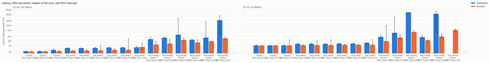
</picture>

### Latency, median

<picture>
  <source media="(prefers-color-scheme: dark)" srcset="latency_p50-dark.svg">
  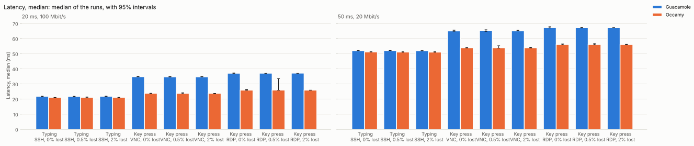
</picture>

### Frames shown per second

<picture>
  <source media="(prefers-color-scheme: dark)" srcset="fps-dark.svg">
  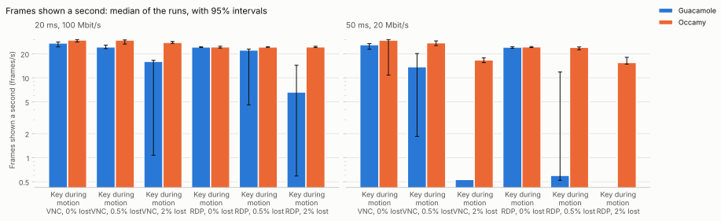
</picture>

### Scene frames never shown

<picture>
  <source media="(prefers-color-scheme: dark)" srcset="scene_missed-dark.svg">
  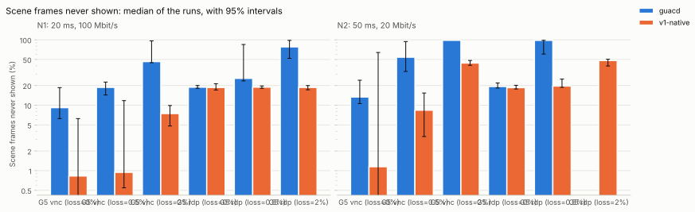
</picture>

### Gap between frames, 95th percentile

<picture>
  <source media="(prefers-color-scheme: dark)" srcset="frame_interval_p95-dark.svg">
  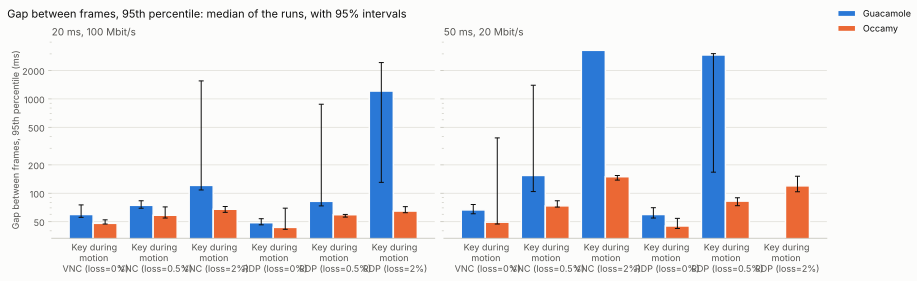
</picture>

### Data per frame

<picture>
  <source media="(prefers-color-scheme: dark)" srcset="bytes_per_frame-dark.svg">
  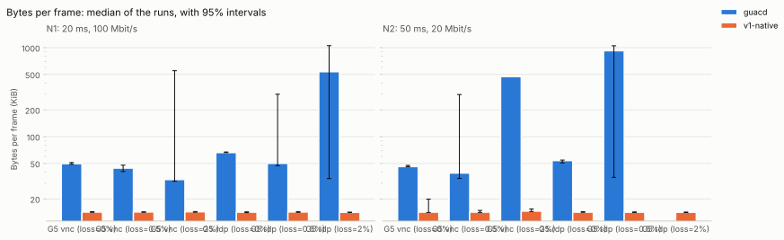
</picture>

### Server CPU per frame

<picture>
  <source media="(prefers-color-scheme: dark)" srcset="cpu_per_frame-dark.svg">
  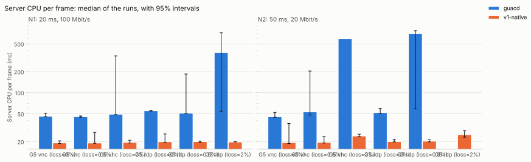
</picture>

### Server CPU time

<picture>
  <source media="(prefers-color-scheme: dark)" srcset="server_cpu-dark.svg">
  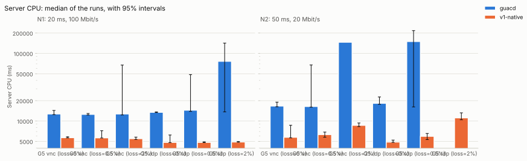
</picture>

### Server memory, peak

<picture>
  <source media="(prefers-color-scheme: dark)" srcset="server_mem-dark.svg">
  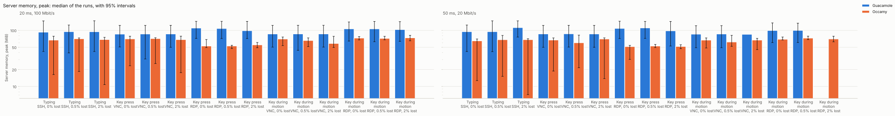
</picture>

### Client CPU time

<picture>
  <source media="(prefers-color-scheme: dark)" srcset="client_cpu-dark.svg">
  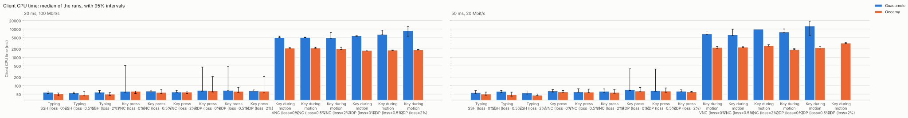
</picture>

### occamyd allocated

<picture>
  <source media="(prefers-color-scheme: dark)" srcset="occamyd_alloc-dark.svg">
  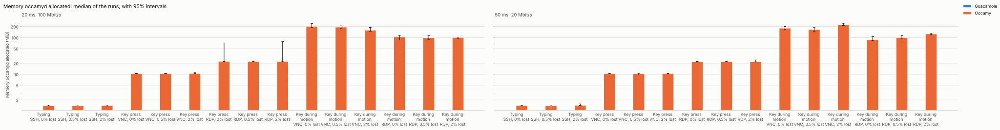
</picture>

### occamyd GC cycles

<picture>
  <source media="(prefers-color-scheme: dark)" srcset="occamyd_gc-dark.svg">
  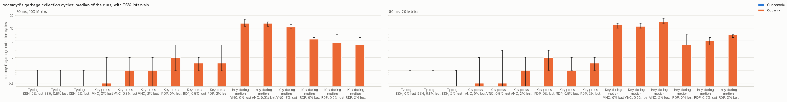
</picture>

### occamyd heap in use

<picture>
  <source media="(prefers-color-scheme: dark)" srcset="occamyd_heap-dark.svg">
  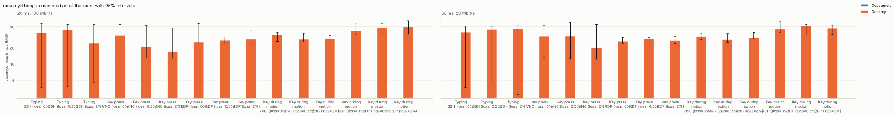
</picture>

### occamyd goroutines

<picture>
  <source media="(prefers-color-scheme: dark)" srcset="occamyd_goroutines-dark.svg">
  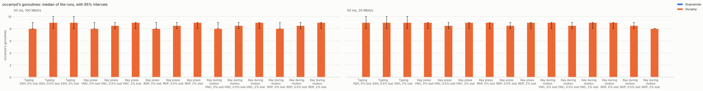
</picture>
