# Occamy with BBR against Occamy with CUBIC

The results in `bench-realtime-3a.json`, analysed by `bench/report.py` as [the comparison benchmark's spec](../../../../specs/008-native-architecture/comparison-benchmark.md) fixed before any data.

- Collected from 2026-11-03T11:10:15.449821Z, on Apple M5 Pro (18 CPUs, darwin), podman version 6.0.2.
- 8 runs, seed 20261103, 100 probe keys a scenario per run; load gate 8.
- 480 results analysed, 0 failed.

Values are the median of the runs, with an exact distribution-free 95% interval from order statistics. A factor is the Hodges–Lehmann estimate of the ratio of the two series, oriented so that above 1 means the second is better, with its exact 95% interval from the Mann–Whitney distribution. p is the exact two-sided permutation test of the rank sum over every split of the runs.

## Congestion control

Occamy with BBR (`v1-native-bbr`) against Occamy with CUBIC (`v1-native`): a factor above 1 means Occamy with BBR is better. Primary metrics, 30 tests, Holm-corrected at 0.05.

| Scenario | Network | Metric | Occamy with CUBIC | Occamy with BBR | Factor | p | p (Holm) |
|---|---|---|---:|---:|---:|---:|---:|
| Typing, SSH (loss=0%) (T1) | 20 ms, 100 Mbit/s (N1) | Latency, 95th percentile (ms) | 21.5 [21.3, 21.7] | 21.5 [21.4, 21.6] | 1.00x [0.997, 1.01] | 0.5929 | 1.0000 |
| Typing, SSH (loss=0.5%) (T1) | 20 ms, 100 Mbit/s (N1) | Latency, 95th percentile (ms) | 21.6 [21.3, 22.5] | 21.4 [21.3, 21.6] | 1.01x [1.00, 1.03] | 0.0468 | 1.0000 |
| Typing, SSH (loss=2%) (T1) | 20 ms, 100 Mbit/s (N1) | Latency, 95th percentile (ms) | 21.7 [21.5, 22.0] | 30.2 [21.6, 85.3] | 0.733x [0.435, 0.999] | 0.0379 | 0.8721 |
| Key press, VNC (loss=0%) (G2) | 20 ms, 100 Mbit/s (N1) | Latency, 95th percentile (ms) | 24.4 [24.3, 24.9] | 24.4 [24.3, 24.9] | 1.00x [0.994, 1.01] | 1.0000 | 1.0000 |
| Key press, VNC (loss=0.5%) (G2) | 20 ms, 100 Mbit/s (N1) | Latency, 95th percentile (ms) | 24.5 [24.3, 30.2] | 24.4 [24.3, 24.6] | 1.00x [0.996, 1.06] | 0.4418 | 1.0000 |
| Key press, VNC (loss=2%) (G2) | 20 ms, 100 Mbit/s (N1) | Latency, 95th percentile (ms) | 25.1 [24.5, 52.2] | 25.4 [24.4, 268] | 0.997x [0.493, 1.03] | 0.8785 | 1.0000 |
| Key press, RDP (loss=0%) (G2) | 20 ms, 100 Mbit/s (N1) | Latency, 95th percentile (ms) | 26.7 [26.5, 27.1] | 27.1 [26.6, 27.8] | 0.983x [0.976, 0.994] | 0.0104 | 0.2603 |
| Key press, RDP (loss=0.5%) (G2) | 20 ms, 100 Mbit/s (N1) | Latency, 95th percentile (ms) | 26.8 [26.4, 44.7] | 28.1 [26.6, 44.8] | 0.967x [0.909, 1.01] | 0.2345 | 1.0000 |
| Key press, RDP (loss=2%) (G2) | 20 ms, 100 Mbit/s (N1) | Latency, 95th percentile (ms) | 44.6 [27.4, 46.4] | 44.8 [26.7, 54.5] | 0.973x [0.627, 1.04] | 0.5737 | 1.0000 |
| Key during motion, VNC (loss=0%) (G5) | 20 ms, 100 Mbit/s (N1) | Latency, 95th percentile (ms) | 59.3 [55.1, 67.6] | 61.3 [58.0, 74.8] | 0.968x [0.878, 1.03] | 0.2345 | 1.0000 |
| Key during motion, VNC (loss=0.5%) (G5) | 20 ms, 100 Mbit/s (N1) | Latency, 95th percentile (ms) | 71.9 [67.3, 264] | 68.6 [65.8, 76.8] | 1.04x [0.974, 2.13] | 0.2345 | 1.0000 |
| Key during motion, VNC (loss=2%) (G5) | 20 ms, 100 Mbit/s (N1) | Latency, 95th percentile (ms) | 124 [99.3, 183] | 79.8 [72.4, 87.2] | 1.56x [1.36, 1.84] | 0.0002 | 0.0047 |
| Key during motion, RDP (loss=0%) (G5) | 20 ms, 100 Mbit/s (N1) | Latency, 95th percentile (ms) | 80.9 [79.2, 81.6] | 81.7 [79.8, 86.8] | 0.991x [0.969, 1.01] | 0.3823 | 1.0000 |
| Key during motion, RDP (loss=0.5%) (G5) | 20 ms, 100 Mbit/s (N1) | Latency, 95th percentile (ms) | 94.9 [92.4, 96.8] | 89.3 [81.7, 104] | 1.06x [0.939, 1.14] | 0.1949 | 1.0000 |
| Key during motion, RDP (loss=2%) (G5) | 20 ms, 100 Mbit/s (N1) | Latency, 95th percentile (ms) | 136 [109, 199] | 107 [91.3, 131] | 1.26x [1.07, 1.52] | 0.0104 | 0.2603 |
| Typing, SSH (loss=0%) (T1) | 50 ms, 20 Mbit/s (N2) | Latency, 95th percentile (ms) | 51.4 [51.3, 54.7] | 51.5 [51.5, 52.6] | 0.998x [0.995, 1.01] | 0.2345 | 1.0000 |
| Typing, SSH (loss=0.5%) (T1) | 50 ms, 20 Mbit/s (N2) | Latency, 95th percentile (ms) | 51.5 [51.4, 51.7] | 51.6 [51.4, 52.8] | 0.999x [0.988, 1.00] | 0.4587 | 1.0000 |
| Typing, SSH (loss=2%) (T1) | 50 ms, 20 Mbit/s (N2) | Latency, 95th percentile (ms) | 51.7 [51.4, 117] | 51.8 [51.4, 117] | 1.00x [0.993, 1.01] | 0.7984 | 1.0000 |
| Key press, VNC (loss=0%) (G2) | 50 ms, 20 Mbit/s (N2) | Latency, 95th percentile (ms) | 54.5 [54.3, 54.7] | 54.5 [54.2, 55.4] | 1x [0.997, 1.00] | 0.8785 | 1.0000 |
| Key press, VNC (loss=0.5%) (G2) | 50 ms, 20 Mbit/s (N2) | Latency, 95th percentile (ms) | 54.6 [54.5, 55.1] | 54.6 [54.4, 54.7] | 1.00x [0.998, 1.00] | 0.5540 | 1.0000 |
| Key press, VNC (loss=2%) (G2) | 50 ms, 20 Mbit/s (N2) | Latency, 95th percentile (ms) | 54.7 [54.5, 357] | 55.0 [54.4, 359] | 1x [0.976, 1.78] | 1.0000 | 1.0000 |
| Key press, RDP (loss=0%) (G2) | 50 ms, 20 Mbit/s (N2) | Latency, 95th percentile (ms) | 57.0 [56.5, 57.6] | 56.9 [56.5, 57.7] | 1.00x [0.996, 1.01] | 0.7984 | 1.0000 |
| Key press, RDP (loss=0.5%) (G2) | 50 ms, 20 Mbit/s (N2) | Latency, 95th percentile (ms) | 56.9 [56.4, 59.8] | 57.4 [56.6, 59.8] | 0.992x [0.973, 1.01] | 0.2786 | 1.0000 |
| Key press, RDP (loss=2%) (G2) | 50 ms, 20 Mbit/s (N2) | Latency, 95th percentile (ms) | 61.2 [56.8, 131] | 75.1 [56.9, 122] | 0.966x [0.686, 1.13] | 0.4418 | 1.0000 |
| Key during motion, VNC (loss=0%) (G5) | 50 ms, 20 Mbit/s (N2) | Latency, 95th percentile (ms) | 93.7 [89.9, 98.6] | 95.2 [92.7, 106] | 0.97x [0.925, 1.01] | 0.1049 | 1.0000 |
| Key during motion, VNC (loss=0.5%) (G5) | 50 ms, 20 Mbit/s (N2) | Latency, 95th percentile (ms) | 192 [125, 205] | 122 [94.8, 132] | 1.55x [1.27, 1.67] | 0.0011 | 0.0283 |
| Key during motion, VNC (loss=2%) (G5) | 50 ms, 20 Mbit/s (N2) | Latency, 95th percentile (ms) | 360 [291, 409] | 149 [136, 167] | 2.45x [2.29, 2.65] | 0.0002 | 0.0047 |
| Key during motion, RDP (loss=0%) (G5) | 50 ms, 20 Mbit/s (N2) | Latency, 95th percentile (ms) | 112 [110, 115] | 114 [111, 114] | 0.988x [0.973, 1.00] | 0.1049 | 1.0000 |
| Key during motion, RDP (loss=0.5%) (G5) | 50 ms, 20 Mbit/s (N2) | Latency, 95th percentile (ms) | 195 [151, 238] | 135 [127, 158] | 1.41x [1.22, 1.60] | 0.0003 | 0.0084 |
| Key during motion, RDP (loss=2%) (G5) | 50 ms, 20 Mbit/s (N2) | Latency, 95th percentile (ms) | 471 [396, 682] | 163 [150, 173] | 2.97x [2.78, 3.39] | 0.0002 | 0.0047 |

5 of 30 differences are significant after correction.

<picture>
  <source media="(prefers-color-scheme: dark)" srcset="factors-congestion-control-dark.svg">
  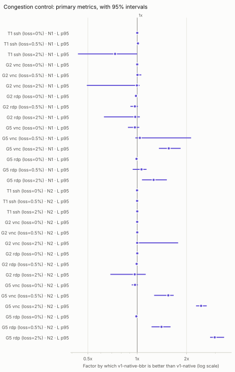
</picture>

### Congestion control: secondary metrics

Exploratory: the p-values are not corrected.

| Scenario | Network | Metric | Occamy with CUBIC | Occamy with BBR | Factor | p |
|---|---|---|---:|---:|---:|---:|
| Typing, SSH (loss=0%) (T1) | 20 ms, 100 Mbit/s (N1) | Latency, median (ms) | 21.0 [21.0, 21.2] | 21.1 [21.1, 21.2] | 0.996x [0.994, 1.00] | 0.0999 |
| Typing, SSH (loss=0%) (T1) | 20 ms, 100 Mbit/s (N1) | Server memory, peak (MiB) | 67.4 [13.5, 71.6] | 62.3 [5.52, 72.5] | 1.02x [0.682, 3.38] | 0.7002 |
| Typing, SSH (loss=0%) (T1) | 20 ms, 100 Mbit/s (N1) | Client CPU time (ms) | 49.0 [45.9, 53.4] | 47.5 [46.5, 57.7] | 1.03x [0.957, 1.08] | 0.5054 |
| Typing, SSH (loss=0.5%) (T1) | 20 ms, 100 Mbit/s (N1) | Latency, median (ms) | 21.1 [21.0, 21.2] | 21.0 [21.0, 21.2] | 1.00x [0.999, 1.01] | 0.1949 |
| Typing, SSH (loss=0.5%) (T1) | 20 ms, 100 Mbit/s (N1) | Server memory, peak (MiB) | 68.5 [38.1, 75.7] | 68.8 [10.5, 75.3] | 1.02x [0.883, 3.59] | 0.7984 |
| Typing, SSH (loss=0.5%) (T1) | 20 ms, 100 Mbit/s (N1) | Client CPU time (ms) | 47.5 [45.1, 54.0] | 47.6 [42.7, 49.7] | 1.01x [0.967, 1.11] | 0.7984 |
| Typing, SSH (loss=2%) (T1) | 20 ms, 100 Mbit/s (N1) | Latency, median (ms) | 21.1 [20.9, 21.2] | 21.1 [21.0, 21.7] | 0.999x [0.995, 1.00] | 0.7984 |
| Typing, SSH (loss=2%) (T1) | 20 ms, 100 Mbit/s (N1) | Server memory, peak (MiB) | 68.2 [39.8, 72.8] | 65.0 [12.0, 73.5] | 1.05x [0.873, 2.26] | 0.5737 |
| Typing, SSH (loss=2%) (T1) | 20 ms, 100 Mbit/s (N1) | Client CPU time (ms) | 49.0 [45.9, 54.7] | 48.5 [46.1, 60.7] | 1.01x [0.95, 1.07] | 0.7209 |
| Key press, VNC (loss=0%) (G2) | 20 ms, 100 Mbit/s (N1) | Latency, median (ms) | 23.7 [23.4, 23.9] | 23.7 [23.6, 23.8] | 1.00x [0.998, 1.01] | 0.5054 |
| Key press, VNC (loss=0%) (G2) | 20 ms, 100 Mbit/s (N1) | Server memory, peak (MiB) | 67.5 [19.3, 73.9] | 64.1 [13.8, 74.1] | 1.01x [0.65, 2.21] | 0.7984 |
| Key press, VNC (loss=0%) (G2) | 20 ms, 100 Mbit/s (N1) | Client CPU time (ms) | 58.4 [56.0, 62.4] | 59.1 [55.1, 64.2] | 0.982x [0.938, 1.01] | 0.2786 |
| Key press, VNC (loss=0.5%) (G2) | 20 ms, 100 Mbit/s (N1) | Latency, median (ms) | 23.7 [23.7, 24.2] | 23.7 [23.6, 23.8] | 1.00x [0.997, 1.01] | 0.3282 |
| Key press, VNC (loss=0.5%) (G2) | 20 ms, 100 Mbit/s (N1) | Server memory, peak (MiB) | 69.4 [38.1, 76.0] | 69.6 [17.2, 74.9] | 0.996x [0.751, 2.48] | 0.8570 |
| Key press, VNC (loss=0.5%) (G2) | 20 ms, 100 Mbit/s (N1) | Client CPU time (ms) | 59.7 [55.7, 79.1] | 56.3 [55.0, 66.3] | 1.05x [0.997, 1.26] | 0.0650 |
| Key press, VNC (loss=2%) (G2) | 20 ms, 100 Mbit/s (N1) | Latency, median (ms) | 23.8 [23.6, 24.6] | 23.8 [23.6, 23.9] | 1.00x [0.996, 1.01] | 0.9375 |
| Key press, VNC (loss=2%) (G2) | 20 ms, 100 Mbit/s (N1) | Server memory, peak (MiB) | 71.2 [39.6, 75.9] | 65.1 [17.8, 73.2] | 1.08x [0.971, 2.73] | 0.2786 |
| Key press, VNC (loss=2%) (G2) | 20 ms, 100 Mbit/s (N1) | Client CPU time (ms) | 59.2 [56.7, 73.0] | 59.5 [55.1, 63.7] | 1.01x [0.948, 1.12] | 0.7984 |
| Key press, RDP (loss=0%) (G2) | 20 ms, 100 Mbit/s (N1) | Latency, median (ms) | 25.9 [25.8, 26.0] | 25.9 [25.9, 26.1] | 0.997x [0.995, 1.00] | 0.0692 |
| Key press, RDP (loss=0%) (G2) | 20 ms, 100 Mbit/s (N1) | Server memory, peak (MiB) | 49.9 [43.3, 54.2] | 48.1 [43.8, 50.8] | 1.04x [0.984, 1.10] | 0.1049 |
| Key press, RDP (loss=0%) (G2) | 20 ms, 100 Mbit/s (N1) | Client CPU time (ms) | 61.5 [58.9, 67.3] | 63.4 [57.8, 74.6] | 0.977x [0.878, 1.05] | 0.5737 |
| Key press, RDP (loss=0.5%) (G2) | 20 ms, 100 Mbit/s (N1) | Latency, median (ms) | 25.9 [25.9, 26.0] | 25.9 [25.8, 26.0] | 1.00x [0.998, 1.00] | 0.8785 |
| Key press, RDP (loss=0.5%) (G2) | 20 ms, 100 Mbit/s (N1) | Server memory, peak (MiB) | 49.3 [29.1, 55.3] | 48.3 [45.8, 56.8] | 1.01x [0.897, 1.07] | 0.8785 |
| Key press, RDP (loss=0.5%) (G2) | 20 ms, 100 Mbit/s (N1) | Client CPU time (ms) | 61.9 [54.4, 70.3] | 62.9 [58.0, 69.0] | 0.991x [0.909, 1.06] | 0.6454 |
| Key press, RDP (loss=2%) (G2) | 20 ms, 100 Mbit/s (N1) | Latency, median (ms) | 25.9 [25.8, 26.5] | 25.9 [25.9, 26.3] | 0.999x [0.995, 1.00] | 0.4244 |
| Key press, RDP (loss=2%) (G2) | 20 ms, 100 Mbit/s (N1) | Server memory, peak (MiB) | 49.7 [26.2, 50.2] | 50.3 [46.3, 52.4] | 0.973x [0.945, 1.03] | 0.4418 |
| Key press, RDP (loss=2%) (G2) | 20 ms, 100 Mbit/s (N1) | Client CPU time (ms) | 63.9 [60.7, 91.6] | 62.9 [55.7, 80.5] | 1.02x [0.892, 1.14] | 0.5737 |
| Key during motion, VNC (loss=0%) (G5) | 20 ms, 100 Mbit/s (N1) | Frames shown per second (frames/s) | 29.9 [29.5, 30.1] | 29.7 [29.2, 30.2] | 0.999x [0.989, 1.01] | 0.8785 |
| Key during motion, VNC (loss=0%) (G5) | 20 ms, 100 Mbit/s (N1) | Scene frames never shown (%) | 0.398 [-0.278, 1.68] | 0.844 [-0.576, 2.54] | –x | 0.8785 |
| Key during motion, VNC (loss=0%) (G5) | 20 ms, 100 Mbit/s (N1) | Gap between frames, 95th percentile (ms) | 48.6 [46.1, 49.7] | 48.2 [46.9, 53.9] | 0.996x [0.95, 1.03] | 0.7984 |
| Key during motion, VNC (loss=0%) (G5) | 20 ms, 100 Mbit/s (N1) | Data per frame (KiB) | 14.2 [14.1, 14.3] | 14.2 [14.1, 14.3] | 0.998x [0.994, 1.00] | 0.6454 |
| Key during motion, VNC (loss=0%) (G5) | 20 ms, 100 Mbit/s (N1) | Server CPU per frame (ms) | 19.0 [18.8, 19.4] | 19.0 [18.9, 21.0] | 0.996x [0.935, 1.00] | 0.5054 |
| Key during motion, VNC (loss=0%) (G5) | 20 ms, 100 Mbit/s (N1) | Server CPU time (ms) | 5,641 [5,590, 5,732] | 5,681 [5,614, 6,187] | 0.993x [0.956, 1.00] | 0.1605 |
| Key during motion, VNC (loss=0%) (G5) | 20 ms, 100 Mbit/s (N1) | Server memory, peak (MiB) | 63.9 [49.8, 73.1] | 57.0 [46.3, 74.1] | 1.02x [0.868, 1.34] | 0.6454 |
| Key during motion, VNC (loss=0%) (G5) | 20 ms, 100 Mbit/s (N1) | Client CPU time (ms) | 2,157 [2,122, 2,188] | 2,152 [2,094, 2,360] | 1.00x [0.973, 1.03] | 0.6454 |
| Key during motion, VNC (loss=0.5%) (G5) | 20 ms, 100 Mbit/s (N1) | Frames shown per second (frames/s) | 29.6 [16.5, 30.0] | 29.6 [29.3, 30.0] | 1.00x [0.989, 1.48] | 0.8785 |
| Key during motion, VNC (loss=0.5%) (G5) | 20 ms, 100 Mbit/s (N1) | Scene frames never shown (%) | 1.17 [0.0894, 45.0] | 1.26 [0.0513, 2.47] | 1.18x [0.308, 21.4] | 0.8785 |
| Key during motion, VNC (loss=0.5%) (G5) | 20 ms, 100 Mbit/s (N1) | Gap between frames, 95th percentile (ms) | 58.1 [55.6, 174] | 56.9 [50.5, 63.6] | 1.08x [0.979, 2.07] | 0.1949 |
| Key during motion, VNC (loss=0.5%) (G5) | 20 ms, 100 Mbit/s (N1) | Data per frame (KiB) | 14.2 [14.1, 15.2] | 14.2 [14.0, 14.3] | 1.00x [0.994, 1.03] | 0.6454 |
| Key during motion, VNC (loss=0.5%) (G5) | 20 ms, 100 Mbit/s (N1) | Server CPU per frame (ms) | 19.1 [18.8, 34.8] | 19.1 [18.8, 19.7] | 1.00x [0.986, 1.69] | 0.5737 |
| Key during motion, VNC (loss=0.5%) (G5) | 20 ms, 100 Mbit/s (N1) | Server CPU time (ms) | 5,643 [5,599, 6,643] | 5,652 [5,569, 5,754] | 1.00x [0.991, 1.15] | 0.8785 |
| Key during motion, VNC (loss=0.5%) (G5) | 20 ms, 100 Mbit/s (N1) | Server memory, peak (MiB) | 68.8 [49.1, 76.0] | 58.4 [47.4, 73.2] | 1.04x [0.917, 1.42] | 0.5737 |
| Key during motion, VNC (loss=0.5%) (G5) | 20 ms, 100 Mbit/s (N1) | Client CPU time (ms) | 2,148 [1,815, 2,267] | 2,159 [2,102, 2,174] | 1.00x [0.882, 1.03] | 0.9591 |
| Key during motion, VNC (loss=2%) (G5) | 20 ms, 100 Mbit/s (N1) | Frames shown per second (frames/s) | 28.4 [23.2, 29.3] | 29.4 [28.9, 29.6] | 1.03x [1.01, 1.06] | 0.0006 |
| Key during motion, VNC (loss=2%) (G5) | 20 ms, 100 Mbit/s (N1) | Scene frames never shown (%) | 5.17 [2.46, 22.8] | 1.96 [1.27, 3.53] | 2.61x [1.60, 4.46] | 0.0006 |
| Key during motion, VNC (loss=2%) (G5) | 20 ms, 100 Mbit/s (N1) | Gap between frames, 95th percentile (ms) | 62.8 [61.2, 94.8] | 65.1 [61.9, 66.8] | 0.978x [0.944, 1.02] | 0.3823 |
| Key during motion, VNC (loss=2%) (G5) | 20 ms, 100 Mbit/s (N1) | Data per frame (KiB) | 14.2 [14.1, 14.6] | 14.2 [14.2, 14.4] | 1.00x [0.997, 1.01] | 0.3282 |
| Key during motion, VNC (loss=2%) (G5) | 20 ms, 100 Mbit/s (N1) | Server CPU per frame (ms) | 19.5 [19.2, 30.8] | 19.1 [19.0, 19.6] | 1.02x [1.01, 1.04] | 0.0207 |
| Key during motion, VNC (loss=2%) (G5) | 20 ms, 100 Mbit/s (N1) | Server CPU time (ms) | 5,599 [5,416, 7,332] | 5,612 [5,559, 5,727] | 0.998x [0.978, 1.03] | 0.8785 |
| Key during motion, VNC (loss=2%) (G5) | 20 ms, 100 Mbit/s (N1) | Server memory, peak (MiB) | 69.0 [48.2, 75.9] | 60.8 [48.3, 70.2] | 1.09x [0.967, 1.36] | 0.1605 |
| Key during motion, VNC (loss=2%) (G5) | 20 ms, 100 Mbit/s (N1) | Client CPU time (ms) | 2,066 [1,961, 2,230] | 2,157 [2,101, 2,206] | 0.963x [0.933, 1.01] | 0.1304 |
| Key during motion, RDP (loss=0%) (G5) | 20 ms, 100 Mbit/s (N1) | Frames shown per second (frames/s) | 24.5 [24.3, 24.9] | 24.5 [24.0, 24.7] | 0.997x [0.987, 1.01] | 0.5737 |
| Key during motion, RDP (loss=0%) (G5) | 20 ms, 100 Mbit/s (N1) | Scene frames never shown (%) | 18.3 [17.1, 19.0] | 18.3 [17.5, 19.8] | 0.985x [0.945, 1.03] | 0.5737 |
| Key during motion, RDP (loss=0%) (G5) | 20 ms, 100 Mbit/s (N1) | Gap between frames, 95th percentile (ms) | 42.4 [41.8, 43.4] | 45.5 [41.9, 57.3] | 0.937x [0.848, 1.00] | 0.1049 |
| Key during motion, RDP (loss=0%) (G5) | 20 ms, 100 Mbit/s (N1) | Data per frame (KiB) | 14.1 [14.0, 14.3] | 14.2 [14.0, 14.4] | 0.992x [0.984, 1.00] | 0.0830 |
| Key during motion, RDP (loss=0%) (G5) | 20 ms, 100 Mbit/s (N1) | Server CPU per frame (ms) | 19.6 [19.5, 19.8] | 20.0 [19.5, 20.8] | 0.985x [0.951, 1.00] | 0.1949 |
| Key during motion, RDP (loss=0%) (G5) | 20 ms, 100 Mbit/s (N1) | Server CPU time (ms) | 4,814 [4,767, 4,880] | 4,828 [4,800, 5,101] | 0.994x [0.955, 1.00] | 0.1949 |
| Key during motion, RDP (loss=0%) (G5) | 20 ms, 100 Mbit/s (N1) | Server memory, peak (MiB) | 68.8 [64.1, 73.1] | 71.7 [65.3, 75.1] | 0.975x [0.915, 1.03] | 0.3282 |
| Key during motion, RDP (loss=0%) (G5) | 20 ms, 100 Mbit/s (N1) | Client CPU time (ms) | 1,760 [1,712, 1,826] | 1,779 [1,717, 2,011] | 0.986x [0.944, 1.02] | 0.3823 |
| Key during motion, RDP (loss=0.5%) (G5) | 20 ms, 100 Mbit/s (N1) | Frames shown per second (frames/s) | 24.6 [23.7, 24.9] | 24.1 [23.6, 24.8] | 0.98x [0.967, 1.00] | 0.0650 |
| Key during motion, RDP (loss=0.5%) (G5) | 20 ms, 100 Mbit/s (N1) | Scene frames never shown (%) | 18.0 [17.0, 20.9] | 19.8 [17.3, 21.2] | 0.917x [0.874, 1.01] | 0.0650 |
| Key during motion, RDP (loss=0.5%) (G5) | 20 ms, 100 Mbit/s (N1) | Gap between frames, 95th percentile (ms) | 59.4 [54.2, 62.5] | 65.8 [60.1, 69.8] | 0.898x [0.857, 0.974] | 0.0019 |
| Key during motion, RDP (loss=0.5%) (G5) | 20 ms, 100 Mbit/s (N1) | Data per frame (KiB) | 14.1 [14.0, 14.4] | 14.4 [14.1, 14.5] | 0.984x [0.978, 1.00] | 0.0650 |
| Key during motion, RDP (loss=0.5%) (G5) | 20 ms, 100 Mbit/s (N1) | Server CPU per frame (ms) | 19.7 [19.4, 20.1] | 20.0 [19.5, 28.6] | 0.984x [0.902, 0.999] | 0.0379 |
| Key during motion, RDP (loss=0.5%) (G5) | 20 ms, 100 Mbit/s (N1) | Server CPU time (ms) | 4,827 [4,753, 4,906] | 4,830 [4,734, 6,760] | 0.998x [0.921, 1.00] | 0.4418 |
| Key during motion, RDP (loss=0.5%) (G5) | 20 ms, 100 Mbit/s (N1) | Server memory, peak (MiB) | 71.4 [61.9, 75.0] | 68.4 [63.1, 77.0] | 1.03x [0.944, 1.09] | 0.5054 |
| Key during motion, RDP (loss=0.5%) (G5) | 20 ms, 100 Mbit/s (N1) | Client CPU time (ms) | 1,817 [1,730, 1,851] | 1,827 [1,733, 2,017] | 0.99x [0.941, 1.02] | 0.4418 |
| Key during motion, RDP (loss=2%) (G5) | 20 ms, 100 Mbit/s (N1) | Frames shown per second (frames/s) | 23.9 [23.8, 24.7] | 24.4 [23.8, 25.0] | 1.01x [0.998, 1.03] | 0.1049 |
| Key during motion, RDP (loss=2%) (G5) | 20 ms, 100 Mbit/s (N1) | Scene frames never shown (%) | 20.2 [17.8, 20.7] | 18.7 [16.8, 20.5] | 1.06x [0.993, 1.15] | 0.1049 |
| Key during motion, RDP (loss=2%) (G5) | 20 ms, 100 Mbit/s (N1) | Gap between frames, 95th percentile (ms) | 62.8 [60.7, 79.3] | 68.4 [63.4, 78.6] | 0.942x [0.848, 1.01] | 0.1304 |
| Key during motion, RDP (loss=2%) (G5) | 20 ms, 100 Mbit/s (N1) | Data per frame (KiB) | 14.2 [14.1, 14.3] | 14.2 [14.0, 14.5] | 1.00x [0.993, 1.01] | 0.7984 |
| Key during motion, RDP (loss=2%) (G5) | 20 ms, 100 Mbit/s (N1) | Server CPU per frame (ms) | 20.1 [19.8, 20.6] | 19.8 [19.5, 20.2] | 1.02x [1.00, 1.03] | 0.0499 |
| Key during motion, RDP (loss=2%) (G5) | 20 ms, 100 Mbit/s (N1) | Server CPU time (ms) | 4,994 [4,776, 5,209] | 4,811 [4,766, 4,951] | 1.02x [1.00, 1.05] | 0.0379 |
| Key during motion, RDP (loss=2%) (G5) | 20 ms, 100 Mbit/s (N1) | Server memory, peak (MiB) | 71.0 [65.8, 74.3] | 71.0 [66.8, 78.8] | 0.991x [0.938, 1.04] | 0.9591 |
| Key during motion, RDP (loss=2%) (G5) | 20 ms, 100 Mbit/s (N1) | Client CPU time (ms) | 1,909 [1,778, 2,028] | 1,819 [1,754, 1,884] | 1.05x [0.994, 1.10] | 0.0830 |
| Typing, SSH (loss=0%) (T1) | 50 ms, 20 Mbit/s (N2) | Latency, median (ms) | 51.1 [51.0, 51.3] | 51.1 [51.0, 51.4] | 0.999x [0.997, 1.00] | 0.1949 |
| Typing, SSH (loss=0%) (T1) | 50 ms, 20 Mbit/s (N2) | Server memory, peak (MiB) | 66.5 [11.3, 73.1] | 68.7 [11.2, 76.6] | 0.975x [0.866, 2.34] | 0.6454 |
| Typing, SSH (loss=0%) (T1) | 50 ms, 20 Mbit/s (N2) | Client CPU time (ms) | 49.1 [46.2, 60.8] | 48.7 [45.1, 65.0] | 1x [0.92, 1.09] | 0.9807 |
| Typing, SSH (loss=0.5%) (T1) | 50 ms, 20 Mbit/s (N2) | Latency, median (ms) | 51.1 [51.0, 51.2] | 51.2 [51.0, 51.3] | 0.999x [0.997, 1.00] | 0.4875 |
| Typing, SSH (loss=0.5%) (T1) | 50 ms, 20 Mbit/s (N2) | Server memory, peak (MiB) | 69.2 [61.4, 75.3] | 65.8 [37.7, 78.1] | 1.06x [0.962, 1.46] | 0.2460 |
| Typing, SSH (loss=0.5%) (T1) | 50 ms, 20 Mbit/s (N2) | Client CPU time (ms) | 50.7 [46.2, 55.7] | 47.7 [42.8, 57.1] | 1.03x [0.935, 1.15] | 0.6454 |
| Typing, SSH (loss=2%) (T1) | 50 ms, 20 Mbit/s (N2) | Latency, median (ms) | 51.1 [51.0, 51.2] | 51.2 [51.1, 51.3] | 0.999x [0.997, 1.00] | 0.3282 |
| Typing, SSH (loss=2%) (T1) | 50 ms, 20 Mbit/s (N2) | Server memory, peak (MiB) | 66.3 [6.60, 72.5] | 67.5 [57.0, 70.7] | 0.997x [0.919, 1.10] | 0.9591 |
| Typing, SSH (loss=2%) (T1) | 50 ms, 20 Mbit/s (N2) | Client CPU time (ms) | 49.0 [44.8, 53.6] | 47.8 [46.1, 50.9] | 1.02x [0.972, 1.06] | 0.2786 |
| Key press, VNC (loss=0%) (G2) | 50 ms, 20 Mbit/s (N2) | Latency, median (ms) | 53.8 [53.8, 53.9] | 53.8 [53.6, 53.9] | 1.00x [0.999, 1.00] | 1.0000 |
| Key press, VNC (loss=0%) (G2) | 50 ms, 20 Mbit/s (N2) | Server memory, peak (MiB) | 70.4 [17.9, 76.8] | 71.0 [17.8, 76.8] | 0.989x [0.869, 1.34] | 0.7984 |
| Key press, VNC (loss=0%) (G2) | 50 ms, 20 Mbit/s (N2) | Client CPU time (ms) | 58.3 [55.8, 66.6] | 62.0 [56.5, 70.6] | 0.953x [0.851, 1.02] | 0.1049 |
| Key press, VNC (loss=0.5%) (G2) | 50 ms, 20 Mbit/s (N2) | Latency, median (ms) | 53.8 [53.7, 53.9] | 53.8 [53.6, 53.9] | 1x [0.998, 1.00] | 0.8564 |
| Key press, VNC (loss=0.5%) (G2) | 50 ms, 20 Mbit/s (N2) | Server memory, peak (MiB) | 69.2 [64.7, 75.9] | 69.2 [38.0, 79.7] | 1.00x [0.947, 1.49] | 0.7984 |
| Key press, VNC (loss=0.5%) (G2) | 50 ms, 20 Mbit/s (N2) | Client CPU time (ms) | 60.9 [57.4, 75.1] | 60.6 [56.4, 68.0] | 1.03x [0.967, 1.13] | 0.4418 |
| Key press, VNC (loss=2%) (G2) | 50 ms, 20 Mbit/s (N2) | Latency, median (ms) | 53.8 [53.6, 53.9] | 53.8 [53.6, 54.5] | 1.00x [0.998, 1.00] | 0.3823 |
| Key press, VNC (loss=2%) (G2) | 50 ms, 20 Mbit/s (N2) | Server memory, peak (MiB) | 68.7 [13.6, 76.1] | 70.0 [57.2, 72.3] | 0.992x [0.902, 1.09] | 0.8785 |
| Key press, VNC (loss=2%) (G2) | 50 ms, 20 Mbit/s (N2) | Client CPU time (ms) | 58.7 [56.3, 62.6] | 57.7 [56.6, 71.8] | 1.00x [0.936, 1.06] | 1.0000 |
| Key press, RDP (loss=0%) (G2) | 50 ms, 20 Mbit/s (N2) | Latency, median (ms) | 56.0 [56.0, 56.4] | 56.0 [56.0, 56.2] | 1.00x [0.999, 1.00] | 0.5737 |
| Key press, RDP (loss=0%) (G2) | 50 ms, 20 Mbit/s (N2) | Server memory, peak (MiB) | 48.2 [44.1, 51.9] | 48.7 [47.9, 50.7] | 0.995x [0.952, 1.03] | 0.7209 |
| Key press, RDP (loss=0%) (G2) | 50 ms, 20 Mbit/s (N2) | Client CPU time (ms) | 64.1 [61.5, 81.2] | 65.4 [61.2, 75.2] | 0.982x [0.923, 1.04] | 0.4418 |
| Key press, RDP (loss=0.5%) (G2) | 50 ms, 20 Mbit/s (N2) | Latency, median (ms) | 56.1 [56.0, 56.2] | 56.0 [55.9, 56.1] | 1.00x [1, 1.00] | 0.1605 |
| Key press, RDP (loss=0.5%) (G2) | 50 ms, 20 Mbit/s (N2) | Server memory, peak (MiB) | 49.4 [45.9, 51.8] | 50.5 [47.1, 52.3] | 0.976x [0.944, 1.03] | 0.5054 |
| Key press, RDP (loss=0.5%) (G2) | 50 ms, 20 Mbit/s (N2) | Client CPU time (ms) | 65.4 [60.8, 69.2] | 63.2 [57.7, 72.7] | 1.01x [0.949, 1.08] | 0.7984 |
| Key press, RDP (loss=2%) (G2) | 50 ms, 20 Mbit/s (N2) | Latency, median (ms) | 56.0 [56.0, 56.2] | 56.0 [55.9, 56.4] | 1.00x [0.996, 1.00] | 0.3823 |
| Key press, RDP (loss=2%) (G2) | 50 ms, 20 Mbit/s (N2) | Server memory, peak (MiB) | 52.2 [45.9, 56.5] | 48.1 [47.5, 54.8] | 1.07x [0.966, 1.14] | 0.2786 |
| Key press, RDP (loss=2%) (G2) | 50 ms, 20 Mbit/s (N2) | Client CPU time (ms) | 60.7 [59.0, 72.5] | 61.1 [55.9, 72.6] | 1.00x [0.909, 1.08] | 1.0000 |
| Key during motion, VNC (loss=0%) (G5) | 50 ms, 20 Mbit/s (N2) | Frames shown per second (frames/s) | 29.8 [29.3, 30.0] | 29.4 [28.7, 30.0] | 0.987x [0.973, 1.00] | 0.0650 |
| Key during motion, VNC (loss=0%) (G5) | 50 ms, 20 Mbit/s (N2) | Scene frames never shown (%) | 0.814 [-0.135, 2.33] | 1.92 [0.0412, 4.27] | –x | 0.0650 |
| Key during motion, VNC (loss=0%) (G5) | 50 ms, 20 Mbit/s (N2) | Gap between frames, 95th percentile (ms) | 47.3 [46.0, 48.9] | 49.2 [47.6, 64.8] | 0.959x [0.93, 0.988] | 0.0104 |
| Key during motion, VNC (loss=0%) (G5) | 50 ms, 20 Mbit/s (N2) | Data per frame (KiB) | 14.2 [14.1, 14.3] | 14.2 [14.1, 14.4] | 1.01x [0.996, 1.01] | 0.2786 |
| Key during motion, VNC (loss=0%) (G5) | 50 ms, 20 Mbit/s (N2) | Server CPU per frame (ms) | 19.0 [18.8, 21.3] | 19.1 [18.8, 20.1] | 0.992x [0.967, 1.01] | 0.1949 |
| Key during motion, VNC (loss=0%) (G5) | 50 ms, 20 Mbit/s (N2) | Server CPU time (ms) | 5,657 [5,618, 6,275] | 5,649 [5,582, 5,817] | 1.00x [0.986, 1.01] | 0.9591 |
| Key during motion, VNC (loss=0%) (G5) | 50 ms, 20 Mbit/s (N2) | Server memory, peak (MiB) | 68.5 [46.5, 76.0] | 70.8 [48.4, 76.3] | 0.963x [0.809, 1.38] | 0.4418 |
| Key during motion, VNC (loss=0%) (G5) | 50 ms, 20 Mbit/s (N2) | Client CPU time (ms) | 2,259 [2,203, 2,345] | 2,176 [2,157, 2,280] | 1.03x [1.01, 1.07] | 0.0148 |
| Key during motion, VNC (loss=0.5%) (G5) | 50 ms, 20 Mbit/s (N2) | Frames shown per second (frames/s) | 26.8 [25.0, 29.2] | 28.6 [27.7, 29.4] | 1.06x [1.01, 1.10] | 0.0148 |
| Key during motion, VNC (loss=0.5%) (G5) | 50 ms, 20 Mbit/s (N2) | Scene frames never shown (%) | 10.7 [2.77, 16.5] | 4.56 [2.06, 7.79] | 2.26x [1.34, 3.53] | 0.0148 |
| Key during motion, VNC (loss=0.5%) (G5) | 50 ms, 20 Mbit/s (N2) | Gap between frames, 95th percentile (ms) | 79.1 [67.6, 87.5] | 76.4 [57.8, 80.9] | 1.04x [0.911, 1.14] | 0.5054 |
| Key during motion, VNC (loss=0.5%) (G5) | 50 ms, 20 Mbit/s (N2) | Data per frame (KiB) | 14.2 [14.0, 14.4] | 14.2 [14.1, 14.6] | 1.00x [0.988, 1.01] | 1.0000 |
| Key during motion, VNC (loss=0.5%) (G5) | 50 ms, 20 Mbit/s (N2) | Server CPU per frame (ms) | 19.9 [19.0, 20.3] | 19.7 [19.1, 21.2] | 1.01x [0.967, 1.03] | 0.5054 |
| Key during motion, VNC (loss=0.5%) (G5) | 50 ms, 20 Mbit/s (N2) | Server CPU time (ms) | 6,199 [5,618, 6,602] | 5,627 [5,561, 6,085] | 1.09x [1.02, 1.13] | 0.0047 |
| Key during motion, VNC (loss=0.5%) (G5) | 50 ms, 20 Mbit/s (N2) | Server memory, peak (MiB) | 64.4 [50.5, 75.5] | 67.0 [48.4, 78.9] | 0.97x [0.794, 1.14] | 0.7984 |
| Key during motion, VNC (loss=0.5%) (G5) | 50 ms, 20 Mbit/s (N2) | Client CPU time (ms) | 2,286 [2,217, 2,600] | 2,237 [2,173, 2,283] | 1.03x [1, 1.06] | 0.0650 |
| Key during motion, VNC (loss=2%) (G5) | 50 ms, 20 Mbit/s (N2) | Frames shown per second (frames/s) | 16.4 [13.9, 19.4] | 27.6 [27.4, 28.9] | 1.69x [1.61, 1.88] | 0.0002 |
| Key during motion, VNC (loss=2%) (G5) | 50 ms, 20 Mbit/s (N2) | Scene frames never shown (%) | 45.4 [35.5, 53.7] | 8.08 [3.71, 8.81] | 6.06x [5.21, 7.49] | 0.0002 |
| Key during motion, VNC (loss=2%) (G5) | 50 ms, 20 Mbit/s (N2) | Gap between frames, 95th percentile (ms) | 134 [103, 153] | 91.6 [89.4, 101] | 1.41x [1.26, 1.59] | 0.0002 |
| Key during motion, VNC (loss=2%) (G5) | 50 ms, 20 Mbit/s (N2) | Data per frame (KiB) | 14.7 [14.4, 15.4] | 14.3 [14.1, 14.5] | 1.03x [1.02, 1.04] | 0.0006 |
| Key during motion, VNC (loss=2%) (G5) | 50 ms, 20 Mbit/s (N2) | Server CPU per frame (ms) | 24.9 [22.9, 26.2] | 19.6 [18.9, 21.0] | 1.26x [1.21, 1.33] | 0.0002 |
| Key during motion, VNC (loss=2%) (G5) | 50 ms, 20 Mbit/s (N2) | Server CPU time (ms) | 8,880 [8,164, 9,602] | 5,764 [5,591, 6,529] | 1.52x [1.43, 1.58] | 0.0002 |
| Key during motion, VNC (loss=2%) (G5) | 50 ms, 20 Mbit/s (N2) | Server memory, peak (MiB) | 68.0 [45.7, 75.6] | 68.8 [48.7, 72.0] | 0.989x [0.936, 1.11] | 0.6454 |
| Key during motion, VNC (loss=2%) (G5) | 50 ms, 20 Mbit/s (N2) | Client CPU time (ms) | 2,659 [2,444, 2,853] | 2,266 [2,057, 2,412] | 1.17x [1.11, 1.23] | 0.0002 |
| Key during motion, RDP (loss=0%) (G5) | 50 ms, 20 Mbit/s (N2) | Frames shown per second (frames/s) | 24.4 [23.9, 24.9] | 24.5 [24.2, 24.7] | 1.00x [0.99, 1.01] | 0.6454 |
| Key during motion, RDP (loss=0%) (G5) | 50 ms, 20 Mbit/s (N2) | Scene frames never shown (%) | 18.6 [17.0, 20.2] | 18.3 [17.8, 19.2] | 1.01x [0.953, 1.06] | 0.6454 |
| Key during motion, RDP (loss=0%) (G5) | 50 ms, 20 Mbit/s (N2) | Gap between frames, 95th percentile (ms) | 43.3 [41.3, 51.1] | 42.4 [41.7, 46.1] | 1.02x [0.983, 1.05] | 0.1949 |
| Key during motion, RDP (loss=0%) (G5) | 50 ms, 20 Mbit/s (N2) | Data per frame (KiB) | 14.2 [14.0, 14.4] | 14.2 [14.1, 14.3] | 1.00x [0.993, 1.01] | 0.7984 |
| Key during motion, RDP (loss=0%) (G5) | 50 ms, 20 Mbit/s (N2) | Server CPU per frame (ms) | 19.8 [19.5, 21.6] | 19.9 [19.6, 20.4] | 0.995x [0.982, 1.01] | 0.4418 |
| Key during motion, RDP (loss=0%) (G5) | 50 ms, 20 Mbit/s (N2) | Server CPU time (ms) | 4,852 [4,811, 5,238] | 4,903 [4,843, 4,999] | 0.99x [0.982, 1.00] | 0.0650 |
| Key during motion, RDP (loss=0%) (G5) | 50 ms, 20 Mbit/s (N2) | Server memory, peak (MiB) | 71.0 [62.6, 75.7] | 67.7 [64.6, 73.7] | 1.03x [0.958, 1.10] | 0.3823 |
| Key during motion, RDP (loss=0%) (G5) | 50 ms, 20 Mbit/s (N2) | Client CPU time (ms) | 1,908 [1,807, 1,945] | 1,878 [1,785, 1,947] | 1.02x [0.984, 1.05] | 0.3823 |
| Key during motion, RDP (loss=0.5%) (G5) | 50 ms, 20 Mbit/s (N2) | Frames shown per second (frames/s) | 24.1 [23.3, 24.5] | 24.6 [24.1, 24.9] | 1.02x [1.01, 1.04] | 0.0070 |
| Key during motion, RDP (loss=0.5%) (G5) | 50 ms, 20 Mbit/s (N2) | Scene frames never shown (%) | 19.7 [18.3, 22.4] | 17.9 [17.2, 19.5] | 1.08x [1.03, 1.17] | 0.0070 |
| Key during motion, RDP (loss=0.5%) (G5) | 50 ms, 20 Mbit/s (N2) | Gap between frames, 95th percentile (ms) | 78.9 [58.7, 83.4] | 79.8 [66.6, 88.8] | 0.956x [0.828, 1.04] | 0.2345 |
| Key during motion, RDP (loss=0.5%) (G5) | 50 ms, 20 Mbit/s (N2) | Data per frame (KiB) | 14.1 [14.0, 14.2] | 14.1 [14.0, 14.2] | 1.00x [0.995, 1.01] | 0.6454 |
| Key during motion, RDP (loss=0.5%) (G5) | 50 ms, 20 Mbit/s (N2) | Server CPU per frame (ms) | 20.0 [19.6, 20.4] | 19.8 [19.6, 20.8] | 1.00x [0.987, 1.02] | 0.7209 |
| Key during motion, RDP (loss=0.5%) (G5) | 50 ms, 20 Mbit/s (N2) | Server CPU time (ms) | 5,596 [4,790, 6,006] | 4,919 [4,826, 5,127] | 1.13x [1.09, 1.19] | 0.0104 |
| Key during motion, RDP (loss=0.5%) (G5) | 50 ms, 20 Mbit/s (N2) | Server memory, peak (MiB) | 71.7 [68.4, 73.1] | 70.3 [65.0, 73.8] | 1.02x [0.979, 1.05] | 0.2786 |
| Key during motion, RDP (loss=0.5%) (G5) | 50 ms, 20 Mbit/s (N2) | Client CPU time (ms) | 2,114 [1,912, 2,323] | 1,895 [1,801, 1,946] | 1.12x [1.06, 1.18] | 0.0011 |
| Key during motion, RDP (loss=2%) (G5) | 50 ms, 20 Mbit/s (N2) | Frames shown per second (frames/s) | 17.6 [15.4, 18.9] | 24.4 [24.1, 24.7] | 1.39x [1.35, 1.54] | 0.0002 |
| Key during motion, RDP (loss=2%) (G5) | 50 ms, 20 Mbit/s (N2) | Scene frames never shown (%) | 41.3 [36.9, 48.8] | 18.8 [17.6, 19.7] | 2.29x [2.09, 2.53] | 0.0002 |
| Key during motion, RDP (loss=2%) (G5) | 50 ms, 20 Mbit/s (N2) | Gap between frames, 95th percentile (ms) | 114 [104, 153] | 100 [91.6, 108] | 1.13x [1.06, 1.26] | 0.0047 |
| Key during motion, RDP (loss=2%) (G5) | 50 ms, 20 Mbit/s (N2) | Data per frame (KiB) | 14.2 [14.1, 14.2] | 14.2 [14.0, 14.3] | 1x [0.994, 1.01] | 0.9591 |
| Key during motion, RDP (loss=2%) (G5) | 50 ms, 20 Mbit/s (N2) | Server CPU per frame (ms) | 23.8 [22.3, 25.3] | 19.8 [19.6, 21.4] | 1.19x [1.15, 1.23] | 0.0002 |
| Key during motion, RDP (loss=2%) (G5) | 50 ms, 20 Mbit/s (N2) | Server CPU time (ms) | 10,257 [9,069, 11,498] | 5,284 [4,983, 5,470] | 1.96x [1.83, 2.10] | 0.0002 |
| Key during motion, RDP (loss=2%) (G5) | 50 ms, 20 Mbit/s (N2) | Server memory, peak (MiB) | 72.3 [67.0, 75.3] | 70.2 [63.8, 73.2] | 1.03x [0.994, 1.07] | 0.1049 |
| Key during motion, RDP (loss=2%) (G5) | 50 ms, 20 Mbit/s (N2) | Client CPU time (ms) | 3,162 [2,913, 3,428] | 2,010 [1,913, 2,130] | 1.56x [1.48, 1.64] | 0.0002 |

## Loss: what it adds

Per series, what each loss added to a metric over the same cell without loss, both on the link in the kernel: the Hodges–Lehmann estimate of the shift, with its exact 95% interval from the Mann–Whitney distribution, beside the condition's round trip. Primary metrics, 40 tests, Holm-corrected at 0.05.

| Series | Scenario | Network | Loss | Metric | Without loss | With loss | Added | Round trip | p | p (Holm) |
|---|---|---|---:|---|---:|---:|---:|---:|---:|---:|
| Occamy with CUBIC | Typing, SSH (T1) | 20 ms, 100 Mbit/s (N1) | 0.5% | Latency, 95th percentile (ms) | 21.5 [21.3, 21.7] | 21.6 [21.3, 22.5] | 0.139 [-0.087, 0.648] | 20 ms | 0.1520 | 1.0000 |
| Occamy with BBR | Typing, SSH (T1) | 20 ms, 100 Mbit/s (N1) | 0.5% | Latency, 95th percentile (ms) | 21.5 [21.4, 21.6] | 21.4 [21.3, 21.6] | -0.046 [-0.131, 0.05] | 20 ms | 0.5054 | 1.0000 |
| Occamy with CUBIC | Typing, SSH (T1) | 20 ms, 100 Mbit/s (N1) | 2% | Latency, 95th percentile (ms) | 21.5 [21.3, 21.7] | 21.7 [21.5, 22.0] | 0.189 [-0.02, 0.409] | 20 ms | 0.1049 | 1.0000 |
| Occamy with BBR | Typing, SSH (T1) | 20 ms, 100 Mbit/s (N1) | 2% | Latency, 95th percentile (ms) | 21.5 [21.4, 21.6] | 30.2 [21.6, 85.3] | 8.71 [0.238, 28.6] | 20 ms | 0.0002 | 0.0062 |
| Occamy with CUBIC | Key press, VNC (G2) | 20 ms, 100 Mbit/s (N1) | 0.5% | Latency, 95th percentile (ms) | 24.4 [24.3, 24.9] | 24.5 [24.3, 30.2] | 0.0835 [-0.136, 1.46] | 20 ms | 0.5737 | 1.0000 |
| Occamy with BBR | Key press, VNC (G2) | 20 ms, 100 Mbit/s (N1) | 0.5% | Latency, 95th percentile (ms) | 24.4 [24.3, 24.9] | 24.4 [24.3, 24.6] | -0.01 [-0.172, 0.107] | 20 ms | 0.8196 | 1.0000 |
| Occamy with CUBIC | Key press, VNC (G2) | 20 ms, 100 Mbit/s (N1) | 2% | Latency, 95th percentile (ms) | 24.4 [24.3, 24.9] | 25.1 [24.5, 52.2] | 0.545 [0.264, 25.1] | 20 ms | 0.0033 | 0.0718 |
| Occamy with BBR | Key press, VNC (G2) | 20 ms, 100 Mbit/s (N1) | 2% | Latency, 95th percentile (ms) | 24.4 [24.3, 24.9] | 25.4 [24.4, 268] | 0.817 [0.199, 27.0] | 20 ms | 0.0030 | 0.0679 |
| Occamy with CUBIC | Key press, RDP (G2) | 20 ms, 100 Mbit/s (N1) | 0.5% | Latency, 95th percentile (ms) | 26.7 [26.5, 27.1] | 26.8 [26.4, 44.7] | 0.196 [-0.119, 1.44] | 20 ms | 0.2786 | 1.0000 |
| Occamy with BBR | Key press, RDP (G2) | 20 ms, 100 Mbit/s (N1) | 0.5% | Latency, 95th percentile (ms) | 27.1 [26.6, 27.8] | 28.1 [26.6, 44.8] | 0.992 [-0.39, 3.83] | 20 ms | 0.1605 | 1.0000 |
| Occamy with CUBIC | Key press, RDP (G2) | 20 ms, 100 Mbit/s (N1) | 2% | Latency, 95th percentile (ms) | 26.7 [26.5, 27.1] | 44.6 [27.4, 46.4] | 17.9 [1.45, 18.8] | 20 ms | 0.0002 | 0.0062 |
| Occamy with BBR | Key press, RDP (G2) | 20 ms, 100 Mbit/s (N1) | 2% | Latency, 95th percentile (ms) | 27.1 [26.6, 27.8] | 44.8 [26.7, 54.5] | 17.7 [7.60, 20.4] | 20 ms | 0.0070 | 0.1399 |
| Occamy with CUBIC | Key during motion, VNC (G5) | 20 ms, 100 Mbit/s (N1) | 0.5% | Latency, 95th percentile (ms) | 59.3 [55.1, 67.6] | 71.9 [67.3, 264] | 12.6 [8.38, 90.6] | 20 ms | 0.0003 | 0.0084 |
| Occamy with BBR | Key during motion, VNC (G5) | 20 ms, 100 Mbit/s (N1) | 0.5% | Latency, 95th percentile (ms) | 61.3 [58.0, 74.8] | 68.6 [65.8, 76.8] | 7.91 [1.95, 12.4] | 20 ms | 0.0281 | 0.4782 |
| Occamy with CUBIC | Key during motion, VNC (G5) | 20 ms, 100 Mbit/s (N1) | 2% | Latency, 95th percentile (ms) | 59.3 [55.1, 67.6] | 124 [99.3, 183] | 64.5 [45.6, 87.1] | 20 ms | 0.0002 | 0.0062 |
| Occamy with BBR | Key during motion, VNC (G5) | 20 ms, 100 Mbit/s (N1) | 2% | Latency, 95th percentile (ms) | 61.3 [58.0, 74.8] | 79.8 [72.4, 87.2] | 17.3 [10.3, 21.9] | 20 ms | 0.0003 | 0.0084 |
| Occamy with CUBIC | Key during motion, RDP (G5) | 20 ms, 100 Mbit/s (N1) | 0.5% | Latency, 95th percentile (ms) | 80.9 [79.2, 81.6] | 94.9 [92.4, 96.8] | 14.2 [12.4, 15.4] | 20 ms | 0.0002 | 0.0062 |
| Occamy with BBR | Key during motion, RDP (G5) | 20 ms, 100 Mbit/s (N1) | 0.5% | Latency, 95th percentile (ms) | 81.7 [79.8, 86.8] | 89.3 [81.7, 104] | 7.61 [1.80, 18.8] | 20 ms | 0.0148 | 0.2805 |
| Occamy with CUBIC | Key during motion, RDP (G5) | 20 ms, 100 Mbit/s (N1) | 2% | Latency, 95th percentile (ms) | 80.9 [79.2, 81.6] | 136 [109, 199] | 55.7 [45.0, 83.4] | 20 ms | 0.0002 | 0.0062 |
| Occamy with BBR | Key during motion, RDP (G5) | 20 ms, 100 Mbit/s (N1) | 2% | Latency, 95th percentile (ms) | 81.7 [79.8, 86.8] | 107 [91.3, 131] | 24.2 [17.7, 47.3] | 20 ms | 0.0002 | 0.0062 |
| Occamy with CUBIC | Typing, SSH (T1) | 50 ms, 20 Mbit/s (N2) | 0.5% | Latency, 95th percentile (ms) | 51.4 [51.3, 54.7] | 51.5 [51.4, 51.7] | 0.081 [-0.456, 0.197] | 50 ms | 0.2345 | 1.0000 |
| Occamy with BBR | Typing, SSH (T1) | 50 ms, 20 Mbit/s (N2) | 0.5% | Latency, 95th percentile (ms) | 51.5 [51.5, 52.6] | 51.6 [51.4, 52.8] | 0.0175 [-0.159, 0.603] | 50 ms | 0.7209 | 1.0000 |
| Occamy with CUBIC | Typing, SSH (T1) | 50 ms, 20 Mbit/s (N2) | 2% | Latency, 95th percentile (ms) | 51.4 [51.3, 54.7] | 51.7 [51.4, 117] | 0.274 [-0.001, 0.968] | 50 ms | 0.0650 | 0.9744 |
| Occamy with BBR | Typing, SSH (T1) | 50 ms, 20 Mbit/s (N2) | 2% | Latency, 95th percentile (ms) | 51.5 [51.5, 52.6] | 51.8 [51.4, 117] | 0.189 [-0.074, 0.499] | 50 ms | 0.1949 | 1.0000 |
| Occamy with CUBIC | Key press, VNC (G2) | 50 ms, 20 Mbit/s (N2) | 0.5% | Latency, 95th percentile (ms) | 54.5 [54.3, 54.7] | 54.6 [54.5, 55.1] | 0.111 [-0.028, 0.314] | 50 ms | 0.0779 | 1.0000 |
| Occamy with BBR | Key press, VNC (G2) | 50 ms, 20 Mbit/s (N2) | 0.5% | Latency, 95th percentile (ms) | 54.5 [54.2, 55.4] | 54.6 [54.4, 54.7] | 0.076 [-0.113, 0.248] | 50 ms | 0.3823 | 1.0000 |
| Occamy with CUBIC | Key press, VNC (G2) | 50 ms, 20 Mbit/s (N2) | 2% | Latency, 95th percentile (ms) | 54.5 [54.3, 54.7] | 54.7 [54.5, 357] | 0.263 [0.06, 64.0] | 50 ms | 0.0148 | 0.2805 |
| Occamy with BBR | Key press, VNC (G2) | 50 ms, 20 Mbit/s (N2) | 2% | Latency, 95th percentile (ms) | 54.5 [54.2, 55.4] | 55.0 [54.4, 359] | 0.384 [0.045, 12.1] | 50 ms | 0.0499 | 0.7981 |
| Occamy with CUBIC | Key press, RDP (G2) | 50 ms, 20 Mbit/s (N2) | 0.5% | Latency, 95th percentile (ms) | 57.0 [56.5, 57.6] | 56.9 [56.4, 59.8] | -0.052 [-0.526, 0.712] | 50 ms | 0.8785 | 1.0000 |
| Occamy with BBR | Key press, RDP (G2) | 50 ms, 20 Mbit/s (N2) | 0.5% | Latency, 95th percentile (ms) | 56.9 [56.5, 57.7] | 57.4 [56.6, 59.8] | 0.57 [-0.09, 1.95] | 50 ms | 0.0650 | 0.9744 |
| Occamy with CUBIC | Key press, RDP (G2) | 50 ms, 20 Mbit/s (N2) | 2% | Latency, 95th percentile (ms) | 57.0 [56.5, 57.6] | 61.2 [56.8, 131] | 4.18 [0.682, 65.1] | 50 ms | 0.0047 | 0.0979 |
| Occamy with BBR | Key press, RDP (G2) | 50 ms, 20 Mbit/s (N2) | 2% | Latency, 95th percentile (ms) | 56.9 [56.5, 57.7] | 75.1 [56.9, 122] | 18.0 [1.67, 64.9] | 50 ms | 0.0019 | 0.0466 |
| Occamy with CUBIC | Key during motion, VNC (G5) | 50 ms, 20 Mbit/s (N2) | 0.5% | Latency, 95th percentile (ms) | 93.7 [89.9, 98.6] | 192 [125, 205] | 99.3 [59.1, 106] | 50 ms | 0.0002 | 0.0062 |
| Occamy with BBR | Key during motion, VNC (G5) | 50 ms, 20 Mbit/s (N2) | 0.5% | Latency, 95th percentile (ms) | 95.2 [92.7, 106] | 122 [94.8, 132] | 25.4 [16.7, 32.4] | 50 ms | 0.0019 | 0.0466 |
| Occamy with CUBIC | Key during motion, VNC (G5) | 50 ms, 20 Mbit/s (N2) | 2% | Latency, 95th percentile (ms) | 93.7 [89.9, 98.6] | 360 [291, 409] | 266 [255, 310] | 50 ms | 0.0002 | 0.0062 |
| Occamy with BBR | Key during motion, VNC (G5) | 50 ms, 20 Mbit/s (N2) | 2% | Latency, 95th percentile (ms) | 95.2 [92.7, 106] | 149 [136, 167] | 52.2 [43.3, 59.4] | 50 ms | 0.0002 | 0.0062 |
| Occamy with CUBIC | Key during motion, RDP (G5) | 50 ms, 20 Mbit/s (N2) | 0.5% | Latency, 95th percentile (ms) | 112 [110, 115] | 195 [151, 238] | 82.7 [55.8, 101] | 50 ms | 0.0002 | 0.0062 |
| Occamy with BBR | Key during motion, RDP (G5) | 50 ms, 20 Mbit/s (N2) | 0.5% | Latency, 95th percentile (ms) | 114 [111, 114] | 135 [127, 158] | 22.0 [14.4, 35.3] | 50 ms | 0.0002 | 0.0062 |
| Occamy with CUBIC | Key during motion, RDP (G5) | 50 ms, 20 Mbit/s (N2) | 2% | Latency, 95th percentile (ms) | 112 [110, 115] | 471 [396, 682] | 359 [350, 444] | 50 ms | 0.0002 | 0.0062 |
| Occamy with BBR | Key during motion, RDP (G5) | 50 ms, 20 Mbit/s (N2) | 2% | Latency, 95th percentile (ms) | 114 [111, 114] | 163 [150, 173] | 50.0 [38.7, 53.1] | 50 ms | 0.0002 | 0.0062 |

17 of 40 differences are significant after correction.

<picture>
  <source media="(prefers-color-scheme: dark)" srcset="loss-latency_p95-dark.svg">
  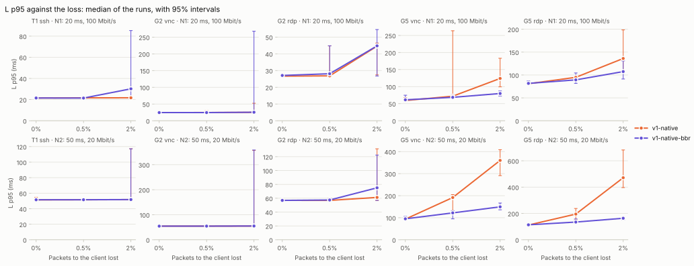
</picture>

<picture>
  <source media="(prefers-color-scheme: dark)" srcset="loss-fps-dark.svg">
  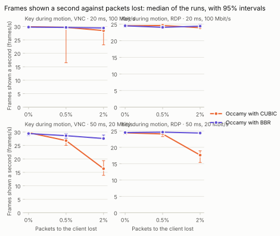
</picture>

<picture>
  <source media="(prefers-color-scheme: dark)" srcset="loss-frame_interval_p95-dark.svg">
  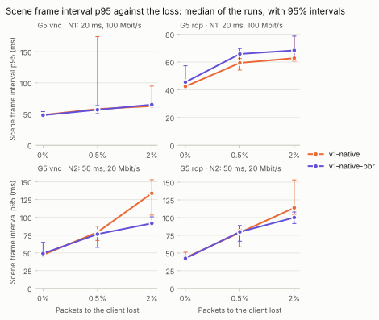
</picture>

### Secondary metrics: what the loss adds

Exploratory: the p-values are not corrected.

| Series | Scenario | Network | Loss | Metric | Without loss | With loss | Added | Round trip | p |
|---|---|---|---:|---|---:|---:|---:|---:|---:|
| Occamy with CUBIC | Typing, SSH (T1) | 20 ms, 100 Mbit/s (N1) | 0.5% | Latency, median (ms) | 21.0 [21.0, 21.2] | 21.1 [21.0, 21.2] | 0.043 [-0.063, 0.133] | 20 ms | 0.2664 |
| Occamy with CUBIC | Typing, SSH (T1) | 20 ms, 100 Mbit/s (N1) | 0.5% | Server memory, peak (MiB) | 67.4 [13.5, 71.6] | 68.5 [38.1, 75.7] | 3.29 [-5.97, 27.3] | 20 ms | 0.4875 |
| Occamy with CUBIC | Typing, SSH (T1) | 20 ms, 100 Mbit/s (N1) | 0.5% | Client CPU time (ms) | 49.0 [45.9, 53.4] | 47.5 [45.1, 54.0] | -1.41 [-4.72, 2.18] | 20 ms | 0.2345 |
| Occamy with BBR | Typing, SSH (T1) | 20 ms, 100 Mbit/s (N1) | 0.5% | Latency, median (ms) | 21.1 [21.1, 21.2] | 21.0 [21.0, 21.2] | -0.0835 [-0.133, -0.003] | 20 ms | 0.0379 |
| Occamy with BBR | Typing, SSH (T1) | 20 ms, 100 Mbit/s (N1) | 0.5% | Server memory, peak (MiB) | 62.3 [5.52, 72.5] | 68.8 [10.5, 75.3] | 4.41 [-15.2, 33.5] | 20 ms | 0.6454 |
| Occamy with BBR | Typing, SSH (T1) | 20 ms, 100 Mbit/s (N1) | 0.5% | Client CPU time (ms) | 47.5 [46.5, 57.7] | 47.6 [42.7, 49.7] | -0.913 [-4.25, 0.913] | 20 ms | 0.5737 |
| Occamy with CUBIC | Typing, SSH (T1) | 20 ms, 100 Mbit/s (N1) | 2% | Latency, median (ms) | 21.0 [21.0, 21.2] | 21.1 [20.9, 21.2] | 0.027 [-0.08, 0.1] | 20 ms | 0.5540 |
| Occamy with CUBIC | Typing, SSH (T1) | 20 ms, 100 Mbit/s (N1) | 2% | Server memory, peak (MiB) | 67.4 [13.5, 71.6] | 68.2 [39.8, 72.8] | 1.72 [-7.33, 26.3] | 20 ms | 0.5546 |
| Occamy with CUBIC | Typing, SSH (T1) | 20 ms, 100 Mbit/s (N1) | 2% | Client CPU time (ms) | 49.0 [45.9, 53.4] | 49.0 [45.9, 54.7] | 0.026 [-2.84, 3.01] | 20 ms | 0.9591 |
| Occamy with BBR | Typing, SSH (T1) | 20 ms, 100 Mbit/s (N1) | 2% | Latency, median (ms) | 21.1 [21.1, 21.2] | 21.1 [21.0, 21.7] | -0.0485 [-0.107, 0.024] | 20 ms | 0.2050 |
| Occamy with BBR | Typing, SSH (T1) | 20 ms, 100 Mbit/s (N1) | 2% | Server memory, peak (MiB) | 62.3 [5.52, 72.5] | 65.0 [12.0, 73.5] | 1.92 [-7.62, 30.4] | 20 ms | 0.5737 |
| Occamy with BBR | Typing, SSH (T1) | 20 ms, 100 Mbit/s (N1) | 2% | Client CPU time (ms) | 47.5 [46.5, 57.7] | 48.5 [46.1, 60.7] | 0.604 [-2.35, 2.88] | 20 ms | 0.5054 |
| Occamy with CUBIC | Key press, VNC (G2) | 20 ms, 100 Mbit/s (N1) | 0.5% | Latency, median (ms) | 23.7 [23.4, 23.9] | 23.7 [23.7, 24.2] | 0.002 [-0.083, 0.244] | 20 ms | 0.9591 |
| Occamy with CUBIC | Key press, VNC (G2) | 20 ms, 100 Mbit/s (N1) | 0.5% | Server memory, peak (MiB) | 67.5 [19.3, 73.9] | 69.4 [38.1, 76.0] | 2.48 [-14.6, 27.1] | 20 ms | 0.4869 |
| Occamy with CUBIC | Key press, VNC (G2) | 20 ms, 100 Mbit/s (N1) | 0.5% | Client CPU time (ms) | 58.4 [56.0, 62.4] | 59.7 [55.7, 79.1] | 1.66 [-1.41, 16.3] | 20 ms | 0.4418 |
| Occamy with BBR | Key press, VNC (G2) | 20 ms, 100 Mbit/s (N1) | 0.5% | Latency, median (ms) | 23.7 [23.6, 23.8] | 23.7 [23.6, 23.8] | 0.004 [-0.076, 0.077] | 20 ms | 1.0000 |
| Occamy with BBR | Key press, VNC (G2) | 20 ms, 100 Mbit/s (N1) | 0.5% | Server memory, peak (MiB) | 64.1 [13.8, 74.1] | 69.6 [17.2, 74.9] | 1.39 [-17.7, 33.9] | 20 ms | 0.4418 |
| Occamy with BBR | Key press, VNC (G2) | 20 ms, 100 Mbit/s (N1) | 0.5% | Client CPU time (ms) | 59.1 [55.1, 64.2] | 56.3 [55.0, 66.3] | -2.86 [-4.57, 1.09] | 20 ms | 0.1949 |
| Occamy with CUBIC | Key press, VNC (G2) | 20 ms, 100 Mbit/s (N1) | 2% | Latency, median (ms) | 23.7 [23.4, 23.9] | 23.8 [23.6, 24.6] | 0.0255 [-0.113, 0.27] | 20 ms | 0.5556 |
| Occamy with CUBIC | Key press, VNC (G2) | 20 ms, 100 Mbit/s (N1) | 2% | Server memory, peak (MiB) | 67.5 [19.3, 73.9] | 71.2 [39.6, 75.9] | 2.06 [-4.84, 26.0] | 20 ms | 0.3282 |
| Occamy with CUBIC | Key press, VNC (G2) | 20 ms, 100 Mbit/s (N1) | 2% | Client CPU time (ms) | 58.4 [56.0, 62.4] | 59.2 [56.7, 73.0] | 1.62 [-1.23, 7.83] | 20 ms | 0.3282 |
| Occamy with BBR | Key press, VNC (G2) | 20 ms, 100 Mbit/s (N1) | 2% | Latency, median (ms) | 23.7 [23.6, 23.8] | 23.8 [23.6, 23.9] | 0.058 [-0.064, 0.118] | 20 ms | 0.2909 |
| Occamy with BBR | Key press, VNC (G2) | 20 ms, 100 Mbit/s (N1) | 2% | Server memory, peak (MiB) | 64.1 [13.8, 74.1] | 65.1 [17.8, 73.2] | -0.815 [-37.3, 25.3] | 20 ms | 0.8785 |
| Occamy with BBR | Key press, VNC (G2) | 20 ms, 100 Mbit/s (N1) | 2% | Client CPU time (ms) | 59.1 [55.1, 64.2] | 59.5 [55.1, 63.7] | 0.057 [-3.56, 3.82] | 20 ms | 0.8785 |
| Occamy with CUBIC | Key press, RDP (G2) | 20 ms, 100 Mbit/s (N1) | 0.5% | Latency, median (ms) | 25.9 [25.8, 26.0] | 25.9 [25.9, 26.0] | 0.0465 [-0.014, 0.093] | 20 ms | 0.2047 |
| Occamy with CUBIC | Key press, RDP (G2) | 20 ms, 100 Mbit/s (N1) | 0.5% | Server memory, peak (MiB) | 49.9 [43.3, 54.2] | 49.3 [29.1, 55.3] | -0.629 [-3.81, 3.40] | 20 ms | 0.6645 |
| Occamy with CUBIC | Key press, RDP (G2) | 20 ms, 100 Mbit/s (N1) | 0.5% | Client CPU time (ms) | 61.5 [58.9, 67.3] | 61.9 [54.4, 70.3] | -0.528 [-4.67, 3.03] | 20 ms | 0.8785 |
| Occamy with BBR | Key press, RDP (G2) | 20 ms, 100 Mbit/s (N1) | 0.5% | Latency, median (ms) | 25.9 [25.9, 26.1] | 25.9 [25.8, 26.0] | -0.0225 [-0.077, 0.032] | 20 ms | 0.5737 |
| Occamy with BBR | Key press, RDP (G2) | 20 ms, 100 Mbit/s (N1) | 0.5% | Server memory, peak (MiB) | 48.1 [43.8, 50.8] | 48.3 [45.8, 56.8] | 0.658 [-2.09, 5.59] | 20 ms | 0.5737 |
| Occamy with BBR | Key press, RDP (G2) | 20 ms, 100 Mbit/s (N1) | 0.5% | Client CPU time (ms) | 63.4 [57.8, 74.6] | 62.9 [58.0, 69.0] | -1.21 [-8.29, 3.40] | 20 ms | 0.5737 |
| Occamy with CUBIC | Key press, RDP (G2) | 20 ms, 100 Mbit/s (N1) | 2% | Latency, median (ms) | 25.9 [25.8, 26.0] | 25.9 [25.8, 26.5] | 0.043 [-0.025, 0.124] | 20 ms | 0.2235 |
| Occamy with CUBIC | Key press, RDP (G2) | 20 ms, 100 Mbit/s (N1) | 2% | Server memory, peak (MiB) | 49.9 [43.3, 54.2] | 49.7 [26.2, 50.2] | -0.93 [-3.98, 1.20] | 20 ms | 0.5737 |
| Occamy with CUBIC | Key press, RDP (G2) | 20 ms, 100 Mbit/s (N1) | 2% | Client CPU time (ms) | 61.5 [58.9, 67.3] | 63.9 [60.7, 91.6] | 2.51 [-1.35, 10.1] | 20 ms | 0.1605 |
| Occamy with BBR | Key press, RDP (G2) | 20 ms, 100 Mbit/s (N1) | 2% | Latency, median (ms) | 25.9 [25.9, 26.1] | 25.9 [25.9, 26.3] | 0.02 [-0.058, 0.111] | 20 ms | 0.4418 |
| Occamy with BBR | Key press, RDP (G2) | 20 ms, 100 Mbit/s (N1) | 2% | Server memory, peak (MiB) | 48.1 [43.8, 50.8] | 50.3 [46.3, 52.4] | 1.70 [-0.391, 4.43] | 20 ms | 0.0830 |
| Occamy with BBR | Key press, RDP (G2) | 20 ms, 100 Mbit/s (N1) | 2% | Client CPU time (ms) | 63.4 [57.8, 74.6] | 62.9 [55.7, 80.5] | 0.511 [-7.02, 9.37] | 20 ms | 0.9591 |
| Occamy with CUBIC | Key during motion, VNC (G5) | 20 ms, 100 Mbit/s (N1) | 0.5% | Frames shown per second (frames/s) | 29.9 [29.5, 30.1] | 29.6 [16.5, 30.0] | -0.213 [-9.80, 0.038] | 20 ms | 0.1304 |
| Occamy with CUBIC | Key during motion, VNC (G5) | 20 ms, 100 Mbit/s (N1) | 0.5% | Scene frames never shown (%) | 0.398 [-0.278, 1.68] | 1.17 [0.0894, 45.0] | 0.71 [-0.127, 32.7] | 20 ms | 0.1304 |
| Occamy with CUBIC | Key during motion, VNC (G5) | 20 ms, 100 Mbit/s (N1) | 0.5% | Gap between frames, 95th percentile (ms) | 48.6 [46.1, 49.7] | 58.1 [55.6, 174] | 10.6 [8.53, 72.4] | 20 ms | 0.0002 |
| Occamy with CUBIC | Key during motion, VNC (G5) | 20 ms, 100 Mbit/s (N1) | 0.5% | Data per frame (KiB) | 14.2 [14.1, 14.3] | 14.2 [14.1, 15.2] | 0.0647 [-0.0411, 0.519] | 20 ms | 0.3282 |
| Occamy with CUBIC | Key during motion, VNC (G5) | 20 ms, 100 Mbit/s (N1) | 0.5% | Server CPU per frame (ms) | 19.0 [18.8, 19.4] | 19.1 [18.8, 34.8] | 0.174 [-0.103, 13.5] | 20 ms | 0.3282 |
| Occamy with CUBIC | Key during motion, VNC (G5) | 20 ms, 100 Mbit/s (N1) | 0.5% | Server CPU time (ms) | 5,641 [5,590, 5,732] | 5,643 [5,599, 6,643] | 7.43 [-42.9, 867] | 20 ms | 0.7984 |
| Occamy with CUBIC | Key during motion, VNC (G5) | 20 ms, 100 Mbit/s (N1) | 0.5% | Server memory, peak (MiB) | 63.9 [49.8, 73.1] | 68.8 [49.1, 76.0] | 3.40 [-11.2, 17.2] | 20 ms | 0.5054 |
| Occamy with CUBIC | Key during motion, VNC (G5) | 20 ms, 100 Mbit/s (N1) | 0.5% | Client CPU time (ms) | 2,157 [2,122, 2,188] | 2,148 [1,815, 2,267] | -5.01 [-264, 45.7] | 20 ms | 0.8785 |
| Occamy with BBR | Key during motion, VNC (G5) | 20 ms, 100 Mbit/s (N1) | 0.5% | Frames shown per second (frames/s) | 29.7 [29.2, 30.2] | 29.6 [29.3, 30.0] | -0.155 [-0.489, 0.132] | 20 ms | 0.3282 |
| Occamy with BBR | Key during motion, VNC (G5) | 20 ms, 100 Mbit/s (N1) | 0.5% | Scene frames never shown (%) | 0.844 [-0.576, 2.54] | 1.26 [0.0513, 2.47] | 0.516 [-0.441, 1.63] | 20 ms | 0.3282 |
| Occamy with BBR | Key during motion, VNC (G5) | 20 ms, 100 Mbit/s (N1) | 0.5% | Gap between frames, 95th percentile (ms) | 48.2 [46.9, 53.9] | 56.9 [50.5, 63.6] | 7.89 [3.61, 11.7] | 20 ms | 0.0011 |
| Occamy with BBR | Key during motion, VNC (G5) | 20 ms, 100 Mbit/s (N1) | 0.5% | Data per frame (KiB) | 14.2 [14.1, 14.3] | 14.2 [14.0, 14.3] | 0.0107 [-0.0999, 0.12] | 20 ms | 0.7984 |
| Occamy with BBR | Key during motion, VNC (G5) | 20 ms, 100 Mbit/s (N1) | 0.5% | Server CPU per frame (ms) | 19.0 [18.9, 21.0] | 19.1 [18.8, 19.7] | 0.0314 [-1.09, 0.249] | 20 ms | 0.8785 |
| Occamy with BBR | Key during motion, VNC (G5) | 20 ms, 100 Mbit/s (N1) | 0.5% | Server CPU time (ms) | 5,681 [5,614, 6,187] | 5,652 [5,569, 5,754] | -37.2 [-241, 28.0] | 20 ms | 0.1949 |
| Occamy with BBR | Key during motion, VNC (G5) | 20 ms, 100 Mbit/s (N1) | 0.5% | Server memory, peak (MiB) | 57.0 [46.3, 74.1] | 58.4 [47.4, 73.2] | 0.587 [-16.1, 19.2] | 20 ms | 0.6454 |
| Occamy with BBR | Key during motion, VNC (G5) | 20 ms, 100 Mbit/s (N1) | 0.5% | Client CPU time (ms) | 2,152 [2,094, 2,360] | 2,159 [2,102, 2,174] | 3.24 [-69.8, 47.5] | 20 ms | 0.7984 |
| Occamy with CUBIC | Key during motion, VNC (G5) | 20 ms, 100 Mbit/s (N1) | 2% | Frames shown per second (frames/s) | 29.9 [29.5, 30.1] | 28.4 [23.2, 29.3] | -1.38 [-2.13, -0.955] | 20 ms | 0.0002 |
| Occamy with CUBIC | Key during motion, VNC (G5) | 20 ms, 100 Mbit/s (N1) | 2% | Scene frames never shown (%) | 0.398 [-0.278, 1.68] | 5.17 [2.46, 22.8] | 4.61 [3.18, 7.08] | 20 ms | 0.0002 |
| Occamy with CUBIC | Key during motion, VNC (G5) | 20 ms, 100 Mbit/s (N1) | 2% | Gap between frames, 95th percentile (ms) | 48.6 [46.1, 49.7] | 62.8 [61.2, 94.8] | 15.0 [13.2, 17.8] | 20 ms | 0.0002 |
| Occamy with CUBIC | Key during motion, VNC (G5) | 20 ms, 100 Mbit/s (N1) | 2% | Data per frame (KiB) | 14.2 [14.1, 14.3] | 14.2 [14.1, 14.6] | 0.0841 [0.00619, 0.184] | 20 ms | 0.0499 |
| Occamy with CUBIC | Key during motion, VNC (G5) | 20 ms, 100 Mbit/s (N1) | 2% | Server CPU per frame (ms) | 19.0 [18.8, 19.4] | 19.5 [19.2, 30.8] | 0.537 [0.218, 0.954] | 20 ms | 0.0030 |
| Occamy with CUBIC | Key during motion, VNC (G5) | 20 ms, 100 Mbit/s (N1) | 2% | Server CPU time (ms) | 5,641 [5,590, 5,732] | 5,599 [5,416, 7,332] | -48.5 [-149, 148] | 20 ms | 0.4418 |
| Occamy with CUBIC | Key during motion, VNC (G5) | 20 ms, 100 Mbit/s (N1) | 2% | Server memory, peak (MiB) | 63.9 [49.8, 73.1] | 69.0 [48.2, 75.9] | 5.84 [-2.75, 17.7] | 20 ms | 0.1605 |
| Occamy with CUBIC | Key during motion, VNC (G5) | 20 ms, 100 Mbit/s (N1) | 2% | Client CPU time (ms) | 2,157 [2,122, 2,188] | 2,066 [1,961, 2,230] | -91.5 [-142, 19.4] | 20 ms | 0.0830 |
| Occamy with BBR | Key during motion, VNC (G5) | 20 ms, 100 Mbit/s (N1) | 2% | Frames shown per second (frames/s) | 29.7 [29.2, 30.2] | 29.4 [28.9, 29.6] | -0.442 [-0.71, -0.126] | 20 ms | 0.0148 |
| Occamy with BBR | Key during motion, VNC (G5) | 20 ms, 100 Mbit/s (N1) | 2% | Scene frames never shown (%) | 0.844 [-0.576, 2.54] | 1.96 [1.27, 3.53] | 1.47 [0.42, 2.37] | 20 ms | 0.0148 |
| Occamy with BBR | Key during motion, VNC (G5) | 20 ms, 100 Mbit/s (N1) | 2% | Gap between frames, 95th percentile (ms) | 48.2 [46.9, 53.9] | 65.1 [61.9, 66.8] | 16.3 [13.4, 18.1] | 20 ms | 0.0002 |
| Occamy with BBR | Key during motion, VNC (G5) | 20 ms, 100 Mbit/s (N1) | 2% | Data per frame (KiB) | 14.2 [14.1, 14.3] | 14.2 [14.2, 14.4] | 0.0244 [-0.0405, 0.101] | 20 ms | 0.4418 |
| Occamy with BBR | Key during motion, VNC (G5) | 20 ms, 100 Mbit/s (N1) | 2% | Server CPU per frame (ms) | 19.0 [18.9, 21.0] | 19.1 [19.0, 19.6] | 0.0623 [-1.07, 0.269] | 20 ms | 0.5054 |
| Occamy with BBR | Key during motion, VNC (G5) | 20 ms, 100 Mbit/s (N1) | 2% | Server CPU time (ms) | 5,681 [5,614, 6,187] | 5,612 [5,559, 5,727] | -82.8 [-295, -13.5] | 20 ms | 0.0148 |
| Occamy with BBR | Key during motion, VNC (G5) | 20 ms, 100 Mbit/s (N1) | 2% | Server memory, peak (MiB) | 57.0 [46.3, 74.1] | 60.8 [48.3, 70.2] | 0.334 [-14.6, 16.4] | 20 ms | 0.8785 |
| Occamy with BBR | Key during motion, VNC (G5) | 20 ms, 100 Mbit/s (N1) | 2% | Client CPU time (ms) | 2,152 [2,094, 2,360] | 2,157 [2,101, 2,206] | 4.51 [-65.1, 50.1] | 20 ms | 0.8785 |
| Occamy with CUBIC | Key during motion, RDP (G5) | 20 ms, 100 Mbit/s (N1) | 0.5% | Frames shown per second (frames/s) | 24.5 [24.3, 24.9] | 24.6 [23.7, 24.9] | 0.0391 [-0.239, 0.228] | 20 ms | 0.7984 |
| Occamy with CUBIC | Key during motion, RDP (G5) | 20 ms, 100 Mbit/s (N1) | 0.5% | Scene frames never shown (%) | 18.3 [17.1, 19.0] | 18.0 [17.0, 20.9] | -0.13 [-0.76, 0.796] | 20 ms | 0.7984 |
| Occamy with CUBIC | Key during motion, RDP (G5) | 20 ms, 100 Mbit/s (N1) | 0.5% | Gap between frames, 95th percentile (ms) | 42.4 [41.8, 43.4] | 59.4 [54.2, 62.5] | 16.9 [15.6, 18.0] | 20 ms | 0.0002 |
| Occamy with CUBIC | Key during motion, RDP (G5) | 20 ms, 100 Mbit/s (N1) | 0.5% | Data per frame (KiB) | 14.1 [14.0, 14.3] | 14.1 [14.0, 14.4] | 0.0566 [-0.00867, 0.116] | 20 ms | 0.3282 |
| Occamy with CUBIC | Key during motion, RDP (G5) | 20 ms, 100 Mbit/s (N1) | 0.5% | Server CPU per frame (ms) | 19.6 [19.5, 19.8] | 19.7 [19.4, 20.1] | 0.0546 [-0.0431, 0.231] | 20 ms | 0.3282 |
| Occamy with CUBIC | Key during motion, RDP (G5) | 20 ms, 100 Mbit/s (N1) | 0.5% | Server CPU time (ms) | 4,814 [4,767, 4,880] | 4,827 [4,753, 4,906] | 12.1 [-22.5, 57.0] | 20 ms | 0.5737 |
| Occamy with CUBIC | Key during motion, RDP (G5) | 20 ms, 100 Mbit/s (N1) | 0.5% | Server memory, peak (MiB) | 68.8 [64.1, 73.1] | 71.4 [61.9, 75.0] | 2.16 [-1.89, 5.60] | 20 ms | 0.2786 |
| Occamy with CUBIC | Key during motion, RDP (G5) | 20 ms, 100 Mbit/s (N1) | 0.5% | Client CPU time (ms) | 1,760 [1,712, 1,826] | 1,817 [1,730, 1,851] | 30.8 [-4.31, 96.9] | 20 ms | 0.1304 |
| Occamy with BBR | Key during motion, RDP (G5) | 20 ms, 100 Mbit/s (N1) | 0.5% | Frames shown per second (frames/s) | 24.5 [24.0, 24.7] | 24.1 [23.6, 24.8] | -0.411 [-0.682, 0.0189] | 20 ms | 0.0650 |
| Occamy with BBR | Key during motion, RDP (G5) | 20 ms, 100 Mbit/s (N1) | 0.5% | Scene frames never shown (%) | 18.3 [17.5, 19.8] | 19.8 [17.3, 21.2] | 1.37 [-0.0631, 2.27] | 20 ms | 0.0650 |
| Occamy with BBR | Key during motion, RDP (G5) | 20 ms, 100 Mbit/s (N1) | 0.5% | Gap between frames, 95th percentile (ms) | 45.5 [41.9, 57.3] | 65.8 [60.1, 69.8] | 19.2 [13.0, 24.9] | 20 ms | 0.0002 |
| Occamy with BBR | Key during motion, RDP (G5) | 20 ms, 100 Mbit/s (N1) | 0.5% | Data per frame (KiB) | 14.2 [14.0, 14.4] | 14.4 [14.1, 14.5] | 0.114 [-0.0606, 0.271] | 20 ms | 0.1605 |
| Occamy with BBR | Key during motion, RDP (G5) | 20 ms, 100 Mbit/s (N1) | 0.5% | Server CPU per frame (ms) | 20.0 [19.5, 20.8] | 20.0 [19.5, 28.6] | 0.111 [-0.459, 1.96] | 20 ms | 0.4418 |
| Occamy with BBR | Key during motion, RDP (G5) | 20 ms, 100 Mbit/s (N1) | 0.5% | Server CPU time (ms) | 4,828 [4,800, 5,101] | 4,830 [4,734, 6,760] | 6.32 [-99.5, 392] | 20 ms | 0.5054 |
| Occamy with BBR | Key during motion, RDP (G5) | 20 ms, 100 Mbit/s (N1) | 0.5% | Server memory, peak (MiB) | 71.7 [65.3, 75.1] | 68.4 [63.1, 77.0] | -1.24 [-6.06, 3.51] | 20 ms | 0.6454 |
| Occamy with BBR | Key during motion, RDP (G5) | 20 ms, 100 Mbit/s (N1) | 0.5% | Client CPU time (ms) | 1,779 [1,717, 2,011] | 1,827 [1,733, 2,017] | 31.3 [-42.6, 112] | 20 ms | 0.3282 |
| Occamy with CUBIC | Key during motion, RDP (G5) | 20 ms, 100 Mbit/s (N1) | 2% | Frames shown per second (frames/s) | 24.5 [24.3, 24.9] | 23.9 [23.8, 24.7] | -0.516 [-0.768, -0.166] | 20 ms | 0.0070 |
| Occamy with CUBIC | Key during motion, RDP (G5) | 20 ms, 100 Mbit/s (N1) | 2% | Scene frames never shown (%) | 18.3 [17.1, 19.0] | 20.2 [17.8, 20.7] | 1.72 [0.553, 2.56] | 20 ms | 0.0070 |
| Occamy with CUBIC | Key during motion, RDP (G5) | 20 ms, 100 Mbit/s (N1) | 2% | Gap between frames, 95th percentile (ms) | 42.4 [41.8, 43.4] | 62.8 [60.7, 79.3] | 20.3 [19.2, 35.7] | 20 ms | 0.0002 |
| Occamy with CUBIC | Key during motion, RDP (G5) | 20 ms, 100 Mbit/s (N1) | 2% | Data per frame (KiB) | 14.1 [14.0, 14.3] | 14.2 [14.1, 14.3] | 0.0984 [0.00337, 0.16] | 20 ms | 0.0148 |
| Occamy with CUBIC | Key during motion, RDP (G5) | 20 ms, 100 Mbit/s (N1) | 2% | Server CPU per frame (ms) | 19.6 [19.5, 19.8] | 20.1 [19.8, 20.6] | 0.439 [0.232, 0.616] | 20 ms | 0.0006 |
| Occamy with CUBIC | Key during motion, RDP (G5) | 20 ms, 100 Mbit/s (N1) | 2% | Server CPU time (ms) | 4,814 [4,767, 4,880] | 4,994 [4,776, 5,209] | 167 [26.5, 238] | 20 ms | 0.0104 |
| Occamy with CUBIC | Key during motion, RDP (G5) | 20 ms, 100 Mbit/s (N1) | 2% | Server memory, peak (MiB) | 68.8 [64.1, 73.1] | 71.0 [65.8, 74.3] | 1.82 [-1.28, 5.68] | 20 ms | 0.2786 |
| Occamy with CUBIC | Key during motion, RDP (G5) | 20 ms, 100 Mbit/s (N1) | 2% | Client CPU time (ms) | 1,760 [1,712, 1,826] | 1,909 [1,778, 2,028] | 122 [53.4, 213] | 20 ms | 0.0070 |
| Occamy with BBR | Key during motion, RDP (G5) | 20 ms, 100 Mbit/s (N1) | 2% | Frames shown per second (frames/s) | 24.5 [24.0, 24.7] | 24.4 [23.8, 25.0] | -0.0565 [-0.425, 0.3] | 20 ms | 0.8785 |
| Occamy with BBR | Key during motion, RDP (G5) | 20 ms, 100 Mbit/s (N1) | 2% | Scene frames never shown (%) | 18.3 [17.5, 19.8] | 18.7 [16.8, 20.5] | 0.188 [-1.00, 1.42] | 20 ms | 0.8785 |
| Occamy with BBR | Key during motion, RDP (G5) | 20 ms, 100 Mbit/s (N1) | 2% | Gap between frames, 95th percentile (ms) | 45.5 [41.9, 57.3] | 68.4 [63.4, 78.6] | 22.3 [17.5, 30.1] | 20 ms | 0.0002 |
| Occamy with BBR | Key during motion, RDP (G5) | 20 ms, 100 Mbit/s (N1) | 2% | Data per frame (KiB) | 14.2 [14.0, 14.4] | 14.2 [14.0, 14.5] | -0.0529 [-0.193, 0.0992] | 20 ms | 0.7209 |
| Occamy with BBR | Key during motion, RDP (G5) | 20 ms, 100 Mbit/s (N1) | 2% | Server CPU per frame (ms) | 20.0 [19.5, 20.8] | 19.8 [19.5, 20.2] | -0.118 [-0.793, 0.219] | 20 ms | 0.3282 |
| Occamy with BBR | Key during motion, RDP (G5) | 20 ms, 100 Mbit/s (N1) | 2% | Server CPU time (ms) | 4,828 [4,800, 5,101] | 4,811 [4,766, 4,951] | -24.4 [-178, 62.6] | 20 ms | 0.2786 |
| Occamy with BBR | Key during motion, RDP (G5) | 20 ms, 100 Mbit/s (N1) | 2% | Server memory, peak (MiB) | 71.7 [65.3, 75.1] | 71.0 [66.8, 78.8] | 0.21 [-3.18, 5.18] | 20 ms | 0.9591 |
| Occamy with BBR | Key during motion, RDP (G5) | 20 ms, 100 Mbit/s (N1) | 2% | Client CPU time (ms) | 1,779 [1,717, 2,011] | 1,819 [1,754, 1,884] | 32.7 [-27.9, 78.5] | 20 ms | 0.5054 |
| Occamy with CUBIC | Typing, SSH (T1) | 50 ms, 20 Mbit/s (N2) | 0.5% | Latency, median (ms) | 51.1 [51.0, 51.3] | 51.1 [51.0, 51.2] | 0.037 [-0.174, 0.099] | 50 ms | 0.3265 |
| Occamy with CUBIC | Typing, SSH (T1) | 50 ms, 20 Mbit/s (N2) | 0.5% | Server memory, peak (MiB) | 66.5 [11.3, 73.1] | 69.2 [61.4, 75.3] | 2.70 [-2.99, 41.0] | 50 ms | 0.2786 |
| Occamy with CUBIC | Typing, SSH (T1) | 50 ms, 20 Mbit/s (N2) | 0.5% | Client CPU time (ms) | 49.1 [46.2, 60.8] | 50.7 [46.2, 55.7] | 0.447 [-5.07, 5.46] | 50 ms | 0.8785 |
| Occamy with BBR | Typing, SSH (T1) | 50 ms, 20 Mbit/s (N2) | 0.5% | Latency, median (ms) | 51.1 [51.0, 51.4] | 51.2 [51.0, 51.3] | 0.0215 [-0.127, 0.142] | 50 ms | 0.7984 |
| Occamy with BBR | Typing, SSH (T1) | 50 ms, 20 Mbit/s (N2) | 0.5% | Server memory, peak (MiB) | 68.7 [11.2, 76.6] | 65.8 [37.7, 78.1] | -0.434 [-10.1, 34.8] | 50 ms | 0.9591 |
| Occamy with BBR | Typing, SSH (T1) | 50 ms, 20 Mbit/s (N2) | 0.5% | Client CPU time (ms) | 48.7 [45.1, 65.0] | 47.7 [42.8, 57.1] | -1.79 [-7.78, 5.08] | 50 ms | 0.4418 |
| Occamy with CUBIC | Typing, SSH (T1) | 50 ms, 20 Mbit/s (N2) | 2% | Latency, median (ms) | 51.1 [51.0, 51.3] | 51.1 [51.0, 51.2] | 0.0385 [-0.143, 0.117] | 50 ms | 0.5737 |
| Occamy with CUBIC | Typing, SSH (T1) | 50 ms, 20 Mbit/s (N2) | 2% | Server memory, peak (MiB) | 66.5 [11.3, 73.1] | 66.3 [6.60, 72.5] | -0.939 [-6.11, 35.3] | 50 ms | 0.8785 |
| Occamy with CUBIC | Typing, SSH (T1) | 50 ms, 20 Mbit/s (N2) | 2% | Client CPU time (ms) | 49.1 [46.2, 60.8] | 49.0 [44.8, 53.6] | -0.198 [-8.37, 2.63] | 50 ms | 0.8785 |
| Occamy with BBR | Typing, SSH (T1) | 50 ms, 20 Mbit/s (N2) | 2% | Latency, median (ms) | 51.1 [51.0, 51.4] | 51.2 [51.1, 51.3] | 0.0155 [-0.103, 0.128] | 50 ms | 0.7209 |
| Occamy with BBR | Typing, SSH (T1) | 50 ms, 20 Mbit/s (N2) | 2% | Server memory, peak (MiB) | 68.7 [11.2, 76.6] | 67.5 [57.0, 70.7] | 0.219 [-7.90, 46.8] | 50 ms | 0.9591 |
| Occamy with BBR | Typing, SSH (T1) | 50 ms, 20 Mbit/s (N2) | 2% | Client CPU time (ms) | 48.7 [45.1, 65.0] | 47.8 [46.1, 50.9] | -0.899 [-12.4, 1.60] | 50 ms | 0.3282 |
| Occamy with CUBIC | Key press, VNC (G2) | 50 ms, 20 Mbit/s (N2) | 0.5% | Latency, median (ms) | 53.8 [53.8, 53.9] | 53.8 [53.7, 53.9] | -0.0155 [-0.096, 0.055] | 50 ms | 0.6454 |
| Occamy with CUBIC | Key press, VNC (G2) | 50 ms, 20 Mbit/s (N2) | 0.5% | Server memory, peak (MiB) | 70.4 [17.9, 76.8] | 69.2 [64.7, 75.9] | -0.858 [-3.69, 48.4] | 50 ms | 0.8785 |
| Occamy with CUBIC | Key press, VNC (G2) | 50 ms, 20 Mbit/s (N2) | 0.5% | Client CPU time (ms) | 58.3 [55.8, 66.6] | 60.9 [57.4, 75.1] | 3.02 [-0.716, 8.51] | 50 ms | 0.0830 |
| Occamy with BBR | Key press, VNC (G2) | 50 ms, 20 Mbit/s (N2) | 0.5% | Latency, median (ms) | 53.8 [53.6, 53.9] | 53.8 [53.6, 53.9] | -0.001 [-0.084, 0.088] | 50 ms | 1.0000 |
| Occamy with BBR | Key press, VNC (G2) | 50 ms, 20 Mbit/s (N2) | 0.5% | Server memory, peak (MiB) | 71.0 [17.8, 76.8] | 69.2 [38.0, 79.7] | -1.10 [-8.44, 27.8] | 50 ms | 0.9591 |
| Occamy with BBR | Key press, VNC (G2) | 50 ms, 20 Mbit/s (N2) | 0.5% | Client CPU time (ms) | 62.0 [56.5, 70.6] | 60.6 [56.4, 68.0] | -1.33 [-8.37, 2.71] | 50 ms | 0.3823 |
| Occamy with CUBIC | Key press, VNC (G2) | 50 ms, 20 Mbit/s (N2) | 2% | Latency, median (ms) | 53.8 [53.8, 53.9] | 53.8 [53.6, 53.9] | -0.004 [-0.108, 0.071] | 50 ms | 0.9591 |
| Occamy with CUBIC | Key press, VNC (G2) | 50 ms, 20 Mbit/s (N2) | 2% | Server memory, peak (MiB) | 70.4 [17.9, 76.8] | 68.7 [13.6, 76.1] | -0.825 [-7.50, 42.7] | 50 ms | 0.7984 |
| Occamy with CUBIC | Key press, VNC (G2) | 50 ms, 20 Mbit/s (N2) | 2% | Client CPU time (ms) | 58.3 [55.8, 66.6] | 58.7 [56.3, 62.6] | 0.302 [-3.26, 2.69] | 50 ms | 0.8785 |
| Occamy with BBR | Key press, VNC (G2) | 50 ms, 20 Mbit/s (N2) | 2% | Latency, median (ms) | 53.8 [53.6, 53.9] | 53.8 [53.6, 54.5] | -0.0435 [-0.122, 0.129] | 50 ms | 0.4418 |
| Occamy with BBR | Key press, VNC (G2) | 50 ms, 20 Mbit/s (N2) | 2% | Server memory, peak (MiB) | 71.0 [17.8, 76.8] | 70.0 [57.2, 72.3] | -0.601 [-6.67, 39.7] | 50 ms | 0.8785 |
| Occamy with BBR | Key press, VNC (G2) | 50 ms, 20 Mbit/s (N2) | 2% | Client CPU time (ms) | 62.0 [56.5, 70.6] | 57.7 [56.6, 71.8] | -2.28 [-10.1, 1.98] | 50 ms | 0.3282 |
| Occamy with CUBIC | Key press, RDP (G2) | 50 ms, 20 Mbit/s (N2) | 0.5% | Latency, median (ms) | 56.0 [56.0, 56.4] | 56.1 [56.0, 56.2] | 0.0055 [-0.05, 0.076] | 50 ms | 0.8785 |
| Occamy with CUBIC | Key press, RDP (G2) | 50 ms, 20 Mbit/s (N2) | 0.5% | Server memory, peak (MiB) | 48.2 [44.1, 51.9] | 49.4 [45.9, 51.8] | 0.925 [-1.44, 2.56] | 50 ms | 0.5054 |
| Occamy with CUBIC | Key press, RDP (G2) | 50 ms, 20 Mbit/s (N2) | 0.5% | Client CPU time (ms) | 64.1 [61.5, 81.2] | 65.4 [60.8, 69.2] | 0.216 [-3.69, 3.98] | 50 ms | 0.9591 |
| Occamy with BBR | Key press, RDP (G2) | 50 ms, 20 Mbit/s (N2) | 0.5% | Latency, median (ms) | 56.0 [56.0, 56.2] | 56.0 [55.9, 56.1] | -0.031 [-0.102, 0.043] | 50 ms | 0.4418 |
| Occamy with BBR | Key press, RDP (G2) | 50 ms, 20 Mbit/s (N2) | 0.5% | Server memory, peak (MiB) | 48.7 [47.9, 50.7] | 50.5 [47.1, 52.3] | 1.34 [-1.11, 3.65] | 50 ms | 0.3823 |
| Occamy with BBR | Key press, RDP (G2) | 50 ms, 20 Mbit/s (N2) | 0.5% | Client CPU time (ms) | 65.4 [61.2, 75.2] | 63.2 [57.7, 72.7] | -1.75 [-5.75, 3.66] | 50 ms | 0.4418 |
| Occamy with CUBIC | Key press, RDP (G2) | 50 ms, 20 Mbit/s (N2) | 2% | Latency, median (ms) | 56.0 [56.0, 56.4] | 56.0 [56.0, 56.2] | -0.034 [-0.078, 0.023] | 50 ms | 0.1605 |
| Occamy with CUBIC | Key press, RDP (G2) | 50 ms, 20 Mbit/s (N2) | 2% | Server memory, peak (MiB) | 48.2 [44.1, 51.9] | 52.2 [45.9, 56.5] | 3.59 [-1.23, 7.25] | 50 ms | 0.1605 |
| Occamy with CUBIC | Key press, RDP (G2) | 50 ms, 20 Mbit/s (N2) | 2% | Client CPU time (ms) | 64.1 [61.5, 81.2] | 60.7 [59.0, 72.5] | -2.83 [-5.95, -1.07] | 50 ms | 0.0281 |
| Occamy with BBR | Key press, RDP (G2) | 50 ms, 20 Mbit/s (N2) | 2% | Latency, median (ms) | 56.0 [56.0, 56.2] | 56.0 [55.9, 56.4] | -0.0325 [-0.094, 0.21] | 50 ms | 0.3282 |
| Occamy with BBR | Key press, RDP (G2) | 50 ms, 20 Mbit/s (N2) | 2% | Server memory, peak (MiB) | 48.7 [47.9, 50.7] | 48.1 [47.5, 54.8] | -0.3 [-2.11, 0.725] | 50 ms | 0.4418 |
| Occamy with BBR | Key press, RDP (G2) | 50 ms, 20 Mbit/s (N2) | 2% | Client CPU time (ms) | 65.4 [61.2, 75.2] | 61.1 [55.9, 72.6] | -4.71 [-8.47, 1.44] | 50 ms | 0.1049 |
| Occamy with CUBIC | Key during motion, VNC (G5) | 50 ms, 20 Mbit/s (N2) | 0.5% | Frames shown per second (frames/s) | 29.8 [29.3, 30.0] | 26.8 [25.0, 29.2] | -2.93 [-4.12, -1.72] | 50 ms | 0.0002 |
| Occamy with CUBIC | Key during motion, VNC (G5) | 50 ms, 20 Mbit/s (N2) | 0.5% | Scene frames never shown (%) | 0.814 [-0.135, 2.33] | 10.7 [2.77, 16.5] | 9.77 [5.74, 13.7] | 50 ms | 0.0002 |
| Occamy with CUBIC | Key during motion, VNC (G5) | 50 ms, 20 Mbit/s (N2) | 0.5% | Gap between frames, 95th percentile (ms) | 47.3 [46.0, 48.9] | 79.1 [67.6, 87.5] | 31.7 [21.8, 37.7] | 50 ms | 0.0002 |
| Occamy with CUBIC | Key during motion, VNC (G5) | 50 ms, 20 Mbit/s (N2) | 0.5% | Data per frame (KiB) | 14.2 [14.1, 14.3] | 14.2 [14.0, 14.4] | 0.0156 [-0.123, 0.137] | 50 ms | 0.7984 |
| Occamy with CUBIC | Key during motion, VNC (G5) | 50 ms, 20 Mbit/s (N2) | 0.5% | Server CPU per frame (ms) | 19.0 [18.8, 21.3] | 19.9 [19.0, 20.3] | 0.85 [0.13, 1.20] | 50 ms | 0.0207 |
| Occamy with CUBIC | Key during motion, VNC (G5) | 50 ms, 20 Mbit/s (N2) | 0.5% | Server CPU time (ms) | 5,657 [5,618, 6,275] | 6,199 [5,618, 6,602] | 501 [35.8, 810] | 50 ms | 0.0281 |
| Occamy with CUBIC | Key during motion, VNC (G5) | 50 ms, 20 Mbit/s (N2) | 0.5% | Server memory, peak (MiB) | 68.5 [46.5, 76.0] | 64.4 [50.5, 75.5] | -1.22 [-14.3, 9.20] | 50 ms | 0.7209 |
| Occamy with CUBIC | Key during motion, VNC (G5) | 50 ms, 20 Mbit/s (N2) | 0.5% | Client CPU time (ms) | 2,259 [2,203, 2,345] | 2,286 [2,217, 2,600] | 21.7 [-42.7, 110] | 50 ms | 0.3823 |
| Occamy with BBR | Key during motion, VNC (G5) | 50 ms, 20 Mbit/s (N2) | 0.5% | Frames shown per second (frames/s) | 29.4 [28.7, 30.0] | 28.6 [27.7, 29.4] | -0.795 [-1.35, -0.16] | 50 ms | 0.0104 |
| Occamy with BBR | Key during motion, VNC (G5) | 50 ms, 20 Mbit/s (N2) | 0.5% | Scene frames never shown (%) | 1.92 [0.0412, 4.27] | 4.56 [2.06, 7.79] | 2.65 [0.532, 4.51] | 50 ms | 0.0104 |
| Occamy with BBR | Key during motion, VNC (G5) | 50 ms, 20 Mbit/s (N2) | 0.5% | Gap between frames, 95th percentile (ms) | 49.2 [47.6, 64.8] | 76.4 [57.8, 80.9] | 27.2 [14.9, 30.2] | 50 ms | 0.0003 |
| Occamy with BBR | Key during motion, VNC (G5) | 50 ms, 20 Mbit/s (N2) | 0.5% | Data per frame (KiB) | 14.2 [14.1, 14.4] | 14.2 [14.1, 14.6] | 0.0525 [-0.0283, 0.203] | 50 ms | 0.3823 |
| Occamy with BBR | Key during motion, VNC (G5) | 50 ms, 20 Mbit/s (N2) | 0.5% | Server CPU per frame (ms) | 19.1 [18.8, 20.1] | 19.7 [19.1, 21.2] | 0.324 [-0.0966, 0.948] | 50 ms | 0.1049 |
| Occamy with BBR | Key during motion, VNC (G5) | 50 ms, 20 Mbit/s (N2) | 0.5% | Server CPU time (ms) | 5,649 [5,582, 5,817] | 5,627 [5,561, 6,085] | -11.8 [-95.9, 109] | 50 ms | 0.7984 |
| Occamy with BBR | Key during motion, VNC (G5) | 50 ms, 20 Mbit/s (N2) | 0.5% | Server memory, peak (MiB) | 70.8 [48.4, 76.3] | 67.0 [48.4, 78.9] | -1.33 [-13.2, 17.1] | 50 ms | 0.7209 |
| Occamy with BBR | Key during motion, VNC (G5) | 50 ms, 20 Mbit/s (N2) | 0.5% | Client CPU time (ms) | 2,176 [2,157, 2,280] | 2,237 [2,173, 2,283] | 56.8 [-5.15, 84.2] | 50 ms | 0.1049 |
| Occamy with CUBIC | Key during motion, VNC (G5) | 50 ms, 20 Mbit/s (N2) | 2% | Frames shown per second (frames/s) | 29.8 [29.3, 30.0] | 16.4 [13.9, 19.4] | -13.4 [-15.0, -12.5] | 50 ms | 0.0002 |
| Occamy with CUBIC | Key during motion, VNC (G5) | 50 ms, 20 Mbit/s (N2) | 2% | Scene frames never shown (%) | 0.814 [-0.135, 2.33] | 45.4 [35.5, 53.7] | 44.6 [41.6, 50.0] | 50 ms | 0.0002 |
| Occamy with CUBIC | Key during motion, VNC (G5) | 50 ms, 20 Mbit/s (N2) | 2% | Gap between frames, 95th percentile (ms) | 47.3 [46.0, 48.9] | 134 [103, 153] | 86.6 [73.8, 100] | 50 ms | 0.0002 |
| Occamy with CUBIC | Key during motion, VNC (G5) | 50 ms, 20 Mbit/s (N2) | 2% | Data per frame (KiB) | 14.2 [14.1, 14.3] | 14.7 [14.4, 15.4] | 0.441 [0.329, 0.63] | 50 ms | 0.0002 |
| Occamy with CUBIC | Key during motion, VNC (G5) | 50 ms, 20 Mbit/s (N2) | 2% | Server CPU per frame (ms) | 19.0 [18.8, 21.3] | 24.9 [22.9, 26.2] | 5.70 [4.78, 7.01] | 50 ms | 0.0002 |
| Occamy with CUBIC | Key during motion, VNC (G5) | 50 ms, 20 Mbit/s (N2) | 2% | Server CPU time (ms) | 5,657 [5,618, 6,275] | 8,880 [8,164, 9,602] | 3,200 [2,613, 3,521] | 50 ms | 0.0002 |
| Occamy with CUBIC | Key during motion, VNC (G5) | 50 ms, 20 Mbit/s (N2) | 2% | Server memory, peak (MiB) | 68.5 [46.5, 76.0] | 68.0 [45.7, 75.6] | -0.324 [-8.02, 15.0] | 50 ms | 0.7984 |
| Occamy with CUBIC | Key during motion, VNC (G5) | 50 ms, 20 Mbit/s (N2) | 2% | Client CPU time (ms) | 2,259 [2,203, 2,345] | 2,659 [2,444, 2,853] | 390 [240, 508] | 50 ms | 0.0002 |
| Occamy with BBR | Key during motion, VNC (G5) | 50 ms, 20 Mbit/s (N2) | 2% | Frames shown per second (frames/s) | 29.4 [28.7, 30.0] | 27.6 [27.4, 28.9] | -1.59 [-2.04, -1.10] | 50 ms | 0.0003 |
| Occamy with BBR | Key during motion, VNC (G5) | 50 ms, 20 Mbit/s (N2) | 2% | Scene frames never shown (%) | 1.92 [0.0412, 4.27] | 8.08 [3.71, 8.81] | 5.30 [3.67, 6.79] | 50 ms | 0.0003 |
| Occamy with BBR | Key during motion, VNC (G5) | 50 ms, 20 Mbit/s (N2) | 2% | Gap between frames, 95th percentile (ms) | 49.2 [47.6, 64.8] | 91.6 [89.4, 101] | 42.7 [40.1, 49.7] | 50 ms | 0.0002 |
| Occamy with BBR | Key during motion, VNC (G5) | 50 ms, 20 Mbit/s (N2) | 2% | Data per frame (KiB) | 14.2 [14.1, 14.4] | 14.3 [14.1, 14.5] | 0.115 [-0.0346, 0.242] | 50 ms | 0.2345 |
| Occamy with BBR | Key during motion, VNC (G5) | 50 ms, 20 Mbit/s (N2) | 2% | Server CPU per frame (ms) | 19.1 [18.8, 20.1] | 19.6 [18.9, 21.0] | 0.455 [-0.194, 0.747] | 50 ms | 0.2345 |
| Occamy with BBR | Key during motion, VNC (G5) | 50 ms, 20 Mbit/s (N2) | 2% | Server CPU time (ms) | 5,649 [5,582, 5,817] | 5,764 [5,591, 6,529] | 117 [-30.6, 442] | 50 ms | 0.1605 |
| Occamy with BBR | Key during motion, VNC (G5) | 50 ms, 20 Mbit/s (N2) | 2% | Server memory, peak (MiB) | 70.8 [48.4, 76.3] | 68.8 [48.7, 72.0] | -1.22 [-7.03, 19.5] | 50 ms | 0.6454 |
| Occamy with BBR | Key during motion, VNC (G5) | 50 ms, 20 Mbit/s (N2) | 2% | Client CPU time (ms) | 2,176 [2,157, 2,280] | 2,266 [2,057, 2,412] | 81.4 [-7.20, 174] | 50 ms | 0.0830 |
| Occamy with CUBIC | Key during motion, RDP (G5) | 50 ms, 20 Mbit/s (N2) | 0.5% | Frames shown per second (frames/s) | 24.4 [23.9, 24.9] | 24.1 [23.3, 24.5] | -0.368 [-0.866, 0.0504] | 50 ms | 0.0830 |
| Occamy with CUBIC | Key during motion, RDP (G5) | 50 ms, 20 Mbit/s (N2) | 0.5% | Scene frames never shown (%) | 18.6 [17.0, 20.2] | 19.7 [18.3, 22.4] | 1.23 [-0.168, 2.89] | 50 ms | 0.0830 |
| Occamy with CUBIC | Key during motion, RDP (G5) | 50 ms, 20 Mbit/s (N2) | 0.5% | Gap between frames, 95th percentile (ms) | 43.3 [41.3, 51.1] | 78.9 [58.7, 83.4] | 34.6 [22.1, 38.1] | 50 ms | 0.0002 |
| Occamy with CUBIC | Key during motion, RDP (G5) | 50 ms, 20 Mbit/s (N2) | 0.5% | Data per frame (KiB) | 14.2 [14.0, 14.4] | 14.1 [14.0, 14.2] | -0.0767 [-0.2, 0.0304] | 50 ms | 0.1304 |
| Occamy with CUBIC | Key during motion, RDP (G5) | 50 ms, 20 Mbit/s (N2) | 0.5% | Server CPU per frame (ms) | 19.8 [19.5, 21.6] | 20.0 [19.6, 20.4] | 0.131 [-0.226, 0.399] | 50 ms | 0.5737 |
| Occamy with CUBIC | Key during motion, RDP (G5) | 50 ms, 20 Mbit/s (N2) | 0.5% | Server CPU time (ms) | 4,852 [4,811, 5,238] | 5,596 [4,790, 6,006] | 704 [520, 1,074] | 50 ms | 0.0104 |
| Occamy with CUBIC | Key during motion, RDP (G5) | 50 ms, 20 Mbit/s (N2) | 0.5% | Server memory, peak (MiB) | 71.0 [62.6, 75.7] | 71.7 [68.4, 73.1] | 0.253 [-3.46, 6.03] | 50 ms | 0.6454 |
| Occamy with CUBIC | Key during motion, RDP (G5) | 50 ms, 20 Mbit/s (N2) | 0.5% | Client CPU time (ms) | 1,908 [1,807, 1,945] | 2,114 [1,912, 2,323] | 219 [119, 329] | 50 ms | 0.0019 |
| Occamy with BBR | Key during motion, RDP (G5) | 50 ms, 20 Mbit/s (N2) | 0.5% | Frames shown per second (frames/s) | 24.5 [24.2, 24.7] | 24.6 [24.1, 24.9] | 0.112 [-0.153, 0.281] | 50 ms | 0.2786 |
| Occamy with BBR | Key during motion, RDP (G5) | 50 ms, 20 Mbit/s (N2) | 0.5% | Scene frames never shown (%) | 18.3 [17.8, 19.2] | 17.9 [17.2, 19.5] | -0.372 [-0.935, 0.51] | 50 ms | 0.2786 |
| Occamy with BBR | Key during motion, RDP (G5) | 50 ms, 20 Mbit/s (N2) | 0.5% | Gap between frames, 95th percentile (ms) | 42.4 [41.7, 46.1] | 79.8 [66.6, 88.8] | 37.5 [35.1, 45.0] | 50 ms | 0.0002 |
| Occamy with BBR | Key during motion, RDP (G5) | 50 ms, 20 Mbit/s (N2) | 0.5% | Data per frame (KiB) | 14.2 [14.1, 14.3] | 14.1 [14.0, 14.2] | -0.0689 [-0.16, 0.0105] | 50 ms | 0.1049 |
| Occamy with BBR | Key during motion, RDP (G5) | 50 ms, 20 Mbit/s (N2) | 0.5% | Server CPU per frame (ms) | 19.9 [19.6, 20.4] | 19.8 [19.6, 20.8] | -0.0764 [-0.295, 0.298] | 50 ms | 0.5054 |
| Occamy with BBR | Key during motion, RDP (G5) | 50 ms, 20 Mbit/s (N2) | 0.5% | Server CPU time (ms) | 4,903 [4,843, 4,999] | 4,919 [4,826, 5,127] | 31.8 [-29.1, 114] | 50 ms | 0.7209 |
| Occamy with BBR | Key during motion, RDP (G5) | 50 ms, 20 Mbit/s (N2) | 0.5% | Server memory, peak (MiB) | 67.7 [64.6, 73.7] | 70.3 [65.0, 73.8] | 1.34 [-1.35, 5.42] | 50 ms | 0.1949 |
| Occamy with BBR | Key during motion, RDP (G5) | 50 ms, 20 Mbit/s (N2) | 0.5% | Client CPU time (ms) | 1,878 [1,785, 1,947] | 1,895 [1,801, 1,946] | 24.8 [-28.7, 92.0] | 50 ms | 0.4418 |
| Occamy with CUBIC | Key during motion, RDP (G5) | 50 ms, 20 Mbit/s (N2) | 2% | Frames shown per second (frames/s) | 24.4 [23.9, 24.9] | 17.6 [15.4, 18.9] | -6.94 [-8.56, -6.21] | 50 ms | 0.0002 |
| Occamy with CUBIC | Key during motion, RDP (G5) | 50 ms, 20 Mbit/s (N2) | 2% | Scene frames never shown (%) | 18.6 [17.0, 20.2] | 41.3 [36.9, 48.8] | 23.1 [20.7, 28.5] | 50 ms | 0.0002 |
| Occamy with CUBIC | Key during motion, RDP (G5) | 50 ms, 20 Mbit/s (N2) | 2% | Gap between frames, 95th percentile (ms) | 43.3 [41.3, 51.1] | 114 [104, 153] | 69.9 [62.9, 74.8] | 50 ms | 0.0002 |
| Occamy with CUBIC | Key during motion, RDP (G5) | 50 ms, 20 Mbit/s (N2) | 2% | Data per frame (KiB) | 14.2 [14.0, 14.4] | 14.2 [14.1, 14.2] | -0.0198 [-0.121, 0.0788] | 50 ms | 0.7209 |
| Occamy with CUBIC | Key during motion, RDP (G5) | 50 ms, 20 Mbit/s (N2) | 2% | Server CPU per frame (ms) | 19.8 [19.5, 21.6] | 23.8 [22.3, 25.3] | 3.72 [3.00, 4.76] | 50 ms | 0.0002 |
| Occamy with CUBIC | Key during motion, RDP (G5) | 50 ms, 20 Mbit/s (N2) | 2% | Server CPU time (ms) | 4,852 [4,811, 5,238] | 10,257 [9,069, 11,498] | 5,380 [4,854, 6,260] | 50 ms | 0.0002 |
| Occamy with CUBIC | Key during motion, RDP (G5) | 50 ms, 20 Mbit/s (N2) | 2% | Server memory, peak (MiB) | 71.0 [62.6, 75.7] | 72.3 [67.0, 75.3] | 1.88 [-2.11, 7.67] | 50 ms | 0.5737 |
| Occamy with CUBIC | Key during motion, RDP (G5) | 50 ms, 20 Mbit/s (N2) | 2% | Client CPU time (ms) | 1,908 [1,807, 1,945] | 3,162 [2,913, 3,428] | 1,262 [1,107, 1,372] | 50 ms | 0.0002 |
| Occamy with BBR | Key during motion, RDP (G5) | 50 ms, 20 Mbit/s (N2) | 2% | Frames shown per second (frames/s) | 24.5 [24.2, 24.7] | 24.4 [24.1, 24.7] | -0.0969 [-0.309, 0.167] | 50 ms | 0.5054 |
| Occamy with BBR | Key during motion, RDP (G5) | 50 ms, 20 Mbit/s (N2) | 2% | Scene frames never shown (%) | 18.3 [17.8, 19.2] | 18.8 [17.6, 19.7] | 0.323 [-0.556, 1.03] | 50 ms | 0.5054 |
| Occamy with BBR | Key during motion, RDP (G5) | 50 ms, 20 Mbit/s (N2) | 2% | Gap between frames, 95th percentile (ms) | 42.4 [41.7, 46.1] | 100 [91.6, 108] | 56.2 [49.9, 64.2] | 50 ms | 0.0002 |
| Occamy with BBR | Key during motion, RDP (G5) | 50 ms, 20 Mbit/s (N2) | 2% | Data per frame (KiB) | 14.2 [14.1, 14.3] | 14.2 [14.0, 14.3] | -0.0184 [-0.138, 0.0728] | 50 ms | 0.9591 |
| Occamy with BBR | Key during motion, RDP (G5) | 50 ms, 20 Mbit/s (N2) | 2% | Server CPU per frame (ms) | 19.9 [19.6, 20.4] | 19.8 [19.6, 21.4] | -0.0494 [-0.28, 0.243] | 50 ms | 0.7984 |
| Occamy with BBR | Key during motion, RDP (G5) | 50 ms, 20 Mbit/s (N2) | 2% | Server CPU time (ms) | 4,903 [4,843, 4,999] | 5,284 [4,983, 5,470] | 363 [128, 531] | 50 ms | 0.0006 |
| Occamy with BBR | Key during motion, RDP (G5) | 50 ms, 20 Mbit/s (N2) | 2% | Server memory, peak (MiB) | 67.7 [64.6, 73.7] | 70.2 [63.8, 73.2] | 1.83 [-1.11, 5.21] | 50 ms | 0.1949 |
| Occamy with BBR | Key during motion, RDP (G5) | 50 ms, 20 Mbit/s (N2) | 2% | Client CPU time (ms) | 1,878 [1,785, 1,947] | 2,010 [1,913, 2,130] | 144 [68.6, 221] | 50 ms | 0.0011 |

## occamyd's runtime

Per result, the median of the runs: bytes allocated and GC cycles during it, and the heap in use and goroutines at its end.

| Series | Scenario | Network | Allocated (MiB) | GC cycles | Heap (MiB) | Goroutines |
|---|---|---|---:|---:|---:|---:|
| Occamy with CUBIC | Typing, SSH (loss=0%) (T1) | 20 ms, 100 Mbit/s (N1) | 1.38 | 0 | 48.2 | 9.00 |
| Occamy with CUBIC | Typing, SSH (loss=0.5%) (T1) | 20 ms, 100 Mbit/s (N1) | 1.38 | 0 | 33.5 | 9.00 |
| Occamy with CUBIC | Typing, SSH (loss=2%) (T1) | 20 ms, 100 Mbit/s (N1) | 1.42 | 0 | 37.7 | 9.00 |
| Occamy with CUBIC | Key press, VNC (loss=0%) (G2) | 20 ms, 100 Mbit/s (N1) | 10.6 | 1.00 | 20.9 | 8.00 |
| Occamy with CUBIC | Key press, VNC (loss=0.5%) (G2) | 20 ms, 100 Mbit/s (N1) | 10.6 | 1.00 | 19.7 | 8.00 |
| Occamy with CUBIC | Key press, VNC (loss=2%) (G2) | 20 ms, 100 Mbit/s (N1) | 10.5 | 0.5 | 33.5 | 9.00 |
| Occamy with CUBIC | Key press, RDP (loss=0%) (G2) | 20 ms, 100 Mbit/s (N1) | 22.5 | 2.00 | 24.9 | 8.00 |
| Occamy with CUBIC | Key press, RDP (loss=0.5%) (G2) | 20 ms, 100 Mbit/s (N1) | 22.7 | 2.00 | 25.3 | 8.00 |
| Occamy with CUBIC | Key press, RDP (loss=2%) (G2) | 20 ms, 100 Mbit/s (N1) | 22.6 | 2.00 | 24.6 | 9.00 |
| Occamy with CUBIC | Key during motion, VNC (loss=0%) (G5) | 20 ms, 100 Mbit/s (N1) | 213 | 14.0 | 33.2 | 8.00 |
| Occamy with CUBIC | Key during motion, VNC (loss=0.5%) (G5) | 20 ms, 100 Mbit/s (N1) | 186 | 12.0 | 32.5 | 8.00 |
| Occamy with CUBIC | Key during motion, VNC (loss=2%) (G5) | 20 ms, 100 Mbit/s (N1) | 182 | 11.0 | 33.5 | 9.00 |
| Occamy with CUBIC | Key during motion, RDP (loss=0%) (G5) | 20 ms, 100 Mbit/s (N1) | 96.3 | 6.00 | 40.8 | 8.00 |
| Occamy with CUBIC | Key during motion, RDP (loss=0.5%) (G5) | 20 ms, 100 Mbit/s (N1) | 95.3 | 5.00 | 44.0 | 8.00 |
| Occamy with CUBIC | Key during motion, RDP (loss=2%) (G5) | 20 ms, 100 Mbit/s (N1) | 97.8 | 4.50 | 50.7 | 9.00 |
| Occamy with CUBIC | Typing, SSH (loss=0%) (T1) | 50 ms, 20 Mbit/s (N2) | 1.41 | 0 | 37.0 | 9.00 |
| Occamy with CUBIC | Typing, SSH (loss=0.5%) (T1) | 50 ms, 20 Mbit/s (N2) | 1.41 | 0 | 45.5 | 9.00 |
| Occamy with CUBIC | Typing, SSH (loss=2%) (T1) | 50 ms, 20 Mbit/s (N2) | 1.41 | 0 | 40.0 | 9.00 |
| Occamy with CUBIC | Key press, VNC (loss=0%) (G2) | 50 ms, 20 Mbit/s (N2) | 10.6 | 1.00 | 20.3 | 9.00 |
| Occamy with CUBIC | Key press, VNC (loss=0.5%) (G2) | 50 ms, 20 Mbit/s (N2) | 10.6 | 1.00 | 19.8 | 9.00 |
| Occamy with CUBIC | Key press, VNC (loss=2%) (G2) | 50 ms, 20 Mbit/s (N2) | 10.6 | 0.5 | 33.5 | 9.00 |
| Occamy with CUBIC | Key press, RDP (loss=0%) (G2) | 50 ms, 20 Mbit/s (N2) | 22.2 | 2.00 | 24.7 | 9.00 |
| Occamy with CUBIC | Key press, RDP (loss=0.5%) (G2) | 50 ms, 20 Mbit/s (N2) | 22.3 | 2.00 | 24.8 | 9.00 |
| Occamy with CUBIC | Key press, RDP (loss=2%) (G2) | 50 ms, 20 Mbit/s (N2) | 22.1 | 1.00 | 30.0 | 9.00 |
| Occamy with CUBIC | Key during motion, VNC (loss=0%) (G5) | 50 ms, 20 Mbit/s (N2) | 177 | 11.0 | 32.7 | 9.00 |
| Occamy with CUBIC | Key during motion, VNC (loss=0.5%) (G5) | 50 ms, 20 Mbit/s (N2) | 171 | 11.0 | 33.7 | 9.00 |
| Occamy with CUBIC | Key during motion, VNC (loss=2%) (G5) | 50 ms, 20 Mbit/s (N2) | 226 | 14.5 | 28.1 | 9.00 |
| Occamy with CUBIC | Key during motion, RDP (loss=0%) (G5) | 50 ms, 20 Mbit/s (N2) | 94.4 | 5.00 | 45.3 | 8.50 |
| Occamy with CUBIC | Key during motion, RDP (loss=0.5%) (G5) | 50 ms, 20 Mbit/s (N2) | 98.5 | 5.00 | 46.7 | 9.00 |
| Occamy with CUBIC | Key during motion, RDP (loss=2%) (G5) | 50 ms, 20 Mbit/s (N2) | 122 | 5.00 | 47.0 | 8.00 |
| Occamy with BBR | Typing, SSH (loss=0%) (T1) | 20 ms, 100 Mbit/s (N1) | 1.43 | 0 | 22.8 | 8.50 |
| Occamy with BBR | Typing, SSH (loss=0.5%) (T1) | 20 ms, 100 Mbit/s (N1) | 1.38 | 0 | 22.4 | 9.00 |
| Occamy with BBR | Typing, SSH (loss=2%) (T1) | 20 ms, 100 Mbit/s (N1) | 1.39 | 0 | 48.7 | 9.00 |
| Occamy with BBR | Key press, VNC (loss=0%) (G2) | 20 ms, 100 Mbit/s (N1) | 10.5 | 1.50 | 17.1 | 8.50 |
| Occamy with BBR | Key press, VNC (loss=0.5%) (G2) | 20 ms, 100 Mbit/s (N1) | 10.6 | 1.00 | 17.2 | 8.00 |
| Occamy with BBR | Key press, VNC (loss=2%) (G2) | 20 ms, 100 Mbit/s (N1) | 10.6 | 1.00 | 20.2 | 8.00 |
| Occamy with BBR | Key press, RDP (loss=0%) (G2) | 20 ms, 100 Mbit/s (N1) | 22.5 | 1.50 | 26.9 | 8.50 |
| Occamy with BBR | Key press, RDP (loss=0.5%) (G2) | 20 ms, 100 Mbit/s (N1) | 22.6 | 1.50 | 27.7 | 8.00 |
| Occamy with BBR | Key press, RDP (loss=2%) (G2) | 20 ms, 100 Mbit/s (N1) | 22.3 | 1.00 | 27.6 | 8.00 |
| Occamy with BBR | Key during motion, VNC (loss=0%) (G5) | 20 ms, 100 Mbit/s (N1) | 219 | 14.0 | 32.7 | 8.50 |
| Occamy with BBR | Key during motion, VNC (loss=0.5%) (G5) | 20 ms, 100 Mbit/s (N1) | 196 | 12.0 | 29.6 | 8.00 |
| Occamy with BBR | Key during motion, VNC (loss=2%) (G5) | 20 ms, 100 Mbit/s (N1) | 174 | 11.5 | 29.2 | 8.00 |
| Occamy with BBR | Key during motion, RDP (loss=0%) (G5) | 20 ms, 100 Mbit/s (N1) | 100 | 5.00 | 53.5 | 8.50 |
| Occamy with BBR | Key during motion, RDP (loss=0.5%) (G5) | 20 ms, 100 Mbit/s (N1) | 100 | 5.00 | 43.9 | 8.00 |
| Occamy with BBR | Key during motion, RDP (loss=2%) (G5) | 20 ms, 100 Mbit/s (N1) | 97.5 | 4.50 | 52.9 | 8.00 |
| Occamy with BBR | Typing, SSH (loss=0%) (T1) | 50 ms, 20 Mbit/s (N2) | 1.40 | 0 | 43.5 | 9.00 |
| Occamy with BBR | Typing, SSH (loss=0.5%) (T1) | 50 ms, 20 Mbit/s (N2) | 1.39 | 0 | 43.4 | 9.00 |
| Occamy with BBR | Typing, SSH (loss=2%) (T1) | 50 ms, 20 Mbit/s (N2) | 1.41 | 0 | 38.6 | 9.00 |
| Occamy with BBR | Key press, VNC (loss=0%) (G2) | 50 ms, 20 Mbit/s (N2) | 10.6 | 0.5 | 36.9 | 8.50 |
| Occamy with BBR | Key press, VNC (loss=0.5%) (G2) | 50 ms, 20 Mbit/s (N2) | 10.6 | 0.5 | 36.5 | 9.00 |
| Occamy with BBR | Key press, VNC (loss=2%) (G2) | 50 ms, 20 Mbit/s (N2) | 10.6 | 0.5 | 33.5 | 9.00 |
| Occamy with BBR | Key press, RDP (loss=0%) (G2) | 50 ms, 20 Mbit/s (N2) | 22.2 | 2.00 | 24.7 | 8.50 |
| Occamy with BBR | Key press, RDP (loss=0.5%) (G2) | 50 ms, 20 Mbit/s (N2) | 22.1 | 1.00 | 31.0 | 9.00 |
| Occamy with BBR | Key press, RDP (loss=2%) (G2) | 50 ms, 20 Mbit/s (N2) | 22.3 | 2.00 | 24.9 | 9.00 |
| Occamy with BBR | Key during motion, VNC (loss=0%) (G5) | 50 ms, 20 Mbit/s (N2) | 168 | 11.0 | 30.7 | 8.50 |
| Occamy with BBR | Key during motion, VNC (loss=0.5%) (G5) | 50 ms, 20 Mbit/s (N2) | 161 | 11.0 | 30.2 | 9.00 |
| Occamy with BBR | Key during motion, VNC (loss=2%) (G5) | 50 ms, 20 Mbit/s (N2) | 150 | 10.0 | 35.6 | 9.00 |
| Occamy with BBR | Key during motion, RDP (loss=0%) (G5) | 50 ms, 20 Mbit/s (N2) | 97.8 | 5.00 | 40.7 | 8.50 |
| Occamy with BBR | Key during motion, RDP (loss=0.5%) (G5) | 50 ms, 20 Mbit/s (N2) | 95.3 | 5.00 | 51.6 | 9.00 |
| Occamy with BBR | Key during motion, RDP (loss=2%) (G5) | 50 ms, 20 Mbit/s (N2) | 97.8 | 5.50 | 40.5 | 9.00 |

## Sensitivity to the host's load

0 of the results started with the host's 1-minute load above the gate of 8.
Without them, no conclusion on a primary metric changes.

## Figures

### Latency, 95th percentile

<picture>
  <source media="(prefers-color-scheme: dark)" srcset="latency_p95-dark.svg">
  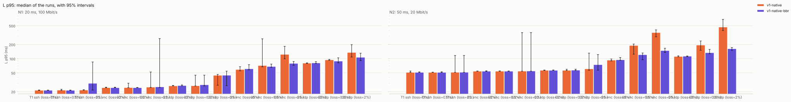
</picture>

### Latency, median

<picture>
  <source media="(prefers-color-scheme: dark)" srcset="latency_p50-dark.svg">
  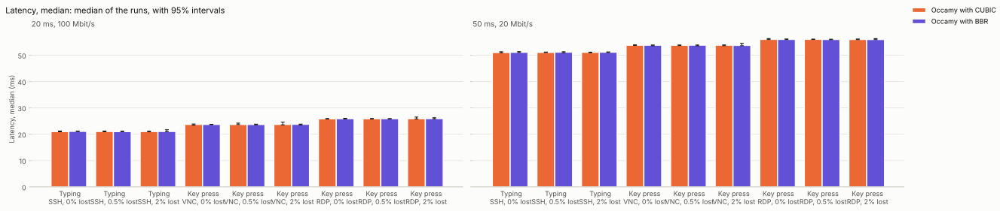
</picture>

### Frames shown per second

<picture>
  <source media="(prefers-color-scheme: dark)" srcset="fps-dark.svg">
  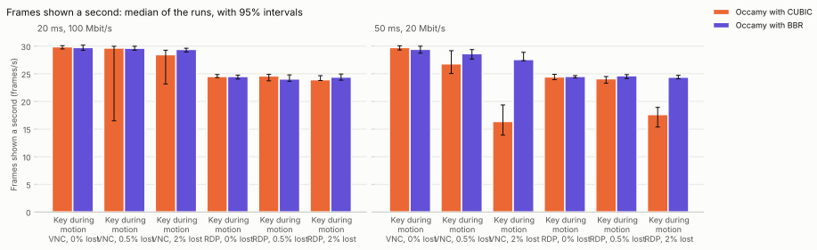
</picture>

### Scene frames never shown

<picture>
  <source media="(prefers-color-scheme: dark)" srcset="scene_missed-dark.svg">
  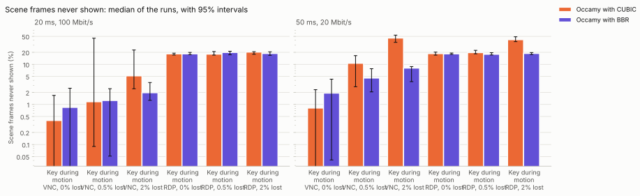
</picture>

### Gap between frames, 95th percentile

<picture>
  <source media="(prefers-color-scheme: dark)" srcset="frame_interval_p95-dark.svg">
  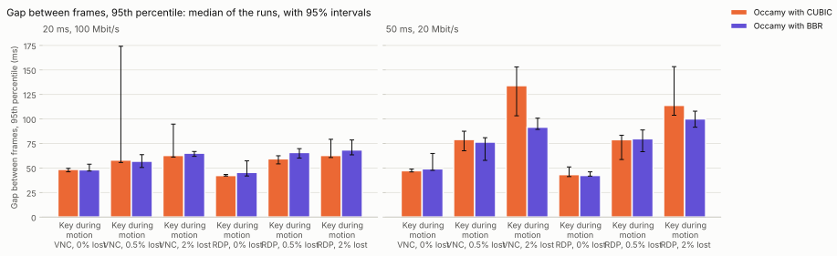
</picture>

### Data per frame

<picture>
  <source media="(prefers-color-scheme: dark)" srcset="bytes_per_frame-dark.svg">
  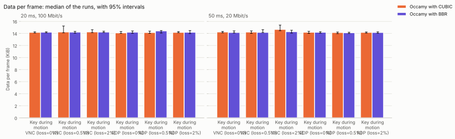
</picture>

### Server CPU per frame

<picture>
  <source media="(prefers-color-scheme: dark)" srcset="cpu_per_frame-dark.svg">
  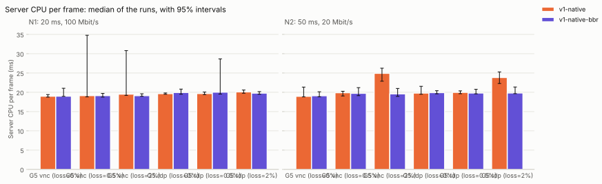
</picture>

### Server CPU time

<picture>
  <source media="(prefers-color-scheme: dark)" srcset="server_cpu-dark.svg">
  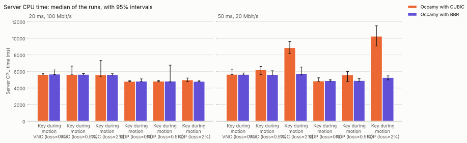
</picture>

### Server memory, peak

<picture>
  <source media="(prefers-color-scheme: dark)" srcset="server_mem-dark.svg">
  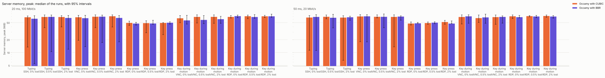
</picture>

### Client CPU time

<picture>
  <source media="(prefers-color-scheme: dark)" srcset="client_cpu-dark.svg">
  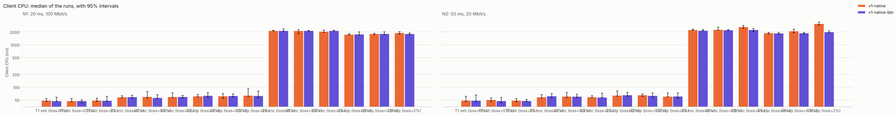
</picture>

### occamyd allocated

<picture>
  <source media="(prefers-color-scheme: dark)" srcset="occamyd_alloc-dark.svg">
  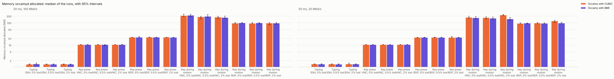
</picture>

### occamyd GC cycles

<picture>
  <source media="(prefers-color-scheme: dark)" srcset="occamyd_gc-dark.svg">
  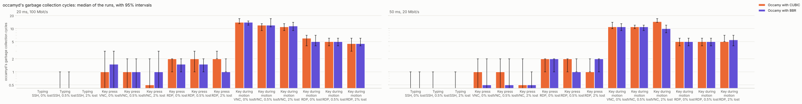
</picture>

### occamyd heap in use

<picture>
  <source media="(prefers-color-scheme: dark)" srcset="occamyd_heap-dark.svg">
  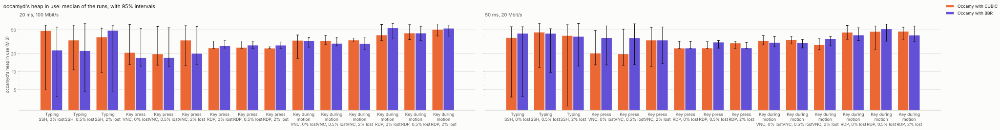
</picture>

### occamyd goroutines

<picture>
  <source media="(prefers-color-scheme: dark)" srcset="occamyd_goroutines-dark.svg">
  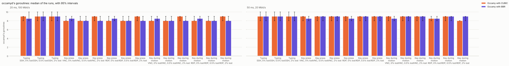
</picture>
