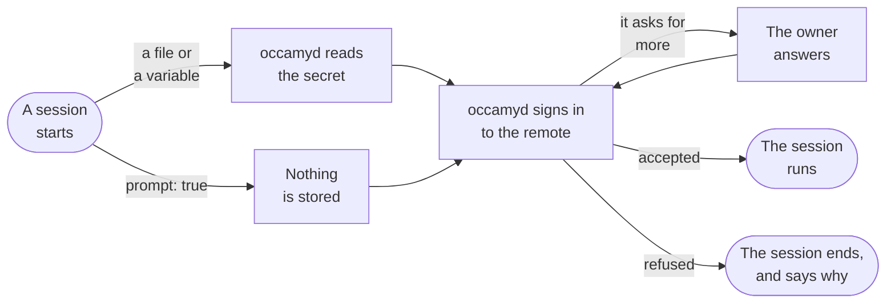
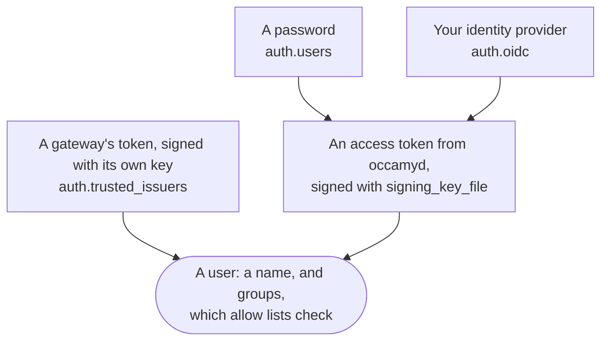
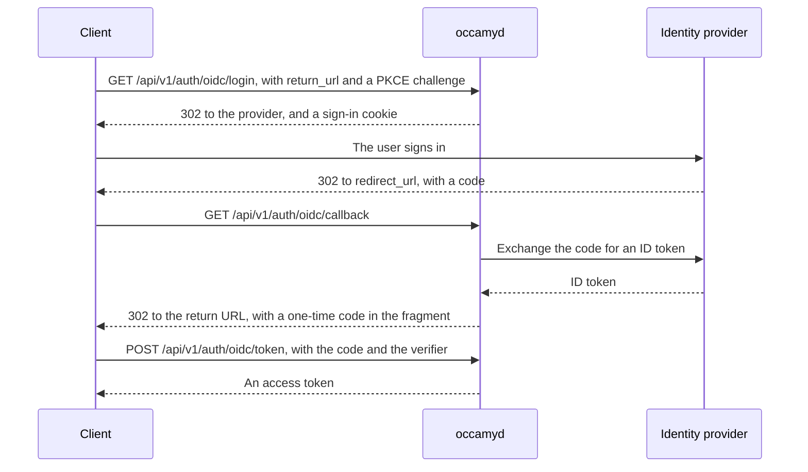
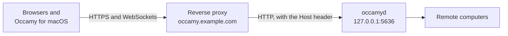
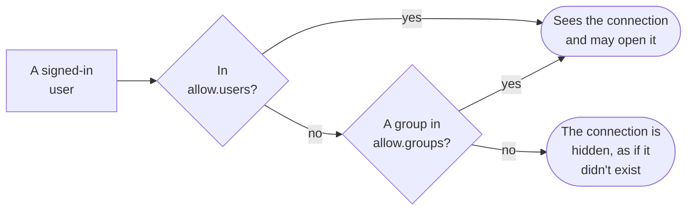
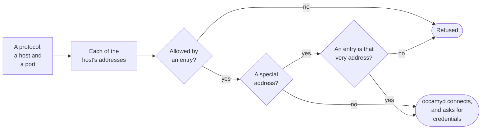

# Configuration

`occamyd` takes its settings from one YAML file, which says where it
listens, who may sign in, and which remote computers each user may open.
This page shows you how to write that file, and then describes every
key.

## How the configuration works

`occamyd` reads the file that its `-conf` flag names, or `conf.yaml` in
its working directory if you don't give the flag. The container image
reads `/occamy/conf.yaml`, where [Deploy](deploy.md) mounts a file of
your own, which this page calls `occamy.yaml`. This is a complete file
for a small team:

```yaml
version: 1
listen: 0.0.0.0:5636
web_client: client/occamy-web/dist
auth:
  signing_key_file: /var/lib/occamy/signing.key
  users:
    - name: alice
      password_hash: "<the output of htpasswd>"
      groups: [ops]
connections:
  - id: build-box
    name: Build box
    protocol: ssh
    target: build.internal
    host_keys: ["SHA256:UtDMff7ThPohflGs6UL1iuiyvVrazbxQT9x0OtzIV7U"]
    credentials: {username: deploy, private_key_file: /etc/occamy/keys/deploy}
    allow: {groups: [ops]}
  - id: nas-desktop
    name: NAS desktop
    protocol: vnc
    target: nas.internal
    credentials: {password_env: NAS_VNC_PASSWORD}
    allow: {users: [alice]}
  - id: windows
    name: Windows workstation
    protocol: rdp
    target: 10.0.4.20
    disable_gfx: true
    tls: {pins: ["3F:A1:07:5C:92:E4:6B:D8:21:0A:F3:8E:57:C6:19:B4:E2:7D:40:95:A8:1C:6F:D3:0B:72:E9:58:34:AC:66:1F"]}
    credentials: {username: 'CORP\alice', prompt: true}
    allow: {users: [alice]}
```

Replace the password hash with one of your own, as
[Add users with passwords](#add-users-with-passwords) shows, before you
start `occamyd`: it refuses the placeholder. The `conf.yaml` that the
image and the release archives ship is a version 1 file like this one,
with no users or connections, for you to fill in.

`occamyd` applies the file's three parts in turn to every request:

<picture>
  <source media="(prefers-color-scheme: dark)" srcset="figures/configuration-overview-dark.svg">
  
</picture>

### Where secrets come from

The file holds no secrets, so you can commit it and review each change
to it. Each secret stays in a file or a variable that the file names,
or with the session's owner, as the figure shows. `occamyd` refuses a
secret written into the file, such as `password:` under `credentials`
or `client_secret:` under `auth.oidc`, and its error names the keys to
use instead.

### When a change takes effect

`occamyd` reads the file once, when it starts, and nothing reloads it,
so a change takes a restart, which ends every session. Users stay
signed in for as long as the signing key stays the same. What the file
points to is read when it's used:

| What | When `occamyd` reads it |
|------|-------------------------|
| The file itself, `tls.cert` and `tls.key`, and the signing key | When it starts |
| A trusted issuer's `public_key_file` | When it starts. From then on, tokens signed with its old key are refused |
| Environment variables, such as `password_env`, `token_env` and `auth.oidc.client_secret_env` | When it starts, since a process's environment doesn't change once it runs |
| A connection's files: `password_file`, `private_key_file`, `token_file`, `client_cert_file`, `client_key_file` and `tls.ca_file` | As each session on the connection starts. Running sessions continue with what they read |
| `auth.oidc.client_secret_file` | At each OIDC sign-in |
| The web client's files, in `web_client` | At each request, so a new build is served at once |

### How occamyd checks the file

`occamyd` checks the whole file when it starts, and doesn't start until
it's right. It reports every problem at once, each with its line and
key, so you can fix them all in one pass. This file has three:

```yaml
version: 1
auth:
  signing_key_file: /var/lib/occamy/signing.key
  users:
    - name: alice
      password_hash: "$2y$12$…" # a whole hash
connections:
  - id: desktop
    protocol: vnc
    target: desktop.example.com
    credentails: {password_env: DESKTOP_PASSWORD}
    allow: {users: [carol]}
```

```
config: 3 problems:
	line 11: connections[0].credentails: unknown key, did you mean credentials?
	line 8: connections[0].credentials: no credential source: set one of password_file, password_env, private_key_file or prompt: true
	line 12: connections[0].allow.users[0]: no static user is named "carol"
```

The file holds one YAML document, and an unknown key is an error, so a
misspelt key is reported rather than ignored. `occamyd` has no default
user and no default password. Besides the rules that the
[reference](#reference) gives for each key, it checks these:

| What | What `occamyd` checks |
|------|-----------------------|
| Each file that the configuration names | It exists, is a regular file, and can be opened, which `occamyd` checks without reading a secret |
| A trusted issuer's public key | It parses |
| Each environment variable that the configuration names | It's set and isn't empty |
| Addresses, origins and OIDC URLs | Addresses are `host:port` with a numeric port, and origins and URLs parse |
| User, group and issuer names | They aren't empty, and have no spaces or control characters |
| Allow lists, without `auth.oidc` and `auth.trusted_issuers` | Every user is a static user, and every group is a static user's. With either, users and groups also come from tokens |
| `auth.oidc.require_known_users` | The file admits someone |

## Add a connection

A connection is a remote computer that users open by its ID: an SSH
server, a VNC or RDP desktop, or a shell in a Kubernetes pod. `occamyd`
connects to each with a client of its own, called its *backend*, so
there is nothing else to install. Every connection has these keys:

```yaml
connections:
  - id: lab-desktop            # what users open it by
    name: Lab desktop          # what they see
    protocol: vnc              # ssh, vnc, rdp or kubernetes
    target: lab.internal:5901  # host:port, or a host alone
    credentials: {password_file: /run/secrets/lab-vnc}
    allow: {groups: [lab]}     # who may open it
```

Each protocol adds keys of its own, which the sections below describe,
and a key on a connection of another protocol is an error.
[`connections`](#connections-connections) in the reference gives each
key's form and default.

### Credentials

On an SSH, VNC or RDP connection, whatever the source of its secret,
`occamyd` asks the session's owner for anything that the remote wants
and the file doesn't store, such as a password, a user name or a
one-time code:



Use `prompt: true` also for a remote that needs no credentials.
[`credentials`](#credentials-keys) in the reference lists every source.

### SSH

An SSH connection opens a shell on the server, which the web client
shows as a terminal:

```yaml
  - id: build-box
    protocol: ssh
    target: build.internal
    host_keys: ["SHA256:UtDMff7ThPohflGs6UL1iuiyvVrazbxQT9x0OtzIV7U"]
    credentials: {username: deploy, private_key_file: /etc/occamy/keys/deploy}
    allow: {groups: [ops]}
```

`host_keys` lists the only host keys that `occamyd` accepts from the
server, so that nobody between them can pose as it. Give each as a
public key, as `ssh-keyscan` prints it, or as its `SHA256:` fingerprint,
which this prints:

```sh
ssh-keyscan build.internal | ssh-keygen -lf -
```

For a demo, [`insecure_ignore_host_key`](#connections-connections)
accepts any host key instead.

The connection needs a `username` unless it has `prompt: true`, which
asks the owner for one. `occamyd` signs in with the private key first,
then with the stored password, and asks the owner for a password only
when none is stored, and for the server's other questions, such as a
one-time code.

### VNC

A VNC connection shows the desktop of a VNC server:

```yaml
  - id: nas-desktop
    protocol: vnc
    target: nas.internal
    credentials: {password_env: NAS_VNC_PASSWORD}
    allow: {users: [alice]}
```

`occamyd` signs in with None, VNC Authentication or VeNCrypt. Of
VeNCrypt's types, it takes X509None, X509Vnc and X509Plain, which run
TLS and check the server's certificate as
[Check a remote's certificate](#check-a-remotes-certificate) describes.
A `username` in `credentials` is for VeNCrypt's Plain type, which
`occamyd` then prefers to the server's other types. Without one, the
owner is asked for a user name if the server wants one.

The server's screen follows the size of the owner's window, where the
server supports the ExtendedDesktopSize extension, and viewers see the
server's cursor.

#### Apple Remote Desktop: `ard`

macOS Screen Sharing signs in a user of the Mac with Apple Remote
Desktop authentication, which is the only type it offers that a VNC
connection could use when the Mac's VNC password is off. `ard: true`
allows it, with the Mac account's name as `username`, and its password
from `credentials` or from the owner:

```yaml
  - id: studio-mac
    protocol: vnc
    ard: true
    target: studio.internal:5900
    credentials: {username: studio, prompt: true}
    allow: {users: [alice]}
```

> [!WARNING]
> Apple Remote Desktop's key exchange doesn't authenticate the server.
> Anyone between `occamyd` and the Mac can read the user name and the
> whole password, which are the Mac account's own, and the session that
> follows isn't encrypted. Set `ard: true` only for Macs on networks you
> trust, such as a VPN to the Mac.

`ard: true` raises that risk on any server of the connection, not only
a Mac: the attacker can strip VeNCrypt from what the server offers and
offer Apple Remote Desktop alone, and `occamyd` then sends the whole
password. Without `ard`, the most that such a downgrade gets is VNC
Authentication's DES response, which comes from the password's first 8
bytes. For the same reason, `ard` can't be combined with a `tls` that
requires TLS (`require`, `ca_file` or `pins`).

Without `ard: true`, a Mac that offers only Apple Remote Desktop fails
the session, and `occamyd`'s log names the key to set. An ad-hoc target
can't use Apple Remote Desktop.

### RDP

An RDP connection shows a Windows or xrdp desktop, always over TLS.
`security` sets how it signs in:

| `security` | What it does |
|------------|--------------|
| `nla` | NLA (CredSSP with NTLMv2) over TLS. The default |
| `nla-ext` | NLA with the early user authorization result only |
| `tls` | TLS without NLA, which sends the password to whichever server passes the certificate check |
| `any` | Offers TLS and NLA, and lets the server choose |

The names follow Guacamole's. NLA signs in with NTLMv2, not Kerberos,
so a domain that refuses NTLM refuses `occamyd` too. `occamyd` never
uses standard RDP security, which runs without TLS.

**Credentials.** A `username` of the form `DOMAIN\user` signs in to that
domain, and `\user` as the user alone. With NLA, the owner is asked for
the password, and for the user name and domain if no `username` is
stored, which they can type in the same form. Without NLA
(`security: tls`), nothing is asked, and a missing user name or
password leaves the server's own sign-in screen to the owner.

**The screen.** The server's desktop takes the size of the owner's
window, from 200 to 8192 pixels a side and at most 2²⁵ pixels in all,
and follows later resizes through the Display Control channel where the
server has it. Viewers scale a desktop that keeps another size. While no
viewer can see the session, `occamyd` asks the server to stop drawing.

**Drawing.** Through RDP's graphics pipeline (GFX), `occamyd` takes
surfaces, fills, copies, and bitmaps in the uncompressed, planar,
RemoteFX and RemoteFX Progressive codecs, but not ClearCodec, the
bitmap cache, or AVC (H.264), which it doesn't ask for. Without GFX, it
takes bitmap updates in interleaved RLE and planar.

**Input.** Keys go as scancodes of their physical key, text as Unicode
keyboard events, and the pointer and wheel as mouse events.

#### Windows hosts

Set `disable_gfx: true` on a connection to a Windows host. Through GFX,
Windows draws nearly all of its screen with ClearCodec and its bitmap
cache, which `occamyd` doesn't decode, so the screen stays nearly
black. With `disable_gfx: true`, Windows sends plain bitmap updates, and
the whole desktop draws.

```yaml
  - id: windows
    protocol: rdp
    target: 10.0.4.20
    disable_gfx: true
    tls: {pins: ["3F:A1:07:5C:92:E4:6B:D8:21:0A:F3:8E:57:C6:19:B4:E2:7D:40:95:A8:1C:6F:D3:0B:72:E9:58:34:AC:66:1F"]}
    credentials: {username: 'CORP\alice', password_file: /run/secrets/windows-password}
    allow: {users: [alice]}
```

Windows signs its RDP certificate itself unless you give it one, so pin
it by the fingerprint that the first refused session logs, as
[Connect Windows hosts](deploy.md#connect-windows-hosts) shows step by
step. An ad-hoc RDP target always asks for GFX, since only a connection
can set `disable_gfx`, so reach a Windows host through a connection.

#### xrdp

xrdp speaks no NLA. Offered NLA alone, it chooses standard RDP
security, which `occamyd` refuses, so set `security: tls` (or `any`) on
an xrdp connection; the session's error in the log names the key. The
password then goes to whichever server passes the certificate check, so
pin a self-signed certificate by its fingerprint. With
`tls: {insecure_skip_verify: true}`, the password may go to whoever is
in between, and `occamyd` warns of it by name when it starts.

### Kubernetes pods

A Kubernetes connection opens a terminal in a pod's container through
the cluster's API server, as `kubectl exec -it` does:

```yaml
  - id: web-shell
    protocol: kubernetes
    target: k8s.internal:6443
    kubernetes: {namespace: web, pod: web-0, container: app}
    tls: {ca_file: /etc/occamy/k8s-ca.crt}
    credentials: {token_file: /run/secrets/k8s-token}
    allow: {groups: [ops]}
```

The `target` is the API server's `host:port`, which `occamyd` always
reaches over HTTPS, so write it without `https://`. `occamyd` asks for
`/api/v1/…` at the root of the target, so it can't reach an API server
behind a path prefix, such as a cluster that Rancher proxies at
`https://rancher.example/k8s/clusters/c-m-abc12`. `kubernetes` names the
pod, and [`kubernetes`](#kubernetes-keys) in the reference lists its
keys.

**Credentials.** `occamyd` sends a bearer token or presents a client
certificate, and never a user name or a password. With `prompt: true`,
the owner is asked for a token, and an empty answer sends none.
`occamyd` sends the token only once it has accepted the API server's
certificate. A ServiceAccount token works on every cluster, managed
ones included. `kubectl -n web create token occamy --duration=24h` makes
one that expires, and a Secret of type
`kubernetes.io/service-account-token` holds one that doesn't.

`occamyd` takes no kubeconfig, and runs no credential program, so that
a session never starts a process on the server: neither a kubeconfig's
`auth-provider` entries, nor exec credential plugins such as EKS's
`aws eks get-token` or GKE's `gke-gcloud-auth-plugin`.

**Permissions.** The token's or the certificate's user needs `get` and
`create` on `pods/exec`, or on `pods/attach` with `attach: true`, in the
pod's namespace. API servers authorize the WebSocket upgrade, an HTTP
`GET`, as `get`, and from Kubernetes 1.35 they also check `create`. This
is a minimal Role and RoleBinding for a ServiceAccount:

```yaml
apiVersion: v1
kind: ServiceAccount
metadata: {name: occamy, namespace: web}
---
apiVersion: rbac.authorization.k8s.io/v1
kind: Role
metadata: {name: occamy-exec, namespace: web}
rules:
  - apiGroups: [""]
    resources: [pods/exec]
    verbs: [get, create]
---
apiVersion: rbac.authorization.k8s.io/v1
kind: RoleBinding
metadata: {name: occamy-exec, namespace: web}
roleRef: {apiGroup: rbac.authorization.k8s.io, kind: Role, name: occamy-exec}
subjects:
  - {kind: ServiceAccount, name: occamy, namespace: web}
```

`occamyd` needs no other permission: it doesn't list or read pods.

**The session.** `occamyd` speaks the `v5.channel.k8s.io` WebSocket
protocol of Kubernetes 1.30 and later, and falls back to
`v4.channel.k8s.io` for older API servers. The command's exit ends the
session, whatever its exit status.

### Check a remote's certificate

A VNC, RDP or Kubernetes connection checks the certificate of its
remote: a VNC server's when the server offers VeNCrypt, and the
others' always. Without `tls`, the certificate must chain to the
system's roots and name the target's host, as a browser checks it.
`tls` changes that check in one of three ways:

| To accept | Set |
|-----------|-----|
| A certificate from a private CA | `ca_file`, the CA's certificates in PEM, which replace the system's roots |
| A self-signed certificate, such as Windows makes | `pins`, the certificates to accept as they are, with no check of their chain, names or dates |
| Any certificate, for a demo | `insecure_skip_verify: true`, which logs each certificate's fingerprint as a warning |

A refused certificate fails the session, and `occamyd`'s log names its
fingerprint, ready to pin.

A VNC server that doesn't offer VeNCrypt runs without TLS, and an
attacker on the way can make any VNC server look like one by stripping
VeNCrypt from what it offers. `require: true` refuses a server without
VeNCrypt. RDP and Kubernetes connections always require TLS.

### Close the clipboard

Clipboard text goes both ways between a desktop and the people in its
session unless you close it. `disable_copy: true` keeps text copied on
the remote there, and `disable_paste: true` keeps text copied on a
viewer's computer from the remote, though a viewer can still type it.
Neither key applies to a terminal, where the client copies the text
that it draws, and a paste reaches the terminal as typing.

## Set up sign-in

Users sign in to `occamyd` in one of three ways, and you can allow any
of them together. They sign in with a password as *static users*, whom
the file lists; through your identity provider, with OpenID Connect
(OIDC); or they arrive with a token that a *trusted issuer*, such as a
gateway in front of `occamyd`, signed for them:



### Add users with passwords

To add a static user, make a bcrypt hash of the password they chose,
and list the user under `auth.users`. `htpasswd` makes the hash:

```sh
htpasswd -nbBC 12 "" 'the password' | cut -d: -f2
```

```yaml
auth:
  signing_key_file: /var/lib/occamy/signing.key
  users:
    - name: alice
      password_hash: "$2y$12$…"
      groups: [ops]
```

Put the line that `htpasswd` prints, which starts with `$2y$12$`, in
double quotes as the user's `password_hash`. `htpasswd` comes with
Apache's tools: `apache2-utils` on Debian and Ubuntu, `httpd-tools` on
Fedora and RHEL, and macOS has it.

Give every user the same bcrypt cost, the `12` after `-C`, of at least
10. `occamyd` checks a sign-in as an unknown user against a hash of the
highest cost, so a user with a lower cost signs in measurably faster,
which tells who exists. `occamyd` warns when it starts if the costs
differ.

### Signing in through OIDC

`occamyd` signs users in at an OpenID Connect provider with the
authorization code flow and PKCE. Register `occamyd` at your provider
as such a client, with `redirect_url` as its redirect URI, and then add
`auth.oidc`:

```yaml
auth:
  oidc:
    issuer: https://accounts.example.com
    client_id: occamy
    client_secret_file: /run/secrets/oidc-client-secret
    redirect_url: https://occamy.example.com/api/v1/auth/oidc/callback
    return_urls:
      - https://occamy.example.com/static/
      - de.changkun.occamy:/oidc
    groups_claim: groups
```

[`auth.oidc`](#authoidc) in the reference describes each key.

**Return URLs.** After a sign-in, `occamyd` sends the browser back to
the one of `return_urls` that the client named, with a one-time code or
an error in the URL's fragment. List the clients that your users have:

- The web client that `occamyd` serves returns to its own URL, under
  `/static/`, which the default return URL doesn't reach, so list
  `https://<your host>/static/`.
- [Occamy for macOS](macos-app.md) returns to `de.changkun.occamy:/oidc`.
  List it to let the app sign in through OIDC.

**The user's name.** `subject_claim` names the top-level claim of the ID
token that holds the user's name. Its value must be a string of up to
255 bytes, of characters that show, with no space but U+0020, or
`occamyd` refuses the sign-in. Allow lists grant access by this name,
so pick a claim that users can't set themselves, such as `sub` or
`email`, and never a display name, or `preferred_username` where users
can edit it. With `email`, the ID token must also say
`email_verified: true`.

**Groups.** `groups_claim` names a top-level claim that holds the user's
groups, as a list of strings or one string. `occamyd` keeps only the
groups that the file names, in `auth.users[].groups` or in an
`allow.groups`.

**Who gets in.** By default, anyone whom the provider signs in gets an
access token, and allow lists still decide which connections they may
open. With `require_known_users: true`, `occamyd` admits a user only if
a connection's `allow.users` names them exactly, or one of its
`allow.groups` holds one of their groups from `groups_claim`. A static
user's name then admits someone only with `link_static_users`, without
which a static user's name is refused, as [User names](#user-names)
describes.

**The provider.** `occamyd` discovers the provider in the background
when it starts, so a provider that is down doesn't keep `occamyd` from
starting: until it answers, OIDC sign-ins fail and static users sign in
as usual. It expects this of the provider:

| What | How `occamyd` treats it |
|------|-------------------------|
| Discovery | Retried at the first sign-in 10 seconds after a failure. Each request to the provider times out after 10 seconds |
| ID tokens | Accepted when signed with RS, ES or PS at 256, 384 or 512 bits, or with EdDSA. `none` and HMAC are refused, whatever the provider advertises |
| Endpoints | Only those that the discovery document names, over https, or http on localhost when the issuer uses it too. No redirect is followed |
| The `iss` that the provider sends back (RFC 9207) | Compared with `issuer` exactly. `authorization_response_iss_parameter_supported` counts only as a JSON boolean |

**Errors.** A failed sign-in returns to the return URL with `#error=`
and one of these codes:

| `error` | Meaning |
|---------|---------|
| `access_denied` | The provider refused the user, or `occamyd` did: a missing or unusable `subject_claim`, an unverified email, a static user's name without `link_static_users`, or a user that `require_known_users` doesn't admit |
| `sign_in_failed` | The provider answered with another error, or its answer didn't verify |
| `unavailable` | The provider can't be reached, or too many sign-ins wait for their clients |

[The HTTP API](api.md#get-apiv1authoidclogin) describes the three OIDC
routes and every answer they give.

#### How a client signs in

The web client and Occamy for macOS sign in through OIDC already. A
client of your own takes these steps, in which only the client's
verifier proves that the one-time code is its own:



[Sign in through OIDC](api.md#sign-in-through-oidc) in the HTTP API
gives each request. In a browser, keep the verifier in
`sessionStorage`, remove the fragment with `history.replaceState` once
you've read it, and forget the verifier once you have the access token.
A client that finds a `#code` but holds no verifier didn't start that
sign-in, so it must not sign in with the code: spend the code by posting
it with a throwaway verifier, since a code works once, or remove it
from the URL and ignore it.

The access token never appears in a URL, so it reaches no server log,
`Referer` header or browser history. A native app takes the same steps in a browser window of its own, such
as macOS's `ASWebAuthenticationSession`, keeps the verifier in memory,
and returns to a scheme of its own, a domain name in reverse, as RFC
8252 asks. Another app may claim the scheme, but the code it would
receive signs no one in without the verifier.

### Tokens from a trusted issuer

A trusted issuer, such as a gateway in front of `occamyd`, signs in its
users itself, and mints tokens that `occamyd` accepts as its own. List
it with the name it puts in its tokens and its public key:

```yaml
auth:
  trusted_issuers:
    - issuer: gateway
      public_key_file: /etc/occamy/gateway.pub
      allowed_groups: [ops]
```

The issuer's tokens are JWTs with these claims:

| Claim | What it holds |
|-------|---------------|
| `alg`, in the header | `EdDSA`. The token is signed with the issuer's Ed25519 key, and no other algorithm |
| `iss` | The issuer's name, as `issuer` configures it |
| `aud` | `occamy` |
| `iat` and `exp` | When the token was issued and when it expires, at most 12 hours apart |
| `sub` | The user, a usable name by the rules of [`subject_claim`](#signing-in-through-oidc) |
| `kind` | `access` or `session` |
| `groups` | In an access token, optionally, the user's groups |
| `sid` and `role` | In a session token, the session's ID, and the role: `owner`, `viewer` or `read-only` |

`occamyd` drops every group that `allowed_groups` doesn't list, so
that an issuer can't claim `ops` and open every connection that allows
`ops`, with its stored credentials.

A session token joins only a session that one of the issuer's own users
opened, or, with `link_static_users`, a static user. An `owner` token
works only when its `sub` is the session's owner. `occamyd` refuses a
trusted issuer's token that sets `uiss`, and a session token from it
that carries `idp`. A `sub` that is a static user's name is refused with
`invalid_token`, or on a stream with a `close` of `unauthorized`, unless
the issuer has `link_static_users: true` ([User names](#user-names)).

### User names

A user is a name from one source: a static user, a user from OIDC, or a
user of one trusted issuer. The gateway's `carol` and `occamyd`'s
`carol` are two users, and neither reads, closes, shares or owns the
other's sessions.

Allow lists compare names exactly, byte for byte, whichever source
signed the user in. `allow.users: [alice]` admits neither `Alice` nor an
`alice` with a decomposed character, so write names as the provider
sends them.

A name from OIDC or a trusted issuer is refused when it equals a static
user's under Unicode case folding, once both are in NFC, so that
`Alice` can't pass for the static user `alice` in a log or to a person.
With `link_static_users` on the OIDC provider or the issuer, the exact
name signs in as that static user: it shares the static user's place in
every allow list, and their sessions, but takes its groups from its own
token or `groups_claim`. Another case or form is then a user of its
own. Link names only from a `subject_claim` that users can't choose,
such as `sub` or a verified `email`.

Names that only look alike, such as one with a Cyrillic `а` or a
fullwidth `ａ`, are neither refused nor the same user, which is one more
reason to pick such a claim.

### The signing key

`occamyd` signs its tokens with the Ed25519 key in
`auth.signing_key_file`. Keep it at `/var/lib/occamy/signing.key`, on a
persistent volume.

> [!IMPORTANT]
> Whoever holds the signing key can make a token for any user. Keep the
> file readable by `occamyd`'s user alone, and
> [rotate it](#rotate-the-signing-key) if it may have leaked.

If the file doesn't exist, `occamyd` creates it when it starts,
readable by its owner alone (`0600`), through a temporary file in the
same directory, so the directory must exist and `occamyd`'s user must be
able to write to it. Tokens stay valid across a restart for as long as
the file does. If the file is lost, everyone signs in again, and
`occamyd` warns `created a new signing key`
([Warnings at start](debugging.md#warnings-at-start)).

If `occamyd` may not read the key or write to its directory, it stops
at start and names the user it runs as. Give the directory, or what is
mounted on it, to that user. The path in the error is the one that
`occamyd` sees, which in a container isn't a path on the host.

| Where the key is | What to run, with the uid from the error (65532 in the image) |
|------------------|----------------------------------------------------------------|
| A directory, with no container | `sudo chown -R <uid> <the directory>` |
| A host directory mounted into Docker or rootful Podman | `sudo chown -R 65532 <the directory on the host>` |
| A host directory mounted into rootless Podman | `podman unshare chown -R 65532 <the directory on the host>` |
| A named volume on Docker | `docker run --rm -v <the volume>:/data busybox chown -R 65532 /data` |
| A named volume on Podman | `podman run --rm -v <the volume>:/data busybox chown -R 65532 /data` |

With rootless Podman, a plain `chown` is wrong: uid 65532 in the
container is another number on the host, such as 165531, and
`podman unshare` translates it. A named volume keeps its owner once it
holds files. An empty volume that a root container used first stays
root's on Docker, while on Podman it takes the owner of the next
container that uses it.

## Rotate keys and secrets

### Rotate the signing key

`occamyd` holds one signing key at a time, so a new key signs everyone
out. To rotate it:

1. Stop `occamyd`.
2. Move the old key out of the way, or delete it. To use a key that you
   made yourself, put it in its place, readable by `occamyd`'s user
   alone:

    ```sh
    openssl genpkey -algorithm ed25519 -out signing.key
    ```

3. Start `occamyd`. Without a key of yours, it creates one and warns
   `created a new signing key`, which this time you expect.

### Rotate other secrets

A new secret takes effect when `occamyd` next reads it, which
[When a change takes effect](#when-a-change-takes-effect) lists. Write
a new file beside the old one and rename it into place, so that a
session that starts at that moment never reads half a file.

## Put Occamy behind a proxy

A reverse proxy in front of `occamyd` holds the certificate and serves
HTTPS, and `occamyd` serves plain HTTP to the proxy alone:



[Serve it over TLS](deploy.md#serve-it-over-tls) sets up the proxy, for
Caddy and nginx. In `occamyd`'s file, listen where only the proxy reaches, leave `tls`
unset, and give OIDC the URLs as browsers reach them through the proxy:

```yaml
listen: 127.0.0.1:5636
auth:
  oidc:
    redirect_url: https://occamy.example.com/api/v1/auth/oidc/callback
    return_urls:
      - https://occamy.example.com/static/
```

If the proxy rewrites the `Host` header, also list the address that
your users open in [`origins`](#server).

## Limit who can do what

Occamy has no administrator role. What a user may do follows from the
file: the connections whose allow lists admit them, ad-hoc targets if
you allow them, and limits on how much each user can hold. Within a
session, its owner decides who else joins, by
[sharing it](api.md#share-a-session).

### Who may open a connection

A connection's `allow` lists the users, and the groups, who may open
it:



A user's groups depend on how they signed in:

| Signed in with | Groups |
|----------------|--------|
| A password | The user's `groups` in `auth.users` |
| OIDC | The groups in the ID token's `groups_claim` that the file names, in `auth.users[].groups` or an `allow.groups` |
| A trusted issuer's token | The token's `groups` that the issuer's `allowed_groups` lists |

### Ad-hoc targets

An *ad-hoc target* is a remote that isn't a connection, which a
signed-in user names when they open a session. Ad-hoc targets are off
until you set `allow_adhoc_targets: true`, and then `adhoc_allowlist`
says where they may point:

```yaml
allow_adhoc_targets: true
adhoc_allowlist:
  - 10.0.0.0/8:22               # SSH, to any address in the range
  - "*.lab.internal:5900-5910"  # VNC, to the lab's hosts
  - build.internal              # the protocol's own ports
```

[`adhoc_allowlist`](#ad-hoc-target-keys) in the reference lists the
forms that an entry takes. `occamyd` checks a target like this:



A host name is allowed when an entry names it, or when it ends in a
`*.` entry's domain: `a.lab.internal` for `*.lab.internal`, but not
`lab.internal` itself. Any other host name is allowed when every address
it resolves to lies in a listed range, and `occamyd` dials the address
it checked, so that a second lookup can't lead elsewhere.

The special addresses are loopback, link-local, unspecified and
multicast addresses, the cloud metadata services at `169.254.169.254`,
`fd00:ec2::254` and `100.100.100.200`, and `occamyd`'s own `listen` and
`debug.address` at their ports, where a listener on no host, such as
`:5636`, stands for every address of the host. An entry that is that
very address allows it, such as `127.0.0.1:2222`.

> [!WARNING]
> A range that holds the host's own addresses still reaches the host's
> other services on the ports it allows, such as a database on a private
> address. List ranges that leave the host out, or the host's addresses
> with the ports you mean.

A user opens an ad-hoc target of any protocol but Kubernetes, and
`occamyd` always asks them for its credentials.
[Ad-hoc targets](api.md#ad-hoc-targets) in the HTTP API describes the
request, and how each protocol checks the remote. An ad-hoc VNC target can't require TLS, so an attacker in
between can strip VeNCrypt from the server's offer and capture the VNC
Authentication response, from which an offline search can recover a
weak password: reach targets across networks you don't trust through a
connection whose `tls` requires TLS. An ad-hoc RDP target signs in with
NLA alone. Without a `username` in the request, the user is asked for
the user name and domain too, and with one, `DOMAIN\user` names the
domain. It always asks for GFX, so a
server with a self-signed certificate, an xrdp server, or a
[Windows host](#windows-hosts) needs a connection.

### Limit sessions, viewers and shares

`limits` bounds what one user, one session or `occamyd` as a whole may
hold, so that no user takes what the others need:

```yaml
limits:
  sessions: 1000           # sessions that occamyd runs at once
  sessions_per_user: 10    # sessions that one user owns at once
  viewers_per_session: 50  # viewers besides the owner, who can always join
  shares_per_session: 100  # shares of a session that haven't expired
```

These are the defaults. A user counts by name and source, so a trusted
issuer's users count apart from `occamyd`'s own, and `limits.sessions`
holds even when a trusted issuer names new users without end.
[The HTTP API](api.md#limits) lists what a client gets at each limit.

### Limit the cores that RDP sessions take

An RDP session may take about a core to decode what its server sends,
so one user's 10 sessions to hostile servers, such as ad-hoc targets
they chose, could take about 10 cores. `limits.decode_cores` caps all
RDP sessions together at about that many cores, by default half the
cores that `occamyd` may use, which leaves the rest to encoding for
viewers. Raise it where many sessions show full-screen motion, which
takes about 0.8 of a core each at 1920 × 1080 and 30 frames a second,
and lower it on a host that does other work.

A session over its share waits, with its server's updates queued
behind it, and nothing is dropped. Of n sessions that want more than
the cap, each gets at least an nth of it, or a core if that's less, and
what a session leaves goes to the others. The share is a session's, not
a user's, so where you don't trust users with 10 shares, lower
`limits.sessions_per_user`, or keep `allow_adhoc_targets` off. The cap
doesn't count what sessions read and ignore, so a server that floods a
session with what the client doesn't ask for, such as updates of an
unknown kind, can keep that session's reader busy outside it.

### Limit the memory that viewers hold

Each visible viewer holds the screen that it was last sent until it
acknowledges a newer one, and a viewer that may type also holds the
screen of its last input, hidden or not. The largest terminal, 1000 by
500 cells, takes about 11 MiB a screen. `streams.viewer_timeout` drops a
viewer that stops acknowledging, but one that keeps acknowledging keeps
its screens for as long as it stays. At the defaults, one user's 10
sessions, with their owners and 50 viewers each, may hold 510 such
screens, about 5.5 GiB, or twice that if every viewer may type. Where
you don't trust users with that much, lower
`limits.viewers_per_session` or `limits.sessions_per_user`.

## Reference

Each key below has one of these types:

| Type | What to write |
|------|---------------|
| string | Text, such as `alice` |
| boolean | `true` or `false` |
| integer | A whole number, such as `10` |
| duration | A number with a unit, such as `30s`, `15m` or `1h30m` |
| path | A file or directory, relative to `occamyd`'s working directory unless it starts with `/` |
| address | `host:port`, such as `127.0.0.1:5636`. An empty host, as in `:5636`, means every address |
| URL | An absolute URL, such as `https://occamy.example.com/static/` |
| variable | The name of an environment variable, such as `NAS_VNC_PASSWORD` |
| list | A YAML list, such as `[ops, lab]`, of the type that the key names |
| mapping | A YAML mapping, of the keys that its own table lists |

A key that you leave out takes its default. A required key has no
default, and `occamyd` refuses a file without it.

### Server

| Key | Type | Default | Description |
|-----|------|---------|-------------|
| `version` | integer | required | The file's version, always `1` |
| `listen` | address | `:5636` | Where `occamyd` serves the HTTP API, the streams, the web client and `/healthz`, over HTTP/1.1 only, since the streams are WebSockets over HTTP/1.1. Example: `127.0.0.1:5636` |
| `tls.cert` | path | none | A certificate, with its chain, in PEM. With `tls.key`, `occamyd` serves HTTPS, with TLS 1.2 and later. Without them, it speaks plain HTTP, for a [proxy](#put-occamy-behind-a-proxy) to serve TLS. Set both or neither |
| `tls.key` | path | none | The certificate's private key, in PEM |
| `web_client` | path | none | The directory of the built web client, which `occamyd` serves under `/static/`: `client/occamy-web/dist` in the image, or the `dist` directory of a release's web client archive. Without it, `occamyd` serves no web client |
| `origins` | list of strings | none | Other origins whose web pages may open streams, as `scheme://host` or `scheme://host:port` |
| `congestion_control` | string | `bbr` | The TCP congestion control of the listener's connections, on Linux: see [TCP congestion control](#tcp-congestion-control) |
| `debug.address` | address | none | The address of the debug listener, which is off without it. Example: `localhost:6060` |
| `debug.address_env` | variable | none | A variable that holds the debug listener's address, in place of `debug.address`. While it's unset or empty, the listener stays off, so one file serves with the listener and without it |

**The web client.** A `web_client` that isn't a directory, or that
`occamyd` can't read, is an error. A directory that doesn't exist yet,
or has no `index.html`, gets a warning at start, and `occamyd` serves
the client once it's built there.

**Origins.** A browser sends the origin of the page that opens a
stream, and `occamyd` refuses an origin it doesn't know. It knows its
own: an origin whose host and port are the request's `Host`, with the
scheme `https` when `occamyd` serves TLS, and either scheme when it
doesn't, since a proxy in front may. Behind a proxy that rewrites
`Host`, list the address that your users open in `origins`. A stream
request without `Origin`, which no browser sends, is accepted on its
token alone, while an empty, repeated or `null` origin is refused.

**The debug listener.** It serves counters and profiles without
authentication ([The debug listener](debugging.md#the-debug-listener)),
so keep it on the loopback interface, such as `localhost:6060`;
`occamyd` warns at start when it isn't. Give it a port of its own:
`occamyd` refuses a debug address on `listen`'s port when the two could
take the same connections, such as `localhost` beside `127.0.0.1` or
`::1`, or when either listens on every address, such as `:5636`. Set
`debug.address` or `debug.address_env`, not both.

#### TCP congestion control

On Linux, `congestion_control` names the TCP congestion control that
`occamyd` asks for on its listener, and every connection it accepts
inherits it. On other systems, the key has no effect.

| Value | What `occamyd` does |
|-------|---------------------|
| `bbr` | Asks for BBR, which keeps a desktop's frame rate on a link that loses packets. The default |
| Another name that the kernel knows, such as `cubic` | Asks for that one |
| `system` | Keeps the kernel's choice without asking |

A name has at most 15 lower-case letters, digits and underscores. When
the kernel refuses the name, `occamyd` keeps the kernel's choice and
warns at start. [Deploy](deploy.md#tcp-congestion-control) shows how to
load BBR and check which one the connections use.

### Sign-in: `auth`

| Key | Type | Default | Description |
|-----|------|---------|-------------|
| `auth.signing_key_file` | path | required | [The Ed25519 key](#the-signing-key) with which `occamyd` signs its tokens, in PKCS #8 PEM. `occamyd` creates it if it doesn't exist |
| `auth.access_token_lifetime` | duration | `15m` | How long an access token from `occamyd` lasts, from `1m` to `12h`. Example: `1h30m` |
| `auth.users` | list of users | none | [Static users](#add-users-with-passwords), who sign in with a password |
| `auth.oidc` | mapping | none | [Sign-in through an OpenID Connect provider](#signing-in-through-oidc) |
| `auth.trusted_issuers` | list of issuers | none | [Third parties whose tokens `occamyd` accepts](#tokens-from-a-trusted-issuer) |

Set at least one of `auth.users`, `auth.oidc` and
`auth.trusted_issuers`. Without them, nobody could sign in, and
`occamyd` refuses to start.

#### `auth.users`

Each entry of `auth.users` is a static user:

| Key | Type | Default | Description |
|-----|------|---------|-------------|
| `name` | string | required | The name the user signs in with: unique, without spaces, and at most 255 bytes of characters that show |
| `password_hash` | string | required | The bcrypt hash of the user's password, starting with `$2a$`, `$2b$` or `$2y$`, at cost 10 or more |
| `groups` | list of strings | none | The groups that the user belongs to |

#### `auth.oidc`

| Key | Type | Default | Description |
|-----|------|---------|-------------|
| `issuer` | URL | required | The provider's issuer URL, exactly as its discovery document names it, trailing slash included. It uses https, or http on localhost |
| `client_id` | string | required | `occamyd`'s client ID at the provider |
| `client_secret_file` | path | none | A file of at most 64 KiB that holds the client secret |
| `client_secret_env` | variable | none | A variable that holds the client secret. Set it or `client_secret_file`, or neither for a public client |
| `redirect_url` | URL | required | `occamyd`'s callback, `/api/v1/auth/oidc/callback`, as browsers reach it, over https, or http on localhost |
| `return_urls` | list of URLs | `redirect_url`'s origin, with the path `/` | [Where browsers go back to](#signing-in-through-oidc) after signing in, matched exactly as written. Each uses https, or http on localhost, or an app's own scheme, which must be a domain name in reverse, and holds no user name or fragment |
| `scopes` | list of strings | `[openid, profile, email]` | The scopes to ask for, which must include `openid` |
| `subject_claim` | string | `sub` | The ID token's claim that names the user |
| `groups_claim` | string | none | The ID token's claim that lists the user's groups. Without it, users from the provider have no groups |
| `require_known_users` | boolean | `false` | Admit only users whom an allow list names, by name or group |
| `link_static_users` | boolean | `false` | Let a user whose name is exactly a static user's sign in as that static user |

#### `auth.trusted_issuers`

Each entry of `auth.trusted_issuers` is a third party whose tokens
`occamyd` accepts:

| Key | Type | Default | Description |
|-----|------|---------|-------------|
| `issuer` | string | required | The unique name that the issuer puts in `iss`, other than `occamyd`'s own, `occamy` |
| `public_key_file` | path | required | The issuer's Ed25519 public key, in PKIX PEM |
| `link_static_users` | boolean | `false` | Let the issuer's tokens act for the static user that `sub` names exactly |
| `allowed_groups` | list of strings | none | The groups that the issuer's tokens may claim. `occamyd` drops the others |

### Connections: `connections`

Each entry of `connections` is a remote that users may open:

| Key | Type | Default | Description |
|-----|------|---------|-------------|
| `id` | string | required | A unique ID of 1 to 64 lower-case letters, digits, `.`, `_` and `-`, starting with a letter or digit |
| `name` | string | the ID | The name that users see |
| `protocol` | string | required | `ssh`, `vnc`, `rdp` or `kubernetes` |
| `target` | string | required | `host:port`, or a host alone for the protocol's port: 22 for SSH, 5900 for VNC, 3389 for RDP and 443 for Kubernetes. An IPv6 address alone takes that port too, such as `fd00::22`, and goes in brackets with a port, in quotes, since YAML reads a value that starts with `[` as a list: `"[fd00::22]:2222"` |
| `credentials` | mapping | required | [How `occamyd` signs in](#credentials-keys) to the target |
| `allow.users` | list of strings | none | The users who may open the connection, by exact name |
| `allow.groups` | list of strings | none | The groups whose users may open the connection. `allow` needs at least one user or group |
| `host_keys` | list of strings | required for ssh, unless `insecure_ignore_host_key` | SSH only. The [host keys](#ssh) that `occamyd` accepts from the server |
| `insecure_ignore_host_key` | boolean | `false` | SSH only. Accept any host key instead, for demos, and log its fingerprint as a warning. Set it or `host_keys`, not both |
| `tls` | mapping | the system's roots | VNC, RDP and Kubernetes only. [How `occamyd` checks the remote's certificate](#tls-keys) |
| `ard` | boolean | `false` | VNC only. Allow [Apple Remote Desktop](#apple-remote-desktop-ard) authentication |
| `security` | string | `nla` | RDP only. [How the connection signs in](#rdp): `nla`, `nla-ext`, `tls` or `any` |
| `disable_gfx` | boolean | `false` | RDP only. Don't ask for RDP's graphics pipeline, as [Windows hosts](#windows-hosts) need |
| `disable_copy` | boolean | `false` | VNC and RDP only. Keep the remote's clipboard from the session's viewers |
| `disable_paste` | boolean | `false` | VNC and RDP only. Keep the viewers' clipboard from the remote |
| `kubernetes` | mapping | required for kubernetes | Kubernetes only. [The pod](#kubernetes-keys) to open a terminal in |

#### `credentials` keys

`credentials` holds an optional `username` and exactly one source: a
password file or variable, a private key, a token file or variable, a
client certificate with its key, or `prompt: true`.

| Key | Type | Default | Description |
|-----|------|---------|-------------|
| `username` | string | none | The user to sign in as. SSH, VNC and RDP only |
| `password_file` | path | none | A file of at most 64 KiB that holds the password, without its trailing line breaks |
| `password_env` | variable | none | A variable that holds the password, set and not empty |
| `private_key_file` | path | none | SSH only. A private key without a passphrase, readable by `occamyd`'s user alone |
| `token_file` | path | none | Kubernetes only. A file of at most 64 KiB that holds a bearer token, without its trailing line breaks |
| `token_env` | variable | none | Kubernetes only. A variable that holds a bearer token, without its trailing line breaks |
| `client_cert_file` | path | none | Kubernetes only. A client certificate in PEM, with `client_key_file` |
| `client_key_file` | path | none | Kubernetes only. The client certificate's key, in PEM |
| `prompt` | boolean | `false` | Store nothing: the session's owner is asked for what the target needs, and the answers aren't kept |

#### `tls` keys

| Key | Type | Default | Description |
|-----|------|---------|-------------|
| `require` | boolean | `false` | Refuse a VNC server that offers no VeNCrypt with a certificate. `ca_file` and `pins` imply it |
| `server_name` | string | the target's host | The name that the certificate must carry |
| `ca_file` | path | none | PEM certificates of the CAs that replace the system's roots, such as a private CA |
| `pins` | list of strings | none | Certificates accepted as they are, each in PEM or as its SHA-256 fingerprint: in hex, as `openssl x509 -noout -fingerprint -sha256` prints it, or in base64 after `SHA256:` |
| `insecure_skip_verify` | boolean | `false` | Accept any certificate, for demos, and log its fingerprint as a warning |

Set at most one of `ca_file`, `pins` and `insecure_skip_verify`.

#### `kubernetes` keys

| Key | Type | Default | Description |
|-----|------|---------|-------------|
| `namespace` | string | `default` | The pod's namespace |
| `pod` | string | required | The pod's name |
| `container` | string | the pod's only container | The container's name. The API server refuses a stream to a pod with more than one without it, since it doesn't read kubectl's default-container annotation |
| `command` | list of strings | `bash`, or `sh` where the image has no `bash` | What runs, one element per argument. Example: `[/bin/ls, -l]` |
| `attach` | boolean | `false` | Attach to the container's main process instead of running a command, as `kubectl attach -it` does |
| `tty` | boolean | `true` | Run the command in a terminal |

The names must be valid Kubernetes names: lower-case letters, digits
and `-`, and also `.` in a pod's name. Because `attach` runs no
command, set `attach` or `command`, not both. An attached container
needs `stdin: true` in its spec, and `tty: true` unless `tty` is
`false`. Without a terminal, the command's output and errors show
together, and resizes aren't sent.

### Ad-hoc target keys

| Key | Type | Default | Description |
|-----|------|---------|-------------|
| `allow_adhoc_targets` | boolean | `false` | Let signed-in users open [ad-hoc targets](#ad-hoc-targets), remotes that aren't connections |
| `adhoc_allowlist` | list of strings | none | Where ad-hoc targets may point, and on which ports. Required with `allow_adhoc_targets` |

Each entry of `adhoc_allowlist` is one of these, with an optional
`:port` or `:first-last` after it. An entry without ports allows the
protocol's own: 22 for SSH, 5900 to 5999 for VNC, and 3389 for RDP. Put
an entry that starts with `*` or `[` in quotes, since YAML would read
it as something else.

| Entry | Example |
|-------|---------|
| A CIDR range | `10.0.0.0/8`, `10.0.0.0/8:22` |
| An IP address | `10.0.4.20:3389` |
| A host name | `build.internal` |
| `*.` and a domain, in quotes | `"*.lab.internal:5900-5910"` |
| An IPv6 range or address, in brackets with ports, in quotes | `"[fd00::/8]:22"` |

### Limits: `limits`

| Key | Type | Default | Description |
|-----|------|---------|-------------|
| `limits.sessions` | integer | `1000` | Sessions that `occamyd` runs at once, whoever owns them |
| `limits.sessions_per_user` | integer | `10` | Sessions that one user owns at once |
| `limits.viewers_per_session` | integer | `50` | Viewers that a session takes besides its owner, who can always join |
| `limits.shares_per_session` | integer | `100` | Shares of a session that haven't expired |
| `limits.decode_cores` | integer | half the cores `occamyd` may use (Go's `GOMAXPROCS`), at least 1 | [Cores of decoding](#limit-the-cores-that-rdp-sessions-take) that all RDP sessions share |

`0` stands for the default, and a negative number is an error.

### Streams: `streams`

| Key | Type | Default | Description |
|-----|------|---------|-------------|
| `streams.viewer_timeout` | duration | `30s` | How long, at least `1s`, a viewer may leave its frames unacknowledged, or one write to it blocked, before it gets `close` with `too-slow`. See [Limit the memory that viewers hold](#limit-the-memory-that-viewers-hold) |

## Upgrading

A release can rename or remove a key. `occamyd` then refuses the old
key and says what to write instead, so read its errors after an
upgrade. [Deploy](deploy.md#upgrade) shows how to move a running server
to a new release.

### v0 files

Version 1.0.0-beta.2 removed the v0.x files, which have no `version`
key, together with guacd, which served all their sessions. `occamyd`
refuses such a file:

```
config: the file has no version: 1; occamyd reads only version 1 files since v1.0.0-beta.2, and serves no v0 file: write a version 1 file, as docs/configuration.md describes
```

Any `version` other than `1` is an error too. A v0 file's keys map to
these:

| v0 | Version 1 |
|----|-----------|
| `address` | `listen` |
| `mode: debug` | `debug.address`, a listener of its own |
| `auth.jwt_secret`, `auth.jwt_alg` | `auth.signing_key_file`, an Ed25519 key, with users who sign in as [Set up sign-in](#set-up-sign-in) describes |
| `client` | `web_client` |
| `guacd` | None: `occamyd` serves ssh, vnc, rdp and kubernetes itself |
| A v0 token's target | A connection in `connections`, or an [ad-hoc target](#ad-hoc-targets) |

### Files written for guacd

Version 1.0.0-beta.2 also removed guacd, and telnet, which only guacd
served. `occamyd` refuses a version 1 file that still configures them,
and names each key with what replaced it:

| Written for guacd | Now |
|-------------------|-----|
| `guacd`, a connection's `backend`, and `adhoc_backends` | Removed, since `occamyd` serves each protocol itself |
| guacd's `ignore-cert` and `cert-fingerprints` | `tls`, which checks a VNC or RDP server's certificate against the system's roots unless it says otherwise. Pin a self-signed certificate with `tls.pins`, by the fingerprint that the refusal logs |
| guacd's `security` | `security`, NLA by default. An xrdp target needs `security: tls` |
| guacd's `disable-gfx` | `disable_gfx`. A connection asks for the graphics pipeline unless it's set |
| guacd's `disable-copy` and `disable-paste` | `disable_copy` and `disable_paste` on each VNC and RDP connection |
| `legacy_v0` | Removed. The v0 routes are gone, and clients use API v1 and protocol v1 |
| A telnet connection | Removed. Telnet is gone |

`occamyd` records no sessions, so a file that sets one of guacd's
recording parameters under `guacd.params`, such as `recording-path` or
another `recording-` or `typescript-` parameter, is refused rather than
served unrecorded. guacd's `disable-copy` and `disable-paste` are
refused too, so that no clipboard opens that the file closed. A file
whose RDP connection went through guacd, with recording on and copying
off, is refused with:

```
config: 4 problems:
	line 7: guacd: guacd was removed in v1.0.0-beta.2: remove guacd, and occamyd serves ssh, vnc, rdp and kubernetes with its own backends
	line 10: guacd.params.rdp.recording-path: occamyd records no sessions until a later beta: guacd recorded them, and was removed in v1.0.0-beta.2; occamyd does not serve unrecorded what a file wants recorded, so remove the parameter to serve the sessions unrecorded, or keep v1.0.0-beta.1 until recording returns
	line 11: guacd.params.rdp.disable-copy: guacd was removed in v1.0.0-beta.2: set disable_copy: true on each vnc and rdp connection whose clipboard stays with the remote; occamyd does not open a clipboard that a file closes
	line 15: connections[0].backend: guacd was removed in v1.0.0-beta.2: remove backend, and the connection's protocol is served by occamyd's own backend
```

Remove the recording parameters to serve the sessions unrecorded, or
keep version 1.0.0-beta.1, which records them through guacd.
