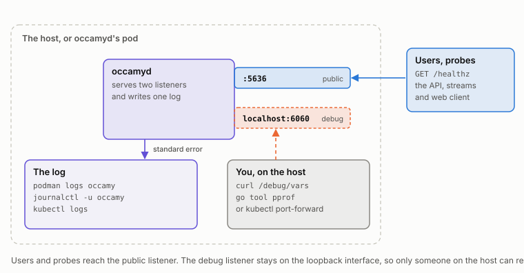
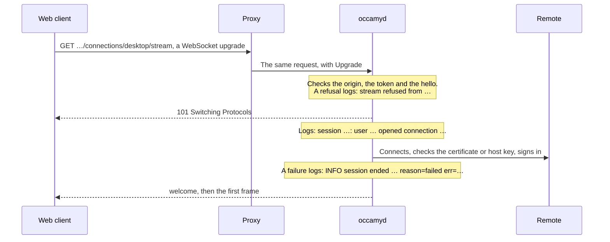

# Debugging and monitoring

Find out why a session failed, and keep an eye on a running `occamyd`.
This page starts from what you or your users see, says where to look
and what it means, and ends with a reference to the log and the debug
listener.

## Where to look

`occamyd` tells you about itself in three places. Its *log* has a line
for each request, for each session that opens and ends, and for each
warning. The *health check*, `/healthz` on the public listener, says
whether `occamyd` serves requests. The *debug listener*, which is off
until you turn it on, serves the Go runtime's numbers and profiles.

<picture>
  <source media="(prefers-color-scheme: dark)" srcset="figures/debugging-sources-dark.svg">
  
</picture>

Start with the log. When a session can't connect, the web client says
why in a sentence, such as “The remote computer refused the
connection.”, but never names a host, an address or a fingerprint,
because everyone in the session reads it. The log has the whole error.
Read it where your `occamyd` runs:

```sh
podman logs occamy             # the container of Deploy
journalctl -u occamy           # the systemd unit of Deploy
kubectl logs deploy/occamy     # a Deployment named occamy
```

Each session has an ID, which the line that opens it names, as in
`session iveQDlpIpFSzK2wLN6Fr7Q: user "alice" opened …`. Search the log
for that ID to find how the session went and how it ended.

## occamyd doesn't start

`occamyd` checks the whole configuration before it serves anything. It
stops with every problem it found, each with its line and key:

```
config: 2 problems:
	line 7: conections: unknown key, did you mean connections?
	line 31: debug.address: "localhost:5636" shares a port with listen ":5636": give the debug listener a port of its own, since whatever reaches the one could reach the other
```

[Configuration](configuration.md) describes each key. These are the
other reasons that `occamyd` stops at start:

| It says | What to do |
|---------|------------|
| `cannot read the configuration file: …; name another with -conf` | Check the path. `-conf` names the file, `./conf.yaml` by default |
| `auth: signing key …: occamyd runs as uid 65532, which may not use …` | Give the key's directory, or the volume mounted on it, to that user. [The signing key](configuration.md#the-signing-key) has the step for a host, Docker and Podman |
| `listen tcp :5636: bind: address already in use` | Another process has the port. Stop it, or change `listen` |
| `tls: …` | `tls.cert` or `tls.key` doesn't load. Check that the two files are PEM and belong together |

`occamyd` can also start with warnings, each beginning with `warning:`.
[Warnings at start](#warnings-at-start) lists them.

## Users can't sign in

A wrong user name or password logs `sign-in failed from` the client's
address. The line leaves out the user name, because people sometimes
type a password into it.

If everyone has to sign in again after a restart, look for
`warning: created a new signing key` at start. It's expected the first
time `occamyd` starts, but on a server that has run before, it means
that the key's volume is missing, so that the tokens `occamyd` gave out
no longer verify ([Keep the signing key](deploy.md#keep-the-signing-key)).

Through OIDC, a failed sign-in logs `OIDC sign-in failed from` the
client's address with the reason, and a provider that can't be reached
logs `warning: OIDC discovery at … failed`. The web client shows the
error code that [Signing in through
OIDC](configuration.md#signing-in-through-oidc) explains.

## The session ends at once

A session opens in a few steps, and each one that fails leaves its own
line in the log:



Find the page's message in the first column, then the line in the log:

| The page says | The log says | What it means |
|---------------|--------------|---------------|
| **Could not connect**: “The remote computer refused the connection.” | `session ended … reason=failed err="vnc: dial tcp 10.0.4.20:5900: connect: connection refused"` | Nothing listens at the connection's `target`. Check the address and the port, and that the remote's server runs |
| **Could not connect**: “The remote computer didn't answer in time.” | `dial tcp 10.0.4.20:5900: i/o timeout` | A firewall between `occamyd` and the remote drops the connection, or the remote is off |
| **Could not connect**: “The server couldn't look up the remote computer's name.” | `dial tcp: lookup build-box.lab: no such host` | The `target`'s host name doesn't resolve where `occamyd` runs, which in a container is the container's DNS |
| **Could not connect**: “The server has no route to the remote computer.” | `connect: no route to host` | `occamyd`'s host has no route to the remote's network |
| **Could not connect**: “The server doesn't trust the remote computer's certificate.” | `the server's certificate "…" (SHA-256 3F:A1:…) is not trusted` | The remote's certificate doesn't chain to a CA that `occamyd` trusts. Add the logged fingerprint to the connection's `tls.pins`, or give the issuing CA in `tls.ca_file` ([Check a remote's certificate](configuration.md#check-a-remotes-certificate)) |
| **Could not connect**: “The server doesn't trust the remote computer's host key.” | `host key ssh-ed25519 SHA256:… is not pinned` | The SSH server's host key isn't in the connection's `host_keys`. Check that it's the key you expect, then add it |
| **Could not connect**: “The remote computer refused the user name or password.” | `vnc: authentication failed` or `rdp: authentication failed` | Check the connection's `credentials`, and the file or variable that holds the password |
| **Remote unreachable** | `ssh: … unable to authenticate` | The SSH server refused the credentials. Check the connection's `credentials`, or its private key |
| **Could not connect**: “The Kubernetes API server refused the credentials.” | `kubernetes: the API server refused the stream with 401` | The connection's token is wrong or has expired |
| **Could not connect**: “The Kubernetes API server refused to open a shell in the pod.” | `kubernetes: the API server refused the stream with 403` | The token's role doesn't allow `create` on `pods/exec` in the pod's namespace |
| **Remote unreachable** | `set ard: true on connection "…" to allow it` | A Mac offers only Apple Remote Desktop's sign-in. Read [the risk](configuration.md#apple-remote-desktop-ard) before you set `ard: true` |
| **Remote unreachable** | `allow TLS with security: tls on connection "…"` | The RDP server speaks no NLA, as xrdp doesn't. Set `security: tls`, and pin its certificate ([xrdp](configuration.md#xrdp)) |
| **Access refused** | `user "…" opening connection "…": too many sessions open` | The user already owns `limits.sessions_per_user` sessions |
| **Access refused** | `user "…" opening connection "…": occamyd runs as many sessions as it takes` | `occamyd` runs `limits.sessions` sessions ([Limits](configuration.md#limits-limits)) |
| **Access refused** | `stream refused from …: origin not allowed` | The page that opened the stream isn't on `occamyd`'s origin, as when a proxy rewrites the `Host` header. List the page's origin in [`origins`](configuration.md#server) |
| **Session ended**, with `the session could not be opened` under **Details** | `user "…" opening connection "…":` and the cause | `occamyd` failed on its own, such as when it can't read a password file |
| **Connection lost**, saying that `occamyd` can't be reached | `"GET" "/api/v1/connections/…/stream" 426` | The proxy doesn't pass the WebSocket upgrade on. If no such line appears at all, the proxy answered by itself ([Serve it over TLS](deploy.md#serve-it-over-tls)) |

## The session drops after a quiet minute

If users see **Connection lost** whenever the screen stays still for a
while, a proxy between them and `occamyd` closes quiet connections. A
stream carries nothing while the screen is still and nobody types, so
the proxy takes it for idle. Each stream's request line appears when
the stream ends, with how long it was open, and these all end after
about the same time, such as nginx's default of a minute:

```
2026/11/04 10:16:41 middleware.go:41: occamy: "GET" "/api/v1/connections/desktop/stream" 101 1m0.004s 127.0.0.1:41818
```

Raise the proxy's timeouts above 30 minutes, the time after which a
session without input ends anyway ([What each hop
needs](deploy.md#what-each-hop-needs)). **Join again** returns the
owner to the session within a minute. After that, the session ends, and
the log says `reason="owner left"`.

## Disconnected: too slow

`occamyd` disconnects a viewer that acknowledges no frame, or takes
none of what it's sent, for `streams.viewer_timeout`, 30 seconds by
default, and logs:

```
INFO viewer dropped viewer=2 err="stream: the viewer stopped taking frames: no frame acknowledged for 30s"
```

The viewer's network stalled, or its device couldn't keep up. The
session goes on, and **Join again** returns to it. On networks that
stall for longer, raise `streams.viewer_timeout`
([Streams](configuration.md#streams-streams)).

## Typing feels slow

`occamyd` logs nothing for a slow session, so look at what a key goes
through. A key's effect crosses two hops twice: from the user to
`occamyd` and on to the remote, then back as the remote's new screen.
Its time is the round trip of each hop, plus the time the remote takes
to draw and `occamyd` takes to encode.

- **Compare an SSH session with a desktop.** A terminal has little to
  draw. If it's slow too, the network is; if only the desktop is, look
  at the remote and at `occamyd`'s CPU.
- **Put `occamyd` near the remotes**, and the proxy near `occamyd`. A
  proxy in another region adds its round trip to every key.
- **Check the congestion control.** On a link that loses packets, such
  as Wi-Fi, BBR keeps a desktop's frame rate where CUBIC cuts it. The
  start of the log says `TCP congestion control: bbr`, and so does
  `tcp_congestion` in [`/debug/vars`](#debugvars). A warning that the
  kernel hasn't loaded BBR means it hasn't
  ([TCP congestion control](deploy.md#tcp-congestion-control)).
- **Check `occamyd`'s CPU**, with `podman stats` or `top`. If it's
  busy, a [CPU profile](#cpu-and-memory) shows where. RDP sessions share
  `limits.decode_cores`, half the cores by default, so many RDP
  desktops in motion can wait for their share
  ([Limits](configuration.md#limits-limits)).
- **Run `occamyd` on Linux or macOS.** There, `occamyd` limits the bytes
  that the kernel keeps queued on each stream, so that a key's frame
  doesn't wait behind data the viewer will never need. Windows has no
  such limit. If the kernel refuses it, the log says
  `stream from …: setting TCP_NOTSENT_LOWAT:` with the error.

[Benchmarks](benchmarks.md) shows how long keys take to show through
Occamy and through Guacamole on the same paths.

## The screen is black, or parts are missing

A Windows desktop over RDP that stays nearly black needs
`disable_gfx: true` on its connection. `occamyd` warns of it at the
first part of the screen that it can't draw:

```
WARN rdp: the server draws with GFX that the client does not decode yet, so parts of the screen may stay missing or stale; to turn GFX off, set disable_gfx: true on the target's connection, and reach an ad-hoc target, which cannot set it, through a connection session=… addr=10.0.4.20:3389 skipped=…
```

[Connect Windows hosts](deploy.md#connect-windows-hosts) sets it up.
A desktop that doesn't fill the window is a VNC server that keeps its
own size, which `occamyd` logs as
`WARN vnc: the server prohibits resizing the screen` or
`WARN vnc: the server did not resize the screen`. The web client then
scales the desktop to fit.

## The clipboard doesn't arrive

The clipboard depends on the connection, the browser and the remote,
and the web client's **Clipboard** panel says which of them held the
text back ([Copy and paste](web-client.md#copy-and-paste)).

From the remote to the user:

- The page takes the remote's text only while it has the focus, and
  only for a role that may type. A view-only viewer's clipboard is left
  alone.
- A connection with `disable_copy` never sends it
  ([Close the clipboard](configuration.md#close-the-clipboard)).
- A terminal, over SSH or Kubernetes, has no remote clipboard. Select
  the text in the terminal, and copy it with the browser.
- A VNC server's text beyond 4 MiB is cut to 4 MiB, and the log says
  `WARN vnc: cut text truncated` or
  `WARN vnc: extended clipboard text truncated`.

From the user to the remote:

- Firefox and Safari never let the page read the clipboard by itself.
  Paste into the **Clipboard** panel there, and click **Send**.
- A view-only viewer can't send, and a connection with `disable_paste`
  drops the text.
- An RDP server takes clipboard text only once a user has logged on,
  because it runs its clipboard in a process that starts at logon.
  Until then, the text waits, the panel says "The
  remote hasn't taken the clipboard yet", and after a minute the log
  says `WARN rdp: the server's clipboard has not taken the owner's text, which waits for it`.
  If the message stays after logon, the remote's clipboard process has
  probably stopped, and opening the session again may start it.
- A VNC server that doesn't speak the Extended Clipboard extension, as
  x11vnc doesn't, takes Latin-1 only, so other characters, such as 日本,
  arrive as `?`. TigerVNC takes UTF-8.

## Memory or goroutines keep growing

Turn on the [debug listener](#the-debug-listener) and watch the number
of goroutines and the heap over a day:

```sh
curl -s localhost:6060/debug/vars | jq '{goroutines, fds, heap: .memstats.HeapInuse}'
```

An idle `occamyd` runs a handful of goroutines. Each session adds
several, for its backend and for each viewer's stream, and each idle
keep-alive connection adds one. Once every session has ended, the count
is back where it was, so a count that keeps growing is a leak.
[Goroutines](#goroutines) shows which stack grows.

Memory follows the screens that viewers hold: each visible viewer
keeps the screen it was last sent until it acknowledges a newer one
([Streams](configuration.md#streams-streams)).

## The log

`occamyd` writes its log to standard error. This is the start of an
`occamyd` whose user `alice` mistyped her password once, then opened a
connection to a VNC server that was down:

```
2026/11/04 20:12:56 server.go:135: occamy: serving API v1 at http://127.0.0.1:5636
2026/11/04 20:12:56 server.go:137: occamy: serving expvar and pprof at http://127.0.0.1:6060/debug/
2026/11/04 20:12:57 middleware.go:41: occamy: "GET" "/healthz" 200 108µs 127.0.0.1:54599
2026/11/04 20:13:01 signin.go:120: occamy: sign-in failed from 127.0.0.1:54996
2026/11/04 20:13:01 middleware.go:41: occamy: "POST" "/api/v1/auth/token" 401 187.813ms 127.0.0.1:54996
2026/11/04 20:13:01 signin.go:131: occamy: user "alice" signed in, idp local
2026/11/04 20:13:01 middleware.go:41: occamy: "POST" "/api/v1/auth/token" 200 194.18ms 127.0.0.1:55014
2026/11/04 20:13:05 sessions.go:406: occamy: session iveQDlpIpFSzK2wLN6Fr7Q: user "alice" opened connection "build-box" through vnc
2026/11/04 20:13:05 middleware.go:41: occamy: "POST" "/api/v1/sessions" 201 500µs 127.0.0.1:55212
2026/11/04 20:13:05 session.go:483: occamy: INFO session ended session=iveQDlpIpFSzK2wLN6Fr7Q reason=failed err="vnc: dial tcp 10.0.4.20:5900: connect: connection refused"
```

Each line has the same parts:

| Part | In the last line | What it is |
|------|------------------|------------|
| Date and time | `2026/11/04 20:13:05` | The host's local time, to the second |
| Source | `session.go:483` | The file and line of `occamyd`'s code that wrote it, for a bug report |
| Prefix | `occamy:` | The same on every line |
| Level | `INFO` | `INFO`, `WARN` or `ERROR`, on lines from sessions, streams and backends only |
| Message | `session ended` | What happened |
| Details | `session=… reason=failed err="…"` | `key=value` pairs, with a value in quotes when it has spaces |

`occamyd` writes no debug lines, and you can't change the level.

Every line about a session carries its ID, so you can follow one
session by searching the log for it. The lines about what a user did
with the session, such as `opened` and `shared`, start
`session <id>:`. The lines of the session itself, of its viewers'
streams and of its connection to the remote, such as `session ended`,
`viewer dropped` and `WARN vnc: …`, carry `session=<id>`.

### What the lines say

| Line | When |
|------|------|
| `serving API v1 at http://[::]:5636` | At start, with the public listener's address |
| `serving expvar and pprof at http://127.0.0.1:6060/debug/` | At start, when the debug listener is on |
| `debug listener off: OCCAMY_DEBUG_ADDRESS, which debug.address_env names, is unset or empty` | At start, when `debug.address_env` names a variable without an address |
| `TCP congestion control: bbr` | At start, on Linux. With `congestion_control: system`, it ends `, the kernel's choice` |
| `OIDC provider https://idp.example.com discovered` | With OIDC, once the provider has answered |
| `"GET" "/api/v1/connections" 200 1.234ms 10.0.0.7:51544` | After each request, on either listener: the method, the path, the status, the duration and the client's address |
| `user "alice" signed in, idp local` | A sign-in with a password. Through OIDC, the line ends `idp oidc` |
| `sign-in failed from 10.0.0.7:51544` | A wrong user name or password |
| `OIDC sign-in failed from 10.0.0.7:51544: …` | An OIDC sign-in failed, with the reason |
| `session <id>: user "alice" opened connection "build-box" through rdp` | A session opened. An ad-hoc target shows as `ad-hoc target "vnc://10.0.0.5:5900"` |
| `user "alice" opening connection "build-box": …` | A session couldn't open, with the reason |
| `session <id>: shared with role viewer for 1h0m0s` | The owner made a share link |
| `session <id>: closed by its owner` | The owner ended the session |
| `INFO session ended session=<id> reason=… err=…` | A session ended, for one of the reasons below |
| `stream refused from 10.0.0.7:51544: origin not allowed` | A stream was refused before it joined a session. The other reasons are `invalid hello` and `unsupported protocol version` |
| `session <id>: viewer 2: the stream ended: …` | A viewer's stream failed while the session runs on |
| `INFO viewer dropped session=<id> viewer=2 err=…` | A viewer acknowledged no frame for `streams.viewer_timeout`, and `occamyd` disconnected it |
| `INFO client closed session=<id> code=… reason=…` | A client closed its stream because of a fault, such as a tile it couldn't decode |
| `INFO rdp: the server ended the session session=<id> addr=… reason=…` | An RDP server ended the session, with its reason |
| `ERROR session panicked session=<id>` | `occamyd` failed on its own. The line has the stack, for a bug report |

The request line never holds the query string, the headers or the body,
so tokens and passwords stay out of the log. The client's address is
the one `occamyd` sees, which behind a reverse proxy is the proxy's. A
stream's request line appears when the stream ends, with the status
`101` and the whole time it was open.

A session ends for one of these reasons:

| `reason=` | Why |
|-----------|-----|
| `closed` | The owner ended it |
| `"owner left"` | The owner left and didn't come back within a minute |
| `idle` | Nobody gave input for 30 minutes |
| `"remote ended"` | The remote ended it, as when its user logs out |
| `failed` | The backend couldn't connect, or lost the remote. `err=` says why |
| `shutdown` | `occamyd` is stopping |
| `"internal error"` | `occamyd` failed on its own. An `ERROR session panicked` line before it has the stack |

When `occamyd` stops on `SIGTERM`, it logs
`received terminated: shutting down; a second signal stops occamyd at once`
and `shutting down: draining requests for up to 5s`, then
`occamyd has stopped`. On `SIGINT`, the first line says `interrupt`
in place of `terminated`. A request still running after the drain, such
as a long CPU profile, is cut with a warning, and so are streams still
open 5 seconds after that.

### Warnings at start

| Warning | What to do |
|---------|------------|
| `created a new signing key in …; tokens signed with any earlier key no longer verify` | Expected at the first start. On a server that has run before, the key's volume is missing, and everyone has to sign in again. Keep the key on a persistent volume |
| `the debug listener on … serves profiles and the command line without authentication beyond the loopback interface` | Move `debug.address` to `localhost`. In a container, publish the port on the host's loopback interface only, and the warning is expected |
| `congestion_control bbr: the kernel has not loaded it: load its module, tcp_bbr; connections use cubic` | Load the module, with `sudo modprobe tcp_bbr`, on the host or the node ([TCP congestion control](deploy.md#tcp-congestion-control)) |
| `congestion_control bbr: the kernel allows it only to privileged processes: …` | Add it to the `net.ipv4.tcp_allowed_congestion_control` sysctl |
| `web_client: …; /static/ serves no web client until it is built there (make client)` | Build the web client into that directory, or point `web_client` at the `dist` directory of its release archive |
| `the static users' password hashes have different bcrypt costs, …` | Hash every user's password at the cost that the warning names. Otherwise the time a sign-in takes tells which users exist |
| `connection "…": security: tls may send the password inside TLS whose certificate tls.insecure_skip_verify accepts unchecked, …` | Pin the server's certificate with `tls.pins` in place of `insecure_skip_verify` |
| `OIDC discovery at … failed, retried on the next sign-in after 10s: …` | `occamyd` can't reach the provider, and OIDC sign-ins fail until it can. Check `auth.oidc.issuer` and the network to it |
| `adhoc_allowlist: not every address of occamyd's listeners is known, so a range may open it: …` | `occamyd` couldn't resolve the host of `listen` or `debug.address`, so an ad-hoc target in a range of `adhoc_allowlist` may reach `occamyd` itself. Use IP addresses there, or keep them out of the ranges |

### Warnings during a session

| Warning | What it means |
|---------|---------------|
| `WARN ssh: accepting an unverified host key` | The connection sets `insecure_ignore_host_key`, or the user accepted any host key for an ad-hoc target. Pin the logged fingerprint in `host_keys` |
| `WARN vnc: accepting an unverified certificate`, and the same for rdp and kubernetes | The connection sets `tls.insecure_skip_verify`. Pin the logged fingerprint in `tls.pins` |
| `WARN vnc: logged in with Apple Remote Desktop authentication, …` | The session runs unencrypted, as `ard: true` allows |
| `WARN rdp: the server draws with GFX that the client does not decode yet, …` | Parts of the screen may stay missing or stale, as on a Windows host. Set `disable_gfx: true` on the connection |
| `WARN rdp: the server's clipboard has not taken the owner's text, …` | The RDP server's clipboard doesn't answer. The text waits until it does |
| `WARN vnc: the server prohibits resizing the screen; …` | The VNC server keeps its own screen size |

## The health check

`occamyd` answers `GET /healthz` on its public listener while it
serves requests. The check takes no token:

```sh
curl -s http://localhost:5636/healthz    # {"status":"ok"}
```

It tells you that `occamyd` serves requests, not that the remotes can
be reached. The image has no shell, so probe it from outside, as a
Kubernetes probe does:

```yaml
livenessProbe:
  httpGet:
    path: /healthz
    port: 5636
```

When `occamyd` serves TLS itself, add `scheme: HTTPS`. Each check adds
a request line to the log.

## The debug listener

`occamyd` can serve Go's runtime statistics and profiles on a second
listener, which you turn on with `debug.address` in the configuration:

```yaml
debug:
  address: localhost:6060
```

At start, `occamyd` then logs
`serving expvar and pprof at http://127.0.0.1:6060/debug/`. Without
`debug.address`, these routes are served nowhere, and the public
listener never serves them.

> [!IMPORTANT]
> The debug listener has no authentication, and its profiles and
> command line describe your server. Keep it on the loopback interface;
> `occamyd` warns at start when it isn't.

Give the debug listener a port of its own. `occamyd` refuses a
`debug.address` on `listen`'s port when the two could take the same
connections: on the same host, `localhost` beside `127.0.0.1` or
`::1`, or either one on every address, such as `:5636`.

To turn the listener on without editing the file, name an environment
variable that holds the address instead. While the variable is unset
or empty, the listener stays off, and `occamyd` logs
`debug listener off:` with the variable's name:

```yaml
debug:
  address_env: OCCAMY_DEBUG_ADDRESS
```

In a container, a published port reaches the container's own address,
not its loopback interface. Listen on `0.0.0.0:6060` there, and publish
the port on the host's loopback interface only, as in
`-p 127.0.0.1:6060:6060`; the warning at start is then expected. In
Kubernetes, keep `localhost:6060`, and reach it with
`kubectl port-forward`. The demo stack of [Try Occamy](try-it.md)
serves its debug listener at `localhost:5638` after
`make run OCCAMY_DEBUG=1`.

### `/debug/vars`

`/debug/vars` returns one JSON object:

| Field | What it holds |
|-------|---------------|
| `cmdline` | `occamyd`'s command line |
| `memstats` | Go's memory statistics, such as `HeapInuse`, `Sys` and `NumGC` |
| `goroutines` | The number of goroutines |
| `fds` | The open file descriptors on Linux and macOS, or -1 where `occamyd` can't count them |
| `tcp_congestion` | The TCP congestion control of the public listener's connections, such as `bbr`, or empty where `occamyd` can't tell, as off Linux |

To watch the numbers that matter most:

```sh
curl -s localhost:6060/debug/vars | jq '{goroutines, fds, tcp_congestion, heap: .memstats.HeapInuse}'
```

## Profiling occamyd

The debug listener serves Go's profiles under `/debug/pprof/`, and the
[HTTP API](api.md#the-debug-listener) lists each route:

| Route | What it shows |
|-------|---------------|
| `/debug/pprof/` | An index of the profiles |
| `/debug/pprof/goroutine` | Every goroutine and its stack |
| `/debug/pprof/heap` | Memory in use, by allocation site |
| `/debug/pprof/allocs` | Every allocation since start |
| `/debug/pprof/profile` | CPU, sampled for `seconds`, 30 by default |
| `/debug/pprof/trace` | An execution trace, for `seconds`, 1 by default |
| `/debug/pprof/threadcreate` | The stacks that created OS threads |
| `/debug/pprof/block`, `/debug/pprof/mutex` | Blocking and lock contention. Both are empty, since `occamyd` doesn't record them |

### Goroutines

```sh
# The first line is the total, then one entry for each distinct stack.
curl -s 'localhost:6060/debug/pprof/goroutine?debug=1' | head -1
# Every goroutine with its full stack and how long it has waited.
curl -s 'localhost:6060/debug/pprof/goroutine?debug=2'
```

`?debug=1` groups the goroutines by stack, so when the count grows, the
stack whose count grows is the one to look at.

### CPU and memory

```sh
# Sample the CPU for 30 s while sessions run, then open pprof's web UI.
go tool pprof -http=:8080 'http://localhost:6060/debug/pprof/profile?seconds=30'
# Memory in use now.
go tool pprof -http=:8080 http://localhost:6060/debug/pprof/heap
# A 5 s execution trace: scheduling, network waits and garbage collection.
curl -o trace.out 'localhost:6060/debug/pprof/trace?seconds=5'
go tool trace trace.out
```

### Threads

Go runs goroutines on a small pool of OS threads, so the number of
threads doesn't follow the number of sessions. The total in
`threadcreate?debug=1` counts the threads created since start, and the
runtime seldom ends one. For the number running now, look at the
process: on Linux, `grep Threads /proc/$(pidof occamyd)/status` shows
it, and in a container, the `PIDS` column of `podman stats` or
`docker stats` does.

The pressure test and the soak read the debug listener to check that
`occamyd` doesn't leak, as [Development](development.md#pressure-test-and-soak)
describes.
