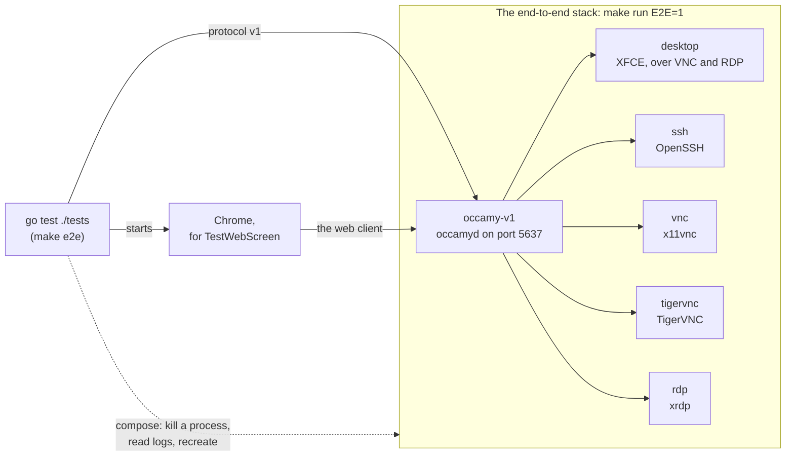
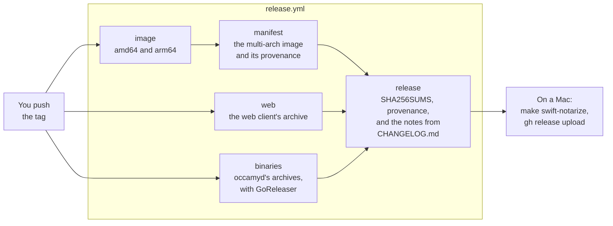

# Development

This page shows you how to build Occamy from source, run each of its
test suites, try a change to the web client against a running
`occamyd`, preview this website, and cut a release. Run each command
from the repository's root unless it says otherwise.
[CONTRIBUTING.md](../CONTRIBUTING.md) explains how to send a change,
and [Architecture](architecture.md) how the code fits together.

## What you need

| What | Version | For |
|------|---------|-----|
| [Go](https://go.dev/dl/) | 1.26.4 or later, as `go.mod` says | `occamyd` and the Go tests |
| A C compiler, such as gcc | Any | The race detector, `-race`, on Linux and Windows. macOS needs none |
| [Podman](https://podman.io) with a compose provider, or Docker with Compose v2 | Any recent | The image, the demo stack, and the end-to-end and integration tests |
| [Node.js](https://nodejs.org) with npm | 22.13 or later in 22, any 24, or 26 or later | The web client |
| [golangci-lint](https://golangci-lint.run) | v2. CI runs v2.15.0 | `make lint` |
| Chrome | Any recent | One end-to-end test, which skips without it |
| Xcode | 26 or later | Occamy for macOS |
| Python | 3 | Previewing the website, and drawing its figures |

`make` runs Podman unless `CONTAINER_ENGINE` names another engine. Give
every `make` command the same engine, which you can do by exporting
it once:

```sh
export CONTAINER_ENGINE=docker
```

The integration tests read `OCCAMY_CONTAINER_ENGINE` instead.

## Build

```sh
make compile    # ./occamyd
make client     # the web client, in client/occamy-web/dist
make build      # the image occamy:latest
```

`make compile` runs `CGO_ENABLED=0 go build -trimpath`, so `occamyd`
needs no C toolchain, and it builds the same way on Linux, macOS and
Windows. `make client` runs `npm ci` and `npm run build` in
`client/occamy-web`. `make build` builds both again inside the image,
from [docker/Dockerfile](../docker/Dockerfile), and tags the image
`occamy:latest` and `occamy:<version>`, where the version is what
`git describe` says. Set `OCCAMY_IMAGE` to give the image another name,
for example on a machine that others share
([Next to another stack](try-it.md#next-to-another-stack)).

`occamyd` takes one flag, `-conf`, which names its configuration file
and is `./conf.yaml` by default. The configuration's `web_client` names
the directory of the web client to serve, such as
`client/occamy-web/dist`. [Configuration](configuration.md) describes
every key, and [Deploy](deploy.md) a configuration to start from.

## Run the tests

CI runs these checks on every pull request, and you can run each of
them on your own machine:

| Suite | Command | What it needs | CI job |
|-------|---------|---------------|--------|
| [Unit tests](#unit-tests) | `go test -race ./...` | Go | `go` |
| [Lint](#lint) | `make lint` | golangci-lint v2 | `lint` |
| [The web client's tests](#the-web-clients-tests) | `npm test` in `client/occamy-web` | Node.js and Go | `web` |
| [End-to-end tests](#end-to-end-tests) | `make e2e` | The end-to-end stack | `e2e` |
| [Pressure test](#pressure-test-and-soak) | `make e2e OCCAMY_PRESSURE_N=10` | The end-to-end stack, with its debug listener | `e2e` |
| [Occamy for macOS](#build-occamy-for-macos) | `make swift-test` | Xcode | `macos` |

CI also builds `occamyd` on macOS and Windows, builds the image with
`make build`, and runs a short benchmark to keep the harness working,
which [Benchmarks](benchmarks.md) explains how to run. Three more suites
run only when you start them, because they take long or need servers of
their own: the [soak](#pressure-test-and-soak), the
[integration tests](#integration-tests) and the
[fuzz tests](#fuzz-tests). CI fuzzes every target each night.

### Unit tests

```sh
go test -race ./...
```

The unit tests need no stack and no container engine, and take a few
minutes with the race detector. The end-to-end tests in `tests/` skip
unless `make e2e` points them at a stack.

On Linux and Windows, the race detector needs a C compiler. Without
one, `go test -race` stops with `-race requires cgo` or
`C compiler "gcc" not found`. Run `go test ./...` instead, which runs
the same tests without the race detector.

The codec measurement, `bench/codecs`, is a Go module of its own, so
you run its tests from its directory. CI also vets the code, checks
the dependencies for known vulnerabilities and their licences, and
tests the benchmark's analysis on results with known answers:

```sh
(cd bench/codecs && go test ./...)
go vet ./...
go run golang.org/x/vuln/cmd/govulncheck@v1.9.0 ./...
go run github.com/google/go-licenses/v2@v2.0.1 check ./... --disallowed_types=forbidden,restricted
uv run bench/report_test.py    # needs uv
```

### Lint

```sh
golangci-lint version    # must say version 2
make lint
```

`make lint` runs golangci-lint with [.golangci.yml](../.golangci.yml),
then again on `bench/codecs` with its `measure` build tag. golangci-lint
v1 can't read the configuration, so check the version first. The
configuration also checks that the code is formatted with `gofmt`, and
that its imports are grouped as `goimports` groups them.

CI lints the RDP integration tests too, which build only under their
build tag:

```sh
golangci-lint run --build-tags=rdp_integration ./internal/rdp/... ./internal/backend/rdp/...
```

### The web client's tests

The web client's tests run in `client/occamy-web`, as CI runs them. Its
*interop tests* run the TypeScript client against `occamyd`'s own stream
code, which `client/internal/webinterop` serves. You build that server
first, with the race detector, so that a data race stops the server and
fails the test:

```sh
go build -race -o "${TMPDIR:-/tmp}/occamy-webinterop" ./client/internal/webinterop
cd client/occamy-web
npm ci
npm run lint
npm run typecheck
OCCAMY_INTEROP_SERVER="${TMPDIR:-/tmp}/occamy-webinterop" GORACE=halt_on_error=1 npm test
npm run build
cd ../..
```

On Linux or Windows without a C compiler, leave `-race` out of the
`go build`. Without `OCCAMY_INTEROP_SERVER`, `npm test` skips the
interop tests. With it, `npm test` still reports two tests as skipped:
they check that CI has the interop server, and run only in CI.

### End-to-end tests

The end-to-end tests open real sessions through `occamyd` in the demo
stack, with the Go client of protocol v1. They run against the
*end-to-end stack*: the demo stack with the tests' own configuration,
[docker/occamy-v1-e2e.yaml](../docker/occamy-v1-e2e.yaml), which
[docker/docker-compose.e2e.yaml](../docker/docker-compose.e2e.yaml)
mounts in place of the demo's. It adds connections to the small servers
that the tests probe.



To run them:

```sh
make build
make run E2E=1
make e2e
```

`make run E2E=1` starts the end-to-end stack, or switches a running
demo stack to it, and `make e2e` runs `go test ./tests/` against it.
Give `make e2e` the same engine that `make run` used, because some tests
stop processes in the `rdp` and `vnc` containers, or recreate
`occamy-v1`, through that engine's compose. `make run` without `E2E=1`
returns the stack to the demo's configuration, and `make stop` stops
either.

| Test | What it checks |
|------|----------------|
| `TestE2EV1` | Both demo desktops arrive twice in a row over VNC and RDP, and input reaches them without ending the session |
| `TestE2EV1SSH` | Two SSH sessions in a row each open a shell that answers a command |
| `TestDemoDesktop` | On both demo desktops, XFCE draws its panel and wallpaper, and the panel follows the screen when it grows |
| `TestE2EV1RDP` | On `rdp`: the clipboard both ways, a resize, a viewer who joins by a share, the owner leaving and coming back, and the clipboard again after its process in the `rdp` container is killed |
| `TestE2ETokenSurvivesRestart` | An access token still works after `occamy-v1` is recreated, because the signing key is on a volume |
| `TestX11vncClipboardRequestorGone` | x11vnc survives a clipboard request from a window that has gone |
| `TestVNCParity` | Each VNC feature on x11vnc and on TigerVNC. It logs a table, and writes it to the file that `OCCAMY_PARITY_MATRIX` names |
| `TestWebScreen` | In Chrome, on `tigervnc` and `rdp`, the web client asks for the window's size in CSS pixels at device pixel ratios of 2, 1 and 1.5, when the session opens and when the window changes. It finds Chrome on the host, or at `OCCAMY_E2E_CHROME`, and skips without it, except in CI |

A run takes a few minutes on an idle host, most of them in the parity
matrix. To run one test, such as the owner's return:

```sh
OCCAMY_E2E_V1_ENDPOINT=localhost:5637 go test -count=1 -v -run 'TestE2EV1RDP/reconnect' ./tests/
```

When a test fails, the services' logs usually say why. Read them with
the engine's compose, for example `(cd docker && podman compose logs rdp)`.
If the RDP clipboard check times out and the `rdp` log shows
`error in trans_connect chan`, xrdp found no channel server, the
process that carries the clipboard, for the session's display. The image
starts one again on the next connection, and logs
`starting xrdp-chansrv again`.

#### The test servers

Under `make run E2E=1`, **Connections** in the web client lists 14
connections: the demo's three, then the servers that the tests probe.
These show bare X desktops rather than a desktop to work in.

| Connection | What you see |
|------------|--------------|
| **x11vnc** | A black desktop with two xterms and no window manager. The small one at the top left is a probe: lines typed there reach the clipboard as hex. x11vnc keeps its 1024×768 screen, and the page scales it to the window. Keys go to the window under the pointer |
| **TigerVNC** | The same desktop, served by TigerVNC, which resizes its screen to the window |
| **RDP** | xrdp's X session: one xterm with the prompt `occamy@…:~$`. It resizes to the window. The first connection after the stack starts creates the X session, so wait a few seconds before you type |

The other connections reach the same servers with no password, over
VeNCrypt, and with the German and French keyboard layouts.
**TigerVNC, asking for the password** asks for a password first, which
is `vncpassword`.

The xterms have `xclip`. With the pointer over one,
`echo hello | xclip -selection clipboard` puts text on the remote
clipboard, and `xclip -o -selection clipboard; echo` prints it. The
test servers also answer the clipboard by themselves. On **x11vnc** and
**TigerVNC**, send `owner: hi` from the **Clipboard** panel, and the
remote clipboard soon holds `echo: hi`. **RDP** answers
`occamy-e2e:hi` with `echo:occamy-e2e:hi`. x11vnc ignores clipboard
text from the browser until its latest client has been connected for 45
seconds, so on a fresh connection, wait and send it again.

### Pressure test and soak

Both tests read `occamyd`'s goroutines, heap and open files from its
debug listener, so start the end-to-end stack with the listener on:

```sh
make run E2E=1 OCCAMY_DEBUG=1
```

The *pressure test* runs with the end-to-end tests when
`OCCAMY_PRESSURE_N` gives its number of rounds, as CI gives 10:

```sh
make e2e OCCAMY_PRESSURE_N=10
```

Each round opens two sessions at once to each of `ssh`, `vnc` and
`rdp`, one of which sends garbage once it's welcomed. Within a minute
after the rounds, `occamyd`'s goroutines must return to their number
before them.

The *soak* runs sessions for a long time while it samples `occamyd`'s
goroutines, heap and open files, and fails if they keep growing or a
session fails. This short soak runs 8 sessions to `tigervnc` for 5
minutes, each typing and moving the pointer, replaces each session
after 2 minutes, and samples every 10 seconds:

```sh
make soak OCCAMY_SOAK_DURATION=5m OCCAMY_SOAK_INTERVAL=10s OCCAMY_SOAK_LIFETIME=2m
```

`make soak` without these variables runs for an hour, and the full soak
runs 20 sessions for 8 hours:

```sh
make soak OCCAMY_SOAK_SESSIONS=20 OCCAMY_SOAK_DURATION=8h
```

After a warm-up of a tenth of the run, the soak fails in three cases:
when the median of a figure's last quarter of samples exceeds its first
quarter's by more than the figure's bound, when a figure isn't back
within its bound of where it started a minute after the last session
closed, or when a session fails. `OCCAMY_SOAK_BOUNDS` sets the bounds,
which are `goroutines=50,heap=32,fds=25` by default, with the heap in
MiB. `tests/soak_test.go` lists every variable.

### Integration tests

The integration tests run a backend against a real server in a
container of its own, and need no demo stack. Build tags keep them out
of `go test ./...`. Each run builds its own images, starts its own
containers, and removes them when it ends. Building an image can take
longer than `go test`'s default of 10 minutes, so each command sets a
longer `-timeout`.

| Build tag | Command | What it tests |
|-----------|---------|---------------|
| `rdp_integration` | `go test -tags rdp_integration -run Integration -timeout 30m ./internal/rdp` | The RDP client, against xrdp in the bench desktop image |
| `rdp_integration` | `go test -tags rdp_integration -run Integration -timeout 30m ./internal/backend/rdp` | The RDP backend, against the same |
| `kubernetes_integration` | `go test -tags kubernetes_integration -run Integration -timeout 15m ./internal/backend/kubernetes` | The Kubernetes backend, against k3s with a busybox pod. It pulls busybox, so it needs the network |
| `integration` | `go test -tags integration -run TestTigerVNC -timeout 30m ./internal/backend/vnc` | The VNC backend over VeNCrypt, against the demo's TigerVNC image |

The test files describe their settings in their comments. The
`integration` tag has three more tests, which run against a server that
you start yourself:

- `TestBenchDesktop` runs the VNC backend against x11vnc on the bench
  desktop. On a machine that others share, give the image, the
  container and the port names of your own:

    ```sh
    podman build -t occamy-bench-desktop -f docker/bench/desktop/Dockerfile .
    podman run -d --rm --name occamy-vnc-test -p 127.0.0.1:15900:5900 occamy-bench-desktop vnc
    OCCAMY_VNC_ADDR=127.0.0.1:15900 go test -tags integration -run TestBenchDesktop ./internal/backend/vnc
    podman rm -f occamy-vnc-test
    ```

- `TestEncodings` takes the same `OCCAMY_VNC_ADDR`, and asks for one
  encoding at a time.
- `TestMacOS` needs a Mac with Screen Sharing on, at
  `OCCAMY_VNC_ARD_ADDR`. Its comment in
  `internal/backend/vnc/ard_integration_test.go` says how to set it up.

### Fuzz tests

Every parser of what arrives over a network has a fuzz target, and
`go test -list '^Fuzz' ./...` lists them by package. Fuzz one target at
a time:

```sh
go test -run '^$' -fuzz '^FuzzSession$' -fuzztime 30s -parallel 4 ./client
```

`-parallel 4` keeps the fuzzer to four workers, which leaves the
machine usable. CI fuzzes every target for 30 seconds each night
([fuzz.yml](../.github/workflows/fuzz.yml)). To do the same on your
machine, which takes about 20 minutes:

```sh
for pkg in $(go list ./...); do
  for target in $(go test -list '^Fuzz' "$pkg" | grep '^Fuzz'); do
    go test -run '^$' -fuzz "^$target\$" -fuzztime 30s -parallel 4 "$pkg" || break 2
  done
done
```

A failure writes its input to the package's `testdata/fuzz/<target>/`.
Once you commit that file, plain `go test` replays the input every time
it runs.

## Run the web client against a local occamyd

To work on the web client, run Vite's dev server, which reloads the
page as you edit. It needs an `occamyd` to talk to, such as the demo
stack's:

```sh
make build && make run      # an occamyd on localhost:5637
cd client/occamy-web
npm ci
npm run dev
```

The dev server passes `/api` and its WebSockets on to the `occamyd` at
`http://localhost:5637`, or at the URL in `OCCAMY_DEV_SERVER`. Open the
address that it prints, and sign in as `demo` with the password
`occamy`.

## Turn on the debug listener

The demo stack's debug listener serves expvar and pprof without
authentication, so it's off unless you give `make run`
`OCCAMY_DEBUG=1`. It then listens on `localhost:5638`, on the loopback
interface only, whatever `OCCAMY_BIND` says:

```sh
make run OCCAMY_DEBUG=1
curl -s localhost:5638/debug/vars | head -c 200; echo
curl -s -o /dev/null -w '%{http_code}\n' localhost:5638/debug/pprof/    # 200
```

`make run` without `OCCAMY_DEBUG=1` turns it off again, whatever the
shell or `docker/.env` holds, and `occamy-v1` logs
`debug listener off`. `go test -run TestDemoDebugGating ./internal/config`
checks that the demo's files gate the listener this way.
[Debugging](debugging.md) explains how to profile `occamyd` through it.

## Build Occamy for macOS

The Mac app runs on macOS 26 or later. It links the Go client as a C
library, which `make swift-core` builds as a universal archive for
Apple silicon and Intel:

```sh
make swift-core
swift run --package-path client/occamy-swift Occamy    # run it from source
make swift-test    # its tests, which also start the interop server
make swift-app     # client/occamy-swift/build/app/Occamy.app
make swift-dmg     # a disk image of it, beside it
```

The app has the hardened runtime. Without a Developer ID, the build
signs it ad hoc, so it runs on the Mac that built it, and Gatekeeper
refuses a copy downloaded on another Mac. To sign it for other Macs,
name your Developer ID certificate. To have Apple notarize the disk
image too, name the profile that `xcrun notarytool store-credentials`
saved:

```sh
make swift-notarize DEVELOPER_ID="Developer ID Application: Your Name (TEAMID)" NOTARY_PROFILE=occamy
```

## Preview the website

The README and `docs/` are also the website,
<https://changkun.github.io/occamy/>, which MkDocs builds from
[mkdocs.yml](../mkdocs.yml). To preview it as you edit:

```sh
python3 -m venv .venv && .venv/bin/pip install -r scripts/docs-requirements.txt
.venv/bin/mkdocs serve
```

To check it as CI does, build it with `--strict`, which fails on a link
or an anchor that doesn't resolve:

```sh
.venv/bin/mkdocs build --strict
```

The `Pages` workflow runs that build for every pull request that
changes the docs, and publishes the site from `master`. `--strict`
checks the links between pages of the site, but not links into the
docs from `specs/`, `CHANGELOG.md` or the code, so search for a
heading's anchor before you rename it.

The figures that aren't measurements or Mermaid diagrams, such as the
protocol page's byte layout, are SVGs in a light and a dark version.
A module of `scripts/figures/` named after the page draws them. After
you change one, draw them all again:

```sh
python3 scripts/docs_figures.py
```

## Cut a release

A release is a tag `vMAJOR.MINOR.PATCH`, with a suffix such as
`-beta.1` for a prerelease. Pushing the tag runs
[release.yml](../.github/workflows/release.yml), which builds and
publishes everything except Occamy for macOS, which you build on a Mac:



1. Move the `Unreleased` entries in `CHANGELOG.md` under the new
   version and today's date, and update the comparison links at the
   end of the file.
2. Merge that change, and wait for CI to pass on `master`.
3. Tag the merge commit, and push the tag:

    ```sh
    git tag vMAJOR.MINOR.PATCH
    git push origin vMAJOR.MINOR.PATCH
    ```

    The workflow publishes the image `ghcr.io/changkun/occamy` with
    the tag's name, and also as `latest` unless the version has a
    suffix. It publishes the `occamyd` archives for Linux, macOS and
    Windows ([.goreleaser.yaml](../.goreleaser.yaml)), the web
    client's archive, `SHA256SUMS`, and provenance attestations, in a
    GitHub release whose notes are the version's section of the
    changelog. A version with a suffix is marked as a prerelease. The
    workflow fails if `CHANGELOG.md` has no entries for the version.

4. On a Mac with the Developer ID, build Occamy for macOS from the tag,
   because its version comes from `git describe`. Have Apple notarize
   it, and add the disk image to the release:

    ```sh
    git worktree add --detach ../occamy-release vMAJOR.MINOR.PATCH
    cd ../occamy-release
    make swift-notarize DEVELOPER_ID="Developer ID Application: …" NOTARY_PROFILE=…
    gh release upload vMAJOR.MINOR.PATCH client/occamy-swift/build/app/Occamy-MAJOR.MINOR.PATCH.dmg
    ```

    `NOTARY_PROFILE` names a profile that `xcrun notarytool
    store-credentials` saved. The disk image isn't in `SHA256SUMS`,
    because its Developer ID signature and Apple's notarization vouch
    for it.

To rehearse a release, run the workflow by hand from GitHub's
**Actions** tab: choose **Release**, then **Run workflow**. This dry run
builds everything and publishes nothing. A pull request that changes
the workflow, `.goreleaser.yaml`, `docker/Dockerfile` or
`scripts/third-party-licenses.sh` runs the dry run by itself.

## Clean up

[Tear down](try-it.md#6-tear-down) removes the demo stack and its
images. To remove what the builds and tests left in the checkout:

```sh
rm -f occamyd
rm -rf client/occamy-web/dist client/occamy-web/node_modules
rm -f "${TMPDIR:-/tmp}/occamy-webinterop"
```

`podman rmi occamy-bench-desktop` removes the bench desktop's image,
which `TestBenchDesktop` needs.
