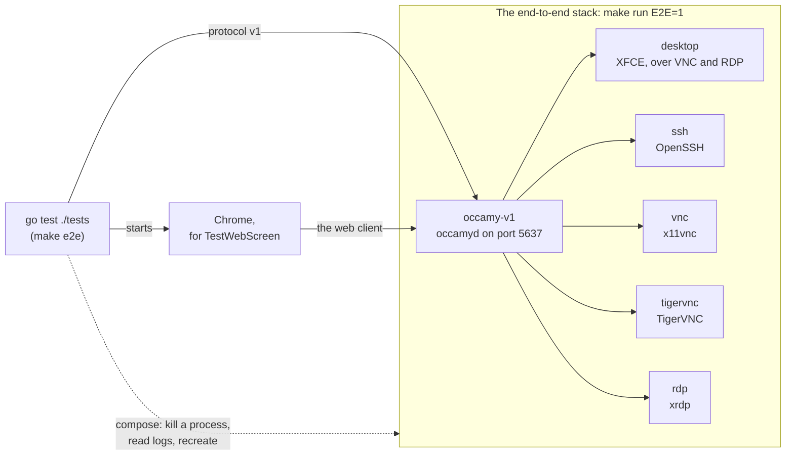
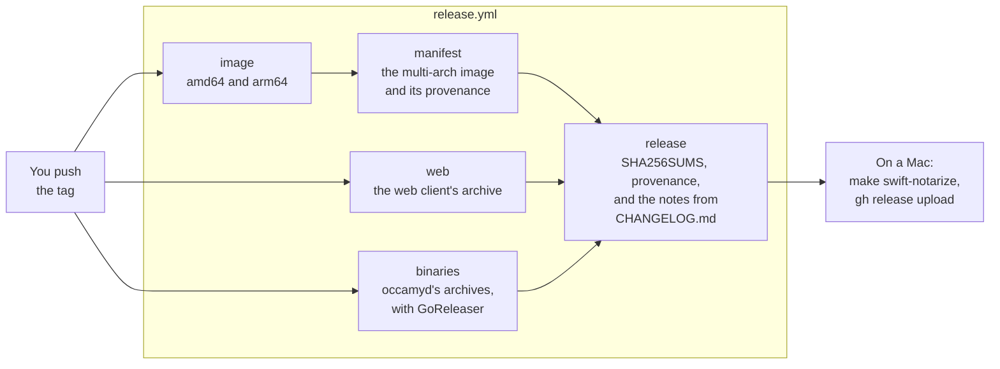

# Development

This page shows you how to build Occamy from source, run its tests, try
a change to the web client against a running `occamyd`, preview this
website, and cut a release. Run each command from the repository's
root unless it says otherwise. [CONTRIBUTING.md](../CONTRIBUTING.md)
explains how to send a change, and [Architecture](architecture.md) how
the code fits together.

## What you need

| What | Version | For |
|------|---------|-----|
| [Go](https://go.dev/dl/) | 1.26.4 or later, as `go.mod` says | `occamyd` and the Go tests |
| A C compiler, such as gcc | Any | The race detector, `-race`, on Linux and Windows. macOS needs none |
| [Podman](https://podman.io) with a compose provider, or Docker with Compose v2 | Any recent | The image, the demo stack, and the end-to-end and integration tests |
| [Node.js](https://nodejs.org) with npm | 22.13 or later in 22, any 24, or 26 or later | The web client |
| [golangci-lint](https://golangci-lint.run) | v2. CI runs v2.15.0 | `make lint` |
| Chrome | Any recent | One end-to-end test, which skips without it |
| Xcode | 26 or later | Occamy for macOS |
| Python | 3 | Previewing the website, and drawing its figures |

`make` runs Podman unless `CONTAINER_ENGINE` names another engine.
Give every `make` command the same engine, for example by exporting it:

```sh
export CONTAINER_ENGINE=docker
```

The integration tests read `OCCAMY_CONTAINER_ENGINE` instead.

## Build

```sh
make compile    # ./occamyd
make client     # the web client, in client/occamy-web/dist
make build      # the image occamy:latest
```

`make compile` runs `CGO_ENABLED=0 go build -trimpath`, which needs no
C toolchain on Linux, macOS or Windows. `make client` runs `npm ci` and
`npm run build` in `client/occamy-web`. `make build` builds both inside
the image, from [docker/Dockerfile](../docker/Dockerfile), and tags it
`occamy:latest` and `occamy:<version>`, from `git describe`, or as
`OCCAMY_IMAGE` names it
([Next to another stack](try-it.md#next-to-another-stack)). To run the
`occamyd` you built, give `-conf` a [configuration](configuration.md)
whose `web_client` is `client/occamy-web/dist`.

## Run the tests

You can run each of CI's checks on your own machine:

| Suite | Command | What it needs | CI job |
|-------|---------|---------------|--------|
| [Unit tests](#unit-tests) | `go test -race ./...` | Go | `go` |
| [Lint](#lint) | `make lint` | golangci-lint v2 | `lint` |
| [The web client's tests](#the-web-clients-tests) | `npm test` in `client/occamy-web` | Node.js and Go | `web` |
| [End-to-end tests](#end-to-end-tests) | `make e2e` | The end-to-end stack | `e2e` |
| [Pressure test](#pressure-test-and-soak) | `make e2e OCCAMY_PRESSURE_N=10` | The end-to-end stack, with its debug listener | `e2e` |
| [Occamy for macOS](#build-occamy-for-macos) | `make swift-test` | Xcode | `macos` |
| [Soak](#pressure-test-and-soak) | `make soak` | The end-to-end stack, with its debug listener | None |
| [Integration tests](#integration-tests) | `go test -tags …` | A container engine | None |
| [Fuzz tests](#fuzz-tests) | `go test -fuzz …` | Go | Each night, in `fuzz.yml` |

The last three take long or need servers of their own, so no pull
request runs them. CI also builds `occamyd` on macOS and Windows,
builds the image, and runs a short
[benchmark](benchmarks.md#run-the-benchmark) to keep the harness
working.

### Unit tests

```sh
go test -race ./...
```

The unit tests need no stack or container engine, and take a few
minutes with the race detector; the end-to-end tests in `tests/` skip
without a stack. Without a C compiler on Linux or Windows, `-race`
stops with `-race requires cgo` or `C compiler "gcc" not found`, so
leave it out.

CI also tests `bench/codecs`, a Go module of its own, vets the code,
checks the dependencies' vulnerabilities and licences, and tests the
benchmark's analysis on results with known answers:

```sh
(cd bench/codecs && go test ./...)
go vet ./...
go run golang.org/x/vuln/cmd/govulncheck@v1.9.0 ./...
go run github.com/google/go-licenses/v2@v2.0.1 check ./... --disallowed_types=forbidden,restricted
uv run bench/report_test.py    # needs uv
```

### Lint

```sh
golangci-lint version    # must say version 2
make lint
```

`make lint` runs golangci-lint with [.golangci.yml](../.golangci.yml),
which v1 can't read, then again on `bench/codecs` with its `measure`
build tag. The configuration also checks the code's `gofmt` formatting
and `goimports` grouping. CI lints the RDP integration tests too, which
build only under their tag:

```sh
golangci-lint run --build-tags=rdp_integration ./internal/rdp/... ./internal/backend/rdp/...
```

### The web client's tests

The web client's *interop tests* run the TypeScript client against
`occamyd`'s own stream code, which `client/internal/webinterop` serves.
Build that server with the race detector, so that a data race fails the
test, then run the tests as CI does:

```sh
go build -race -o "${TMPDIR:-/tmp}/occamy-webinterop" ./client/internal/webinterop
cd client/occamy-web
npm ci
npm run lint
npm run typecheck
OCCAMY_INTEROP_SERVER="${TMPDIR:-/tmp}/occamy-webinterop" GORACE=halt_on_error=1 npm test
npm run build
cd ../..
```

Without a C compiler, leave out `-race`. Without
`OCCAMY_INTEROP_SERVER`, `npm test` skips the interop tests; with it,
it still skips the two that check that CI has the interop server.

### End-to-end tests

The end-to-end tests open real sessions through `occamyd`, with the Go
client of protocol v1, on the *end-to-end stack*: the demo stack with
the tests' configuration,
[docker/occamy-v1-e2e.yaml](../docker/occamy-v1-e2e.yaml), which
[docker/docker-compose.e2e.yaml](../docker/docker-compose.e2e.yaml)
mounts in place of the demo's.



To run them:

```sh
make build
make run E2E=1
make e2e
```

`make run E2E=1` also switches a running demo stack to the end-to-end
one, `make run` switches back, and `make stop` stops either. Give
`make e2e` the engine that `make run` used: some tests stop processes
in the `rdp` and `vnc` containers, or recreate `occamy-v1`, through its
compose.

| Test | What it checks |
|------|----------------|
| `TestE2EV1` | Both demo desktops arrive twice in a row over VNC and RDP, and input reaches them without ending the session |
| `TestE2EV1SSH` | Two SSH sessions in a row each open a shell that answers a command |
| `TestDemoDesktop` | On both demo desktops, XFCE draws its panel and wallpaper, and the panel follows the screen when it grows |
| `TestE2EV1RDP` | On `rdp`: the clipboard both ways, a resize, a viewer who joins by a share, the owner leaving and coming back, and the clipboard again after its process in the `rdp` container is killed |
| `TestE2ETokenSurvivesRestart` | An access token still works after `occamy-v1` is recreated, because the signing key is on a volume |
| `TestX11vncClipboardRequestorGone` | x11vnc survives a clipboard request from a window that has gone |
| `TestVNCParity` | Each VNC feature on x11vnc and on TigerVNC. It logs a table, and writes it to the file that `OCCAMY_PARITY_MATRIX` names |
| `TestWebScreen` | In Chrome, on `tigervnc` and `rdp`, the web client asks for the window's size in CSS pixels at device pixel ratios of 2, 1 and 1.5, when the session opens and when the window changes. It finds Chrome on the host, or at `OCCAMY_E2E_CHROME`, and skips without it, except in CI |

A run takes a few minutes on an idle host, mostly the parity matrix.
To run one test, such as the owner's return:

```sh
OCCAMY_E2E_V1_ENDPOINT=localhost:5637 go test -count=1 -v -run 'TestE2EV1RDP/reconnect' ./tests/
```

When a test fails, the services' logs usually say why:
`(cd docker && podman compose logs rdp)`. An RDP clipboard check that
times out with `error in trans_connect chan` in the `rdp` log means
that xrdp found no channel server, the process that carries the
clipboard, for the session's display. The image starts one on the next
connection, and logs `starting xrdp-chansrv again`.

#### The test servers

Under `make run E2E=1`, the web client lists 14 connections: the
demo's three, then the tests' servers, which show bare X desktops.

| Connection | What you see |
|------------|--------------|
| **x11vnc** | A black desktop with two xterms and no window manager. The small one at the top left is a probe: lines typed there reach the clipboard as hex. x11vnc keeps its 1024×768 screen, and the page scales it to the window. Keys go to the window under the pointer |
| **TigerVNC** | The same desktop, served by TigerVNC, which resizes its screen to the window |
| **RDP** | xrdp's X session: one xterm with the prompt `occamy@…:~$`. It resizes to the window. The first connection after the stack starts creates the X session, so wait a few seconds before you type |

The other connections reach the same servers with no password, over
VeNCrypt, and with the German and French keyboard layouts.
**TigerVNC, asking for the password** asks for a password first, which
is `vncpassword`.

In the xterms, `echo hello | xclip -selection clipboard` puts text on
the remote clipboard, and `xclip -o -selection clipboard; echo` prints
it. The servers also answer text that you send from the **Clipboard**
panel:

| Connection | Send | The remote clipboard soon holds |
|------------|------|---------------------------------|
| **x11vnc**, **TigerVNC** | `owner: hi` | `echo: hi` |
| **RDP** | `occamy-e2e:hi` | `echo:occamy-e2e:hi` |

x11vnc ignores the browser's text until its latest client has been
connected for 45 seconds, so on a fresh connection, wait and send it
again.

### Pressure test and soak

Both tests read `occamyd`'s goroutines, heap and open files from its
debug listener, so start the end-to-end stack with the listener on:

```sh
make run E2E=1 OCCAMY_DEBUG=1
```

The *pressure test* runs with the end-to-end tests when
`OCCAMY_PRESSURE_N` gives its rounds, 10 in CI. Each round opens two
sessions at once to each of `ssh`, `vnc` and `rdp`, one of which sends
garbage once it's welcomed, and within a minute after the rounds,
`occamyd`'s goroutines must be back to their number before them.

```sh
make e2e OCCAMY_PRESSURE_N=10
```

The *soak* runs sessions that type and move the pointer for a long
time, and samples the same figures. After a warm-up, it fails when the
median of a figure's last quarter of samples exceeds its first
quarter's by more than the figure's bound, when a figure isn't back
within its bound of where it started a minute after the last session
closed, or when a session fails. `tests/soak_test.go` describes its
variables:

| Variable | Default | What it sets |
|----------|---------|--------------|
| `OCCAMY_SOAK_SESSIONS` | 8 | Sessions at once |
| `OCCAMY_SOAK_DURATION` | `1h` | How long the soak runs |
| `OCCAMY_SOAK_CONNECTIONS` | `tigervnc` | The connections that the sessions take in turn |
| `OCCAMY_SOAK_LIFETIME` | `10m` | How long a session lasts before another replaces it; `0` keeps each for the whole run |
| `OCCAMY_SOAK_INTERVAL` | `30s` | How often it samples |
| `OCCAMY_SOAK_WARMUP` | A tenth of the duration | How long before samples count |
| `OCCAMY_SOAK_BOUNDS` | `goroutines=50,heap=32,fds=25` | The growth allowed, with the heap in MiB |

A short soak of 5 minutes, and the full soak of 20 sessions for 8
hours:

```sh
make soak OCCAMY_SOAK_DURATION=5m OCCAMY_SOAK_INTERVAL=10s OCCAMY_SOAK_LIFETIME=2m
make soak OCCAMY_SOAK_SESSIONS=20 OCCAMY_SOAK_DURATION=8h
```

### Integration tests

The integration tests run a backend against a real server in a
container that they build, start and remove themselves, without the
demo stack. Build tags keep them out of `go test ./...`, and each
command sets a `-timeout` beyond the default 10 minutes, which building
an image can outlast.

| Build tag | Command | What it tests |
|-----------|---------|---------------|
| `rdp_integration` | `go test -tags rdp_integration -run Integration -timeout 30m ./internal/rdp` | The RDP client, against xrdp in the bench desktop image |
| `rdp_integration` | `go test -tags rdp_integration -run Integration -timeout 30m ./internal/backend/rdp` | The RDP backend, against the same |
| `kubernetes_integration` | `go test -tags kubernetes_integration -run Integration -timeout 15m ./internal/backend/kubernetes` | The Kubernetes backend, against k3s with a busybox pod. It pulls busybox, so it needs the network |
| `integration` | `go test -tags integration -run TestTigerVNC -timeout 30m ./internal/backend/vnc` | The VNC backend over VeNCrypt, against the demo's TigerVNC image |

The test files describe their settings in their comments. Three more
tests of the `integration` tag run the VNC backend against a server
that you start yourself:

| Test | Server | At |
|------|--------|----|
| `TestBenchDesktop` | x11vnc on the bench desktop | `OCCAMY_VNC_ADDR` |
| `TestEncodings` | The same, asking for one encoding at a time | `OCCAMY_VNC_ADDR` |
| `TestMacOS` | A Mac with Screen Sharing on, set up as the comment in `internal/backend/vnc/ard_integration_test.go` says | `OCCAMY_VNC_ARD_ADDR` |

For example, with names of your own on a machine that others share:

```sh
podman build -t occamy-bench-desktop -f docker/bench/desktop/Dockerfile .
podman run -d --rm --name occamy-vnc-test -p 127.0.0.1:15900:5900 occamy-bench-desktop vnc
OCCAMY_VNC_ADDR=127.0.0.1:15900 go test -tags integration -run TestBenchDesktop ./internal/backend/vnc
podman rm -f occamy-vnc-test
```

### Fuzz tests

Every parser of what arrives over a network has a fuzz target, which
`go test -list '^Fuzz' ./...` lists by package. Fuzz one target at a
time, with four workers to leave the machine usable:

```sh
go test -run '^$' -fuzz '^FuzzSession$' -fuzztime 30s -parallel 4 ./client
```

CI fuzzes every target for 30 seconds each night
([fuzz.yml](../.github/workflows/fuzz.yml)). To do the same on your
machine, which takes about 20 minutes:

```sh
for pkg in $(go list ./...); do
  for target in $(go test -list '^Fuzz' "$pkg" | grep '^Fuzz'); do
    go test -run '^$' -fuzz "^$target\$" -fuzztime 30s -parallel 4 "$pkg" || break 2
  done
done
```

A failure writes its input to the package's `testdata/fuzz/<target>/`,
and once you commit that file, every `go test` replays it.

## Run the web client against a local occamyd

To work on the web client, run Vite's dev server, which reloads the
page as you edit, against an `occamyd` such as the demo stack's:

```sh
make build && make run      # an occamyd on localhost:5637
cd client/occamy-web
npm ci
npm run dev
```

The dev server passes `/api` and its WebSockets on to the `occamyd` at
`http://localhost:5637`, or at the URL in `OCCAMY_DEV_SERVER`. Open the
address that it prints, and sign in as `demo` with the password
`occamy`.

## Turn on the debug listener

The demo stack's [debug listener](debugging.md#the-debug-listener)
serves expvar and pprof without authentication, so it's off unless you
give `make run` `OCCAMY_DEBUG=1`. It then listens on `localhost:5638`,
on the loopback interface only, whatever `OCCAMY_BIND` says:

```sh
make run OCCAMY_DEBUG=1
curl -s localhost:5638/debug/vars | head -c 200; echo
curl -s -o /dev/null -w '%{http_code}\n' localhost:5638/debug/pprof/    # 200
```

`make run` without it turns the listener off again, whatever the shell
or `docker/.env` holds, and `occamy-v1` logs `debug listener off`, as
`go test -run TestDemoDebugGating ./internal/config` checks.

## Build Occamy for macOS

The Mac app links the Go client as a C library, which `make swift-core`
builds as a universal archive for Apple silicon and Intel:

```sh
make swift-core
swift run --package-path client/occamy-swift Occamy    # run it from source
make swift-test    # its tests, which also start the interop server
make swift-app     # client/occamy-swift/build/app/Occamy.app
make swift-dmg     # a disk image of it, beside it
```

The app has the hardened runtime. Without a Developer ID, the build
signs it ad hoc: it runs on the Mac that built it, but Gatekeeper
refuses a copy downloaded on another Mac. For other Macs, name your
Developer ID certificate, and for Apple to notarize the disk image, the
profile that `xcrun notarytool store-credentials` saved:

```sh
make swift-notarize DEVELOPER_ID="Developer ID Application: Your Name (TEAMID)" NOTARY_PROFILE=occamy
```

## Preview the website

The README and `docs/` are also the website,
<https://changkun.github.io/occamy/>, which MkDocs builds from
[mkdocs.yml](../mkdocs.yml). To preview it as you edit:

```sh
python3 -m venv .venv && .venv/bin/pip install -r scripts/docs-requirements.txt
.venv/bin/mkdocs serve
```

To check it as the `Pages` workflow does on every pull request that
changes the docs, before it publishes the site from `master`, build it
with `--strict`, which fails on a link or an anchor that doesn't
resolve:

```sh
.venv/bin/mkdocs build --strict
```

That build doesn't check links into the docs from `specs/`,
`CHANGELOG.md` or the code, so search for a heading's anchor before you
rename it.

A module of `scripts/figures/` named after the page draws its figures
other than measurements and Mermaid diagrams, as light and dark SVGs.
After you change one, draw them all again:

```sh
python3 scripts/docs_figures.py
```

## Cut a release

A release is a tag `vMAJOR.MINOR.PATCH`, with a suffix such as
`-beta.1` for a prerelease. Pushing it runs
[release.yml](../.github/workflows/release.yml), which publishes
everything but Occamy for macOS, which you build on a Mac:



1. Move the `Unreleased` entries in `CHANGELOG.md` under the new
   version and today's date, and update the comparison links at the
   end of the file.
2. Merge that change, and wait for CI to pass on `master`.
3. Tag the merge commit, and push the tag:

    ```sh
    git tag vMAJOR.MINOR.PATCH
    git push origin vMAJOR.MINOR.PATCH
    ```

    The image `ghcr.io/changkun/occamy` gets the tag's name, and
    `latest` unless a suffix marks a prerelease. GoReleaser builds the
    archives from [.goreleaser.yaml](../.goreleaser.yaml). The workflow
    fails if `CHANGELOG.md` has no entries for the version.

4. On a Mac with the Developer ID, build Occamy for macOS from the tag,
   which gives its version, have Apple notarize it, and add the disk
   image to the release:

    ```sh
    git worktree add --detach ../occamy-release vMAJOR.MINOR.PATCH
    cd ../occamy-release
    make swift-notarize DEVELOPER_ID="Developer ID Application: …" NOTARY_PROFILE=…
    gh release upload vMAJOR.MINOR.PATCH client/occamy-swift/build/app/Occamy-MAJOR.MINOR.PATCH.dmg
    ```

    The disk image isn't in `SHA256SUMS`, because its Developer ID
    signature and Apple's notarization vouch for it.

To rehearse a release, choose **Release** in GitHub's **Actions** tab,
then **Run workflow**: this dry run builds everything and publishes
nothing. A pull request that changes the workflow, `.goreleaser.yaml`,
`docker/Dockerfile` or `scripts/third-party-licenses.sh` runs it by
itself.

## Clean up

[Tear down](try-it.md#6-tear-down) removes the demo stack and its
images. To remove what the builds and tests left in the checkout:

```sh
rm -f occamyd
rm -rf client/occamy-web/dist client/occamy-web/node_modules
rm -f "${TMPDIR:-/tmp}/occamy-webinterop"
```

`podman rmi occamy-bench-desktop` removes the bench desktop's image,
which `TestBenchDesktop` needs.
