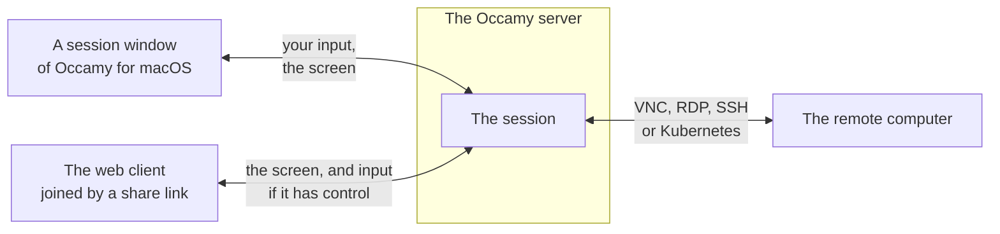
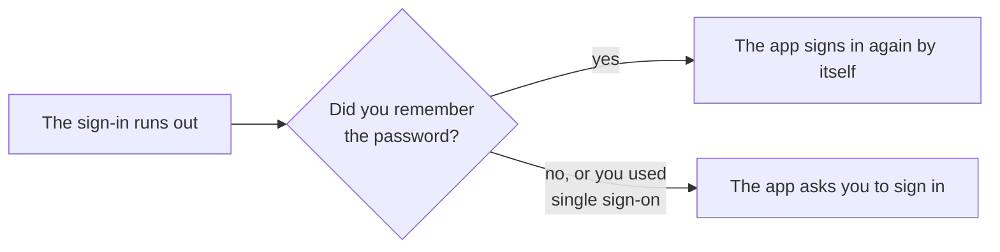

# Occamy for macOS

Occamy for macOS opens the remote desktops and terminals of your
Occamy servers in Mac windows of their own. This page shows you how
to install the app, add a server, open a connection, and work in a
session.

## How the app works

The app has one main window and a window for each session. The main
window's sidebar lists the Occamy servers that you have added, each of
which runs `occamyd`. The window shows the *connections* that the
selected server offers you as cards: each connection is a remote
computer, reached over VNC, RDP, SSH or Kubernetes, that the server's
configuration names. When you open a
connection, the server starts a *session* on it, and the session opens
in a window of its own.



The session runs on the server, not in the app, so it behaves as a
session of [the web client](web-client.md#how-the-web-client-works)
does. You own the sessions that you open. A session outlives its window
by a minute, and you can share it with people who join in a browser.

The app runs on macOS 26 and later, on Apple silicon and Intel.

## Install the app

1. Download `Occamy-<version>.dmg`, such as `Occamy-1.0.0-beta.2.dmg`,
   from the [releases](https://github.com/changkun/occamy/releases).
2. Open the disk image, and drag Occamy to Applications.
3. Open Occamy from Applications.

The app is signed with a Developer ID and notarized by Apple, so macOS
opens it. The first time, macOS asks whether to open an app that you
downloaded from the internet. When you add a server on your local
network, macOS also asks whether Occamy may connect to devices there.
Allow it, or the app can't reach that server.

## Add a server

1. Choose **File > Add Server…** (⌘N), or click **+** in the toolbar.
2. In **Server**, enter the server's address, such as
   `occamy.example.com`. The app connects over HTTPS unless the address
   starts with `http://`.
3. Enter your **User** and **Password**, and click **Sign In**.

The server appears in the sidebar, and its connections appear on the
right. A server that you are signed out of shows a lock in the
sidebar. The demo stack of [Try Occamy](try-it.md) is at
`http://localhost:5637`, with the user `demo` and the password
`occamy`.

### Stay signed in

A sign-in lasts 15 minutes, unless the server's administrator chose
another length, and the server doesn't renew it. When you turn on
**Remember the password in the Keychain** as you sign in, the app signs
in again by itself whenever the sign-in runs out, as the sheet says: "A
sign-in expires after a short time. With the password remembered, the
app signs in again on its own." Otherwise, it asks you to sign in
again.



### Sign in with single sign-on

When the server signs users in through an identity provider, the
sign-in sheet offers **Sign In with Single Sign-On…**. It opens the
provider's page in a browser sheet, and returns to the app once you
have signed in there. The app can't sign in again by itself after a
single sign-on, so it asks you again when the sign-in runs out.

For this to work, the server's administrator has to allow the app's
return address, `de.changkun.occamy:/oidc`, in
[`auth.oidc.return_urls`](configuration.md#signing-in-through-oidc).

## Open a connection

Each connection shows as a card with its name and protocol. To open
one in a new window, double-click it, select it and press Return, or
choose **Open** from its context menu. **Refresh** in the toolbar lists
the connections again.

A desktop's card shows a picture of its screen as you last left it.
The app keeps these pictures on this Mac, in
`~/Library/Application Support/Occamy/Thumbnails`.

The field in the toolbar, **Search or enter an address**, finds
connections by name, ID or protocol, and Return opens the first match.
A server that offers you no connections says "No Connections", and
that it has none available to you; ask its administrator for access.

### Open an address

Some servers also open machines that aren't among their connections.
Such a server shows "Opens vnc://, rdp:// and ssh:// addresses" under
its name in the toolbar. Enter an address in the field, and when the
window says **Open** and the address, press Return:

| Address | Opens | Port when the address has none |
|---------|-------|--------------------------------|
| `vnc://host:5901` | A VNC server | 5900 |
| `rdp://host` | An RDP server | 3389 |
| `ssh://user@host:2222` | An SSH server | 22 |

The server's administrator decides which machines it may reach
([ad-hoc targets](configuration.md#ad-hoc-targets)). A server that opens
no addresses shows the alert **Cannot Open Address**, which says that
the server "opens only the connections it lists, not addresses you
enter."

An `ssh://` address first asks how the server should prove who it is,
because without the server's host key, a machine in the middle could
pose as the server. Enter the key in **Host key**: either the
`ssh-ed25519 AAAA…` part of a line that `ssh-keyscan host` prints, or
its `SHA256:` fingerprint. Then click **Connect**. **Accept any host
key** skips the check, so use it only on a network you trust.

Whatever else the remote needs, such as a password, or a user name for
an `ssh://` address without `user@`, the remote asks for once the
session opens, as [Answer the remote's
questions](#answer-the-remotes-questions) describes.

## Work in a session

A desktop's window opens at the size of the remote's screen, or smaller
if that doesn't fit your display. A terminal's window sets the
terminal's size, so when you resize the window, the remote terminal
follows.

### The bar

Move the pointer to the top edge of a session's window to show its
bar. The bar hides again two seconds after the pointer leaves it. Hold
the pointer over a control to see its name, or, for the ⌘ and clipboard
buttons, whether it's on.

| Control | What it does |
|---------|--------------|
| **Scaling** | Desktops only. Choose **Scale to Window**, **Actual Size** or **Resize Remote to Window** |
| **Full Screen** | Fills the display. The bar still shows at the top edge, and **Exit Full Screen** leaves |
| **Send Ctrl-Alt-Del** | Desktops only. Sends Control-Alt-Delete, which the Mac doesn't pass on |
| ⌘ | Desktops only. Sends ⌘ shortcuts, such as ⌘Q or ⌘W, to the remote instead of the app. It says "⌘ shortcuts go to the remote computer" when it's on, and "⌘ shortcuts stay on this Mac" when it's off |
| The clipboard | Shares the clipboard with the remote, or stops sharing it. It says "Clipboard sharing is on" or "Clipboard sharing is off", and it's on when the window opens |
| **Share the session** | Copies a share link: **Copy Link with Control** or **Copy View-Only Link** |
| **End Session** | Ends the session for everyone in it, and closes the window |

**Scale to Window** shows the whole screen in the window. **Actual
Size** shows one pixel of the remote's screen per pixel of your
display, with scroll bars. **Resize Remote to Window** asks the remote
for a screen the size of the window. Some VNC servers don't change
their size.

### Use the keyboard

In a desktop session, keys go by their position on the keyboard, so the
remote's keyboard layout decides which character you type.

| On the Mac | On the remote |
|------------|---------------|
| Option | Alt |
| ⌘ | The Super key, which is the Windows key on Windows. Pressing ⌘ alone presses Super |
| ⌘ with a key that the app doesn't use | That key with Super |
| ⌘ with one of the app's shortcuts, such as ⌘W or ⌘Q | Nothing: the app takes it, unless ⌘ in the bar is on |
| Delete | Backspace |
| Fn-Delete | Delete |
| **Send Ctrl-Alt-Del** in the bar | Control-Alt-Delete |

### Copy and paste

In a desktop session, text that you copy on the Mac reaches the remote
when you switch to the session's window, and text copied on the remote
reaches the Mac's clipboard. Only text goes either way.

In a terminal session, text that a program on the remote copies to the
clipboard reaches the Mac's clipboard. To put text into the terminal,
paste it with ⌘V.

The clipboard button in the bar turns clipboard sharing off in both
directions, and on again. The server's administrator can also keep the clipboard
from going one way or the other for a connection.

### Share a session

**Share the session** in the bar copies a link to the clipboard. Anyone
who has the link can join the session in a browser, through the web
client that the server serves, for an hour or until the session ends.

- **Copy Link with Control** lets them type, point and use the
  clipboard. The window says "Link with control copied. It works for
  an hour."
- **Copy View-Only Link** lets them watch. The window says "View-only
  link copied. It works for an hour."

Send a link only to the people you mean to join. [Share a
session](web-client.md#share-a-session) describes how links work.

### Answer the remote's questions

When the remote asks for something that the connection doesn't carry,
such as a password, a sheet asks you. It shows the remote's question,
or "The remote computer needs more information" when the remote gives
none. Fill it in and click **Continue**, or click **End Session** to
give up.

When a field is secret, **Save in the Keychain** keeps your answer, and
the next time the remote asks the same question, the app answers for
you, once a session. If the remote asks again, as after a wrong
password, the sheet asks you, and says "The saved answer didn't work.
Save a new one to replace it." Saving then replaces the saved
answer.

## When a session ends

**End Session** in the bar ends the session for everyone in it and
closes the window. If the app can't reach the server to end it, the
session ends a minute later anyway.

Closing the window leaves the session without ending it at once. The
session runs on for a minute, as it does after a lost connection, and
then ends.

When a session ends in another way, the window says why. **Connect
Again** opens the connection again. After **Connection lost** or
**Disconnected: too slow**, it joins the same session, which waits a
minute for you. **Close** closes the window.

| The window says | What happened |
|-----------------|---------------|
| Connection lost | The connection to the server failed. The session may still run |
| Disconnected: too slow | The server heard nothing from the app for its viewer timeout, 30 seconds unless its configuration sets another: the network stalled, or the app couldn't keep up |
| Remote unreachable | The server couldn't connect to the remote, or lost its connection to it |
| Could not connect | The server couldn't open the session, for the reason shown, such as a remote that refused the sign-in |
| Session ended | The session was ended elsewhere, you didn't come back to it in time, or the remote ended it, as when its user logs out. The window says which. It also says "Session ended" when the server ran into an internal error, or ended the session for a reason the app doesn't know |
| Ended for inactivity | Nobody in the session typed or used the pointer for 30 minutes |
| Signed out | The sign-in ran out. Click **Sign In…** |
| Access refused | The connection isn't open to you, or you have as many sessions as the server allows |
| Server shut down | The server stopped, which ends every session on it. Try again once it's back |
| Disconnected | The session was closed for another reason |
| Protocol error | The server or the app sent something the other couldn't handle, which is a bug in one of them |

Below the reason, the window shows the close code and the server's
words, which help in a bug report.

A session that can't open shows **Could Not Connect** and the reason,
with **Try Again**, or with **Sign In…** when the sign-in ran out.

## Sign out or remove a server

Right-click a server in the sidebar:

- **Sign In…** signs in to the server again.
- **Sign Out** deletes its sign-in and the password that you saved.
- **Remove Server** also removes the server, and the pictures of its
  connections.

The app keeps every secret in your login keychain, under
`de.changkun.occamy`. Answers that you saved for a remote stay there
after you sign out or remove the server. To delete them, open Keychain
Access and search for `de.changkun.occamy`.

## Build it from source

You need Xcode 26 or later, and Go. From the repository's root:

```sh
make swift-app    # client/occamy-swift/build/app/Occamy.app
```

Without a Developer ID, the app is signed ad hoc. It runs on the Mac
that built it, but Gatekeeper refuses a copy downloaded on another Mac.
[Development](development.md#occamy-for-macos) covers running it from
source, its tests, and signing it for other Macs.
