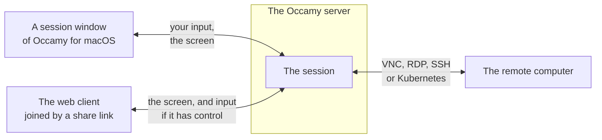
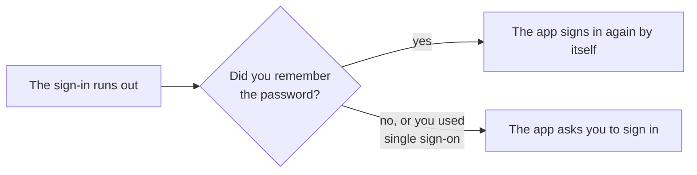

# Occamy for macOS

Occamy for macOS opens the remote desktops and terminals of your
Occamy servers in Mac windows of their own. This page shows you how
to install the app, add a server, open a connection, and work in a
session.

## How the app works

The main window lists the Occamy servers that you have added in its
sidebar, and the [connections](web-client.md#how-the-web-client-works)
that the selected server offers you as cards. Each session that you
open has a window of its own.



The session runs on the server, as a web client session does: it
outlives its window by a minute, and you can share it with people who
join in a browser.

The app runs on macOS 26 and later, on Apple silicon and Intel.

## Install the app

1. Download `Occamy-<version>.dmg`, such as `Occamy-1.0.0-beta.2.dmg`,
   from the [releases](https://github.com/changkun/occamy/releases).
2. Open the disk image, and drag Occamy to Applications.
3. Open Occamy from Applications.

The app is signed with a Developer ID and notarized by Apple, so macOS
opens it once you confirm that you mean to open an app from the
internet. When you add a server on your local network, macOS also asks
whether Occamy may connect to devices there: allow it, or the app can't
reach the server.

## Add a server

1. Choose **File > Add Server…** (⌘N), or click **+** in the toolbar.
2. In **Server**, enter the server's address, such as
   `occamy.example.com`. The app connects over HTTPS unless the address
   starts with `http://`.
3. Enter your **User** and **Password**, and click **Sign In**.

A lock in the sidebar marks a server that you are signed out of. The
demo stack of [Try Occamy](try-it.md) is at `http://localhost:5637`,
with the user `demo` and the password `occamy`.

### Stay signed in

A sign-in lasts 15 minutes by default, and the server doesn't renew
it. Turn on **Remember the password in the Keychain** as you sign in,
and the app signs in again by itself whenever the sign-in runs out.
Otherwise, it asks you to sign in again.



### Sign in with single sign-on

When the server signs users in through an identity provider, the
sign-in sheet offers **Sign In with Single Sign-On…**, which opens the
provider's page in a browser sheet and returns to the app once you have
signed in. The server's administrator has to allow the app's return
address, `de.changkun.occamy:/oidc`, in
[`auth.oidc.return_urls`](configuration.md#signing-in-through-oidc).

## Open a connection

Each connection shows as a card with its name and protocol. To open
one in a new window, double-click it, select it and press Return, or
choose **Open** from its context menu. **Refresh** in the toolbar lists
the connections again.

A desktop's card shows a picture of its screen as you last left it,
which the app keeps in
`~/Library/Application Support/Occamy/Thumbnails`.

**Search or enter an address**, in the toolbar, finds connections by
name, ID or protocol, and Return opens the first match.
A server that offers you no connections says "No Connections"; ask its
administrator for access.

### Open an address

A server that opens machines beyond its connections shows "Opens
vnc://, rdp:// and ssh:// addresses" under its name in the toolbar.
Enter an address in the field, and press Return when the window says
**Open** and the address:

| Address | Opens | Port when the address has none |
|---------|-------|--------------------------------|
| `vnc://host:5901` | A VNC server | 5900 |
| `rdp://host` | An RDP server | 3389 |
| `ssh://user@host:2222` | An SSH server | 22 |

The server's administrator decides which machines it may reach
([ad-hoc targets](configuration.md#ad-hoc-targets)). On a server that
reaches none, the alert **Cannot Open Address** says that it "opens only
the connections it lists, not addresses you enter."

An `ssh://` address first asks for the server's host key, so that no
machine in the middle can pose as the server. In **Host key**, enter
the `ssh-ed25519 AAAA…` part of what `ssh-keyscan host` prints, or its
`SHA256:` fingerprint, and click **Connect**. **Accept any host
key** skips the check, so use it only on a network you trust.

The remote asks for anything else it needs once the session opens,
such as a password, or a user name for an `ssh://` address without
`user@` ([Answer the remote's questions](#answer-the-remotes-questions)).

## Work in a session

A desktop's window opens at the size of the remote's screen, or smaller
if that doesn't fit your display. A terminal's window sets the
terminal's size, so the remote terminal follows when you resize it.

### The bar

Move the pointer to the top edge of a session's window to show its
bar, which hides two seconds after the pointer leaves. Hold the pointer
over a control to see its name, or, for the ⌘ and clipboard buttons,
whether it's on.

| Control | What it does |
|---------|--------------|
| **Scaling** | Desktops only. Chooses how the window shows the remote's screen, as the next table describes |
| **Full Screen** | Fills the display. The bar still shows at the top edge, and **Exit Full Screen** leaves |
| **Send Ctrl-Alt-Del** | Desktops only. Sends Control-Alt-Delete, which the Mac doesn't pass on |
| ⌘ | Desktops only. Sends ⌘ shortcuts, such as ⌘Q or ⌘W, to the remote instead of the app. It says "⌘ shortcuts go to the remote computer" when it's on, and "⌘ shortcuts stay on this Mac" when it's off |
| The clipboard | Shares the clipboard with the remote, or stops sharing it. It says "Clipboard sharing is on" or "Clipboard sharing is off", and it's on when the window opens |
| **Share the session** | Copies a share link: **Copy Link with Control** or **Copy View-Only Link** |
| **End Session** | Ends the session for everyone in it, and closes the window |

| Scaling | What the window shows |
|---------|-----------------------|
| **Scale to Window** | The whole screen, scaled to the window |
| **Actual Size** | One pixel of the remote's screen per pixel of your display, with scroll bars |
| **Resize Remote to Window** | A screen that the remote resizes to the window. Some VNC servers don't change their size |

### Use the keyboard

In a desktop session, keys go by their position on the keyboard, so the
remote's keyboard layout decides which character you type.

| On the Mac | On the remote |
|------------|---------------|
| Option | Alt |
| ⌘ | The Super key, which is the Windows key on Windows. Pressing ⌘ alone presses Super |
| ⌘ with a key that the app doesn't use | That key with Super |
| ⌘ with one of the app's shortcuts, such as ⌘W or ⌘Q | Nothing: the app takes it, unless ⌘ in the bar is on |
| Delete | Backspace |
| Fn-Delete | Delete |
| **Send Ctrl-Alt-Del** in the bar | Control-Alt-Delete |

### Copy and paste

Only text goes either way:

| Session | From the Mac to the remote | From the remote to the Mac |
|---------|----------------------------|----------------------------|
| Desktop | Text that you copy reaches the remote when you switch to the session's window | Text copied on the remote reaches the Mac's clipboard |
| Terminal | ⌘V pastes into the terminal | Text that a program on the remote copies reaches the Mac's clipboard |

Besides the clipboard button in the bar, a connection's configuration
can close the clipboard either way
([Close the clipboard](configuration.md#close-the-clipboard)).

### Share a session

**Share the session** in the bar copies a link with which anyone can
join the session in the web client for an hour, or until the session
ends. **Copy Link with
Control** lets them type, point and use the clipboard, and **Copy
View-Only Link** lets them watch. Send a link only to the people you
mean to join. [Share a session](web-client.md#share-a-session)
describes how links work.

### Answer the remote's questions

When the remote asks for something that the connection doesn't carry,
such as a password, a sheet shows the remote's question, or "The
remote computer needs more information" when the remote gives none.
Fill it in and click **Continue**, or click **End Session** to give
up.

For a secret field, **Save in the Keychain** keeps your answer, and the
app gives it the next time the remote asks the same question, once a
session. If the remote asks again, as after a wrong password, the sheet
asks you and says "The saved answer didn't work. Save a new one to
replace it."

## When a session ends

If **End Session** can't reach the server, the session ends a minute
later anyway. Closing the window leaves the session running for that
minute, as a lost connection does.

When a session ends in another way, the window says why, and below
that the close code and the server's words, which help in a bug
report. **Connect Again** opens the connection again: after
**Connection lost** or **Disconnected: too slow**, it joins the same
session, which waits a minute for you. **Close** closes the window.

| The window says | What happened |
|-----------------|---------------|
| Connection lost | The connection to the server failed. The session may still run |
| Disconnected: too slow | The server heard nothing from the app for its viewer timeout, 30 seconds unless its configuration sets another: the network stalled, or the app couldn't keep up |
| Could not connect | The server couldn't connect to the remote, for the reason shown, such as “The remote computer refused the user name or password.” |
| Remote unreachable | The server lost its connection to the remote, or couldn't connect to it for a reason that only its log shows |
| Session ended | The session was ended elsewhere, you didn't come back to it in time, or the remote ended it, as when its user logs out. The window says which. It also says "Session ended" when the server ran into an internal error, or ended the session for a reason the app doesn't know |
| Ended for inactivity | Nobody in the session typed or used the pointer for 30 minutes |
| Signed out | The sign-in ran out. Click **Sign In…** |
| Access refused | The connection isn't open to you, or you have as many sessions as the server allows |
| Server shut down | The server stopped, which ends every session on it. Try again once it's back |
| Disconnected | The session was closed for another reason |
| Protocol error | The server or the app sent something the other couldn't handle, which is a bug in one of them |

A session that can't open shows **Could Not Connect** and the reason,
with **Try Again**, or with **Sign In…** when the sign-in ran out.

## Sign out or remove a server

Right-click a server in the sidebar, and choose:

| Item | What it does |
|------|--------------|
| **Sign In…** | Signs in to the server again |
| **Sign Out** | Deletes the server's sign-in and the password that you saved |
| **Remove Server** | Also removes the server, and the pictures of its connections |

The app keeps every secret in your login keychain, under
`de.changkun.occamy`. Answers that you saved for a remote stay there
after you sign out or remove the server; to delete them, search for
`de.changkun.occamy` in Keychain Access.

## Build it from source

With Xcode 26 or later and Go, from the repository's root:

```sh
make swift-app    # client/occamy-swift/build/app/Occamy.app
```

[Development](development.md#build-occamy-for-macos) covers running it
from source, its tests, and signing it for Macs other than the one
that built it.
