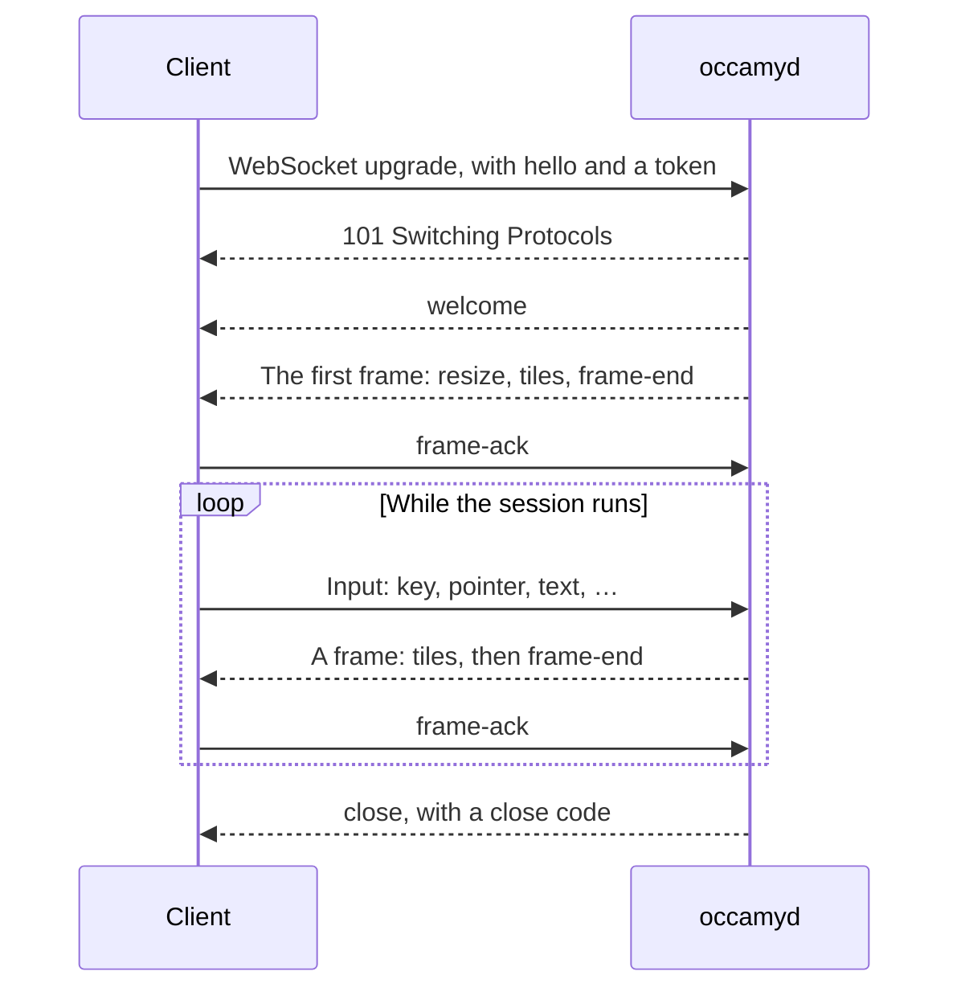
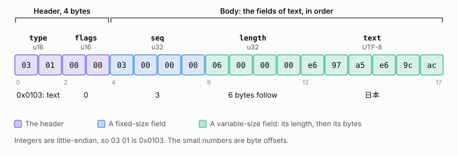
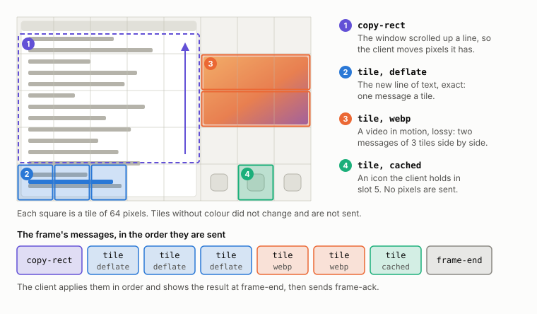
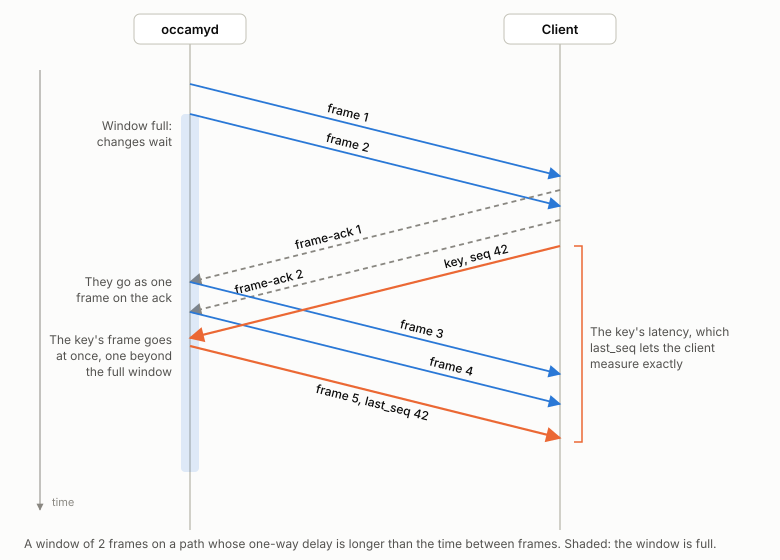
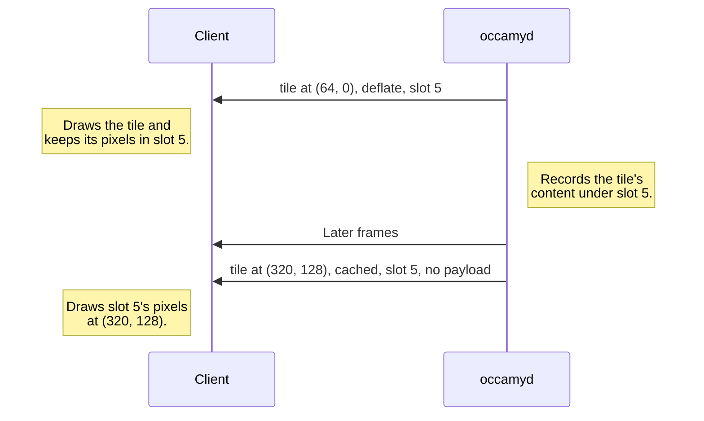
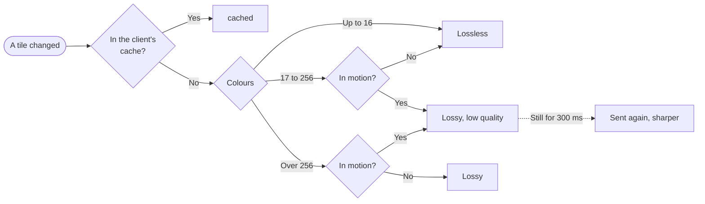

# Occamy protocol v1

Occamy protocol v1 carries a remote session between a client and
`occamyd` over a WebSocket: your input goes to the remote computer, and
its screen comes back. The web client and Occamy for macOS speak it, and
this page specifies it so that you can write a client of your own.

## How a session works

A session starts after a single round trip: the client puts its `hello`
message in the WebSocket's upgrade request, and `occamyd` answers with
`welcome` and then the whole screen.



The client sends numbered *input*: keys, pointer moves, scrolls, text
from an input method, and clipboard content. The server sends the
screen in *frames* of tiles or terminal output, each acknowledged once
shown, and keeps only a few unacknowledged, so a slow client receives
fewer and fresher frames instead of a queue of old ones. Each frame
names the last input it reflects, so the client can measure how long an
input takes to show.

Several clients can share a session: the client that opens it is its
*owner*, and others join as *viewers*, who can send input, or as
*read-only viewers*, who can't. When the session ends, the server sends
`close` with a [close code](#close-codes) that says why.

## Transport

The protocol runs over a WebSocket
([RFC 6455](https://www.rfc-editor.org/rfc/rfc6455)) with the
subprotocol `occamy.v1`. Use TLS everywhere except in tests. A
connection carries one session.

Each message is exactly one binary WebSocket message, and the WebSocket
marks where it ends, so the protocol needs no length of its own. The
receiver of a text message closes the connection with `unsupported`.
Extensions such as `permessage-deflate` may compress the connection
without changing the messages.

## Handshake

### The upgrade request

To open a session on a connection, or to join a running one, the client
opens a WebSocket on the matching [stream route](api.md#streams), and
adds two things to the request:

- **The query parameter `hello`.** It holds the whole `hello` message,
  header included, in base64url without padding
  ([RFC 4648, section 5](https://www.rfc-editor.org/rfc/rfc4648#section-5)).
  A `hello` is at most 2048 bytes, so the parameter is at most 2731
  characters, well within the 8 KiB request line that common proxies
  allow.
- **The header `Sec-WebSocket-Protocol`.** It offers two subprotocols:
  `occamy.v1`, and `occamy.v1.token.` followed by the token, which is an
  access token, a session token or a share, in base64url without
  padding.

> [!IMPORTANT]
> Never put the token in the URL, because proxies and servers log URLs.
> A native client can send `Authorization: Bearer <token>` instead and
> offer `occamy.v1` alone. The `hello` carries no secret.

This web client's upgrade request carries the vector
`hello from a web client` and the token
`eyJhbGciOiJFZERTQSJ9.eyJzdWIiOiJhbGljZSJ9.c2ln`:

```text
GET /api/v1/connections/lab/stream?hello=AQEAAAEAgAc4BAAAAAABDgAAAG9jY2FteS13ZWIvMS4wBQABAAUAAAACBAMBBgIAAgAAAAAQAwABAAAAAQQAAgAAAMgABQACAAAAAAQ HTTP/1.1
Host: occamy.example
Upgrade: websocket
Connection: Upgrade
Sec-WebSocket-Version: 13
Sec-WebSocket-Key: dGhlIHNhbXBsZSBub25jZQ==
Sec-WebSocket-Protocol: occamy.v1, occamy.v1.token.ZXlKaGJHY2lPaUpGWkVSVFFTSjkuZXlKemRXSWlPaUpoYkdsalpTSjkuYzJsbg
Origin: https://occamy.example
```

The server decodes `hello` strictly, so that each `hello` has exactly
one encoding. It checks the parameter's length against the 2048-byte
limit before it decodes anything, and it refuses characters outside the
base64url alphabet, including `=` and line breaks, and non-zero
trailing bits.

The server finds the token among the offered subprotocols, which can
arrive in several header lines, each a comma-separated list. It refuses
a request that offers more than one token, an empty token, or a token
that isn't base64url, and it never logs a token.

### The response

The server checks `Origin`, finds the token, and decodes `hello`. It
answers `101 Switching Protocols` with `Sec-WebSocket-Protocol:
occamy.v1` alone. Then it authenticates the token, opens or joins the
session, and sends, without waiting, [`welcome`](#welcome) and the first
frame: `resize`, then the whole screen as `tile` messages or as
`term-snapshot`, then `frame-end`. A client that joins a running session
also receives `viewer-joined` for each viewer already there and the
current `title`, and in a graphical session the current `cursor` and
`cursor-move`.

Both sides keep to these rules:

- The client sends nothing until it has received `welcome`.
- From `welcome` on, both sides use the agreed
  [capabilities](#capabilities).
- Until the server has let a client in, it reads no message larger than
  65536 bytes, the smallest maximum message size.
- A `hello` sent as a WebSocket message is a protocol error, and so is a
  second `welcome`.

#### Refusals

The server refuses a request that doesn't offer `occamy.v1` with an
HTTP error. It makes every other refusal after the upgrade, because a
browser can't read the HTTP status of a refused upgrade: it completes
the upgrade and sends `close`.

| Refused | Close code |
|---------|------------|
| An `Origin` that is not allowed | `forbidden` |
| A missing, malformed, invalid or expired token | `unauthorized` |
| A token that does not grant the connection or the session | `forbidden` |
| A `hello` larger than 2048 bytes | `too-large` |
| A `hello` of another version | `unsupported` |
| Any other invalid `hello` | `protocol-error` |

A client that doesn't answer the WebSocket's close promptly may find the
connection dropped.

#### A session that ends before welcome

A session can end before the server sends `welcome`, as when its backend
fails at once: the remote can't be reached, its certificate is refused,
or it refuses the credentials. The server then sends, in place
of `welcome`, the `close` that the client would otherwise have received
just after it, such as `backend-failed`. Which of the two comes is a
race, so a client must take a `close` before `welcome` as the end of
the session it asked for. An owner who opens a stream to the ended
session within the owner grace period receives that `close` too, and
anyone else a [refusal](api.md#get-apiv1sessionsidstream).

## Message layout

Every message is a 4-byte [header](#header) and then the message's
fields, in the order that its section lists them, with no names, tags,
or padding between them. Fixed-size fields come first, and
variable-size fields last.

This is the `text` message that sends 日本 as the client's third input,
byte by byte:

<picture>
  <source media="(prefers-color-scheme: dark)" srcset="figures/protocol-layout-dark.svg">
  
</picture>

### Header

| Field | Type | Meaning |
|-------|------|---------|
| type | u16 | The message type. Type 0 is never used. |
| flags | u16 | Bit 0 marks the message as ignorable. Bits 1 to 15 are reserved. |

Senders leave the reserved bits zero, and receivers ignore them. A
receiver that doesn't know a message's type skips the message if it's
ignorable, and otherwise closes the connection with `unsupported`. Every
v1 message has flags 0, except `clipboard-status`, which is ignorable.

### Fields

Each field has one of these types:

| Type | Encoding |
|------|----------|
| u8, u16, u32, u64 | Unsigned integers, little-endian. |
| i32 | A signed integer in two's complement, little-endian. |
| bool | A u8 that is 0 (false) or 1 (true). Other values are invalid. |
| bytes | A u32 length in bytes, then that many bytes. |
| string | A u32 length in bytes, then that many bytes of UTF-8. |
| list of T | A u16 count, then that many elements of T. |
| capabilities | A list of capability entries; see [Capabilities](#capabilities). |

A receiver refuses a string that isn't valid UTF-8, including overlong
forms, surrogates, and code points above U+10FFFF, as `TextDecoder` does
with `fatal: true`. A sender therefore replaces invalid UTF-8 with
U+FFFD, for example in a title that comes from a remote host.

The examples on this page write integers in decimal and hex in
lowercase.

### Decoding

A receiver reads a message's fields in order, checking each as it reads
it, then checks that no bytes are left over, and last, checks the rules
between fields that the message's section lists. It closes the
connection at the first failure, with this code:

| Failure | Close code |
|---------|------------|
| A message larger than the maximum message size, or a tile or cursor wider or taller than the maximum texture size | `too-large` |
| A message of an unknown type that is not ignorable, or a `hello` of another version | `unsupported` |
| A message that ends inside its header or a field, including a length or count past the end of the message | `protocol-error` |
| Bytes after the last field | `protocol-error` |
| A string that is not UTF-8 | `protocol-error` |
| A value the protocol does not allow, such as a bool of 2, an unknown role or codec, or capabilities out of order | `protocol-error` |

A receiver checks every size before it allocates memory for it:

| Size | Checked against |
|------|-----------------|
| The message's size | The maximum message size |
| Each length | The bytes left |
| Each list's count times the size of its smallest element | The bytes left |
| A tile's width and height, before the payload is decoded | The maximum texture size |

A receiver that uses a WebSocket library sets the library's read limit
to the maximum message size. A browser's WebSocket has no read limit,
so a browser client checks each message's size as it arrives, before it
decodes anything; that bounds what the client decodes, but not what the
browser buffers. A receiver may keep byte fields as views into the
message instead of copying them.

These checks need only the agreed limits. A message that fails a check
against the session, which its section describes, such as a rectangle
outside the screen or a frame ID that doesn't match its frame, is a
protocol error too.

## Frames and flow control

### Frames

A *frame* is a run of the server's `resize`, `tile`, `copy-rect`,
`term-data` and `term-snapshot` messages, up to and including the
`frame-end` that closes them. The client applies a frame's messages in
order and shows the result at `frame-end`, so the user never sees half a
frame.

In a frame of a desktop, `occamyd` sends only the tiles of 64 pixels
that changed since the last frame, each in the cheapest form that the
client accepts ([What occamyd sends](#what-occamyd-sends)):

<picture>
  <source media="(prefers-color-scheme: dark)" srcset="figures/protocol-frame-dark.svg">
  
</picture>

The server's other messages are outside frames, and can arrive between
any two messages, even between the tiles of a frame.

A frame carries the current content of what changed, not a history of
changes, so a client that receives fewer frames loses nothing: the
newest frame holds the effect of every input.

### The frame window

The server keeps at most [`frame_window`](#capabilities) frames
unacknowledged for each viewer, and `occamyd` and Occamy's clients offer
16. On a long path, several frames are in flight at once, as in this
window of 2:

<picture>
  <source media="(prefers-color-scheme: dark)" srcset="figures/protocol-window-dark.svg">
  
</picture>

Within that bound, the server keeps as many frames unacknowledged as
cover an acknowledgement's round trip at the screen's frame rate: 2 on a
local link, and about 5 across 50 ms. While the window is full, changes accumulate, and they go out as one
frame once a `frame-ack` arrives. A terminal's window is at most 2
frames, whatever was agreed, so that bulk output coalesces instead of
queueing.

Input is the one exception to the window. Once the server has applied a
viewer's input, the frame that carries its effect goes out at once, even
one beyond a full window. A viewer therefore never has more than
`frame_window` + 1 frames unacknowledged, and a client may close a
server that sends more with `protocol-error`.

#### Slow and stalled clients

A client that can't show frames as fast as they arrive leaves them
unacknowledged, which holds the server back instead of queueing stale
frames: by the frame window, by the bytes in flight that only
acknowledgements free, and by the decode time that each acknowledgement
reports.

The server keeps what it last sent each viewer, such as a terminal's
whole screen, until the viewer acknowledges something newer. A viewer
that leaves a frame unacknowledged, or takes no message, for the
server's viewer timeout receives `close` with `too-slow`, hidden or not.
`occamyd`'s viewer timeout is 30 seconds unless you configure another.

A hidden client receives no new frames, but must still acknowledge
those it was already sent as they arrive, since it shows none of them:
a browser tab in the background still receives messages though it no
longer draws.

### Bytes in flight

Besides the frame window, the server paces each viewer's writes at the
delivery rate that its `frame-ack` messages measure. It caps
its bytes in flight near the bandwidth-delay product, and it backs off
when round trips grow above their minimum. These details belong to
`occamyd`, not to the protocol.

## Message types

Type numbers are divided by direction, so the number alone shows when a
message was sent the wrong way:

| Types | Sent by |
|-------|---------|
| 0x0001 to 0x00FF | Either peer |
| 0x0100 to 0x01FF | The client |
| 0x0200 to 0x02FF | The server |
| 0x0300 to 0xFFFF | Unassigned |

A receiver treats a message meant for the other direction as an unknown
type.

| Type | Name | From | Purpose |
|------|------|------|---------|
| 0x0001 | [`ping`](#ping) | either | Asks for a `pong`, to measure the round trip |
| 0x0002 | [`pong`](#pong) | either | Answers a `ping` |
| 0x0003 | [`close`](#close) | either | Ends the connection with a code and a reason |
| 0x0101 | [`hello`](#hello) | client | Opens a session; travels in the upgrade request |
| 0x0102 | [`key`](#key) | client | A key press or release |
| 0x0103 | [`text`](#text) | client | Text from an input method |
| 0x0104 | [`term-input`](#term-input) | client | Bytes from the client's terminal emulator |
| 0x0105 | [`pointer`](#pointer) | client | The pointer's position and buttons |
| 0x0106 | [`wheel`](#wheel) | client | A scroll |
| 0x0107 | [`resize-request`](#resize-request) | client | Asks the remote for a screen size |
| 0x0108 | [`clipboard`](#clipboard-from-the-client) | client | The client's clipboard, for the remote |
| 0x0109 | [`view`](#view) | client | Whether the client is visible, and its viewport |
| 0x010a | [`frame-ack`](#frame-ack) | client | Acknowledges a frame |
| 0x010b | [`prompt-reply`](#prompt-reply) | client | Answers a `prompt` |
| 0x0201 | [`welcome`](#welcome) | server | Answers `hello` |
| 0x0202 | [`resize`](#resize) | server | The remote screen's size |
| 0x0203 | [`tile`](#tile) | server | Pixels for a rectangle |
| 0x0204 | [`copy-rect`](#copy-rect) | server | Copies a rectangle of the screen |
| 0x0205 | [`frame-end`](#frame-end) | server | Closes a frame |
| 0x0206 | [`cursor`](#cursor) | server | The pointer's image |
| 0x0207 | [`cursor-move`](#cursor-move) | server | The pointer's position, moved by the remote |
| 0x0208 | [`term-data`](#term-data) | server | Escape sequences that update the terminal |
| 0x0209 | [`term-snapshot`](#term-snapshot) | server | Escape sequences that replace the terminal |
| 0x020a | [`clipboard`](#clipboard-from-the-server) | server | The remote's clipboard |
| 0x020b | [`bell`](#bell) | server | Rings the bell |
| 0x020c | [`title`](#title) | server | The remote's title |
| 0x020d | [`prompt`](#prompt) | server | Asks the owner for answers |
| 0x020e | [`viewer-joined`](#viewer-joined) | server | A viewer in the session |
| 0x020f | [`viewer-left`](#viewer-left) | server | A viewer that left |
| 0x0210 | [`clipboard-status`](#clipboard-status) | server | Whether the remote's clipboard is taking text |

## Messages in both directions

### ping

Asks the other peer for a `pong`, to measure the round trip.

Type 0x0001, sent by either side.

| Field | Type | Meaning |
|-------|------|---------|
| nonce | u32 | Any value, echoed in the `pong`. |
| time | u64 | The sender's clock in microseconds, from an epoch of its choice, echoed in the `pong`. |

The receiver answers at once with a `pong` that carries the same nonce
and time, and the `pong` never waits behind tiles. `occamyd` sends a
`ping` on a stream that has carried nothing for 25 seconds, so that a
proxy that closes quiet connections keeps it open. The client's `pong`
counts as no input toward the idle timeout.

```hex
# vector: ping
01 00 00 00              # header: type 0x0001 (ping), flags 0
01 00 00 00              # nonce: 1
60 e3 16 00 00 00 00 00  # time: 1500000
```

### pong

Answers a `ping`.

Type 0x0002, sent by either side.

| Field | Type | Meaning |
|-------|------|---------|
| nonce | u32 | The `ping`'s nonce. |
| time | u64 | The `ping`'s time. |

The sender of the `ping` measures the round trip as its own clock when
the `pong` arrives, minus `time`.

```hex
# vector: pong
02 00 00 00              # header: type 0x0002 (pong), flags 0
01 00 00 00              # nonce: 1
60 e3 16 00 00 00 00 00  # time: 1500000
```

### close

Ends the connection, with a code and a reason.

Type 0x0003, sent by either side.

| Field | Type | Meaning |
|-------|------|---------|
| code | u16 | A [close code](#close-codes). |
| reason | string | Why, for people and logs. |

After `close`, the sender sends nothing more: it closes the WebSocket
with the same code as its status, and the receiver closes too. The
reason never holds a secret and, where possible, fits in a WebSocket
close frame, which holds 123 bytes.

A browser may close a WebSocket only with 1000 or with a code from 3000
to 4999, so a browser client that sends another code, such as
`protocol-error`, closes the WebSocket with 1000, and a native client
closes with the code itself. The server takes the code from the `close`
message, so the close frame that follows changes nothing.

The server takes a close frame without a `close` before it as the
client leaving, such as the 1001 that a browser sends when its page goes
away on navigating or reloading, and not as `server-shutdown`. The
server always sends `close` before it closes with `server-shutdown`, so
a client takes a 1001 without `close` before it as a lost connection,
not as the end of the session. Firefox reports its own page going away
to the page this way, before `pagehide`, and a proxy that goes away may
send one too.

A receiver that doesn't know a code treats it as an error that the
reason describes.

```hex
# vector: close unauthorized
03 00 00 00              # header: type 0x0003 (close), flags 0
a0 0f                    # code: 4000 (unauthorized)
0d 00 00 00              # reason: length 13
74 6f 6b 65 6e 20 65 78  # "token expired"
70 69 72 65 64
```

## Messages from the client

### hello

Opens a session.

Type 0x0101, sent by the client, and only in the upgrade request's
`hello` parameter ([Handshake](#handshake)). It is at most 2048 bytes.

| Field | Type | Meaning |
|-------|------|---------|
| version | u16 | The protocol's major version, 1. |
| width | u16 | The screen width the client asks for, in the remote's pixels, for a graphical session. |
| height | u16 | The screen height, likewise. |
| cols | u16 | The terminal width the client asks for, in character cells, for a terminal session. 0 asks for the server's default. |
| rows | u16 | The terminal height, likewise. |
| visible | bool | Whether the client can be seen, as in [`view`](#view). |
| name | string | The client and its version, such as `occamy-web/1.0`. |
| capabilities | capabilities | What the client offers; see [Capabilities](#capabilities). |

`version` comes first, so that any later version of the protocol can
read it before the rest, whose layout may change, and a server refuses
another version without reading further.

The client doesn't know yet whether the session is a terminal or a
desktop, so it states both sizes, and the server uses the one that
fits, which `occamyd` bounds as it bounds a
[`resize-request`](#resize-request). The client's
viewport starts as the whole screen. The web client asks for its
window's size in CSS pixels, so that a remote pixel is a CSS pixel at
any device pixel ratio.

```hex
# vector: hello from a web client
01 01 00 00              # header: type 0x0101 (hello), flags 0
01 00                    # version: 1
80 07                    # width: 1920
38 04                    # height: 1080
00 00                    # cols: 0
00 00                    # rows: 0
01                       # visible: true
0e 00 00 00              # name: length 14
6f 63 63 61 6d 79 2d 77  # "occamy-web/1.0"
65 62 2f 31 2e 30
05 00                    # capabilities: count 5
01 00                    # id 1 (codecs)
05 00 00 00              # length 5
02 04 03 01 06           # codecs: deflate, jpeg, png, raw, cached
02 00                    # id 2 (max_texture_size)
02 00 00 00              # length 2
00 10                    # max_texture_size: 4096
03 00                    # id 3 (terminal)
01 00 00 00              # length 1
01                       # terminal: 1
04 00                    # id 4 (pixel_ratio)
02 00 00 00              # length 2
c8 00                    # pixel_ratio: 200
05 00                    # id 5 (cache_slots)
02 00 00 00              # length 2
00 04                    # cache_slots: 1024
```

### Input messages

`key`, `text`, `term-input`, `pointer`, `wheel`, `resize-request` and
the client's `clipboard` are input. Each starts with a sequence number,
`seq`.

The client numbers its input messages from 1, adding one for each.
After 2³²−1, the next number is 1. 0 is never an input's number, so a
[`last_seq`](#frame-end) of 0 always means none.

The server applies input in the order it arrives. It drops input from
read-only viewers, and input that the session can't take, such as
`term-input` to a graphical session.

### key

Reports a key press or release.

Type 0x0102, sent by the client as [input](#input-messages).

| Field | Type | Meaning |
|-------|------|---------|
| seq | u32 | The input's sequence number. |
| down | bool | True for a press, false for a release. |
| keysym | u32 | The X11 keysym the key produced, or 0 if it produced none the client can name. |
| code | u16 | The physical key as a USB HID usage from the keyboard page (0x07), or 0 if the client does not know it. |

A release carries the keysym of its press. A key with keysym 0, such as
a dead key in a browser, reaches the remote only through `code`, so a
backend that takes keysyms alone drops it. A client translates `KeyboardEvent.code` or
`NSEvent.keyCode` to `code` with a table.

```hex
# vector: key down a
02 01 00 00              # header: type 0x0102 (key), flags 0
01 00 00 00              # seq: 1
01                       # down: true
61 00 00 00              # keysym: 0x61
04 00                    # code: 0x0004
```

### text

Sends text that an input method composed, such as a word typed through
an IME.

Type 0x0103, sent by the client as [input](#input-messages).

| Field | Type | Meaning |
|-------|------|---------|
| seq | u32 | The input's sequence number. |
| text | string | The text. |

Ordinary typing goes as [`key`](#key), not as `text`.

```hex
# vector: text
03 01 00 00              # header: type 0x0103 (text), flags 0
03 00 00 00              # seq: 3
06 00 00 00              # text: length 6
e6 97 a5 e6 9c ac        # "日本"
```

### term-input

Sends the bytes that the client's terminal emulator produced, such as
xterm.js's `onData`.

Type 0x0104, sent by the client as [input](#input-messages).

| Field | Type | Meaning |
|-------|------|---------|
| seq | u32 | The input's sequence number. |
| data | bytes | The bytes. |

In a terminal session, the server writes the bytes to the remote's
input.

```hex
# vector: term-input
04 01 00 00              # header: type 0x0104 (term-input), flags 0
04 00 00 00              # seq: 4
03 00 00 00              # data: length 3
6c 73 0d
```

### pointer

Reports the pointer's position on the remote screen and the buttons
held.

Type 0x0105, sent by the client as [input](#input-messages).

| Field | Type | Meaning |
|-------|------|---------|
| seq | u32 | The input's sequence number. |
| x | u16 | The column, in pixels. |
| y | u16 | The row, in pixels. |
| buttons | u8 | The buttons held: bit 0 left, 1 middle, 2 right, 3 back, 4 forward. |

Bits 5 to 7 of `buttons` are reserved: senders leave them zero, and
receivers ignore them.

```hex
# vector: pointer
05 01 00 00              # header: type 0x0105 (pointer), flags 0
05 00 00 00              # seq: 5
80 02                    # x: 640
68 01                    # y: 360
01                       # buttons: 0x01
```

### wheel

Reports a scroll.

Type 0x0106, sent by the client as [input](#input-messages).

| Field | Type | Meaning |
|-------|------|---------|
| seq | u32 | The input's sequence number. |
| dx | i32 | The horizontal delta. Positive scrolls right. |
| dy | i32 | The vertical delta. Positive scrolls down. |
| mode | u8 | The unit of the deltas: 0 pixels, 1 lines. Other values are invalid. |

```hex
# vector: wheel by lines
06 01 00 00              # header: type 0x0106 (wheel), flags 0
06 00 00 00              # seq: 6
00 00 00 00              # dx: 0
fd ff ff ff              # dy: -3
01                       # mode: 1
```

### resize-request

Asks the remote to change the screen's size, such as when the client's
window changes.

Type 0x0107, sent by the client as [input](#input-messages).

| Field | Type | Meaning |
|-------|------|---------|
| seq | u32 | The input's sequence number. |
| width | u16 | The width, in pixels for a graphical session and in character cells for a terminal. |
| height | u16 | The height, likewise. |

The remote may refuse, or pick another size, and [`resize`](#resize)
reports what it did. `occamyd` asks a remote for at most 8192 pixels a
side, or 1000 columns and 500 rows, and takes a larger request, or a
larger size in `hello`, as that bound. A backend may have tighter
limits: the VNC backend asks for no screen of more than 2²⁵ pixels, so
it ignores a request for 8192 × 8192.

```hex
# vector: resize-request
07 01 00 00              # header: type 0x0107 (resize-request), flags 0
08 00 00 00              # seq: 8
00 05                    # width: 1280
d0 02                    # height: 720
```

### clipboard (from the client)

Sends the client's clipboard content, for the remote's clipboard.

Type 0x0108, sent by the client as [input](#input-messages).

| Field | Type | Meaning |
|-------|------|---------|
| seq | u32 | The input's sequence number. |
| mime | string | The MIME type, such as `text/plain;charset=utf-8`. |
| data | bytes | The content. |

Nothing confirms that the content arrived;
[`clipboard-status`](#clipboard-status) says when it has waited too
long. On a connection that sets `disable_paste`, the server drops it.

```hex
# vector: clipboard from the client
08 01 00 00              # header: type 0x0108 (clipboard), flags 0
09 00 00 00              # seq: 9
18 00 00 00              # mime: length 24
74 65 78 74 2f 70 6c 61  # "text/plain;charset=utf-8"
69 6e 3b 63 68 61 72 73
65 74 3d 75 74 66 2d 38
05 00 00 00              # data: length 5
68 65 6c 6c 6f
```

### view

Reports what the client shows, whenever that changes.

Type 0x0109, sent by the client.

| Field | Type | Meaning |
|-------|------|---------|
| visible | bool | False while the client cannot be seen, such as in a hidden browser tab or a minimized window. |
| x | u16 | The left of the part of the screen the viewport shows, in the session's units. |
| y | u16 | Its top. |
| w | u16 | Its width. |
| h | u16 | Its height. |

A zero `w` or `h` means the whole screen. A hidden client gets no
frames, and when it becomes visible again, it gets one frame of the
current screen, never a backlog. Tiles outside the viewport wait until
they come into view.

```hex
# vector: view of a viewport
09 01 00 00              # header: type 0x0109 (view), flags 0
01                       # visible: true
00 00                    # x: 0
c8 00                    # y: 200
20 03                    # w: 800
58 02                    # h: 600
```

### frame-ack

Acknowledges that the client has shown a frame, and every frame before
it.

Type 0x010a, sent by the client.

| Field | Type | Meaning |
|-------|------|---------|
| frame_id | u32 | The frame's ID, from its `frame-end`. |
| decode_time | u32 | How long the client took to decode and draw the frame, in microseconds: from its `frame-end` arriving to this acknowledgement, including any wait for the frame to be shown. |

The client acknowledges a frame once it is shown, not when it arrives,
and doesn't hold the acknowledgement back after that, because the
server measures round trips from acknowledgements and holds frames back
by them. A client that hands frames to a renderer acknowledges one when
the renderer is done with it and asks for the next. A client may skip
an acknowledgement that a later one covers, as when two wait to be sent
and only the newer goes.

The server takes `decode_time` out of the round trip and spaces its
frames by it, as [Frames and flow control](#frames-and-flow-control)
describes. It ignores an acknowledgement of a frame that isn't awaiting
one.

```hex
# vector: frame-ack
0a 01 00 00              # header: type 0x010a (frame-ack), flags 0
01 00 00 00              # frame_id: 1
e2 04 00 00              # decode_time: 1250
```

### prompt-reply

Answers a [`prompt`](#prompt).

Type 0x010b, sent by the client.

| Field | Type | Meaning |
|-------|------|---------|
| id | u32 | The prompt's ID. |
| answers | list of string | One answer per field of the prompt, in order. |

Only the owner sends it, at most once per prompt. The server ignores a
reply from any other viewer, and a reply to a prompt that is no longer
open. Answers may be secrets, such as passwords, so neither side logs
them.

```hex
# vector: prompt-reply
0b 01 00 00              # header: type 0x010b (prompt-reply), flags 0
01 00 00 00              # id: 1
01 00                    # answers: count 1
07 00 00 00              # answers[0]: length 7
68 75 6e 74 65 72 32     # "hunter2"
```

## Messages from the server

### welcome

Answers `hello`, as the server's first message on the WebSocket.

Type 0x0201, sent by the server.

| Field | Type | Meaning |
|-------|------|---------|
| viewer_id | u32 | This viewer's ID, as `viewer-joined` and `viewer-left` name viewers. |
| role | u8 | 1 owner, 2 viewer, 3 read-only. Other values are invalid. |
| class | u8 | 1 terminal, 2 graphical. Other values are invalid. |
| session_id | string | The session's ID, for joining and sharing it. |
| capabilities | capabilities | The agreed capabilities. |

```hex
# vector: welcome
01 02 00 00              # header: type 0x0201 (welcome), flags 0
01 00 00 00              # viewer_id: 1
01                       # role: 1 (owner)
02                       # class: 2 (graphical)
06 00 00 00              # session_id: length 6
73 2d 37 66 33 61        # "s-7f3a"
07 00                    # capabilities: count 7
01 00                    # id 1 (codecs)
05 00 00 00              # length 5
02 04 03 01 06           # codecs: deflate, jpeg, png, raw, cached
02 00                    # id 2 (max_texture_size)
02 00 00 00              # length 2
00 10                    # max_texture_size: 4096
03 00                    # id 3 (terminal)
01 00 00 00              # length 1
01                       # terminal: 1
04 00                    # id 4 (pixel_ratio)
02 00 00 00              # length 2
c8 00                    # pixel_ratio: 200
05 00                    # id 5 (cache_slots)
02 00 00 00              # length 2
00 04                    # cache_slots: 1024
06 00                    # id 6 (frame_window)
01 00 00 00              # length 1
02                       # frame_window: 2
07 00                    # id 7 (max_message_size)
04 00 00 00              # length 4
00 00 40 00              # max_message_size: 4194304
```

### resize

Reports the remote screen's size, and starts a frame that redraws the
whole screen.

Type 0x0202, sent by the server as part of a [frame](#frames).

| Field | Type | Meaning |
|-------|------|---------|
| width | u16 | The width, in pixels for a graphical session and in character cells for a terminal. |
| height | u16 | The height, likewise. |

The screen's content is undefined until the frame that `resize` starts
has redrawn it.

```hex
# vector: resize
02 02 00 00              # header: type 0x0202 (resize), flags 0
80 07                    # width: 1920
38 04                    # height: 1080
```

### tile

Draws pixels in a rectangle of the screen.

Type 0x0203, sent by the server as part of a [frame](#frames).

| Field | Type | Meaning |
|-------|------|---------|
| frame_id | u32 | The frame it belongs to, whose `frame-end` has the same ID. |
| x | u16 | The rectangle's left, in pixels. |
| y | u16 | Its top. |
| w | u16 | Its width: at least 1 and at most the maximum texture size. |
| h | u16 | Its height, likewise. |
| codec | u8 | The payload's [codec](#codecs). 0 and codecs not defined in v1 are invalid. |
| slot | u16 | The client cache slot to store the decoded tile in, from 1 to the agreed cache slots, or 0 to store nothing. For `cached`, the slot to draw. |
| payload | bytes | The encoded pixels. Empty for `cached`. |

A tile's fields must agree with each other:

- A tile with a slot other than 0 covers at most 4096 pixels (`w × h`).
- A `cached` tile has a slot other than 0 and an empty payload.
- A `raw` tile's payload is exactly `w × h × 4` bytes.
- A `scaled` tile's payload starts with a valid factor and codec
  ([The scaled codec](#the-scaled-codec)).

It must also agree with the session: its rectangle lies within the
screen, and a `cached` tile names a slot that holds a tile of size
`w × h`.

The server keeps each tile message small, so that any other message
waits behind at most one tile.

#### The tile cache

A client keeps decoded tiles in numbered *slots*, so that the server can
draw a tile again without sending its pixels:



The client and the server keep to these rules:

- A tile that names a slot replaces what the slot held with the tile's
  decoded pixels as the client reads the message, and the slot holds
  them from then on, whatever becomes of the frame: a `cached` tile
  later in the same frame draws them, and so does one after a `resize`
  that dropped the frame.
- The client keeps its slots across resizes, and while it is hidden.
- A client bounds its cache at the agreed `cache_slots` times 16 KiB of
  pixels: 16 MiB for the 1024 slots that `occamyd` offers.
- The server mirrors each client's slots. It sends `cached` only for a
  slot that holds the tile's content.

`occamyd` stores a tile only when it sends that tile alone and exactly,
as `raw` or `deflate`, so a slot holds pixels that the server's screen
held. It replaces the slot used least recently. It keys its mirror by a
128-bit hash of the pixels under a secret seed for each client, so that
content made to collide cannot choose the slot a tile is drawn from.

```hex
# vector: tile raw
03 02 00 00              # header: type 0x0203 (tile), flags 0
01 00 00 00              # frame_id: 1
40 00                    # x: 64
80 00                    # y: 128
02 00                    # w: 2
02 00                    # h: 2
01                       # codec: 1 (raw)
00 00                    # slot: 0
10 00 00 00              # payload: length 16
00 25 4a 6f 94 b9 de 03
28 4d 72 97 bc e1 06 2b
```

```hex
# vector: tile cached
03 02 00 00              # header: type 0x0203 (tile), flags 0
02 00 00 00              # frame_id: 2
40 00                    # x: 64
00 00                    # y: 0
40 00                    # w: 64
40 00                    # h: 64
06                       # codec: 6 (cached)
05 00                    # slot: 5
00 00 00 00              # payload: length 0
```

This [`scaled`](#the-scaled-codec) tile carries a 64×32 WebP image, cut
short, for a 128×64 rectangle:

```hex
# vector: tile scaled
03 02 00 00              # header: type 0x0203 (tile), flags 0
03 00 00 00              # frame_id: 3
00 00                    # x: 0
40 00                    # y: 64
80 00                    # w: 128
40 00                    # h: 64
07                       # codec: 7 (scaled)
00 00                    # slot: 0
06 00 00 00              # payload: length 6
02                       # factor: 2
05                       # codec: 5 (webp)
52 49 46 46              # image: "RIFF"
```

### copy-rect

Copies a rectangle of the screen to another place on it, as when the
remote scrolls or moves a window.

Type 0x0204, sent by the server as part of a [frame](#frames).

| Field | Type | Meaning |
|-------|------|---------|
| frame_id | u32 | The frame it belongs to. |
| src_x | u16 | The source's left, in pixels. |
| src_y | u16 | The source's top. |
| dst_x | u16 | The destination's left. |
| dst_y | u16 | The destination's top. |
| w | u16 | The width of both. |
| h | u16 | The height of both. |

It copies the source as the screen is after the messages before it. Both
rectangles lie within the screen. They may overlap, as they do in a
scroll, and the destination then gets the source's pixels as they were
before the copy.

A copy moves the pixels that the client has, which for a lossy tile are
what its decoder produced. A client must therefore apply every `tile`
and `copy-rect` of every frame it receives, in order, even those of a
frame it won't show.

`occamyd` sends `copy-rect` for changed content that the client already
shows elsewhere, scrolled up or down. It sends the copies before the
tiles they were found among.

```hex
# vector: copy-rect
04 02 00 00              # header: type 0x0204 (copy-rect), flags 0
03 00 00 00              # frame_id: 3
00 00                    # src_x: 0
10 00                    # src_y: 16
00 00                    # dst_x: 0
00 00                    # dst_y: 0
20 03                    # w: 800
48 02                    # h: 584
```

### frame-end

Closes a frame.

Type 0x0205, sent by the server.

| Field | Type | Meaning |
|-------|------|---------|
| frame_id | u32 | The frame's ID. |
| server_time | u64 | When the server read the frame's content, in microseconds since the server began to serve this connection. |
| last_seq | u32 | The sequence number of the last input from this client that the server applied before it finished reading the frame's content, or 0 if none. |

Frame IDs start at 1 on each connection and grow by one for each frame,
wrapping from 2³²−1 to 0.

A frame never shows the effect of an input after `last_seq`. An input's
effect may show only in a later frame, though, when the remote answers
late, as a remote shell's echo does.

```hex
# vector: frame-end
05 02 00 00              # header: type 0x0205 (frame-end), flags 0
01 00 00 00              # frame_id: 1
1b 41 00 00 00 00 00 00  # server_time: 16667
05 00 00 00              # last_seq: 5
```

### cursor

Sets the pointer's image. The client draws it itself at the local
pointer, so pointer motion needs no round trip.

Type 0x0206, sent by the server.

| Field | Type | Meaning |
|-------|------|---------|
| hot_x | u16 | The hot spot's column within the image. |
| hot_y | u16 | The hot spot's row. |
| w | u16 | The image's width, at most the maximum texture size. |
| h | u16 | Its height, likewise. |
| codec | u8 | The image's [codec](#codecs). |
| payload | bytes | The encoded image. |

A hidden pointer is a cursor of 0×0, with a zero hot spot, codec 0 and
an empty payload. A shown cursor has a non-zero width and height, a
codec defined in v1 other than `cached` and `scaled`, and a hot spot
inside the image. A `raw` cursor's payload is exactly `w × h × 4`
bytes.

`occamyd` sends no cursor larger than the client's maximum texture size,
or in no codec the client lists. The client then keeps its own pointer.

```hex
# vector: cursor
06 02 00 00              # header: type 0x0206 (cursor), flags 0
01 00                    # hot_x: 1
00 00                    # hot_y: 0
02 00                    # w: 2
02 00                    # h: 2
01                       # codec: 1 (raw)
10 00 00 00              # payload: length 16
00 25 4a 6f 94 b9 de 03
28 4d 72 97 bc e1 06 2b
```

```hex
# vector: cursor hidden
06 02 00 00              # header: type 0x0206 (cursor), flags 0
00 00                    # hot_x: 0
00 00                    # hot_y: 0
00 00                    # w: 0
00 00                    # h: 0
00                       # codec: 0
00 00 00 00              # payload: length 0
```

### cursor-move

Reports that the remote moved the pointer, as when an application warps
it.

Type 0x0207, sent by the server.

| Field | Type | Meaning |
|-------|------|---------|
| x | u16 | The column, in pixels. |
| y | u16 | The row, in pixels. |

```hex
# vector: cursor-move
07 02 00 00              # header: type 0x0207 (cursor-move), flags 0
64 00                    # x: 100
c8 00                    # y: 200
```

### term-data

Turns the client's terminal screen into the server's.

Type 0x0208, sent by the server as part of a [frame](#frames).

| Field | Type | Meaning |
|-------|------|---------|
| data | bytes | Escape sequences for an xterm-compatible terminal. |

The server keeps the terminal's screen, and once per frame it sends
what changed since the screen it last sent this client, so under bulk
output, intermediate screens are skipped. Lines that scroll off the top
go as scrolled lines, so the client's scrollback fills. A frame's data
larger than the maximum message size goes in several `term-data`
messages, which the client feeds to its terminal in order.

```hex
# vector: term-data
08 02 00 00              # header: type 0x0208 (term-data), flags 0
08 00 00 00              # data: length 8
1b 5b 32 3b 31 48 68 69
```

### term-snapshot

Replaces the client's terminal.

Type 0x0209, sent by the server as part of a [frame](#frames).

| Field | Type | Meaning |
|-------|------|---------|
| data | bytes | Escape sequences for an xterm-compatible terminal. |

The client resets its terminal and feeds it the data, which reproduces
the server's screen, cursor, attributes, modes and alternate screen. A
client gets one in its first frame and may get another in any frame;
`occamyd` sends one in a client's first frame after it was hidden. A
snapshot larger than the maximum message size continues in `term-data`
messages of the same frame.

```hex
# vector: term-snapshot
09 02 00 00              # header: type 0x0209 (term-snapshot), flags 0
09 00 00 00              # data: length 9
1b 5b 48 1b 5b 32 4a 68
69
```

### clipboard (from the server)

Sends the remote clipboard's new content.

Type 0x020a, sent by the server.

| Field | Type | Meaning |
|-------|------|---------|
| mime | string | The MIME type. |
| data | bytes | The content. |

`occamyd` sends it when the remote's clipboard changes, so a client
that joins later gets nothing until the next change. It drops a
clipboard that is larger than the client's maximum message size, and a
connection that sets `disable_copy` never sends it.

```hex
# vector: clipboard from the server
0a 02 00 00              # header: type 0x020a (clipboard), flags 0
18 00 00 00              # mime: length 24
74 65 78 74 2f 70 6c 61  # "text/plain;charset=utf-8"
69 6e 3b 63 68 61 72 73
65 74 3d 75 74 66 2d 38
06 00 00 00              # data: length 6
63 6f 70 69 65 64
```

### bell

Rings the bell.

Type 0x020b, sent by the server. It has no fields.

```hex
# vector: bell
0b 02 00 00              # header: type 0x020b (bell), flags 0
```

### title

Sets the remote's desktop or window title.

Type 0x020c, sent by the server.

| Field | Type | Meaning |
|-------|------|---------|
| title | string | The title. |

```hex
# vector: title
0c 02 00 00              # header: type 0x020c (title), flags 0
0c 00 00 00              # title: length 12
75 73 65 72 40 68 6f 73  # "user@host: ~"
74 3a 20 7e
```

### prompt

Asks the owner for answers, such as for an SSH keyboard-interactive
challenge or a password that the connection lacks.

Type 0x020d, sent by the server.

| Field | Type | Meaning |
|-------|------|---------|
| id | u32 | The prompt's ID. |
| name | string | A title for the request. May be empty. |
| instruction | string | Instructions. May be empty. |
| fields | list of field | The answers asked for, in order. |

Each field:

| Field | Type | Meaning |
|-------|------|---------|
| label | string | The question, such as `Password: `. |
| secret | bool | True if the answer is not echoed, such as a password. |

Only the owner gets it, and the owner answers with a
[`prompt-reply`](#prompt-reply) of the same ID. An owner who reconnects
gets the prompts that are still open.

```hex
# vector: prompt
0d 02 00 00              # header: type 0x020d (prompt), flags 0
01 00 00 00              # id: 1
03 00 00 00              # name: length 3
53 53 48                 # "SSH"
00 00 00 00              # instruction: length 0
01 00                    # fields: count 1
0a 00 00 00              # fields[0].label: length 10
50 61 73 73 77 6f 72 64  # "Password: "
3a 20
01                       # fields[0].secret: true
```

### viewer-joined

Reports a viewer in the session.

Type 0x020e, sent by the server.

| Field | Type | Meaning |
|-------|------|---------|
| viewer_id | u32 | The viewer's ID. |
| role | u8 | 1 owner, 2 viewer, 3 read-only. Other values are invalid. |
| name | string | The viewer's user name, or empty. `occamyd` sends it empty. |

The server sends it to every client when a viewer joins, and a client
that joins gets one for each viewer already there.

```hex
# vector: viewer-joined
0e 02 00 00              # header: type 0x020e (viewer-joined), flags 0
02 00 00 00              # viewer_id: 2
02                       # role: 2 (viewer)
05 00 00 00              # name: length 5
61 6c 69 63 65           # "alice"
```

### viewer-left

Reports that a viewer left.

Type 0x020f, sent by the server.

| Field | Type | Meaning |
|-------|------|---------|
| viewer_id | u32 | The viewer's ID. |

```hex
# vector: viewer-left
0f 02 00 00              # header: type 0x020f (viewer-left), flags 0
02 00 00 00              # viewer_id: 2
```

### clipboard-status

Says whether the remote's clipboard is taking text.

Type 0x0210, sent by the server. It is ignorable: its flags are 1.

| Field | Type | Meaning |
|-------|------|---------|
| answering | bool | False if the remote has not taken text sent for its clipboard, which is still waiting. True once it answers again. |

Each time text has waited for the backend's bound without an answer, a
minute for RDP, the server sends false to every client. The text goes
on waiting, and goes when the remote answers, so a client says that it
is waiting, not that it was lost or that something failed, and need not
send it again. Nothing may even be wrong: a remote still at its logon
screen looks the same as one whose clipboard process has gone.

A client that joins while the remote hasn't answered gets false too,
for text it had no part in, and a client that sent no text has nothing
to tell its user. No message says that text arrived: no false means
only that nothing has waited too long yet.

Only the latest value matters. A client may keep only the newest value
it hasn't delivered, so a false followed at once by a true may reach a
client as the true alone.

Only the RDP backend sends it, because an RDP server runs the clipboard
in a process of its own, which starts after the user logs on and can
stop while the session goes on. A connection that sets `disable_paste`
never sends it.

```hex
# vector: clipboard-status silent
10 02 01 00              # header: type 0x0210 (clipboard-status), flags 1 (ignorable)
00                       # answering: false
```

```hex
# vector: clipboard-status answering
10 02 01 00              # header: type 0x0210 (clipboard-status), flags 1 (ignorable)
01                       # answering: true
```

## Capabilities

*Capabilities* are the codecs, limits and features that a client offers
in `hello` and the server agrees to in `welcome`. On the wire, they are
a list of entries:

| Field | Type | Meaning |
|-------|------|---------|
| id | u16 | The capability's ID. ID 0 is reserved. |
| value | bytes | Its value, encoded as the next table says. |

Entries come in ascending order of ID, each ID at most once. A
capability that is zero, or an empty list, isn't sent, and one that
isn't sent takes its default. A receiver refuses entries out of order,
and a known capability whose value is zero or of another size, so that
each set of capabilities has exactly one encoding. It ignores entries
whose IDs it doesn't know.

| ID | Name | Value | Default | Agreed value |
|----|------|-------|---------|--------------|
| 1 | `codecs` | One byte per [codec](#codecs) the client decodes, in order of preference: at least one, none twice, none 0. Unknown codecs are allowed. | None | The client's codecs that the server also has, in the client's order |
| 2 | `max_texture_size` | u16: the largest tile or cursor width or height, in pixels | 4096 | The client's, lowered to the server's if the server states one |
| 3 | `terminal` | u8: the terminal level the client renders. 1 is an xterm-compatible emulator. | 0, no terminal | The lower of the two |
| 4 | `pixel_ratio` | u16: device pixels per CSS pixel, in hundredths, such as 200. It only informs: no server acts on it. | 100 | The client's |
| 5 | `cache_slots` | u16: the number of tile cache slots the client keeps | 0, no cache | The fewer of the two |
| 6 | `frame_window` | u8: unacknowledged frames per viewer | 2 | The smaller of the two, an unstated one counting as the default |
| 7 | `max_message_size` | u32: the largest message in bytes, header included, for both directions. At least 65536; a receiver refuses less. | 4194304 (4 MiB) | The smaller of the two, an unstated one counting as the default |

In `welcome`, the server always states `frame_window` and
`max_message_size`, and the agreed set drops entries with unknown IDs.
A graphical session with no agreed codec, or a terminal session with no
agreed terminal level, gets `close` with `unsupported` in place of
`welcome`.

`occamyd` offers the codecs it sends ([Codecs](#codecs)), terminal level
1, 1024 cache slots and a frame window of 16. It states no maximum
texture size or message size, so the client's or the default applies.

## Codecs

A codec ID is a u8. Codec 0 is not a codec: it appears only in a hidden
`cursor`.

| ID | Name | Payload |
|----|------|---------|
| 1 | `raw` | `w × h × 4` bytes, rows from top to bottom without padding, in RGBA order with straight alpha |
| 2 | `deflate` | A raw DEFLATE stream ([RFC 1951](https://www.rfc-editor.org/rfc/rfc1951)) of a [deflate container](#the-deflate-container). Browsers inflate it with `DecompressionStream('deflate-raw')`. |
| 3 | `png` | A PNG file |
| 4 | `jpeg` | A JFIF file, opaque |
| 5 | `webp` | A WebP file, lossy or lossless, with straight alpha |
| 6 | `cached` | Empty: the tile is drawn from its [cache slot](#the-tile-cache) |
| 7 | `scaled` | A [scaled image](#the-scaled-codec): a factor, a codec (`jpeg` or `webp`), and an image of that codec at the rectangle's size divided by the factor |
| 8 to 0x7F | | Unassigned |
| 0x80 to 0xFF | | Reserved |

A server sends only agreed codecs.

> [!IMPORTANT]
> Before you decode a `jpeg` or `webp` payload, check the size that its
> header claims against the message's rectangle, or, for a `scaled`
> tile's image, [the rectangle scaled down](#the-scaled-codec), and
> refuse a size that differs with `protocol-error`. A few bytes of
> header can claim an image that takes hundreds of megabytes to decode
> into. In Go, call `DecodeConfig` before `Decode`, or use the
> decoder's own limit on the image's size where it has one.

### What occamyd sends

`occamyd` sends each tile and cursor in the best codec of its kind that
the client lists, whatever order the client lists them in, and never
sends `png`:

| Kind | Codec |
|------|-------|
| Lossless | `deflate`, or `raw` to a client that lists `raw` but not `deflate` |
| Lossy | `webp`, or `jpeg` to a client that lists `jpeg` but not `webp` |
| A cursor, always lossless | `deflate`, `raw`, or lossless `webp` to a client that lists neither, with straight alpha in every codec. JPEG has no alpha, so a client that lists only `jpeg` gets no `cursor` and draws its own pointer |

It picks the kind from the tile's colours and from whether the tile is
in motion:



A tile is *in motion* when it changed in each of the last few snapshots
of the screen, other than as the effect of an input; `occamyd` takes at
most ten snapshots a second. A lossy tile in motion goes at a low
quality, and to a client that lists `scaled`, at half its width and
height as a [`scaled`](#the-scaled-codec) image.

Once a tile in motion has been still for 300 ms by default, `occamyd`
sends it again: exactly if it has up to 256 colours, and at a higher
quality and its full size if it has more. These are ordinary `tile`
messages: the client draws the tile a second time, sharper.

Other rules complete the choice:

- A client that lists no lossy codec gets every tile lossless, and one
  that lists no lossless codec gets every tile lossy.
- A lossy tile message may cover several tiles side by side, so that the
  lossy format's headers are paid only once.
- The screen is opaque, and `occamyd` encodes lossy tiles without alpha.

The [codec measurements](benchmarks/codecs.md) show how each choice
performs.

### The golden payloads

[`codecs.json`](../protocol/testdata/codecs.json) holds a payload of
each codec `occamyd` sends, with the pixels it encodes, and `deflate`
payloads that a receiver must refuse.

- A lossy payload's `min_psnr` is 3 dB below what libwebp reaches for
  WebP, and so what a browser reaches, or what Go's `image/jpeg`
  reaches for JPEG.
- Lossy WebP is VP8, whose colours are BT.601 limited-range YCbCr. A
  decoder that reads them as full-range falls about 10 dB short, to
  about 27 dB on the golden payloads.
- In Go, that happens with any `image.YCbCr` or `image.NYCbCrA` drawn
  with the standard library's conversion, which is JPEG's full-range
  one. `golang.org/x/image/webp` returns such images, and so does
  `github.com/gen2brain/vpx` unless asked for RGBA.

### The deflate container

A `deflate` payload inflates to a container of the `w × h` pixels of
the message's rectangle. Its first byte, the form, says how the pixels
follow:

| Form | Bit 0 | Bit 1 | Content |
|------|-------|-------|---------|
| 0 | palette | opaque | A palette of 3-byte colours, then indices |
| 1 | raw | opaque | 3 bytes a pixel |
| 2 | palette | alpha | A palette of 4-byte colours, then indices |
| 3 | raw | alpha | 4 bytes a pixel |

Its parts are laid out as follows:

| Part | Layout |
|------|--------|
| A colour or pixel | Red, green and blue. An opaque one has an alpha of 255, and one with alpha adds straight alpha, as `raw` carries. |
| A palette | A u8 that holds the number of colours minus one, so 1 to 256 colours, then the colours. It may hold colours that no pixel uses, and a colour more than once. |
| Indices | With two or more colours, each pixel's index into the palette, row by row from the top, packed at 1, 2, 4 or 8 bits for up to 2, 4, 16 or 256 colours. The first pixel of a byte is in its most significant bits. Each row starts on a byte: a sender writes the bits that pad a row's last byte as zero, and a receiver ignores them. A palette of one colour has no indices: every pixel is that colour. |
| Raw pixels | `w × h` pixels, row by row from the top. |

A receiver refuses with `protocol-error`:

- a payload that is not one DEFLATE stream with nothing after it;
- a form other than 0 to 3;
- a container longer or shorter than its form and the rectangle call
  for;
- an index beyond the palette.

A receiver bounds what it inflates:

- The longest container of a rectangle is `max(1 + 4wh, 1026 + wh)`
  bytes: raw pixels with alpha, or 256 colours with alpha and a byte an
  index, which is the longer for up to 341 pixels.
- A receiver that inflates as it reads stops one byte past that cap, at
  the byte that shows the container is too long, so it never holds
  more, whatever the payload inflates to.
- An inflater that yields its output in chunks, such as a browser's
  `DecompressionStream`, may have inflated more than it yielded when the
  receiver stops it, and Chrome inflates all the input it was given at
  once. So give it the payload a slice at a time, when it asks for more:
  the web client gives it 1 KiB slices, which inflate to at most about
  1 MiB each.
- Such an inflater reports trailing bytes, and a stream without its
  final block, only at the end of its output, so a receiver reads it to
  the end before it takes the container.
- One golden payload inflates to 1 MiB of zeros. A receiver that
  inflates it whole and then refuses it passes too, so the vector alone
  doesn't show that a receiver keeps to the cap.

A sender may use any form for any pixels. `occamyd` sends a palette for
pixels of at most 256 colours, alpha included, and a form with alpha
only when a pixel isn't opaque, which happens only in cursors.

A tile of 3 × 2 pixels in three colours, its container before deflate:

```hex
# container: deflate: two rows of three colours
00                       # form 0: a palette, opaque
02                       # 3 colours
ff 00 00                 # 0: red
00 00 ff                 # 1: blue
00 ff 00                 # 2: green
18                       # row 0: 00 01 10, 2 bits each, then 2 bits of padding
90                       # row 1: 10 01 00, then padding
```

Two pixels, one translucent, in a palette with alpha:

```hex
# container: deflate: a palette with alpha
02                       # form 2: a palette, with alpha
01                       # 2 colours
ff ff ff 80              # 0: white at half alpha
ff 00 00 ff              # 1: red, opaque
40                       # the row: 0 1, 1 bit each, then 6 bits of padding
```

### The scaled codec

A `scaled` payload carries the rectangle's pixels at a fraction of its
width and height, in another codec:

| Field | Type | Meaning |
|-------|------|---------|
| factor | u8 | What the rectangle's width and height are divided by to give the image's: 2 to 4. |
| codec | u8 | The image's codec: `jpeg` or `webp`, and agreed. |
| image | bytes | The rest of the payload: an image of `⌈w / factor⌉ × ⌈h / factor⌉` pixels in that codec. |

Each pixel of the image stands for a square of `factor × factor`
pixels of the rectangle, from its top left; the squares of the last
column and row may cross the rectangle's edge. The receiver draws the
image scaled up by exactly `factor`, from the rectangle's top left, and
draws nothing outside the rectangle. How it fills the pixels between
the image's is its choice. `occamyd` makes each pixel of the image the
mean of the pixels it stands for, and Occamy's clients scale up
bilinearly, sampling the image at the centre of each pixel of the
rectangle; the `min_psnr` of a scaled payload in the golden payloads
holds for that.

A receiver refuses with `protocol-error` a payload of fewer than two
bytes, a factor outside 2 to 4, an image codec other than `jpeg` or
`webp` or one not agreed, and, before it decodes the image, a header
that claims a size other than `⌈w / factor⌉ × ⌈h / factor⌉`.

## Close codes

Close codes are WebSocket close status codes, and a peer closes the
WebSocket with the code of its `close`, except as [close](#close)
describes for a browser. Where WebSocket defines a fitting status, the
code is that status, so a WebSocket library that closes on its own,
such as on its read limit, uses the right code.

| Code | Name | Meaning |
|------|------|---------|
| 1000 | `normal` | The connection did its work, such as a viewer that leaves. |
| 1001 | `server-shutdown` | The server is shutting down (WebSocket's going away). A close frame of 1001 without `close` before it is not this: it is a browser's page, or a proxy, going away ([close](#close)). |
| 1002 | `protocol-error` | The peer broke the protocol: a truncated message, trailing bytes, invalid UTF-8, an invalid value, or a message that does not fit the session. |
| 1003 | `unsupported` | An unknown type that is not ignorable, a text message, a `hello` of another version, or a session the client cannot show. |
| 1009 | `too-large` | A message over the maximum message size, a `hello` over 2048 bytes, or a tile or cursor over the maximum texture size. |
| 1011 | `internal-error` | The server failed on its own. |
| 4000 | `unauthorized` | The token is missing, invalid or expired. |
| 4001 | `forbidden` | The token does not grant access to the connection or the session, or `Origin` is not allowed. |
| 4002 | `session-closed` | The owner closed the session. |
| 4003 | `owner-left` | The owner left and did not return within the grace period. |
| 4004 | `idle` | Nobody gave input for the idle timeout. |
| 4005 | `remote-ended` | The remote ended the session, such as a shell that exits. |
| 4006 | `backend-failed` | The connection to the remote failed. The reason is a sentence that says why, such as `The remote computer refused the user name or password.`, or `failed` when the server can't say. |
| 4007 | `viewer-limit` | The session has as many viewers as it allows. |
| 4008 | `too-slow` | The viewer acknowledged no frame, or took no message, for the server's viewer timeout. |

## Versioning

The major version lives in the subprotocol's name, `occamy.v1`, and in
the first field of `hello`. Minor versions evolve through capabilities
and ignorable messages: a side sends a new message only once a
capability agrees on it, or it marks the message ignorable, and a flag
that changes how a body reads is agreed as a capability first. Type
numbers, capability IDs, codec IDs and close codes are never reused.

The golden vectors are part of the protocol. An implementation passes
every vector in [`framing.json`](../protocol/testdata/framing.json) and
[`messages.json`](../protocol/testdata/messages.json), both ways, and
fails every invalid vector with the named error. A client decodes every
vector in [`codecs.json`](../protocol/testdata/codecs.json) for the
codecs it lists, and refuses every invalid one.

## Design

The Go package [`changkun.de/x/occamy/protocol`](../protocol) is the
protocol's reference implementation. It generates the golden vectors,
and every example on this page is checked against them, so a
disagreement between this page, the package and the vectors is a bug.
These specs record the design, with the options weighed and the
decisions made:

| Part | Spec |
|------|------|
| The protocol | [Protocol v1](../specs/008-native-architecture/protocol-v1.md) |
| The stream routes and the handshake on the server | [The API and server stack](../specs/008-native-architecture/api-and-server-stack.md) |
| The time from input to display, and how the server paces each viewer | [The session core](../specs/008-native-architecture/session-core.md) |
| The frame window on long paths | [The real-time transport](../specs/008-native-architecture/realtime-transport.md) |
| The codecs, the tile cache and scaled tiles | [The graphics pipeline](../specs/008-native-architecture/graphics-pipeline.md) |
