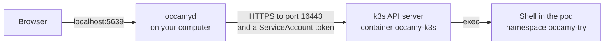

# Try Occamy

Run Occamy on your own computer and open a remote desktop and a shell
in your browser. You build one image, start a demo stack of containers
with a desktop and an SSH server in it, and remove it all with one
command when you're done.

## What the demo stack runs

The demo stack is a set of containers that compose starts from
[docker/docker-compose.yaml](../docker/docker-compose.yaml). One of
them, `occamy-v1`, runs `occamyd` and serves the web client. It's the
only container your browser reaches. The others stand in for the
computers your users would connect to, and `occamyd` reaches them by
their service names on the stack's own network, as it would reach hosts
on yours.

<picture>
  <source media="(prefers-color-scheme: dark)" srcset="figures/try-it-stack-dark.svg">
  
</picture>

| Service | What it runs | Its connections in the web client |
|---------|--------------|-----------------------------------|
| `occamy-v1` | `occamyd` and the web client, with the configuration [docker/occamy-v1.yaml](../docker/occamy-v1.yaml) | |
| `desktop` | An XFCE desktop with Firefox, over VNC on port 5900 and over RDP on port 3389, with a session of its own for each | **Desktop (XFCE) over VNC** and **Desktop (XFCE) over RDP** |
| `ssh` | An OpenSSH server on port 22 | **SSH** |
| `vnc`, `tigervnc`, `rdp` | Small servers for the [end-to-end tests](development.md#end-to-end-tests) | None |

`occamy-v1` is published on the loopback interface only, because
anyone who has read this page knows the demo password. Its second port,
5638, is the debug listener, which stays off unless you ask for it
([Debugging and monitoring](debugging.md)).

## Before you begin

You need these on your computer:

| What | For |
|------|-----|
| [Podman](https://podman.io) with a compose provider, or Docker with Compose v2 | Building the image and running the demo stack |
| `make`, `git` and `curl` | The commands on this page |
| A browser | The web client |
| [Go](https://go.dev/dl/) 1.26.4 or later, and [Node.js](https://nodejs.org) 22.13 or later on 22, 24, or 26 and later | The Kubernetes step only |

The image builds `occamyd` and the web client inside it, so you need Go
and Node.js only to run `occamyd` on your computer in the Kubernetes
step. Check what you have:

```sh
podman version
podman compose version
```

`make` runs Podman. To use Docker instead, export `CONTAINER_ENGINE`
once, so that every `make` command uses the same engine, and write
`docker` wherever this page says `podman`:

```sh
export CONTAINER_ENGINE=docker
```

`podman compose` hands its work to a compose provider, docker-compose
or podman-compose, and `podman compose version` names the one it
found. If it's podman-compose, it must be 1.4.0 or later, because older
releases name the compose project differently, so that `make stop` and
`make clean` could act on another stack.

On macOS and Windows, the engine runs containers in a virtual machine.
Give it 8 GiB of memory if anything else runs in it, and several GiB of
free disk, since the `desktop` image alone is about 1 GB.
`podman machine list` shows its memory, and these commands raise it:

```sh
podman machine stop
podman machine set --memory 8192
podman machine start
```

This restarts the machine, which stops every container in it, so on a
machine that others share, ask them first.

## 1. Build the image

```sh
make build
```

This builds the image `occamy:latest`, which the demo stack runs.

On a machine that others share, read [Next to another
stack](#next-to-another-stack) first, because `make build` replaces
`occamy:latest`, which another stack may be running.

## 2. Start the demo stack

```sh
make run
```

The first run also builds the demo servers' images, which takes
several minutes. `make run` returns once every service is healthy. The
stack is the compose project `occamy`, so its containers are named
`occamy-<service>-1`.

To reach the web client from another computer on a network you trust,
start the stack with `make run OCCAMY_BIND=0.0.0.0`. Give `OCCAMY_BIND`
on `make`'s command line or export it, because `make run` ignores it in
`docker/.env`.

### Next to another stack

On a machine where another stack already uses these ports or names,
give this one its own:

| Variable | Default | What it sets |
|----------|---------|--------------|
| `COMPOSE_PROJECT_NAME` | `occamy` | The compose project, which names the containers, the network, the volumes and the demo servers' images |
| `OCCAMY_V1_PORT` | `5637` | The port of `occamy-v1` |
| `OCCAMY_V1_DEBUG_PORT` | `5638` | The port of its debug listener, when it's on |
| `OCCAMY_IMAGE` | `occamy:latest` | The image that `make build` tags and `occamy-v1` runs |

Export them, and every `make` and `podman compose` command uses them:

```sh
export COMPOSE_PROJECT_NAME=occamy-try OCCAMY_V1_PORT=15637 \
  OCCAMY_V1_DEBUG_PORT=15638 OCCAMY_IMAGE=occamy-try:latest
make build
make run
```

`make build` then tags `occamy-try:latest` and leaves `occamy:latest`
alone. The web client is at <http://localhost:15637/static/>, and the
`curl` command in the next step takes the same port.

## 3. Sign in

Open <http://localhost:5637/static/> and sign in as `demo` with the
password `occamy`. **Connections** lists three connections.

The same sign-in from the command line returns an access token, which
the [HTTP API](api.md) takes:

```sh
curl -s localhost:5637/api/v1/auth/token \
  -H 'Content-Type: application/json' \
  -d '{"username":"demo","password":"occamy"}'
```

The stack keeps everything you might want to look at or change in four
places:

| What | Where |
|------|-------|
| The configuration | [docker/occamy-v1.yaml](../docker/occamy-v1.yaml). [Configuration](configuration.md) describes every key |
| The demo servers' passwords | The environment variables `OCCAMY_DEMO_*` of `occamy-v1` in `docker-compose.yaml`, which the configuration names in `password_env`, so that it holds no password itself |
| The signing key | The volume `occamy-v1-data`. `occamyd` creates the key when it first starts, and access tokens stay valid when it restarts |
| The log | The container's output. Each session starts with a line such as `session k3mJ…: user "demo" opened connection "desktop-vnc" through vnc` |

To follow the log, and to restart `occamy-v1` after you edit its
configuration, run these from the repository's root. A restart ends
every session.

```sh
(cd docker && podman compose logs -f occamy-v1)
(cd docker && podman compose restart occamy-v1)
```

## 4. Open one connection of each protocol

Open each connection from **Connections**. **End session** in the bar
ends it and takes you back to the list.

| Connection | Protocol | What you should see |
|------------|----------|---------------------|
| **Desktop (XFCE) over VNC** | VNC | An XFCE desktop, with a panel along the top and a dock with a terminal, a file manager and Firefox. It resizes to fill the window |
| **Desktop (XFCE) over RDP** | RDP | The same desktop, in a session of its own. The first connection after the stack starts creates that session, so it takes a few seconds to appear |
| **SSH** | SSH | A terminal with Debian's login banner and the prompt `occamy@…:~$` |
| None in the demo stack | Kubernetes | A terminal in a pod: see [step 5](#5-open-a-shell-in-a-kubernetes-pod) |

The desktops outlive their sessions: open one again, and the windows
you left are still there. **Log Out** in the desktop's menu ends the
desktop itself, and a fresh one starts.

While a session is open, try what the web client does:

- **Share it.** Click **Share**, create a link, and open it in a private
  window ([Share a session](web-client.md#share-a-session)).
- **Copy and paste.** In the desktop's terminal, select some text and
  press Ctrl+Shift+C, then click **Clipboard** to see it. Type other
  text in the box, click **Send**, and press Ctrl+Shift+V in the
  terminal ([Copy and paste](web-client.md#copy-and-paste)).
- **Resize.** Resize the window, or click **Full screen**. The desktop
  follows, and in **SSH** the terminal gains rows and columns: run
  `stty size` before and after.
- **Come back.** Reload the page and sign in again within a minute, and
  you return to the same session ([Leave and come
  back](web-client.md#leave-and-come-back)).

## 5. Open a shell in a Kubernetes pod

The demo stack has no cluster, so this step starts one: k3s in a
container, with a busybox pod and a ServiceAccount that may only exec
into it. It then runs `occamyd` on your computer, on `localhost:5639`,
with a configuration of its own:



The k3s container is privileged, and it pulls busybox from the network.
On a machine that others share, give the container a name of your own
in place of `occamy-k3s`, here and in [Tear down](#6-tear-down), and
other ports if 16443 or 5639 are taken.

1. Build `occamyd` and the web client on your computer:

    ```sh
    make compile    # ./occamyd
    make client     # the web client, in client/occamy-web/dist
    ```

2. Start k3s and wait for its API server:

    ```sh
    K8S=$(mktemp -d)
    podman run -d --name occamy-k3s --privileged -p 127.0.0.1:16443:6443 \
      docker.io/rancher/k3s:v1.34.1-k3s1 server \
      --disable=traefik --disable=metrics-server --disable=servicelb --tls-san=127.0.0.1
    for i in $(seq 60); do podman exec occamy-k3s kubectl get --raw /readyz && break; sleep 2; false; done ||
      echo 'k3s is not ready: stop here'
    ```

    The loop prints errors while k3s starts, and `ok` once it's ready,
    usually within half a minute. If k3s isn't ready after about two
    minutes, the loop gives up and prints `k3s is not ready: stop here`,
    and `podman logs occamy-k3s` says why.

3. Add the namespace, the pod, the ServiceAccount `occamy`, and a Role
   that lets it exec into the namespace's pods and do nothing else. The
   loop retries the first `apply`, which can fail while the cluster
   starts:

    ```sh
    cat > "$K8S/manifest.yaml" <<'EOF'
    apiVersion: v1
    kind: Namespace
    metadata: {name: occamy-try}
    ---
    apiVersion: v1
    kind: ServiceAccount
    metadata: {name: occamy, namespace: occamy-try}
    ---
    apiVersion: rbac.authorization.k8s.io/v1
    kind: Role
    metadata: {name: occamy-exec, namespace: occamy-try}
    rules:
      - apiGroups: [""]
        resources: [pods/exec, pods/attach]
        verbs: [get, create]
    ---
    apiVersion: rbac.authorization.k8s.io/v1
    kind: RoleBinding
    metadata: {name: occamy-exec, namespace: occamy-try}
    roleRef: {apiGroup: rbac.authorization.k8s.io, kind: Role, name: occamy-exec}
    subjects: [{kind: ServiceAccount, name: occamy, namespace: occamy-try}]
    ---
    apiVersion: v1
    kind: Pod
    metadata: {name: shell, namespace: occamy-try}
    spec:
      terminationGracePeriodSeconds: 0
      containers:
        - name: box
          image: docker.io/library/busybox:1.37
          command: [sleep, "86400"]
    EOF
    for i in $(seq 30); do podman exec -i occamy-k3s kubectl apply -f - < "$K8S/manifest.yaml" && break; sleep 2; false; done &&
      podman exec occamy-k3s kubectl -n occamy-try wait --for=condition=Ready pod/shell --timeout=300s
    ```

4. `occamyd` takes no kubeconfig, so give it the cluster's CA, a token
   of the ServiceAccount, and a configuration, then start it:

    ```sh
    podman exec occamy-k3s kubectl config view --raw \
      -o 'jsonpath={.clusters[0].cluster.certificate-authority-data}' | base64 -d > "$K8S/ca.pem"
    podman exec occamy-k3s kubectl -n occamy-try create token occamy --duration=1h > "$K8S/token"
    DEMO_HASH=$(sed -n 's/.*password_hash: "\(.*\)"/\1/p' docker/occamy-v1.yaml)
    cat > "$K8S/occamy.yaml" <<EOF
    version: 1
    listen: 127.0.0.1:5639
    web_client: client/occamy-web/dist
    auth:
      signing_key_file: $K8S/signing.key
      users:
        - name: demo
          password_hash: "$DEMO_HASH"
    connections:
      - id: k3s-shell
        name: busybox in k3s
        protocol: kubernetes
        target: 127.0.0.1:16443
        kubernetes: {namespace: occamy-try, pod: shell}
        tls: {ca_file: $K8S/ca.pem}
        credentials: {token_file: $K8S/token}
        allow: {users: [demo]}
    EOF
    ./occamyd -conf "$K8S/occamy.yaml"
    ```

    `occamyd` logs `serving API v1 at http://127.0.0.1:5639` and keeps
    running.

5. Open <http://localhost:5639/static/>, sign in as `demo` with the
   password `occamy`, and open **busybox in k3s**. Busybox has no bash,
   so `occamyd` runs `sh`, and you see BusyBox's prompt, `/ #`.
   `hostname` prints `shell`, the pod's name.

The token lasts an hour. `occamyd` reads the token file as each session
starts, so a new token in `$K8S/token` serves the next session. Stop
`occamyd` with Ctrl-C. [Kubernetes pods](configuration.md#kubernetes-pods)
describes the connection's keys and the permissions it needs.

## 6. Tear down

```sh
make stop
```

`make stop` removes the stack's containers and network, and keeps its
volumes and images for the next `make run`. To remove those too, and
the images of `make build`:

```sh
make clean
podman rmi occamy:latest "occamy:$(git describe --always --tags)"
```

`make clean` removes the stack's volumes and the demo servers' images,
and the untagged images that earlier `make build` runs left behind. It
finds those by a label that every checkout's build carries, so on an
engine that others share, it also removes other Occamy stacks' untagged
images.

On a machine that others share, skip `make clean`, and remove your own
by name after `make stop`, with the variables of [Next to another
stack](#next-to-another-stack) still exported:

```sh
podman rmi occamy-try:latest "occamy-try:$(git describe --always --tags)"
podman rmi occamy-try-vnc occamy-try-tigervnc occamy-try-ssh occamy-try-rdp occamy-try-desktop
podman volume rm occamy-try_tigervnc-ca occamy-try_occamy-v1-data
```

If you followed the Kubernetes step, stop `occamyd` with Ctrl-C, then
remove the cluster with its volumes, and what the step built:

```sh
podman rm -f -v occamy-k3s
rm -r "$K8S"
rm occamyd
rm -r client/occamy-web/dist client/occamy-web/node_modules
```

The base images that the builds pulled stay for the next run:
`debian:trixie-slim`, `golang:1.27-trixie`, `node:26-trixie-slim`,
`gcr.io/distroless/static-debian13:nonroot` and, after the Kubernetes
step, `docker.io/rancher/k3s:v1.34.1-k3s1`. `podman rmi` removes them.

Podman also keeps the intermediate stages of every build as untagged
images, about a gigabyte for each image, as its build cache. `make
clean` leaves them, since nothing marks them as Occamy's, and
`podman images -f dangling=true` lists them. `podman image prune`
removes them along with every other untagged image of the engine, so
run it only if no one else uses that engine. Docker keeps its build
cache apart, and `docker builder prune` removes it for everyone on that
engine.
