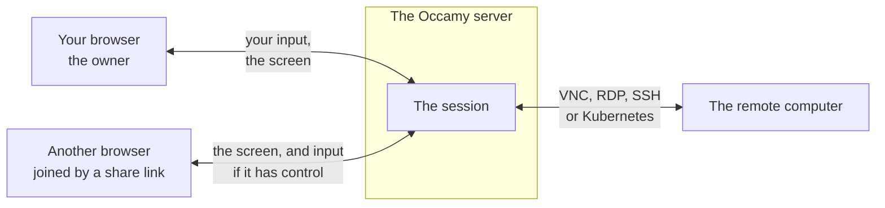
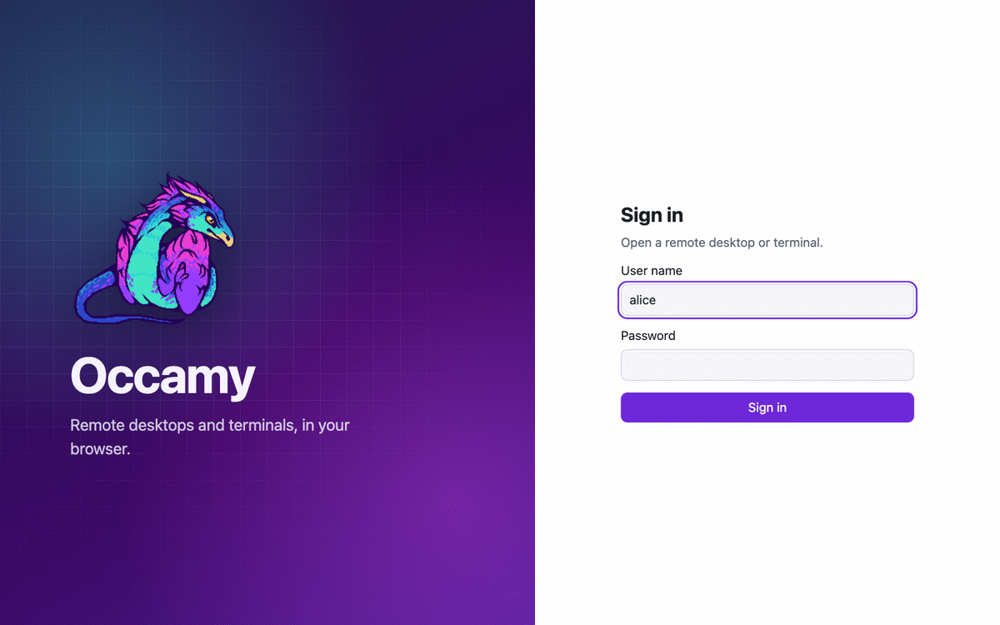
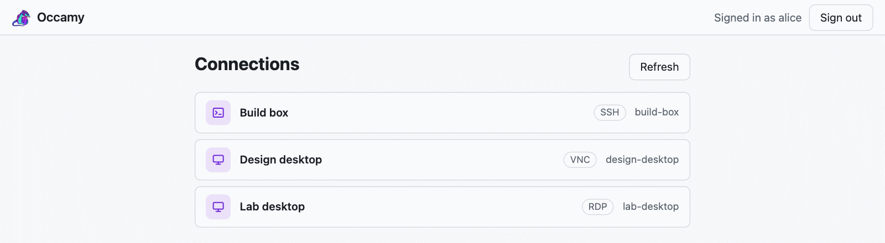
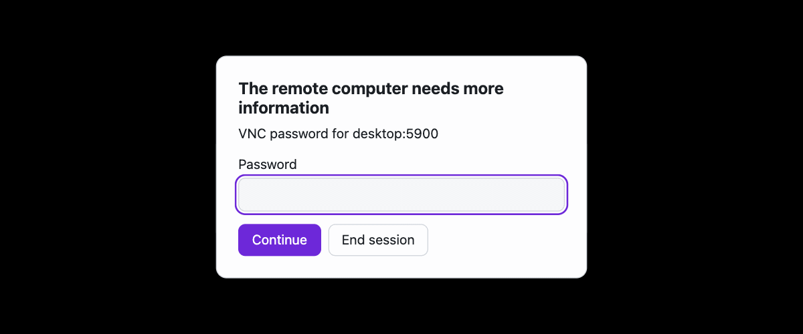
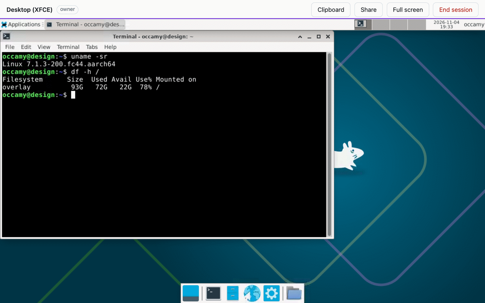
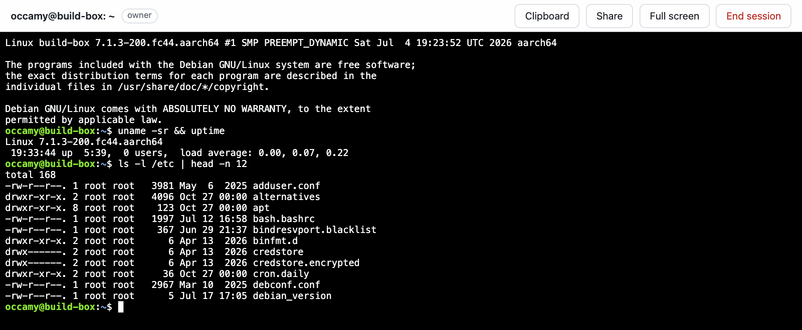
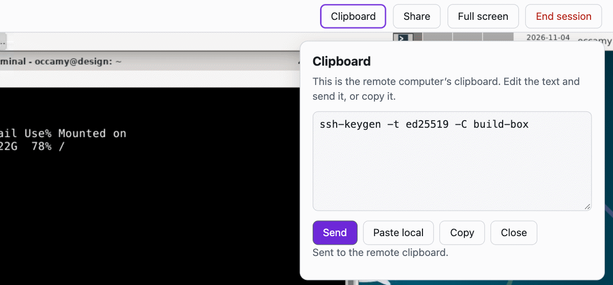
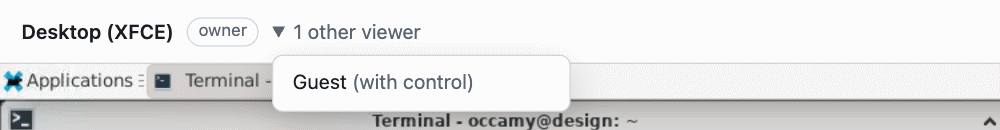
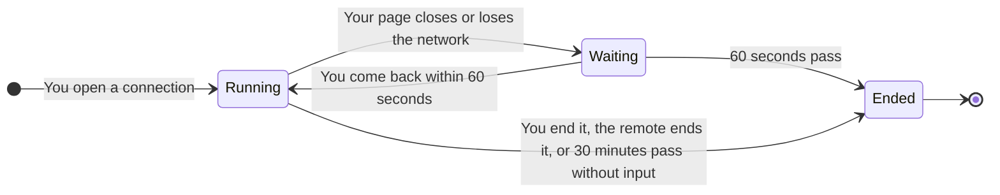
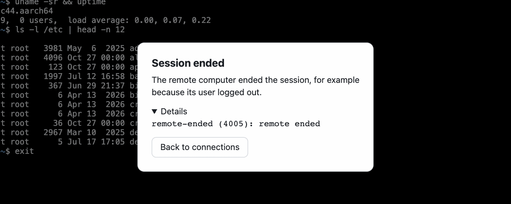

# The web client

The web client opens Occamy's remote desktops and terminals in your
browser, with nothing to install. This page shows you how to sign in,
open a connection, work in a session, share it with others, and tell
why a session ended.

## How the web client works

The Occamy server, `occamyd`, serves the web client under `/static/`,
such as `https://occamy.example.com/static/`, when its configuration
sets `web_client` ([Configuration](configuration.md)). The page lists
the *connections* that are open to you, each a remote computer reached
over VNC, RDP, SSH or Kubernetes. Opening one starts a *session* on the
server, which the page shows and sends your input to.

The session runs on the server, not in your browser tab, so it outlives
your page by a minute ([Leave and come back](#leave-and-come-back)).
You are the *owner* of the sessions you open, and you can let others
into one through a *share link*. To try the web client, start the demo
stack of [Try Occamy](try-it.md).

## Sign in

Open the web client's address, enter your **User name** and
**Password**, and click **Sign in**.

<picture>
  <source media="(prefers-color-scheme: dark)" srcset="figures/web-client-sign-in-dark.png">
  
</picture>

When the server signs users in through an identity provider, the page
also offers **Sign in with single sign-on**, which works only over
HTTPS. If it fails, the page says why ([Messages](#single-sign-on)).

Your sign-in lasts as long as the page: a new tab or a reload asks you
to sign in again, and **Sign out**, at the top right of the
connections, ends it at once. It also expires after 15 minutes by
default, while your sessions keep running. When you next do something
that needs it, such as sharing, the page asks you to **Sign in again**
over the session, and then carries on. **Cancel** returns you to the
session instead.

## Open a connection

**Connections** lists each connection that is open to you by name and
protocol, with its ID when that differs from the name. A screen icon
marks a desktop, and a prompt icon a terminal. **Refresh** loads the
list again.

<picture>
  <source media="(prefers-color-scheme: dark)" srcset="figures/web-client-connections-dark.png">
  
</picture>

Click a connection to open a session on it: a desktop over VNC or RDP,
or a terminal over SSH or Kubernetes. Until the remote's screen
arrives, the page says **Connecting to** and the connection's name,
with **Cancel**. You can own 10 sessions at once by default.

If no connection admits you, the page says "No connections are
available to you. Ask the server’s administrator to give you access to
one."

### Answer the remote's questions

When a connection's configuration holds no password or user name for
the remote, the server asks you, the owner, in a dialog headed "The
remote computer needs more information", which nobody else sees. Fill
in the fields and click **Continue**, or click **End session** to give
up; the session waits until you do.

<picture>
  <source media="(prefers-color-scheme: dark)" srcset="figures/web-client-prompt-dark.png">
  
</picture>

## Work in a session

A desktop session shows the remote's screen and pointer under a bar of
controls, and a bell from the remote flashes the screen.

<picture>
  <source media="(prefers-color-scheme: dark)" srcset="figures/web-client-desktop-dark.png">
  
</picture>

A terminal session shows the remote's terminal under the same bar.

<picture>
  <source media="(prefers-color-scheme: dark)" srcset="figures/web-client-terminal-dark.png">
  
</picture>

| Item | What it does |
|------|--------------|
| The title | The remote's title, such as a terminal's, or else the connection's name. The browser tab shows it too |
| The role | `owner`, `with control` or `view only`, as [Roles](#roles) describes |
| **1 other viewer** | Appears when others are in the session. Click it to list them by user name, or as Guest when they joined by a link |
| **Clipboard** | Opens the clipboard panel, as [Copy and paste](#copy-and-paste) describes |
| **Share** | Opens the share panel, for the owner, as [Share a session](#share-a-session) describes |
| **Full screen** | Gives the session the whole screen. Click it again to leave |
| **End session** | Ends the session for everyone, for the owner, and returns you to the connections. Everyone else sees "Session ended" |
| **Leave** | Leaves the session, for everyone else. The session goes on without you |

If the server can't end the session, the page says **Not ended for
everyone** and why, and offers **Try again**.

While the browser tab is hidden, the server sends it nothing, and the
screen catches up when you return to it. If an RDP desktop of a Windows
host stays nearly black, its connection needs `disable_gfx: true`
([Windows hosts](configuration.md#windows-hosts)).

### Roles

Others join a session through a share link, with control or view only:

| | Owner | With control | View only |
|---|:---:|:---:|:---:|
| Watch the remote | yes | yes | yes |
| Type, point and scroll | yes | yes | no |
| Send to the remote clipboard | yes | yes | no |
| Set the remote's size | yes | no | no |
| Answer the remote's questions | yes | no | no |
| Share and end the session | yes | no | no |

## Use the keyboard and pointer

Click the remote's screen to give it the keyboard. Every key then goes
to the remote, Tab included, and so do the pointer, right clicks and
the wheel. Keys that you still hold when the browser window loses the
focus are released on the remote.

| Keys | What they do |
|------|--------------|
| Control+Alt+Shift, pressed together | Move the focus from the remote's screen to the bar |
| Escape | Close the Clipboard or Share panel, or cancel **Sign in again** |
| ⌘V on a Mac, or Ctrl+Shift+V | Paste into a terminal session, through the browser |
| ⌘C on a Mac | Copy the text selected in a terminal session |

Each key carries both the character that your keyboard layout gives it
and the physical key. RDP servers, and VNC servers that ask for
physical keys, apply their own layout to the physical key, and other
VNC servers take the character. Text from an input method, such as
Japanese, goes to the remote once you have composed it.

## Copy and paste

On a desktop, text moves between your clipboard and the remote's by
itself:

- **From the remote.** When the remote's clipboard changes, the page
  puts its text on your clipboard, if the page has the focus and your
  role lets you type. A view-only viewer's clipboard is left alone,
  so that someone else's copy never replaces yours.
- **To the remote.** When the browser window gets the focus, the page
  sends your clipboard to the remote, if the browser already lets it
  read the clipboard; the page never asks. Chrome and Edge let it once
  you allow it, as when **Paste local** asks. Firefox and Safari never
  do, so use the clipboard panel there.

**Clipboard** in the bar opens the clipboard panel, whose box holds the
remote's clipboard text for you to edit and send.

<picture>
  <source media="(prefers-color-scheme: dark)" srcset="figures/web-client-clipboard-dark.png">
  
</picture>

| Button | What it does |
|--------|--------------|
| **Send** | Puts the box's text on the remote's clipboard |
| **Paste local** | Fills the box from your clipboard. The browser may ask you first |
| **Copy** | Puts the box's text on your clipboard |
| **Close** | Closes the panel, as Escape does |

A view-only viewer can copy the text, but can't send it. After each
action, the panel says what became of it ([Messages](#clipboard)).

When the remote doesn't take your text for a while, the panel and a
notice over the desktop, with **Dismiss**, say so. The text waits until
the remote takes it or the session ends. At an RDP logon screen, it
waits until you log on
([The clipboard doesn't arrive](debugging.md#the-clipboard-doesnt-arrive)).

A terminal session has no remote clipboard, as its panel says, so you
copy and paste through the browser, with the keys in
[Use the keyboard and pointer](#use-the-keyboard-and-pointer), or with
**Copy** in the right-click menu of a selection. Ctrl+C goes to the
remote, where it interrupts the program that runs.

A connection's configuration can close the clipboard either way
([Close the clipboard](configuration.md#close-the-clipboard)).

## Share a session

As the owner, you let others into your session through a link:

1. Click **Share** in the bar to open **Share this session**.
2. Under **Others join**, choose **View only: they watch**, which is
   chosen at first, or **With control: they also type, point and use
   the clipboard**.
3. Under **Link expires after**, choose 10 minutes, 1 hour, 4 hours or
   12 hours. The default is 1 hour.
4. Click **Create link**, then **Copy link**, and send the link to the
   people you mean to join.

<picture>
  <source media="(prefers-color-scheme: dark)" srcset="figures/web-client-share-dark.png">
  
</picture>

The panel then says what the link allows. If the browser doesn't let
the page copy the link, select it in the **Link** field and copy it
yourself. **Create another** makes a new link with the choices that
the panel shows.

Whoever opens the link joins at once, without signing in.
Their bar shows their role, and the title "Shared session" until the
remote sends a title of its own. Your bar shows **1 other viewer**,
which lists them as Guest:

<picture>
  <source media="(prefers-color-scheme: dark)" srcset="figures/web-client-viewers-dark.png">
  
</picture>

A link works this way:

- Anyone who has it can join until it expires, and those who joined
  stay in the session after that.
- Every link ends with its session. You can't withdraw a single link,
  so end the session to end them all.
- The link carries the share after `#`, which the browser sends to no
  server. The page removes it from the address bar as it loads, so a
  viewer who reloads the page needs the link again.
- By default, a session takes 50 viewers besides its owner, and 100
  links that haven't expired.

## Resize the remote

The owner's window sets the remote's size. Once you stop resizing the
window, or click **Full screen**, the page asks the remote for the new
size: a desktop that can change its size fills the window, one that
can't is scaled to fit and keeps its shape, and a terminal gains or
loses rows and columns. Everyone else sees the owner's screen scaled to
their own window.

The page asks for the size in CSS pixels, so programs on the remote
look as large on a high-density display as on any other, and the
owner's browser zoom resizes the remote for everyone: at 50%, the
remote gets twice the width and height, and its programs look half as
large. Anyone else's zoom only scales their view.

## Leave and come back

If you close the tab or lose the network, the session runs on as you
left it, and the others keep watching. If you don't come back within
60 seconds, it ends, and the others see "The owner left and didn’t come
back in time."

| How you left | How you come back |
|--------------|-------------------|
| The page lost the server | The page says "Connection lost". Click **Join again** |
| You reloaded the page | The page asks you to sign in again, saying "Sign in again to return to" and the connection's name. Sign in within the minute to rejoin, or click **Go to the connections instead**. When you sign out, the page forgets the session |
| A newer page of yours joined, such as a duplicated tab | The newer page takes the session over, and the older one says "Opened elsewhere". **Join again** there brings the session back to it |

If the session ended while you were away, less than a minute before,
the page says how it ended. After that, it says "Access refused".

## When a session ends

When a session ends, the page says why, and what you can do next.
**Details** shows the technical reason, which helps in a bug report.

<picture>
  <source media="(prefers-color-scheme: dark)" srcset="figures/web-client-ended-dark.png">
  
</picture>

**Back to connections** returns to the list, or **Close** for someone
who joined by a link. The heading says what happened:

| Heading | What it means |
|---------|---------------|
| Session ended | The owner ended the session, the owner left and didn't come back in time, the remote ended it, as when its user logs out, or the server ran into an internal error |
| Ended for inactivity | Nobody gave input for 30 minutes |
| Could not connect | The server couldn't connect to the remote, and the card says why, such as “The remote computer refused the user name or password.” |
| Remote unreachable | The server lost its connection to the remote, or couldn't connect to it for a reason that only its log shows |
| Connection lost | The page lost its connection to the server. **Join again** returns to the session if it's still running |
| Disconnected: too slow | The server heard nothing from the page for 30 seconds, or for the viewer timeout that its configuration sets: the network stalled, or the page couldn't keep up. **Join again** returns to the session |
| Disconnected | The session was closed for another reason, which **Details** shows |
| Opened elsewhere | Another page of yours took the session over. **Join again** brings it back |
| Signed out | Your sign-in expired. **Sign in** signs you in again |
| Link not valid | The share link expired, or its session ended. Ask the owner for a new one |
| Access refused | The connection or the session isn't open to you, the session has ended, or you have as many sessions as the server allows |
| Session full | The session has as many viewers as the server allows, 50 unless its configuration allows another number |
| Server shut down | The server stopped, which ends every session on it. Try again once it's back |
| Protocol error | A bug in the server or in the web client. Report it with the details |

## Messages

### Single sign-on

If single sign-on fails, the sign-in page shows one of these messages:

| Message | What it means |
|---------|---------------|
| Your identity provider or the server didn’t allow this account to sign in. | The provider refused you, or the server doesn't let you in |
| The identity provider reported an error, or its response couldn’t be verified. Try again. | Something went wrong at the provider |
| The identity provider can’t be reached right now. Try again later. | The server can't reach the provider |
| That sign-in didn’t start in this tab, so it wasn’t used. Sign in again here. | The sign-in came back to a tab that didn't start it |
| The sign-in took too long, or it was already used. Sign in again. | The sign-in expired on its way back, or was used once already |
| Single sign-on works only on a page served over HTTPS. Ask the server’s administrator to serve Occamy over HTTPS. | The page was served over plain HTTP |
| Single sign-on needs session storage, which your browser doesn’t allow for this page. | The browser keeps no session storage for the page, as in some private modes |
| The sign-in failed. Try again. | The sign-in failed for another reason |

### Clipboard

The clipboard panel says what became of each action:

| Message | What it means |
|---------|---------------|
| Sent to the remote clipboard. | The text went to the remote |
| Copied. | The box's text is on your clipboard |
| Edited: the remote clipboard holds other text. | The remote's clipboard changed after you edited the box, and your text stays. **Show it** brings back the remote's text |
| The text wasn’t sent because it’s too large. Send a shorter part of it. | The text stays in the box, so you can send part of it |
| The text wasn’t sent: *and a reason* | The server or the page refused the text, for the reason given |
| The remote computer hasn’t accepted your clipboard text yet. It will be sent when the remote is ready. | The remote hasn't answered for a while. The text waits, and goes when the remote takes it |
| Your browser didn’t let the page read the clipboard. Paste into the box yourself instead. | The browser keeps the page from reading your clipboard, so **Paste local** can't fill the box |
| Your browser didn’t let the page copy to the clipboard. Select the text and copy it yourself. | The browser keeps the page from writing to your clipboard, so **Copy** can't put the text there |
| The remote clipboard isn’t available to you. | Your role can't send to the remote's clipboard, or the session has ended |
