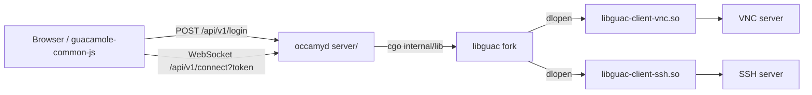

# Status quo after the 2026 revival

> **Note (2026-10-29).** This is a snapshot of the baseline right after the
> revival. Several rows below have been superseded since:
> [005](005-upstream-guacamole.md) replaced libguac with guacd, removed cgo,
> brought back RDP and made the image distroless.
> [006](006-demo-stack-refresh.md) rebuilt the demo stack and added the
> end-to-end tests. [011](011-release-readiness.md) added the release
> pipeline, and v0.5.0 shipped from it. The [README](../README.md) and
> [specs/README.md](README.md) describe the current state.

## Overview

Occamy was last developed in December 2021 and nothing in the repository built
in 2026. This spec records the baseline restored by the revival: what was
changed to make the project build on current toolchains, what was verified and
how, and which known problems remain. It is the reference point every
next-step spec builds on.

## Current State

### Before the revival (master at `b6fdf8c`, 2021-12-07)

- `docker/Dockerfile` was based on `centos:centos7`, whose package mirrors are
  gone, and pinned FreeRDP 1.0.2 and Go 1.15.7 (amd64 only). `make build`
  failed at the first `yum` step.
- `go.mod` declared Go 1.15 with gin v1.4.0, gin-jwt v2.6.2 (on the deprecated
  `dgrijalva/jwt-go`), gorilla/websocket v1.4.0, and `gopkg.in/yaml.v2`.
  `vendor/` also carried `gioui.org` and `tfriedel6/canvas`, which nothing on
  master imports (they belong to the unmerged Gio client, see
  [007](007-native-gio-client.md), retired in favour of
  [010](010-native-swift-client.md)).
- `internal/lib/user_test.go` no longer compiled after the #50 refactor
  changed `lib.NewUser` and `(*lib.User).HandleConnection`.
- The web client used Vue 2, vue-cli 4, element-ui and axios 0.21: all end of
  life, 112 `npm audit` advisories (7 critical).
- CI ran `actions/checkout@v1` and only built the (broken) image.

### After the revival

| Area | State |
|------|-------|
| Go | Go 1.26 module, gin v1.12.0, gin-jwt v2.10.3 (golang-jwt v4), gorilla/websocket v1.5.3, `go.yaml.in/yaml/v3`. No `vendor/`. |
| libguac | Bundled guacamole-server 1.0.0 fork builds on Debian trixie (GCC 14, OpenSSL 3, libvncserver 0.9.15). VNC and SSH plugins built; RDP disabled by configure because FreeRDP 1.x is unavailable. |
| Image | Three-stage `docker/Dockerfile`: `node:24-trixie-slim` builds the web client, `golang:1.27-trixie` builds libguac and `occamyd`, `debian:trixie-slim` runs it. |
| Web client | Vue 3.5, Vite 8, vue-router 5, element-plus 2.14, axios 1.21, ESLint 10 flat config. 0 `npm audit` advisories. |
| CI | Three jobs in `.github/workflows/dockerimage.yml`: Go (build libguac, `go vet`, `go test ./internal/... ./server/...`), web (lint, build), image (`make build`). |

## Architecture

The architecture is unchanged by the revival and is described in
[docs/architecture.md](../docs/architecture.md).

## Components

Changes made in the revival, grouped by area. Each decision below is
reversible.

### Go module

- `go.mod` rebuilt from the four direct dependencies; `go.sum` regenerated.
  The old `ugorji/go` pin conflicted with the split `ugorji/go/codec` module,
  so an in-place upgrade was not possible.
- `vendor/` removed; `go mod vendor` restores it. `Makefile` and the
  Dockerfile no longer pass `-mod vendor`.
- `gioui.org` and `tfriedel6/canvas` dropped from master.
- gin-jwt kept on v2 for now: v3 changes the API. The move to v3 is planned
  with the new token model in [004](004-security-hardening.md).
  (Superseded: the v0 routes moved to the standard library and
  golang-jwt v5 instead, and gin-jwt is gone; see
  [api-and-server-stack](008-native-architecture/api-and-server-stack.md).)
- `internal/config/config.go`: `ioutil.ReadFile` → `os.ReadFile`, yaml v3.
- `internal/lib/user_test.go` updated to the current `NewUser` and
  `HandleConnection` signatures; `FailNow` no longer called from a goroutine.

### Behavior fixes found while upgrading

- `server/connection.go` set `TimeFunc: time.Now().UTC`, a method value
  bound at startup. Every token got `exp = startup + 1h` while golang-jwt
  validates against the real clock, so after one hour of uptime every new
  token was rejected. The override was removed.
- `server/connection.go` now handles `SIGTERM` (what `docker stop` sends)
  instead of the uncatchable `os.Kill`.
- `guacamole/src/protocols/vnc/vnc.c`: libvncclient 0.9.15 frees
  `raw_buffer`, `rcSource` and `rcMask` itself (and frees `rcMask` before
  each cursor update). The fork freed them without resetting the pointers,
  which aborted `occamyd` with a double free when the first VNC session
  ended. Pointers are now reset after free.
- `guacamole/src/protocols/ssh/Makefile.am`: compile at
  `OPENSSL_API_COMPAT=0x10100000L` so `key.c` builds under `-Werror`.
- libguac `dlopen()`s plugins by unversioned name, which `ldconfig` does not
  cache. The old image only worked because an empty `--prefix` installed
  into `/lib`. The image and CI now set `LD_LIBRARY_PATH=/usr/local/lib`.
- `Makefile` defined `HOME = changkun.de/x/occamy`, which make exports to
  recipes and which broke podman and the Go build cache. Removed.

### Build and CI

- `Makefile`: `CONTAINER_ENGINE ?= docker` (use `podman` locally), new
  `client` target, `docker compose` instead of `docker-compose`, fixed the
  `.PHONY: occamy` typo.
- `docker/docker-compose.yaml`: dropped the obsolete `version` key. Demo
  images unchanged (see [006](006-demo-stack-refresh.md)).
- `.dockerignore` keeps `node_modules`, `dist` and `.git` out of the context.

### Web client

- `vue.config.js` and `babel.config.js` replaced by `vite.config.js` (base
  `./`, `/api` proxy with WebSocket support for `npm run dev`) and
  `eslint.config.js`; `public/index.html` moved to `index.html`.
- `src/main.js` uses `createApp`, `createRouter` with hash history, and
  individually registered element-plus components.
- `Login.vue`: `@click.native` → `@click`, `ElMessage`. The RDP option is
  kept; until RDP is restored ([005](005-upstream-guacamole.md)) selecting it
  fails after login without a message.
- `Desktop.vue`: WebSocket URL derived from `window.location` instead of the
  hard-coded `ws://0.0.0.0:5636` (Chrome blocks `0.0.0.0`).
- `occamy.js`: `module.exports` → `export default`.
- `package-lock.json` was not reintroduced; #50 removed it deliberately.

### Documentation

- `README.md`: project status table, Docker/Podman and native build steps,
  web client and test instructions, badges updated (Go Report Card is
  retired; replaced with pkg.go.dev, Go version and license badges).
- `docs/architecture.md`: components table and connection flow.
- `guacamole/README.md`: fork baseline, protocol support, current build
  dependencies.

## Known Issues

| Issue | Where it is tracked |
|-------|---------------------|
| Any token whose `host` lacked a port left the proxy mutex locked (fixed after the revival) | [003](003-session-lifecycle-hardening.md) |
| Second SSH session in one process gets no output (#22). Resolved by 005: guacd runs each connection in its own process | [002](002-ssh-session-rejoin.md) (archived) |
| Panics under high pressure (#20), unsynchronized session teardown. The crashes went with libguac (005), and CI runs the pressure test since 003 | [003](003-session-lifecycle-hardening.md) |
| JWT carries plaintext remote credentials, tokens appear in request logs, `/login` is an open proxy, debug mode (with pprof) is the default | [004](004-security-hardening.md) |
| RDP not built (FreeRDP 1.x only); Windows RDP failures (#32); macOS native segfault (#25). Resolved by 005, except #32, which awaits a check against a Windows host: RDP runs through guacd, and `occamyd` builds without cgo | [005](005-upstream-guacamole.md) |
| Compose demo images from 2019, amd64 only; no automated end-to-end test. Resolved by 006 | [006](006-demo-stack-refresh.md) |
| Gio client (#51) unmerged on branches `gio` and `gio-client` | Retired ([007](007-native-gio-client.md)); Swift client in [010](010-native-swift-client.md) |
| C core in-process via cgo (gone since 005); Guacamole protocol costs; redesign (#3) and traffic (#21) | [008](008-native-architecture.md) |
| Web client framework (React considered) | [009](009-react-web-client.md) |

The branch `vnc` (2020-02) holds an older VNC-only native build experiment
that predates `internal/` and is superseded by this baseline.

## Testing Strategy

Verified during the revival:

- `go vet ./...` is clean (macOS with `CGO_CFLAGS=-I$(brew --prefix)/include`,
  and in the image build stage).
- `go test ./internal/... ./server/...` passes in the Dockerfile `build`
  stage, including the cgo tests in `internal/lib`.
- `make build CONTAINER_ENGINE=podman` succeeds on linux/arm64.
- Smoke test of the image: `/static/` returns 200, `/api/v1/login` issues a
  token, `/api/v1/connect` returns 401 without one.
- End to end against throwaway Debian trixie servers (Xvfb + x11vnc; and
  openssh-server) with a Go WebSocket client that logs in, connects, answers
  `sync`, and counts opcodes: three consecutive VNC sessions each received
  `size`, `img`, `cursor` and `sync` and tore down without crashing; the
  first SSH session rendered a terminal; later SSH sessions failed (#22).
- `npm run lint` and `npm run build` pass; `npm audit` reports 0.

Not verified at the time, and what happened since:

- The CI workflow had not run on GitHub, and the image had not been built
  for linux/amd64. Both have run on every PR since, and v0.5.0 ships an
  amd64 and arm64 image.
- The web client had not been exercised in a browser against a live
  session. It was on 2026-10-29: the v0.5.0 image logs in and renders the
  VNC and RDP sessions from the demo stack.
- The `docker/docker-compose.yaml` demo and `tests/pressure_test.go`. Both
  are covered since 006, and CI runs the pressure test since 003.
- RDP and native macOS builds. Both are covered since 005.

## Acceptance Criteria

- [x] Revival changes committed on master.
- [x] All three CI jobs pass on GitHub.
- [x] Web client logs in and renders a VNC desktop in a browser.

## Outcome

All three criteria hold. The revival commits are on master, and CI has
passed on GitHub on every PR since. On 2026-10-29 the web client was
checked by hand in a browser against the demo stack, running
`ghcr.io/changkun/occamy:v0.5.0`. It logged in and rendered the VNC demo
(an xterm on Xvfb) and the RDP demo (an xterm on xrdp). That release no
longer matches the baseline recorded above, which describes the code
right after the revival. [005](005-upstream-guacamole.md),
[006](006-demo-stack-refresh.md) and [011](011-release-readiness.md)
describe what changed since.
