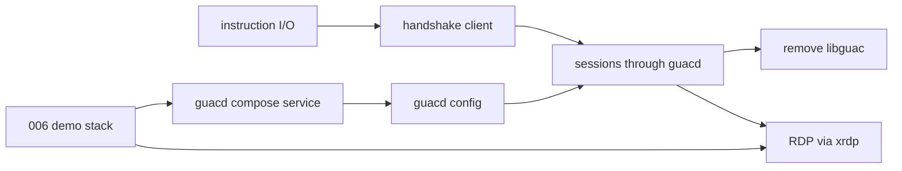

# Catch up with upstream guacamole

## Overview

`guacamole/` is a fork of guacamole-server 1.0.0 (2019), and its age is what
holds Occamy back today: RDP cannot be built, and C bugs in the fork crash the
whole server (two libvncclient double frees were fixed during the revival).
Upstream's current release, 1.6.0, builds against FreeRDP 2 or 3
(`configure.ac` checks `freerdp2` and `freerdp3`; the official guacd
Dockerfile defaults to FreeRDP 2). This spec decides how Occamy gets onto
upstream and restores full protocol coverage. It is the bridge toward
[008](008-native-architecture.md).

## Current State

- 43 commits in this repository touch `guacamole/`. Known changes against
  1.0.0: guacd and the handshake removed, audio removed,
  `guac_client_add_user` reduced to `void guac_client_add_user(guac_user*)`,
  `guac_user_input_thread` exported
  (`guacamole/src/libguac/guacamole/user.h`), clipboard and cursor code merged
  into `guacamole/src/protocols/vnc/vnc.c`.
- RDP sources (`guacamole/src/protocols/rdp/`, `compat/`) and
  `guacamole/configure.ac` target FreeRDP 1.0/1.1, so configure disables RDP
  on every current distribution. FreeRDP 1.0 also cannot reach current
  Windows hosts (#32).
- SSH builds against OpenSSL 3 only at the 1.1.0 API level.
- Native macOS builds segfault in `rfbInitClient` (#25).
- `occamyd` embeds libguac through cgo (`internal/lib/`), loading plugins into
  its own process (`server/session.go` `NewSession`).

## Architecture

### Options

- **A. Drive unmodified upstream guacd over TCP (recommended).** `occamyd`
  connects to a guacd (the `guacamole/guacd` image as a sidecar, or a
  distribution package), performs the Guacamole handshake (`select`, `args`,
  `size`, `audio`, `video`, `image`, `connect`) from the JWT claims, and then
  proxies instructions as `(*Session).serveIO` does today. Shared sessions map
  to guacd's join-by-connection-ID (`select $<id>`).
  - Gains: RDP, VNC, SSH, telnet and Kubernetes from upstream at once, and
    upstream security fixes for free. `occamyd` builds with
    `CGO_ENABLED=0`, so native macOS and Windows builds work (#25), and
    `guacamole/` and `internal/lib/` can be deleted. #22 and the C crash
    class leave `occamyd`'s process.
  - Costs: this temporarily reverses the README's "no guacd" pitch. guacd
    runs one process per connection, and there is one extra local hop. The
    target architecture ([008](008-native-architecture.md)) removes guacd
    again as native backends land, keeping it only as an optional fallback.
- **B. Rebase the fork onto 1.6.0.** Reapply Occamy's changes as a small,
  documented patch series. Keeps a single process; keeps C in-process and an
  ongoing merge cost.
- **C. Port only the RDP plugin to FreeRDP 3.** Smallest change now, largest
  long-term debt.

Recommendation: A. Option B only makes sense if a single process is a hard
requirement before [008](008-native-architecture.md) delivers native backends.

**Decision (2026-10-29): option A.** Temporarily contradicting the
"no guacd" pitch is accepted on the condition that
[008](008-native-architecture.md) lays out the path back to a single
pure-Go binary. After this spec, `occamyd` itself is already pure Go. What
remains is replacing guacd one protocol at a time.

## Components (option A)

### guacd client (`internal/guacd`)

Dials `guacd.address` and runs the handshake (`select`, `args`, `size`,
`audio`, `video`, `image`, `timezone`, `name`, `connect`, `ready`). It sends
the client's real display size instead of the fixed 1024×768 that
`set_user_info` in `internal/lib/user.go` uses today. Joins use
`select $<connection-id>`. See
[guacd-handshake-client](005-upstream-guacamole/guacd-handshake-client.md)
for the verified 1.6 handshake.

### Sessions (`server/`)

The session table keeps the credential-hash sharing key and stores guacd's
connection ID for joiners. It never holds the proxy lock across network
I/O, and it drops an entry when its last user leaves, as guacd does.

### Configuration

`conf.yaml`: `guacd.address` (default `localhost:4822`) and
`guacd.params.<protocol>` defaults, such as `rdp.ignore-cert`. TLS to guacd
is left to [004](004-security-hardening.md).

### Removal

Delete `guacamole/`, `internal/lib/`, and the libguac stage of
`docker/Dockerfile`; the runtime image can become a static or distroless
base. Drop the libguac build from the Go CI job.

### Demo and clients

Add a `guacd` service pinned to the 1.6 line in
`docker/docker-compose.yaml`; RDP works from the existing web client again.

## Testing Strategy

- Handshake unit tests against a fake guacd on `net.Pipe`.
- [006](006-demo-stack-refresh.md) end-to-end suite for VNC, SSH and RDP
  (xrdp) through guacd.
- `CGO_ENABLED=0 go build ./...` in CI.

## Acceptance Criteria

- [x] Option chosen and recorded here (A, 2026-10-29).
- [x] RDP connects to xrdp (automated, [rdp-xrdp](005-upstream-guacamole/rdp-xrdp.md)).
- [ ] RDP connects by hand to a current Windows host (Windows 11 or
      Server 2022/2025) with NLA; result and any needed parameters
      recorded here (#32). Not done: it needs a Windows host, and it stays
      open on #32 (see Outcome).
- [x] `occamyd` builds with `CGO_ENABLED=0`; `guacamole/` and `internal/lib/`
      removed.
- [x] README's architecture pitch updated to match.

## Task Breakdown

| Child spec | Depends on | Effort | Status |
|------------|-----------|--------|--------|
| [Instruction I/O over any stream](005-upstream-guacamole/instruction-stream-io.md) | — | medium | complete |
| [guacd handshake client](005-upstream-guacamole/guacd-handshake-client.md) | instruction-stream-io | medium | complete |
| [guacd service in the demo stack](005-upstream-guacamole/guacd-compose-service.md) | [006](006-demo-stack-refresh.md) | small | complete |
| [guacd configuration and parameters](005-upstream-guacamole/guacd-config.md) | guacd-compose-service | small | complete |
| [Serve sessions through guacd](005-upstream-guacamole/guacd-sessions.md) | guacd-handshake-client, guacd-config | large | complete |
| [Remove libguac and cgo](005-upstream-guacamole/remove-libguac.md) | guacd-sessions | medium | complete |
| [RDP through guacd, verified against xrdp](005-upstream-guacamole/rdp-xrdp.md) | guacd-sessions, [006](006-demo-stack-refresh.md) | medium | complete |

The first two tasks need neither guacd nor 006 and can start now, in
parallel with 006.

## Outcome

**Summary.** Option A, implemented directly in seven tasks and released
in [v0.5.0](https://github.com/changkun/occamy/releases/tag/v0.5.0):

- [instruction-stream-io](005-upstream-guacamole/instruction-stream-io.md),
  `8160431`;
- [guacd-handshake-client](005-upstream-guacamole/guacd-handshake-client.md),
  `327769a`;
- [guacd-compose-service](005-upstream-guacamole/guacd-compose-service.md),
  #56;
- [guacd-config](005-upstream-guacamole/guacd-config.md), #57;
- [guacd-sessions](005-upstream-guacamole/guacd-sessions.md), #62;
- [rdp-xrdp](005-upstream-guacamole/rdp-xrdp.md), #64;
- [remove-libguac](005-upstream-guacamole/remove-libguac.md), #65.

Drift: Minimal. Every component shipped as designed. The one acceptance
criterion left open is the manual Windows check, which needs hardware this
work did not have.

**What shipped.**

- `occamyd` serves VNC, SSH and RDP through upstream guacd 1.6
  (`guacd.address`, `guacd.params`) and builds with `CGO_ENABLED=0` on
  Linux, macOS and Windows.
- `guacamole/` and `internal/lib/` are gone. The image is distroless and
  34.7 MB, down from 172 MB.
- The demo stack runs guacd and an xrdp server. CI's end-to-end suite runs
  vnc, vnc-again, ssh, ssh-again and rdp on every PR.
- Issues #22 (repeated SSH sessions) and #25 (native macOS builds) are
  fixed, each with a comment on the cause.

**Design evolution.** Each task records its own. The ones that matter
here:

- guacd 1.6 answers a join to a vanished connection with status 516, not
  519.
- RDP needs only `ignore-cert` against xrdp; `security` stays unset.
- The task order changed: rdp-xrdp ran before remove-libguac.

**Not implemented.**

- RDP against a current Windows host with NLA (#32). It needs a Windows
  host. The maintainer chose to release v0.5.0 without it, and #32
  asks the reporter to retest. xrdp has no NLA, so the demo stack cannot
  cover it. guacd 1.6 treats an unset `security` as `any`, which
  negotiates NLA (`src/protocols/rdp/settings.c`), so the shipped
  config should need no change. If NLA fails, `security: nla` in
  `guacd.params.rdp` is the first thing to try. The README's
  "Connection parameters" section documents this.

**Decisions, surprises, follow-ups.**

- `client/occamy-web/src/components/occamy.js` is still Apache-2.0
  (guacamole-common-js 0.9.14), so its LICENSE and NOTICE moved next to
  it when `guacamole/` was deleted.
- With libguac gone, the pressure test no longer crashes `occamyd`.
  Enabling it in CI is [003](003-session-lifecycle-hardening.md)'s.
- Follow-ups:
  - TLS to guacd and a warning that guacd must stay off untrusted networks
    ([004](004-security-hardening.md));
  - replacing guacd one protocol at a time
    ([008](008-native-architecture.md)).

