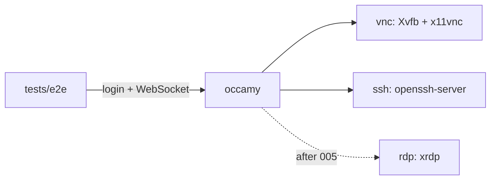

# Demo stack refresh and end-to-end tests

## Overview

The compose demo is the only way to see Occamy work, and nothing tests a real
session automatically. The demo images date from 2019, are amd64 only, and
are wired together with fixed IPs that are hard-coded in three places. This
spec replaces them with small, multi-arch demo servers built from the repo
and adds an end-to-end test that CI runs on every push. Later specs
([002](002-ssh-session-rejoin.md), [003](003-session-lifecycle-hardening.md),
[005](005-upstream-guacamole.md)) rely on it for regression checks.

## Current State

- `docker/docker-compose.yaml` runs `consol/ubuntu-xfce-vnc:1.4.0`,
  `umis/xubuntu-office-xrdp-desktop:v1.0` and
  `rastasheep/ubuntu-sshd:14.04` on subnet `172.16.239.0/24` with fixed
  addresses.
- Those addresses are repeated in
  `client/occamy-web/src/components/Login.vue` (form defaults),
  `tests/pressure_test.go` (`credentials`) and `docs/protocol-cn.md`.
- `tests/pressure_test.go` targets `0.0.0.0:5636` and needs the stack
  running by hand.
- CI (`.github/workflows/dockerimage.yml`) builds and unit-tests but never
  opens a session.
- The revival verified sessions with throwaway images (Debian trixie with
  Xvfb, x11vnc and xterm; and openssh-server with password login) and a Go
  WebSocket client that logs in, connects, answers `sync`, and counts
  opcodes. See [001](001-status-quo.md).

## Architecture



All services join one compose network and address each other by service
name, so no fixed subnet is needed.

## Components

### Demo servers (`docker/demo/`)

- `vnc/Dockerfile`: Debian stable, Xvfb, x11vnc, a lightweight desktop or
  xterm, password from an environment variable.
- `ssh/Dockerfile`: Debian stable, openssh-server, password login for a
  demo user.
- `rdp/` (xrdp) added by [005](005-upstream-guacamole.md), together with a
  `guacd` service if that spec adopts upstream guacd. (Both added:
  [rdp-xrdp](005-upstream-guacamole/rdp-xrdp.md) and
  [guacd-compose-service](005-upstream-guacamole/guacd-compose-service.md).)

### Compose (`docker/docker-compose.yaml`)

Build the demo servers locally, drop `networks.ipam`, publish only
`occamy:5636`.

### Defaults

`Login.vue` defaults and `tests/` credentials use service names (`vnc:5900`,
`ssh:22`); the test endpoint comes from `OCCAMY_E2E_ENDPOINT`, which
`make e2e` defaults to `localhost:5636`.

### End-to-end test (`tests/`)

A Go test that, per protocol, logs in, opens the WebSocket, answers `sync`,
and asserts that `size`, `img` and `sync` arrive within a timeout. Skipped
unless `OCCAMY_E2E_ENDPOINT` is set, so `go test ./...` stays hermetic.

### CI

A job that runs `make build`, `make run` (`compose up -d --build --wait`)
and the end-to-end test, then dumps the stack's logs on failure. The
pressure test is skipped unless `OCCAMY_PRESSURE_N` is set. CI did not
set it at first, since it crashed `occamyd` (#20); since
[003](003-session-lifecycle-hardening.md) the e2e job runs
`make e2e OCCAMY_PRESSURE_N=10`.

## Testing Strategy

The deliverable is itself the test. Validate it by confirming it fails
against a build without the libvncclient fixes from [001](001-status-quo.md),
and passes with them.

## Acceptance Criteria

- [x] `make run` works on linux/amd64 and linux/arm64.
- [x] No hard-coded demo IPs remain in the repository.
- [x] CI runs VNC and SSH end-to-end tests on every push.

## Outcome

**Summary.** Implemented directly in `b615bc9` (`docker: build multi-arch
demo servers, address them by service name`) and `bf0261b` (`tests: add
end-to-end tests against the demo stack, run them in CI`). Drift:
Moderate. 6 of 7 items are satisfied. The CI job does not run the pressure
test, because it still crashes `occamyd`; the body has been updated to
match.

**What shipped.**

- `docker/demo/vnc/` (Xvfb, x11vnc, xterm; `VNC_PASSWORD`) and
  `docker/demo/ssh/` (openssh-server, user `occamy`; `SSH_PASSWORD`), both
  on `debian:trixie-slim` with a small `start.sh`.
- `docker/docker-compose.yaml`:
  - `occamy`, `vnc` and `ssh` on the default network, with only
    `occamy:5636` published;
  - port healthchecks on the demo servers, and
    `depends_on: condition: service_healthy` for `occamy`;
  - no `container_name`, `cap_add`, fixed IPs or restart policy.
- `Makefile`: `run` is `compose up -d --build --wait`; new `e2e` target.
- `tests/occamy_test.go`: shared helpers (`endpoint`, `login`, `dial`,
  `session`, `checkSession`) and `TestMain`. `session` splits WebSocket
  messages with `protocol.ReadRaw` and parses them with
  `protocol.ParseInstruction`.
- `tests/e2e_test.go`: `TestE2E` with `vnc`, `vnc-again` and `ssh`
  subtests.
- `tests/pressure_test.go`: rewritten on the helpers and opt-in through
  `OCCAMY_PRESSURE_N`.
- `.github/workflows/dockerimage.yml`: an `e2e` job (Docker) that runs
  `make build`, `make run` and `make e2e`, and dumps `compose logs` on
  failure.
- `Login.vue` and `docs/protocol-cn.md` use service names; the README
  documents the demo credentials and `make e2e`.

**Validation.** On linux/arm64 (Podman, libkrun VM), each run used a fresh
`occamyd` container:

- With the libvncclient fixes reverted (`vnc.c` from `a3b7a99`), the suite
  failed 5 of 5 runs. In four runs `TestE2E/vnc-again` failed after
  `occamyd` died with SIGSEGV in `guac_client_free`. In the fifth, every
  session passed and `TestMain` caught the dead process.
- With the fixes, `TestE2E` passed 10 of 10 runs and `make e2e` passed
  5 of 5.
- On linux/amd64, the new `e2e` CI job (Docker) passed on `bf0261b` in
  run 40910391049: `vnc`, `vnc-again` and `ssh`, with the pressure test
  skipped.

**Design evolution.**

- *CI and the pressure test.* The spec had CI run the pressure test with
  low limits. With `OCCAMY_PRESSURE_N=3`, the fixed image still crashed in
  3 of 8 runs: SIGSEGV in `join_handler_bridge`, in `guac_client_stop`,
  and in `guac_client_remove_user` racing `guac_client_free`. These are
  [003](003-session-lifecycle-hardening.md) defect 2 and #20. A gate that
  fails a third of the time on correct code teaches people to ignore red,
  so the test is skipped unless `OCCAMY_PRESSURE_N` is set. 003's
  acceptance criterion ("pressure test passes in CI") turns it on.
- *Default endpoint.* The test package has no default endpoint, since a
  default would make `go test ./...` reach for `localhost:5636`. `make e2e`
  supplies the default instead.

**Not implemented.** None.

**Unspecified work.**

- `TestMain` logs in once more two seconds after the tests (improvement).
  A teardown crash happens after the client has gone, so without it one
  run on the broken image passed with `occamyd` dead.
- `checkSession` retries up to five times when the session is
  disconnected before the desktop arrives (improvement). A session that
  starts while the previous one with the same claims is tearing down joins
  it (003 defect 6). `vnc-again` needs one retry in almost every run.
- After the storm, the pressure test checks a session whose claims the
  storm never used (improvement). It is VNC with a username that VNC
  ignores. A session with the storm's claims can stay stuck for good
  (003 defect 8), which failed 3 of 4 early runs on the fixed image.
- Healthchecks, `--wait` and no restart policy (improvement). Starting
  `occamy` before the servers accept connections would poison those claims
  through defect 8, and a restart policy would hide crashes.

**Decisions, surprises, follow-ups.**

- `credentials` and `Login.vue` use the user `occamy`, not `root`. RDP
  defaults to `rdp:3389` with `occamy`/`occamy` for
  [rdp-xrdp](005-upstream-guacamole/rdp-xrdp.md), which adds the server.
- Podman resolves `occamy:latest` to `localhost/occamy:latest`, and both
  compose providers find it without a registry. The CI job uses Docker,
  because runners have the `docker compose` plugin, and the `image` job
  keeps checking the Podman build.
- The demo healthchecks use bash's `/dev/tcp`, since Debian slim ships no
  `nc`. The guacd image is Alpine with busybox `nc` and no bash;
  [guacd-compose-service](005-upstream-guacamole/guacd-compose-service.md)
  now says so.
- Corrected dependents:
  - [002](002-ssh-session-rejoin.md): its sequence goes into `TestE2E`;
  - [003](003-session-lifecycle-hardening.md): the pressure test is opt-in,
    and defect 2 has been observed;
  - [guacd-compose-service](005-upstream-guacamole/guacd-compose-service.md):
    healthcheck, no restart policy;
  - [rdp-xrdp](005-upstream-guacamole/rdp-xrdp.md): where the tests and
    defaults now live.
- Follow-up: 003 enables the pressure test in CI (done).

## Addendum: native VNC in the matrix

Added with the guacd bridge's opt-in period for VNC
([guacd-bridge](008-native-architecture/guacd-bridge.md), Implementation
notes: the opt-in period), after this spec was complete.

- `docker/docker-compose.yaml` runs a second `occamyd`, `occamy-v1`,
  from the same image with `-conf /occamy/v1.yaml`, published on 5637.
  Its v1 file, `docker/occamy-v1.yaml`, has the static user `demo`
  (password `occamy`) and two connections to `vnc:5900`: `vnc-native`
  and `vnc-guacd`. When the opt-in period started, `vnc-native` set
  `backend: native` and `vnc-guacd` took guacd as vnc's default. Since
  the owner's decision of 2026-10-31 that native is the default
  wherever a native backend exists
  ([guacd-bridge](008-native-architecture/guacd-bridge.md), Parity
  gate), `vnc-native` leaves `backend` out and gets that default, and
  `vnc-guacd` sets `backend: guacd`, the fallback that stays as the
  benchmark's baseline. The VNC password
  comes from `OCCAMY_DEMO_VNC_PASSWORD`, and the signing key goes to a
  tmpfs at `/run/occamy`, since the distroless image's `nonroot` user
  cannot write `/occamy`. `occamy-v1` waits for `guacd` and `vnc` only.
- `tests/v1_test.go` (`TestE2EV1`) signs in through API v1, streams
  each connection twice with the Go client of protocol v1, waits for a
  frame of the desktop, checks that the session's state names the
  backend, `vnc` or `guacd`, and that a frame acknowledges pointer and
  key input, then closes the session. It is skipped unless
  `OCCAMY_E2E_V1_ENDPOINT` is set; `make e2e` sets it to
  `localhost:5637`, so CI's `e2e` job runs it with the v0 tests.
  `TestMain` also checks that `occamy-v1` still signs in afterwards.
- `OCCAMY_IMAGE`, `OCCAMY_PORT` and `OCCAMY_V1_PORT` let a second stack
  run beside the first under another project name (`-p`), on a shared
  host; the defaults are unchanged.
- `internal/config`'s `TestDemoV1File` loads `docker/occamy-v1.yaml`, so
  that a configuration change that breaks it fails `go test` rather
  than the `e2e` job.
- Validation: on linux/arm64 (Podman, libkrun VM) the whole suite,
  `TestE2E` and `TestE2EV1`, passed against the stack under its own
  project name, and `TestE2EV1` passed 7 of 7 runs.

## Addendum: TigerVNC and the VNC parity matrix

Added for the parity matrix of the guacd bridge's deletion gate
([guacd-bridge](008-native-architecture/guacd-bridge.md), Implementation
notes: VNC's parity matrix), after this spec was complete.

- `docker/demo/tigervnc` replaces the two TigerVNC test images,
  `internal/backend/vnc/testdata/servers` and `docker/test/tigervnc`, and
  builds from the repository's root, since it carries the bench scene.
  `start.sh demo`, the stack's service `tigervnc`, serves five Xvnc
  screens of 1024×768: `tigervnc:5900` with VNC Authentication
  (`vncpassword`), `:5901` with VeNCrypt's X509Vnc and X509Plain only
  (user `occamy`, password `plainpassword`), `:5902` with None, and
  `:5903` and `:5904` with VNC Authentication and the de and fr keyboard
  layouts. It makes a CA and a server certificate for `localhost`,
  `127.0.0.1` and `tigervnc` at each start, keeps them in
  `/etc/vnc-test`, and copies the CA to the volume `tigervnc-ca`, which
  `occamy-v1` mounts read-only for the `tls` of its VeNCrypt connection.
  `start.sh scene` serves the bench scene on one screen for
  `TestEncodings`. `TestTigerVNC` builds the image and uses port 5901.
- `docker/demo/vnc` serves three Xvfb screens through x11vnc: `vnc:5900`
  with VNC Authentication and `:5901` without, both on the us screen,
  and `:5902` and `:5903` with VNC Authentication and the de and fr
  layouts. x11vnc runs without MIT-SHM (`-noshm`): with it, an x11vnc
  hung for good now and then as a client connected, after an X error,
  and every later check on its port failed (once in six runs of the
  matrix, then four times in about two runs of its x11vnc columns);
  without it, fifteen runs of the x11vnc columns had no X error. Each
  x11vnc also runs under a watchdog in `start.sh`, which kills one that
  leaves a connection unaccepted for ten seconds and starts one that
  exits again, and logs that it did. It follows each waiting connection
  in `/proc/net/tcp`: a first version that went by the length of the
  accept queue killed a live x11vnc, which clients reached every second
  or two. Its log lines start with its port. The restart is logged
  rather than silent, so the reason this spec gives for having no
  restart policy, that crashes stay visible, still holds.
- `docker/demo/vnc/desktop.sh`, the desktop of both images, runs an
  xterm, a typing probe and a clipboard probe, and reports what reaches
  the server over the session's clipboard: a line typed into the probe
  at the top left comes back as `typed: ` and its UTF-8 bytes in hex,
  clipboard text `owner: …` as `echo: …`, and `hex: …` as `hexed: ` and
  its bytes in hex. It polls the clipboard every 0.3 s for a minute after
  a change and every 2 s after that. The layouts are fixed per screen:
  x11vnc adds a keysym missing from the layout to a spare key and keeps
  pressing that key after `setxkbmap` has dropped it, so switching at run
  time typed nothing.
- `docker/occamy-v1.yaml` has every server, security type and layout
  twice, `-native` and `-guacd`, each naming its backend but
  `vnc-native`, which serves vnc's default:
  `vnc`, `vnc-none`, `vnc-de`, `vnc-fr`, `tigervnc`, `tigervnc-prompt`,
  `tigervnc-plain`, `tigervnc-none`, `tigervnc-de` and `tigervnc-fr`.
  `occamy-v1` waits for `tigervnc` too, whose healthcheck waits for its
  five sockets and the CA.
- `tests/parity_test.go` (`TestVNCParity`) runs the matrix through
  `occamy-v1` with the Go client; `make e2e` runs it with the other
  end-to-end tests.
- The healthchecks of `vnc` and `tigervnc` read `/proc/net/tcp` instead
  of connecting, since both servers log every connection that does not
  speak RFB. The bench desktop takes `GEOMETRY`, as the removed image's
  x11vnc mode did, so that `TestEncodings` can record x11vnc at 64×48.

## Appendix: revival verification harness

The throwaway harness used to verify [001](001-status-quo.md), kept here as a
starting point for the components above. Run each server on a shared network
with `occamy:latest`, then `go run . 127.0.0.1:5636 vnc <vnc-host>:5900 "" vncpassword`
or `go run . 127.0.0.1:5636 ssh <ssh-host>:22 root root`. The routes it
used have since moved to `/api/v0/`, and a v0 file serves the login only
with `client: true` ([configuration](../docs/configuration.md)); the
client below uses the new paths.

VNC server:

```dockerfile
FROM debian:trixie-slim
RUN apt-get update && apt-get install -y --no-install-recommends xvfb x11vnc xterm && rm -rf /var/lib/apt/lists/*
CMD sh -c 'Xvfb :0 -screen 0 1024x768x24 & sleep 1; DISPLAY=:0 xterm & x11vnc -display :0 -forever -shared -passwd vncpassword -rfbport 5900'
```

SSH server:

```dockerfile
FROM debian:trixie-slim
RUN apt-get update && apt-get install -y --no-install-recommends openssh-server && rm -rf /var/lib/apt/lists/* \
 && mkdir -p /run/sshd && echo 'root:root' | chpasswd \
 && printf 'PermitRootLogin yes\nPasswordAuthentication yes\nKbdInteractiveAuthentication yes\n' > /etc/ssh/sshd_config.d/test.conf
CMD ["/usr/sbin/sshd","-D","-e"]
```

Client (`go.mod` requires only `github.com/gorilla/websocket`):

```go
package main

import (
	"bytes"
	"encoding/json"
	"fmt"
	"net/http"
	"os"
	"sort"
	"strings"
	"time"

	"github.com/gorilla/websocket"
)

func main() {
	base, proto, host, user, pass := os.Args[1], os.Args[2], os.Args[3], os.Args[4], os.Args[5]
	body, _ := json.Marshal(map[string]string{"protocol": proto, "host": host, "username": user, "password": pass})
	resp, err := http.Post("http://"+base+"/api/v0/login", "application/json", bytes.NewReader(body))
	if err != nil {
		panic(err)
	}
	var out struct{ Token string }
	json.NewDecoder(resp.Body).Decode(&out)
	resp.Body.Close()

	d := websocket.Dialer{Subprotocols: []string{"guacamole"}}
	ws, _, err := d.Dial("ws://"+base+"/api/v0/connect?token="+out.Token, nil)
	if err != nil {
		panic(err)
	}
	defer ws.Close()

	counts := map[string]int{}
	bytesIn := 0
	deadline := time.Now().Add(6 * time.Second)
	ws.SetReadDeadline(deadline)
	for {
		_, msg, err := ws.ReadMessage()
		if err != nil {
			fmt.Println("read ended:", err)
			break
		}
		bytesIn += len(msg)
		for _, ins := range strings.Split(string(msg), ";") {
			if i := strings.Index(ins, "."); i >= 0 {
				rest := ins[i+1:]
				if j := strings.Index(rest, ","); j >= 0 {
					rest = rest[:j]
				}
				counts[rest]++
				if rest == "sync" {
					ws.WriteMessage(websocket.TextMessage, []byte(ins+";"))
				}
			}
		}
	}
	keys := make([]string, 0, len(counts))
	for k := range counts {
		keys = append(keys, k)
	}
	sort.Strings(keys)
	fmt.Printf("%s: %d bytes received; opcodes:", proto, bytesIn)
	for _, k := range keys {
		fmt.Printf(" %s=%d", k, counts[k])
	}
	fmt.Println()
}
```
