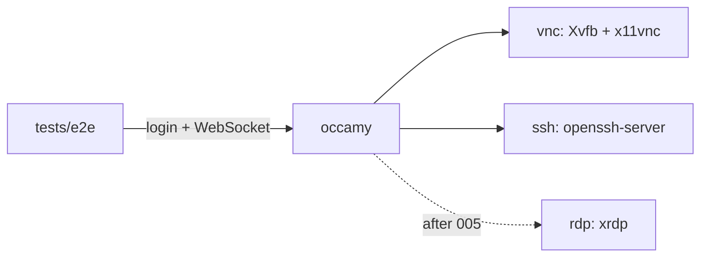

# Demo stack refresh and end-to-end tests

## Overview

The compose demo is the only way to see Occamy work, and nothing tests a real
session automatically. The demo images date from 2019, are amd64 only, and
are wired together with fixed IPs that are hard-coded in three places. This
spec replaces them with small, multi-arch demo servers built from the repo
and adds an end-to-end test that CI runs on every push. Later specs
([002](002-ssh-session-rejoin.md), [003](003-session-lifecycle-hardening.md),
[005](005-upstream-guacamole.md)) rely on it for regression checks.

## Current State

- `docker/docker-compose.yaml` runs `consol/ubuntu-xfce-vnc:1.4.0`,
  `umis/xubuntu-office-xrdp-desktop:v1.0` and
  `rastasheep/ubuntu-sshd:14.04` on subnet `172.16.239.0/24` with fixed
  addresses.
- Those addresses are repeated in
  `client/occamy-web/src/components/Login.vue` (form defaults),
  `tests/pressure_test.go` (`credentials`) and `docs/protocol-cn.md`.
- `tests/pressure_test.go` targets `0.0.0.0:5636` and needs the stack
  running by hand.
- CI (`.github/workflows/dockerimage.yml`) builds and unit-tests but never
  opens a session.
- The revival verified sessions with throwaway images (Debian trixie with
  Xvfb, x11vnc and xterm; and openssh-server with password login) and a Go
  WebSocket client that logs in, connects, answers `sync`, and counts
  opcodes. See [001](001-status-quo.md).

## Architecture



All services join one compose network and address each other by service
name, so no fixed subnet is needed.

## Components

### Demo servers (`docker/demo/`)

- `vnc/Dockerfile`: Debian stable, Xvfb, x11vnc, a lightweight desktop or
  xterm, password from an environment variable.
- `ssh/Dockerfile`: Debian stable, openssh-server, password login for a
  demo user.
- `rdp/` (xrdp) added by [005](005-upstream-guacamole.md), together with a
  `guacd` service if that spec adopts upstream guacd.

### Compose (`docker/docker-compose.yaml`)

Build the demo servers locally, drop `networks.ipam`, publish only
`occamy:5636`.

### Defaults

`Login.vue` defaults and `tests/` credentials use service names (`vnc:5900`,
`ssh:22`); the test endpoint comes from an environment variable with a
`localhost:5636` default.

### End-to-end test (`tests/`)

A Go test that, per protocol, logs in, opens the WebSocket, answers `sync`,
and asserts that `size`, `img` and `sync` arrive within a timeout. Skipped
unless `OCCAMY_E2E_ENDPOINT` is set, so `go test ./...` stays hermetic.

### CI

A job that runs `make build`, `docker compose up -d --wait`, the end-to-end
test, and the pressure test with low limits, then dumps `occamy` logs on
failure.

## Testing Strategy

The deliverable is itself the test. Validate it by confirming it fails
against a build without the libvncclient fixes from [001](001-status-quo.md),
and passes with them.

## Acceptance Criteria

- [ ] `make run` works on linux/amd64 and linux/arm64.
- [ ] No hard-coded demo IPs remain in the repository.
- [ ] CI runs VNC and SSH end-to-end tests on every push.

## Appendix: revival verification harness

The throwaway harness used to verify [001](001-status-quo.md), kept here as a
starting point for the components above. Run each server on a shared network
with `occamy:latest`, then `go run . 127.0.0.1:5636 vnc <vnc-host>:5900 "" vncpassword`
or `go run . 127.0.0.1:5636 ssh <ssh-host>:22 root root`.

VNC server:

```dockerfile
FROM debian:trixie-slim
RUN apt-get update && apt-get install -y --no-install-recommends xvfb x11vnc xterm && rm -rf /var/lib/apt/lists/*
CMD sh -c 'Xvfb :0 -screen 0 1024x768x24 & sleep 1; DISPLAY=:0 xterm & x11vnc -display :0 -forever -shared -passwd vncpassword -rfbport 5900'
```

SSH server:

```dockerfile
FROM debian:trixie-slim
RUN apt-get update && apt-get install -y --no-install-recommends openssh-server && rm -rf /var/lib/apt/lists/* \
 && mkdir -p /run/sshd && echo 'root:root' | chpasswd \
 && printf 'PermitRootLogin yes\nPasswordAuthentication yes\nKbdInteractiveAuthentication yes\n' > /etc/ssh/sshd_config.d/test.conf
CMD ["/usr/sbin/sshd","-D","-e"]
```

Client (`go.mod` requires only `github.com/gorilla/websocket`):

```go
package main

import (
	"bytes"
	"encoding/json"
	"fmt"
	"net/http"
	"os"
	"sort"
	"strings"
	"time"

	"github.com/gorilla/websocket"
)

func main() {
	base, proto, host, user, pass := os.Args[1], os.Args[2], os.Args[3], os.Args[4], os.Args[5]
	body, _ := json.Marshal(map[string]string{"protocol": proto, "host": host, "username": user, "password": pass})
	resp, err := http.Post("http://"+base+"/api/v1/login", "application/json", bytes.NewReader(body))
	if err != nil {
		panic(err)
	}
	var out struct{ Token string }
	json.NewDecoder(resp.Body).Decode(&out)
	resp.Body.Close()

	d := websocket.Dialer{Subprotocols: []string{"guacamole"}}
	ws, _, err := d.Dial("ws://"+base+"/api/v1/connect?token="+out.Token, nil)
	if err != nil {
		panic(err)
	}
	defer ws.Close()

	counts := map[string]int{}
	bytesIn := 0
	deadline := time.Now().Add(6 * time.Second)
	ws.SetReadDeadline(deadline)
	for {
		_, msg, err := ws.ReadMessage()
		if err != nil {
			fmt.Println("read ended:", err)
			break
		}
		bytesIn += len(msg)
		for _, ins := range strings.Split(string(msg), ";") {
			if i := strings.Index(ins, "."); i >= 0 {
				rest := ins[i+1:]
				if j := strings.Index(rest, ","); j >= 0 {
					rest = rest[:j]
				}
				counts[rest]++
				if rest == "sync" {
					ws.WriteMessage(websocket.TextMessage, []byte(ins+";"))
				}
			}
		}
	}
	keys := make([]string, 0, len(counts))
	for k := range counts {
		keys = append(keys, k)
	}
	sort.Strings(keys)
	fmt.Printf("%s: %d bytes received; opcodes:", proto, bytesIn)
	for _, k := range keys {
		fmt.Printf(" %s=%d", k, counts[k])
	}
	fmt.Println()
}
```
