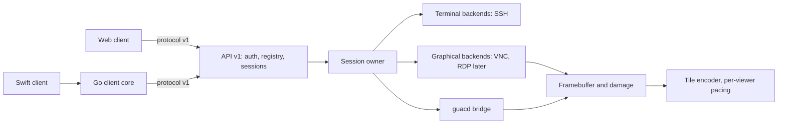
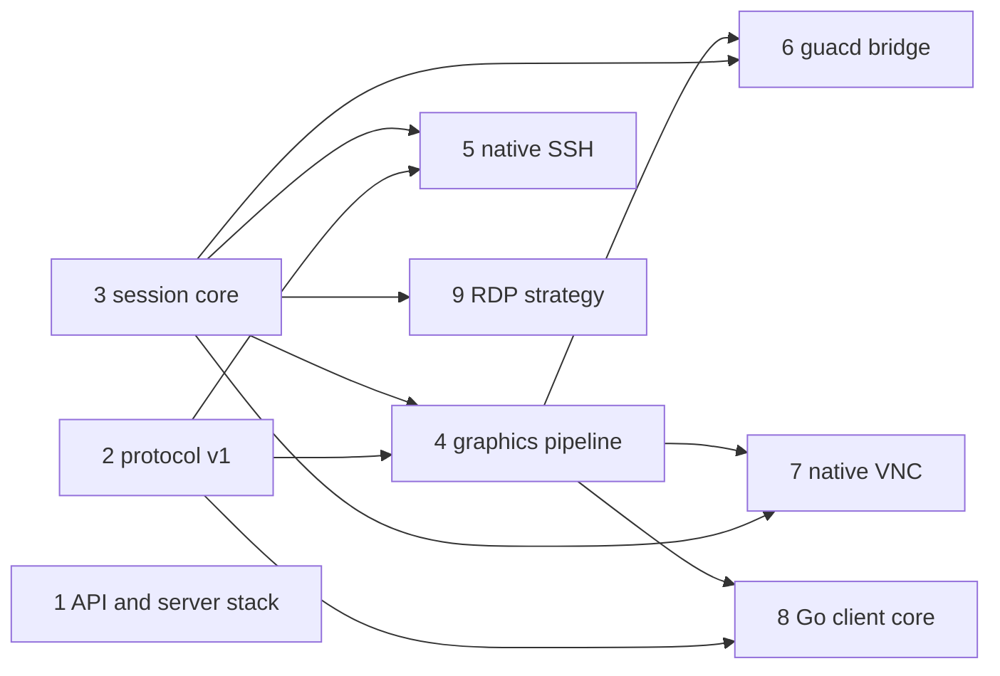

# Occamy v1 architecture

## Overview

Everything Occamy has shipped so far (tags `0.1.0` to `0.4.0`) is a proof of
concept: a Guacamole-protocol proxy around libguac, and soon around guacd
([005](005-upstream-guacamole.md)). This spec designs **Occamy v1**: one
pure-Go server with its own protocol and native backends. The first
release target is **v1 beta**. The spec defines the beta scope, the path
from guacd to pure Go, and the sub-designs, which are broken out as
children.

The recommendation not to reimplement libguac stands. libguac is shaped
around Guacamole's drawing-instruction protocol, and a port would carry
over that protocol's costs (below) without its ecosystem. v1 is a smaller
core built around two content classes, terminals and pixels. Guacamole is
kept only as a bridge for protocols that have no native backend yet.

## Versioning

- **v0** is the PoC line: the Guacamole protocol on `/api/v1/login` and
  `/api/v1/connect` (the path says v1, the design does not). It makes no
  compatibility promise. Its tags lack the `v` prefix, so the Go toolchain
  ignores them.
- **v1** starts with `v1.0.0-beta.1`. Betas may still break the API and
  the protocol. From the release candidate on, both are frozen, and later
  v1 changes are additive and negotiated through capabilities. The module
  path stays `changkun.de/x/occamy` (no `/v2` suffix needed for v1).
- What happens to the v0 routes is decided in
  [api-and-server-stack](008-native-architecture/api-and-server-stack.md).

## v1 beta scope

In scope:

1. `occamyd` as a single binary built with `CGO_ENABLED=0`.
2. API v1: authentication, connection registry, sessions, sharing.
3. Occamy protocol v1 over binary WebSocket frames.
4. Session core: one owner per session, per-viewer pacing, explicit
   sharing roles.
5. Graphics pipeline: framebuffer, damage tracking, lossless and lossy
   tiles.
6. Native SSH backend, with terminals rendered by the client.
7. Native VNC backend.
8. RDP through the guacd bridge. guacd becomes optional and is needed only
   for RDP.
9. Clients: the web client on protocol v1 ([009](009-react-web-client.md))
   and the Go client core, which the end-to-end tests and the Swift client
   ([010](010-native-swift-client.md), preview in beta) build on.

Out of scope for beta: video encoding (H.264 and similar), audio, file
transfer and SFTP, a recording player, WebTransport, native RDP, and
multi-node deployment.

Release gate for `v1.0.0-beta.1`, once the beta.1 items below are in:

- The end-to-end suite passes for every beta.1 backend, covering
  authentication, resize, clipboard, sharing (owner, viewer, read-only)
  and reconnect.
- Protocol decoders are fuzzed in CI.
- A throttled viewer does not lower another viewer's frame rate on the
  same session (slow-viewer test).
- Traffic and CPU are measured against the v0 baselines (see Performance).
- The [004](004-security-hardening.md) properties hold by design: no
  credentials in tokens or logs, an allowlisted connection registry, and
  no debug endpoints on the public listener.
- `docs/protocol.md` and the API reference are complete.

## Path to pure Go

"Pure Go" means `occamyd` builds with `CGO_ENABLED=0` **and** no protocol
needs an external process. 005 already delivers the first half: C leaves
`occamyd`'s process, and guacd becomes a sidecar. The second half replaces
guacd one protocol at a time. Each switch is gated by the parity criteria
in [guacd-bridge](008-native-architecture/guacd-bridge.md).

| Milestone | Delivers | guacd needed for |
|-----------|----------|------------------|
| 0.5 (after [005](005-upstream-guacamole.md)) | `occamyd` without cgo; everything through guacd | VNC, SSH, RDP |
| v1.0.0-beta.1 | API v1, protocol v1, session core, graphics pipeline, guacd bridge, native SSH, web client on v1 | VNC, RDP |
| v1.0.0-beta.2 | Native VNC | RDP |
| v1.0.0-rc.1 | API and protocol frozen; Swift client preview | RDP |
| v1.0.0 | guacd optional and off by default; deployed only when RDP connections are configured | RDP, opt-in |
| v1.x | Native RDP per [rdp-strategy](008-native-architecture/rdp-strategy.md) | nothing |

The client side is a separate matter. The Swift app links the Go client
core through cgo's `c-archive` export ([010](010-native-swift-client.md)).
That is an intentional boundary inside one client, not a dependency of the
server.

## What the v0 design costs

- **C in-process** (until 005). The libguac fork runs inside `occamyd`
  through cgo, so a memory bug crashes every session: the two double frees
  fixed during the revival, plus #15, #17, #20 and #22.
- **Protocol.** Text instructions carry image data as base64 PNG, JPEG or
  WebP in `blob` instructions. That adds a third to the encoded size and
  forces text WebSocket frames. Clients must implement Guacamole's layers
  and drawing model (the 9k-line `client/occamy-web/src/components/occamy.js`).
- **Terminals as pixels.** SSH output is emulated server-side and drawn
  with Pango and Cairo into PNG tiles. Traffic scales with pixels, not
  characters, and clients cannot select text or choose fonts.
- **Implicit sharing.** Identical credentials silently join one session
  (`config.JWT.GenerateID`).
- **External process.** After 005, every connection needs guacd.

## Architecture

Principles:

1. **One pure-Go binary.** Anything that needs C runs in a separate
   process behind the backend interface, so a crash ends one connection,
   not the server.
2. **Terminals stay text.** Terminal backends stream bytes and clients
   render them; only graphical backends produce pixels.
3. **One owner per session.** One goroutine owns the backend connection
   and its state. Viewers have independent pacing: a slow viewer gets
   coalesced updates and never blocks the backend or other viewers.
4. **Binary, versioned protocol** with capability negotiation.
5. **Compatibility is an adapter**, not the core: the guacd bridge is a
   backend like any other.

## Components

Each component is a sub-design (see Design Breakdown):

- **API and server stack:** HTTP API v1, authentication, connection
  registry, sharing links, configuration, fate of the v0 routes, and the
  choice between gin and the standard library.
- **Protocol v1:** framing, hello and capabilities, message catalogue,
  flow control, errors and versioning rules; `docs/protocol.md`; a public
  Go package shared by server and clients.
- **Session core:** the backend interface, the session owner, viewer
  fan-out and pacing, late-join snapshots, roles and lifecycle.
- **Graphics pipeline:** framebuffer format, damage tracking, tile
  classification, codecs, and per-viewer quality.
- **guacd bridge:** runs guacd connections under protocol v1 and defines
  the parity criteria for replacing it per protocol.
- **Native SSH, native VNC:** the first two native backends.
- **RDP strategy:** guacd, helper process, or pure Go, decided by
  evaluation.
- **Go client core:** a pure-Go protocol v1 client library for tests,
  tools and the Swift app.

## Performance

Expectations to measure, not promises:

- Terminals: sending terminal bytes instead of PNG tiles should cut traffic
  by orders of magnitude for typical output.
- Binary frames remove base64's 4/3 expansion.
- Go-side encoding can use all cores per session and apply backpressure per
  viewer, which libguac's model does not expose to Occamy.

Before beta.1, record baselines on 0.5 (guacd): bytes per second and CPU
for VNC idle, scrolling and video playback, and for SSH `ls -R` and `top`
(overlaps #18). Keep the measurement harness in `tests/` so that each beta
reruns it.

## Testing Strategy

- Backend conformance against real servers in the
  [006](006-demo-stack-refresh.md) stack (x11vnc, TigerVNC, OpenSSH, xrdp).
- Protocol: golden encode/decode tests, and `go test -fuzz` on every
  decoder.
- Encoder: lossless tiles must round-trip exactly; lossy tiles meet a
  quality threshold.
- Load: a pressure test on the v1 session stream, including a deliberately
  slow viewer that must not stall the others.

## Acceptance Criteria

- [ ] v1 beta scope and milestones agreed.
- [ ] Every sub-design validated and broken into tasks.
- [ ] Baseline measurements recorded on 0.5.
- [ ] RDP strategy decided after evaluation.

## Design Breakdown

| # | Sub-design | Design problem | Depends on | Effort | Status |
|---|-----------|---------------|-----------|--------|--------|
| 1 | [API and server stack](008-native-architecture/api-and-server-stack.md) | HTTP API v1, auth, registry, v0 routes, gin or stdlib | — | large | drafted |
| 2 | [Protocol v1](008-native-architecture/protocol-v1.md) | Wire format, capabilities, flow control, versioning | — | large | drafted |
| 3 | [Session core](008-native-architecture/session-core.md) | Backend interface, session owner, viewer pacing | — | large | drafted |
| 4 | [Graphics pipeline](008-native-architecture/graphics-pipeline.md) | Framebuffer, damage, codecs, quality | protocol-v1, session-core | large | drafted |
| 5 | [Native SSH backend](008-native-architecture/native-ssh-backend.md) | SSH, terminal state, host keys | protocol-v1, session-core | medium | drafted |
| 6 | [guacd bridge](008-native-architecture/guacd-bridge.md) | guacd under protocol v1; parity gates for removal | session-core, graphics-pipeline, 005 handshake client | large | drafted |
| 7 | [Native VNC backend](008-native-architecture/native-vnc-backend.md) | RFB client: security types, encodings | session-core, graphics-pipeline | large | drafted |
| 8 | [Go client core](008-native-architecture/client-core.md) | Client library shaped for tests and a C ABI | protocol-v1, graphics-pipeline | medium | drafted |
| 9 | [RDP strategy](008-native-architecture/rdp-strategy.md) | guacd, helper process, or pure-Go RDP | session-core | large | drafted |

**Recommended iteration order:** #1, #2 and #3 in parallel. They are the
foundations, and the protocol is the longest-lived contract. Then #4 and
#5. Then #6, #7 and #8. The #9 evaluation spike can run at any time
alongside.
