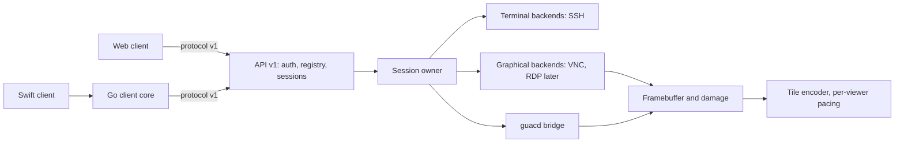
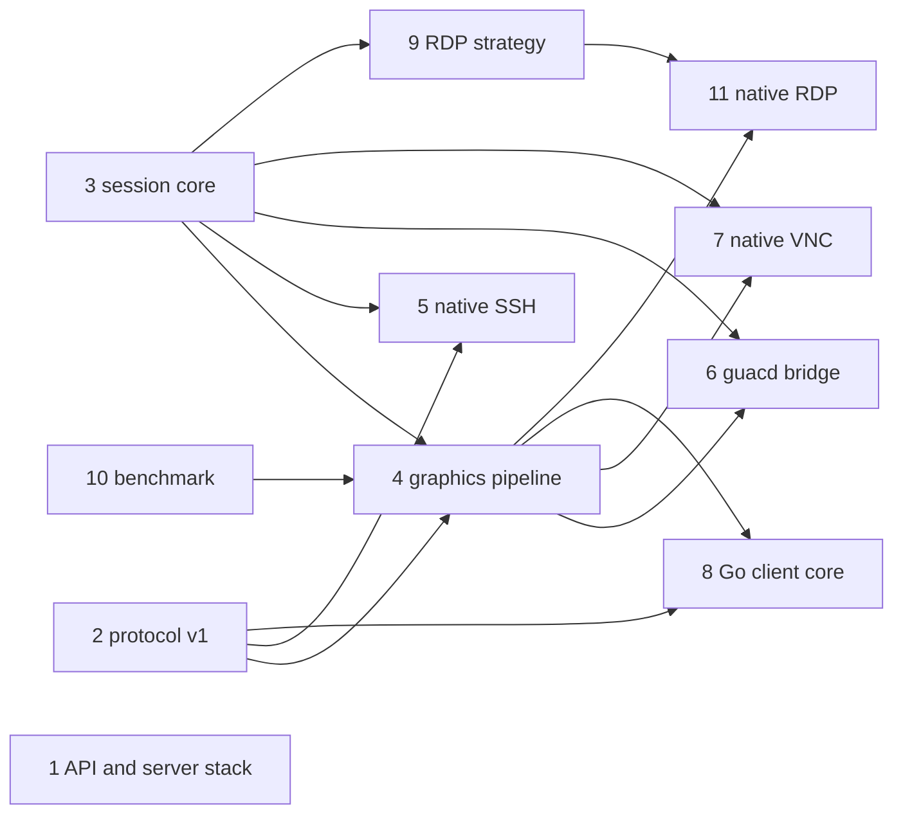

# Occamy v1 architecture

## Overview

Everything Occamy has shipped so far (tags `0.1.0` to `v0.5.0`) is a proof
of concept: a Guacamole-protocol proxy, around libguac up to `0.4.0` and
around guacd since `v0.5.0` ([005](005-upstream-guacamole.md)). This spec
designs **Occamy v1**: one pure-Go server with its own protocol and native
backends. The first release target is **v1 beta**. The spec defines the
beta scope, the path from guacd to pure Go, and the sub-designs, which are
broken out as children.

The recommendation not to reimplement libguac stands. libguac is shaped
around Guacamole's drawing-instruction protocol, and a port would carry
over that protocol's costs (below) without its ecosystem. v1 is a smaller
core built around two content classes, terminals and pixels. Guacamole is
kept only as a bridge for protocols that have no native backend yet, as
an explicit fallback and as the benchmark's baseline, until v1.0 removes
it.

## Versioning

- **v0** is the PoC line: the Guacamole protocol on `/api/v0/login` and
  `/api/v0/connect` (`/api/v1/…` through 0.6.0, though the design was never
  v1). It makes no compatibility promise. Its tags up to `0.4.0` lack the `v` prefix, so
  the Go toolchain ignores them; from `v0.5.0` on, tags carry it.
- **v1** starts with `v1.0.0-beta.1`. Betas may still break the API and
  the protocol. From the release candidate on, both are frozen, and later
  v1 changes are additive and negotiated through capabilities. The module
  path stays `changkun.de/x/occamy` (no `/v2` suffix needed for v1).
- What happens to the v0 routes is decided in
  [api-and-server-stack](008-native-architecture/api-and-server-stack.md).

## v1 beta scope

In scope:

1. `occamyd` as a single binary built with `CGO_ENABLED=0`.
2. API v1: authentication, connection registry, sessions, sharing.
3. Occamy protocol v1 over binary WebSocket frames.
4. Session core: one owner per session, per-viewer pacing, explicit
   sharing roles.
5. Graphics pipeline: framebuffer, damage tracking, lossless and lossy
   tiles.
6. Native SSH backend, with terminals rendered by the client.
7. Native VNC backend, vnc's default (the owner's decision of
   2026-10-31), with the guacd bridge as an explicit fallback.
8. RDP through the guacd bridge until its native backend takes over by
   rc.1, and telnet, which gets no native backend, through guacd until
   guacd is removed. Where a native backend exists it is the default,
   and guacd serves that protocol only with an explicit `backend: guacd`.
9. Clients: the web client on protocol v1 ([009](009-react-web-client.md))
   and the Go client core, which the end-to-end tests and the Swift client
   ([010](010-native-swift-client.md)) build on. The Swift client is a
   preview by rc.1 and does not gate beta.1.

Out of scope for beta: video encoding (H.264 and similar), audio, file
transfer and SFTP, a recording player, WebTransport, native RDP, and
multi-node deployment.

Release gate for `v1.0.0-beta.1`, once the beta.1 items below are in:

- The end-to-end suite passes for every beta.1 backend, covering
  authentication, resize, clipboard, sharing (owner, viewer, read-only)
  and reconnect.
- Protocol decoders are fuzzed in CI.
- A throttled viewer does not lower another viewer's frame rate on the
  same session (slow-viewer test).
- Traffic and CPU are measured against the v0 baselines (see Performance).
- The [004](004-security-hardening.md) properties hold by design: no
  credentials in tokens or logs, an allowlisted connection registry, and
  no debug endpoints on the public listener.
- `docs/protocol.md` and the API reference are complete.

## Path to pure Go

"Pure Go" means `occamyd` builds with `CGO_ENABLED=0` **and** no protocol
needs an external process. 005 delivered the first half in v0.5.0: C left
`occamyd`'s process, and guacd became a sidecar. The second half replaces
guacd one protocol at a time. Each switch is gated by the parity criteria
in [guacd-bridge](008-native-architecture/guacd-bridge.md). The goal, the
owner's call on 2026-10-30, is a v1.0 with no Guacamole anywhere: neither
guacd nor the Guacamole protocol. RDP is native if its spike passes; if
not, an isolated helper process takes its place, the one exception to
"no external process", and still free of Guacamole.

The owner's calls on 2026-10-31 sharpen this. Native is the default
wherever a native backend exists, so VNC is native by default now, and
the parity criteria no longer gate a switch of default. guacd stays only
as an explicit `backend: guacd` fallback and as the benchmark's
baseline, and is deleted per protocol once the benchmark shows the
native backend at least 10x better than the guacd baseline on each
scenario's primary metric and the parity matrix passes
([guacd-bridge](008-native-architecture/guacd-bridge.md), Parity
gate). RDP is native in v1.0, with no helper
([rdp-strategy](008-native-architecture/rdp-strategy.md) decision 5),
and Windows is checked later, once a host is available. v1.0 also needs
a native Kubernetes backend (pod exec), specified separately, and the
React web client on protocol v1. Telnet gets no native backend: it
stays on guacd and is dropped when guacd is removed. A further call
that day (owner, 2026-10-31): v1.0 waits until the benchmark shows
native at least 10x better than guacd. It does not ship with a guacd
fallback for any protocol still short of 10x; release candidates may
still carry one ([benchmark](008-native-architecture/benchmark.md),
Targets).

| Milestone | Delivers | guacd needed for |
|-----------|----------|------------------|
| v0.5.0 ([005](005-upstream-guacamole.md), released 2026-10-29) | `occamyd` without cgo; everything through guacd | VNC, SSH, RDP |
| v1.0.0-beta.1 | API v1, protocol v1, session core, graphics pipeline, guacd bridge, native SSH, native VNC as vnc's default, web client on v1 | RDP; VNC only with `backend: guacd` |
| v1.0.0-beta.2 | Native VNC through the parity gate: VNC's guacd fallback deleted once the benchmark shows native at least 10x better | RDP |
| v1.0.0-rc.1 | API and protocol frozen; native RDP as rdp's default; Swift client preview | nothing by default; any fallback still short of the gate |
| v1.0.0 | No guacd and no Guacamole protocol, so no telnet; the v0 routes are removed | nothing |
| v1.x | Kerberos, audio and the rest of RDP's later scope per [rdp-strategy](008-native-architecture/rdp-strategy.md) | nothing |

The last column leaves out telnet, which needs guacd for as long as
guacd is there.

The client side is a separate matter. The Swift app links the Go client
core through cgo's `c-archive` export ([010](010-native-swift-client.md)).
That is an intentional boundary inside one client, not a dependency of the
server.

## What the v0 design costs

- **C in-process** (up to `0.4.0`). The libguac fork ran inside
  `occamyd` through cgo, so a memory bug crashed every session: the two
  double frees fixed during the revival, plus #15, #17, #20 and #22. 005
  removed it in v0.5.0.
- **Protocol.** Text instructions carry image data as base64 PNG, JPEG or
  WebP in `blob` instructions. That adds a third to the encoded size and
  forces text WebSocket frames. Clients must implement Guacamole's layers
  and drawing model (the 9k-line `client/occamy-web/src/components/occamy.js`).
- **Terminals as pixels.** SSH output is emulated server-side and drawn
  with Pango and Cairo into PNG tiles. Traffic scales with pixels, not
  characters, and clients cannot select text or choose fonts.
- **Implicit sharing.** Identical credentials silently join one session
  (`config.JWT.GenerateID`).
- **External process.** Since v0.5.0, every connection needs guacd.

## Architecture

Principles:

1. **One pure-Go binary.** Anything that needs C runs in a separate
   process behind the backend interface, so a crash ends one connection,
   not the server.
2. **Terminals stay text.** Terminal backends stream bytes and clients
   render them; only graphical backends produce pixels.
3. **One owner per session.** One goroutine owns the backend connection
   and its state. Viewers have independent pacing: a slow viewer gets
   coalesced updates and never blocks the backend or other viewers.
4. **Binary, versioned protocol** with capability negotiation.
5. **Compatibility is an adapter**, not the core: the guacd bridge is a
   backend like any other.

## Components

Each component is a sub-design (see Design Breakdown):

- **API and server stack:** HTTP API v1, authentication, connection
  registry, sharing links, configuration, fate of the v0 routes, and the
  choice between gin and the standard library.
- **Protocol v1:** framing, hello and capabilities, message catalogue,
  flow control, errors and versioning rules; `docs/protocol.md`; a public
  Go package shared by server and clients.
- **Session core:** the backend interface, the session owner, viewer
  fan-out and pacing, late-join snapshots, roles and lifecycle.
- **Graphics pipeline:** framebuffer format, damage tracking, tile
  classification, codecs, and per-viewer quality.
- **guacd bridge:** runs guacd connections under protocol v1 and defines
  the parity criteria for replacing it per protocol.
- **Native SSH, native VNC:** the first two native backends.
- **RDP strategy:** guacd, helper process, or pure Go, decided by
  evaluation (decided: pure Go).
- **Native RDP backend:** the backend over the strategy's pure-Go
  client, then virtual channels, GFX without AVC, and the Windows check.
- **Go client core:** a pure-Go protocol v1 client library for tests,
  tools and the Swift app.

## Performance

v1 has two performance targets, defined and measured by
[benchmark](008-native-architecture/benchmark.md):

- at least 10x better than the v0 Guacamole baseline on each scenario's
  primary metric, under the same network conditions;
- input-to-update latency p95 at most 50 ms for desktop interactions at
  20 ms RTT, including while the screen is in full motion.

The baseline and the per-scenario targets are in
[docs/benchmarks.md](../docs/benchmarks.md), and the designs below are
judged against them. Where they come from:

- Terminals send bytes, not PNG tiles of rendered text.
- Binary frames remove base64's 4/3 expansion.
- Encoding is limited to damaged tiles and spread across cores.
- Small messages never wait behind tiles, and per-viewer windows keep
  queues short, so a keystroke's update is not stuck behind bulk frames.
- Native backends remove guacd's encode and the bridge's decode and
  re-encode.

Each beta reruns the benchmark, which also covers #18.

## Testing Strategy

- Backend conformance against real servers in the
  [006](006-demo-stack-refresh.md) stack (x11vnc, OpenSSH, xrdp), plus a
  TigerVNC server, which the stack does not have yet.
- Protocol: golden encode/decode tests, and `go test -fuzz` on every
  decoder.
- Encoder: lossless tiles must round-trip exactly; lossy tiles meet a
  quality threshold.
- Load: a pressure test on the v1 session stream, including a deliberately
  slow viewer that must not stall the others.

## Acceptance Criteria

- [ ] v1 beta scope and milestones agreed.
- [ ] Every sub-design validated and broken into tasks.
- [x] Guacamole baseline recorded with the
  [benchmark](008-native-architecture/benchmark.md): terminals on master
  after v0.5.0, desktops on v0.6.0
  ([docs/benchmarks.md](../docs/benchmarks.md)).
- [ ] v1 meets the benchmark's 10x and 50 ms targets, or each miss is
  justified there by a bound Occamy does not control.
- [x] RDP strategy decided after evaluation: pure Go, after the spike's
  steps 1 and 3 against xrdp
  ([rdp-strategy](008-native-architecture/rdp-strategy.md) decisions 1
  and 5).

## Design Breakdown

| # | Sub-design | Design problem | Depends on | Effort | Status |
|---|-----------|---------------|-----------|--------|--------|
| 1 | [API and server stack](008-native-architecture/api-and-server-stack.md) | HTTP API v1, auth, registry, v0 routes, gin or stdlib | — | large | validated |
| 2 | [Protocol v1](008-native-architecture/protocol-v1.md) | Wire format, capabilities, flow control, versioning | — | large | complete |
| 3 | [Session core](008-native-architecture/session-core.md) | Backend interface, session owner, viewer pacing | — | large | validated |
| 4 | [Graphics pipeline](008-native-architecture/graphics-pipeline.md) | Framebuffer, damage, codecs, quality | protocol-v1, session-core | large | validated |
| 5 | [Native SSH backend](008-native-architecture/native-ssh-backend.md) | SSH, terminal state, host keys | protocol-v1, session-core | medium | complete |
| 6 | [guacd bridge](008-native-architecture/guacd-bridge.md) | guacd under protocol v1; parity gates for removal | session-core, graphics-pipeline, 005 handshake client | large | validated |
| 7 | [Native VNC backend](008-native-architecture/native-vnc-backend.md) | RFB client: security types, encodings | session-core, graphics-pipeline | large | validated |
| 8 | [Go client core](008-native-architecture/client-core.md) | Client library shaped for tests and a C ABI | protocol-v1, graphics-pipeline | medium | validated |
| 9 | [RDP strategy](008-native-architecture/rdp-strategy.md) | guacd, helper process, or pure-Go RDP | session-core | large | validated |
| 10 | [Protocol benchmark](008-native-architecture/benchmark.md) | Yardstick: scenarios, metrics, the Guacamole baseline, the 10x and 50 ms targets | — | large | complete |
| 11 | [Native RDP backend](008-native-architecture/native-rdp-backend.md) | The backend over the RDP spike's client; channels, GFX without AVC, the Windows check | session-core, graphics-pipeline, rdp-strategy | large | validated |

**Recommended iteration order:** #10 first, so that the Guacamole
baseline exists before any encoding or pacing is built. Alongside it, #1,
#2 and #3, the foundations; the protocol is the longest-lived contract.
Then #4 and #5. Then #6, #7 and #8. The #9 evaluation spike can run at any
time alongside; #11 follows it.
