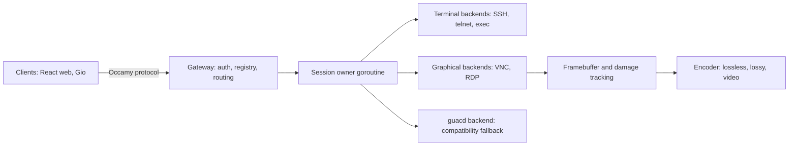

# Occamy native architecture

## Overview

The goal is to stop depending on Guacamole's C core and wire protocol and run
Occamy on its own Go-native design: one pure-Go binary, its own protocol, and
backends that fit what they carry. This spec proposes the target and a
migration that keeps a working product at every step. It is a parent spec, to
be broken down per phase. It supersedes the earlier protocol-redesign spec
(issues #3, #21).

The recommendation is not to reimplement libguac in Go. libguac is shaped
around Guacamole's drawing-instruction protocol. Porting it would carry over
that protocol's costs (below) without its ecosystem. Instead, build a smaller
core around two content classes, terminals and pixels, and keep Guacamole
only as a compatibility backend.

## Current State

What the current design costs:

- **C in-process.** The libguac fork and its plugins run inside `occamyd` via
  cgo (`internal/lib/`). A memory bug crashes every session: the two double
  frees fixed during the revival, plus #15, #17, #20. Unloading a plugin
  breaks Pango (#22). libguac starts its own threads per user, which Go can
  neither see nor schedule; `server/session.go` works around this with
  `runtime.LockOSThread`.
- **Build.** autotools and system C libraries; no native macOS build (#25);
  no static `CGO_ENABLED=0` binary.
- **Protocol.** Text instructions; image data is base64 PNG/JPEG/WebP in
  `blob` instructions, adding a third on top of the encoded size and forcing
  text WebSocket frames. Clients must implement Guacamole's layer and
  drawing model (the 9k-line `client/occamy-web/src/components/occamy.js`).
- **Terminals rendered as pixels.** SSH output is emulated and drawn into
  images server-side with Pango/Cairo, then shipped as PNG tiles. Traffic
  scales with pixels rather than characters, and clients cannot select text
  or choose fonts.
- **Implicit sharing.** Sessions are shared by credential hash
  (`config.JWT.GenerateID`).

## Architecture

Principles:

1. **One pure-Go binary.** Anything that needs C runs in a separate process
   behind the backend interface, so a crash ends one connection, not the
   server.
2. **Terminals stay text.** Terminal backends stream bytes and clients render
   them; only graphical backends produce pixels.
3. **One owner per session.** A goroutine owns the backend connection and
   state. Viewers subscribe with independent pacing: a slow viewer gets
   coalesced frames and never blocks the backend or other viewers.
4. **Binary, versioned protocol** with capability negotiation.
5. **Compatibility is an adapter**, not the core.

## Components

### Backend interface (`internal/backend`)

`Connect(ctx, target, credentials)` returns a connection that emits events
(resize, frame damage, cursor, clipboard, bell, terminal data, closed) and
accepts input (key, pointer, text, clipboard, resize). Backends declare a
class: terminal or graphical.

### Terminal backends

SSH on `golang.org/x/crypto/ssh` (PTY, window change, password and key auth,
agent forwarding later). The server keeps a headless terminal state only to
send snapshots to late joiners and for recording. Evaluate Go terminal
emulator libraries for completeness and maintenance before choosing one.
This removes Pango and Cairo entirely.

### Graphical backends

- **VNC:** a Go RFB client (RFC 6143) with None, VNC and VeNCrypt security,
  and Raw, CopyRect, ZRLE and Tight encodings. Evaluate existing Go RFB
  libraries against writing one; the protocol is small.
- **RDP:** the hardest backend. Stage it:
  1. The guacd backend from [005](005-upstream-guacamole.md) provides RDP
     immediately.
  2. Evaluate a helper-process backend wrapping a maintained RDP stack
     (FreeRDP 3, or IronRDP) and speaking the backend interface over a Unix
     socket.
  3. Consider pure-Go RDP only if an evaluation finds a viable base.

  Evaluation criteria: NLA/CredSSP, TLS, the GFX pipeline (including
  H.264), licensing, and maintenance activity.
- **guacd:** speaks guacd's TCP protocol and translates its instruction
  stream into backend events. Kept as the fallback for protocols without a
  native backend.

### Framebuffer and encoder

One framebuffer per graphical session, updated from backend damage, with
tile-based change detection. Each changed tile is classified: low-colour
content (text, UI) is encoded losslessly (a compressed palette or a fast
lossless codec), photographic content lossily (WebP or JPEG). CopyRect
passes through for scrolling. Quality adapts per viewer from acknowledged
frame timings. A video tier for high-motion regions, decoded with WebCodecs
in browsers, is an evaluation item: pure-Go video encoding is unlikely to be
fast enough, so it probably needs a helper process or hardware encoder, and
codec licensing needs checking.

### Wire protocol

- Binary messages with a small header (type, flags, stream, length) over
  binary WebSocket frames; version and capabilities agreed in an initial
  hello.
- Message families: hello and capabilities, authentication (token in the
  first message, not the URL; see [004](004-security-hardening.md)),
  resize, tile (codec, rectangle, payload), copy-rect, cursor, terminal data
  and snapshot, clipboard (with MIME type), input (keysym and physical code;
  pointer and wheel), acknowledgement and flow control, bell, and close with
  a reason.
- Evaluate WebTransport (HTTP/3; quic-go is already in the dependency graph
  through gin) for input and cursor on unreliable datagrams and frames on
  streams, falling back to WebSocket. Check browser support at evaluation
  time.
- `/api/v1/connect` keeps speaking Guacamole for existing clients while it
  exists; the Occamy protocol lives on `/api/v2`.
- Reference documentation in English (`docs/protocol.md`);
  `docs/protocol-cn.md` describes the legacy format.

### Gateway and sessions

Authentication and the connection registry come from
[004](004-security-hardening.md). The session owner generalizes
[003](003-session-lifecycle-hardening.md) with explicit sharing (owner,
viewers, read-only viewers) and a recording hook.

### Clients

The React web client ([009](009-react-web-client.md)) decodes tiles in a
Worker (OffscreenCanvas, WebCodecs where needed) and renders terminals with
a terminal widget such as xterm.js. The Gio client
([007](007-native-gio-client.md)) uses a Go client library for the protocol,
which the end-to-end and pressure tests share.

## Migration

| Phase | Delivers | Specs |
|-------|----------|-------|
| 0 | Revival baseline | [001](001-status-quo.md) |
| 1 | Stabilize the current path; gin-jwt v3; end-to-end harness | [003](003-session-lifecycle-hardening.md), [004](004-security-hardening.md), [006](006-demo-stack-refresh.md) |
| 2 | Upstream guacd as backend: RDP restored, cgo and `guacamole/` removed | [005](005-upstream-guacamole.md) |
| 3 | Backend interface, protocol v0, React client on `/api/v2` via the guacd backend | this spec, [009](009-react-web-client.md) |
| 4 | Native SSH backend and terminal rendering in clients | child of this spec |
| 5 | Native VNC backend, framebuffer and encoder | child of this spec |
| 6 | RDP strategy evaluated and implemented; guacd optional | child of this spec |

Each phase keeps the [006](006-demo-stack-refresh.md) suite green. Phase 2
reintroduces a guacd process, reversing the README's "no guacd" pitch for a
while. In return Occamy itself becomes pure Go and gains every upstream
protocol at once. In the end state guacd runs only if configured as a
fallback.

## Performance

Expectations to measure, not promises:

- Terminals: sending terminal bytes instead of PNG tiles should cut traffic
  by orders of magnitude for typical output.
- Binary frames remove base64's 4/3 expansion.
- Go-side encoding can use all cores per session and apply backpressure per
  viewer, which libguac's model does not expose to Occamy.

Before phase 3, record baselines with the current path: bytes per second
and CPU for VNC idle, scrolling and video playback, and for SSH `ls -R` and
`top` (overlaps #18).

## Testing Strategy

- Backend conformance against real servers in the
  [006](006-demo-stack-refresh.md) stack (x11vnc, TigerVNC, OpenSSH, xrdp).
- Protocol: golden encode/decode tests and fuzzing of the decoder
  (`go test -fuzz`).
- Encoder: lossless tiles must round-trip exactly; lossy tiles meet a
  quality threshold.
- Load: pressure test on `/api/v2`, including a deliberately slow viewer
  that must not stall others.

## Acceptance Criteria

- [ ] Architecture agreed and phases 3 to 6 broken down with
      `/spec:breakdown`.
- [ ] Baseline measurements recorded.
- [ ] RDP strategy decided after evaluation.
