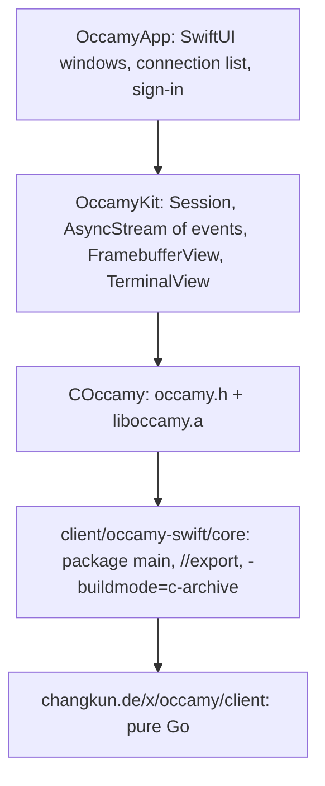

# Native Swift client on a Go core

## Overview

The native client is a SwiftUI app, starting on macOS, that links Occamy's
Go client core as a static library. Go does the protocol, decoding and
session logic, shared with the server and the tests. Swift does the UI,
input, rendering and platform integration. It replaces the Gio client
([007](007-native-gio-client.md), archived), and it is a preview by
`v1.0.0-rc.1`, not a gate for beta.1 ([008](008-native-architecture.md)).

## Current State

- No Swift code exists. The Gio attempt lives on branches `gio` and
  `gio-client` (PR #51, closed unmerged).
- The Go client core exists: `changkun.de/x/occamy/client`, designed in
  [client-core](008-native-architecture/client-core.md), a pure-Go
  package with a pull-style event API (`Dial`, then `Session.Next`),
  chosen with this C ABI in mind.

## Architecture



cgo appears here by design. The export layer is a client artifact.
`occamyd` keeps building with `CGO_ENABLED=0`.

## Components

### C export layer (`client/occamy-swift/core`)

A `package main` in the main Go module, built with
`go build -buildmode=c-archive`, which produces `liboccamy.a` and
`occamy.h`. ABI sketch:

```c
typedef uintptr_t occamy_session;          // runtime/cgo.Handle
int  occamy_dial(const char *url, const char *token,
                 const occamy_options *opts, occamy_session *out, char **err);
int  occamy_next(occamy_session s, int timeout_ms, occamy_event *ev); // blocking pull
void occamy_event_free(occamy_event *ev);
int  occamy_framebuffer_lock(occamy_session s, occamy_framebuffer *fb);
void occamy_framebuffer_unlock(occamy_session s);
int  occamy_key(occamy_session s, uint32_t keysym, uint16_t hid_usage, bool down);
int  occamy_text(occamy_session s, const char *utf8);
int  occamy_term_input(occamy_session s, const uint8_t *p, size_t n);
int  occamy_pointer(occamy_session s, int32_t x, int32_t y, uint32_t buttons);
int  occamy_wheel(occamy_session s, double dx, double dy, int mode);
int  occamy_resize(occamy_session s, int32_t w, int32_t h, double scale);
int  occamy_clipboard(occamy_session s, const char *mime, const uint8_t *p, size_t n);
void occamy_close(occamy_session s);
void occamy_free(void *p);                 // strings and buffers returned by the core
```

Rules:

- No Go pointers reach C.
- Every returned buffer is C-allocated and released with `occamy_free` or
  `occamy_event_free`.
- Every function is safe to call from any thread.

### Build and packaging

- One archive per slice: darwin/arm64 and darwin/amd64 (merged with
  `lipo`), then later ios/arm64 for devices and the simulator, with `CC`
  and `CGO_CFLAGS` pointing at the matching Xcode SDK through `xcrun`.
- A `make swift-core` target builds the slices and the package input
  described under Options.

### OccamyKit (Swift)

- `Session` wraps the handle. A dedicated `Thread`, not the cooperative
  pool, since `occamy_next` blocks, pulls events and yields them into an
  `AsyncStream<Event>` consumed on the main actor.
- `FramebufferView` (`NSViewRepresentable`) displays the core's
  framebuffer. It starts with a `CALayer` whose contents are a `CGImage`
  over the locked buffer, updated per dirty rectangle, and moves to
  `CAMetalLayer` if profiling demands.
- `TerminalView` renders `term-data` with SwiftTerm (MIT, macOS and iOS)
  and sends its output through `occamy_term_input`.
- Input: `NSEvent` key codes are mapped to HID usages and keysyms, with
  IME through `NSTextInputClient`. Pointer and precise scrolling go to
  `wheel` in pixel mode. Clipboard uses `NSPasteboard`.

### OccamyApp

Sign-in against API v1, the connection list (`GET /api/v1/connections`),
one window per session, full screen, and share links.

## Options

### Linking the Go archive into SwiftPM

- **A. `systemLibrary` target.** `Sources/COccamy/module.modulemap`
  declares `module COccamy [system] { header "occamy.h"; link "occamy";
  export * }`, and a generated `occamy.pc` gives SwiftPM the include and
  library paths (`pkgConfig: "occamy"`).
  - Pros: the simplest setup; `make swift-core && swift build` is the
    whole loop on macOS.
  - Cons: the library must already exist on the build machine; system
    library targets are meant for host libraries, so iOS device and
    simulator builds and distribution to other developers do not fit.
- **B. `binaryTarget` with an XCFramework.** `xcodebuild
  -create-xcframework` bundles the per-platform archives, headers and
  module map. `Package.swift` references it by path, or by URL and
  checksum for releases.
  - Pros: one artifact for every platform slice; consumers need no Go
    toolchain; the standard way to ship binary dependencies.
  - Cons: an extra packaging step, and the XCFramework must be rebuilt
    whenever the core changes during development.
- **C. Both.** A for the local development loop and B for CI and
  releases, with the same module map.

## Testing Strategy

- Go: the export layer gets `go test` coverage through a thin Go wrapper
  that calls the exported functions in-process.
- Swift: Swift Testing for `OccamyKit` against the
  [006](006-demo-stack-refresh.md) stack running v1. Open a terminal
  session and a graphical session, send input, and assert on received
  events.
- CI: a `macos-latest` job builds the archive, the package and the app.

## Decisions

Settled on 2026-10-29.

- **Order:** the app is built on protocol v1, after
  [client-core](008-native-architecture/client-core.md). It does not get
  an interim Guacamole client.
- **Platforms:** macOS 14 and later first, for the Observation framework.
  iPadOS follows once the core ships as an XCFramework.
- **Layout:** in this repository, under `client/occamy-swift/`, with one
  version and one CI.
- **Linking: C.** A `systemLibrary` target (option A) for the macOS
  development loop, and option B's XCFramework once iPadOS or binary
  releases need it, with the same module map.
- **App project:** SwiftPM only for now, an executable target plus a
  bundling step. An Xcode project waits until signing and entitlements
  matter.
- **Rendering:** a `CALayer` first. Metal only if profiling asks for it.

Open:

- **Distribution** (a notarized DMG, the Mac App Store, or TestFlight) is
  decided before the first preview build.
- **Gio:** the `gio` and `gio-client` branches stay.
  [guacd-bridge](008-native-architecture/guacd-bridge.md) may reuse their
  `internal/guac`. (Answered: the bridge reuses `internal/guacamole`,
  written fresh, instead.)

## Acceptance Criteria

- [x] Linking option and first platforms chosen.
- [ ] `OccamyKit` opens a terminal session and a graphical session
      against the v1 stack.
- [ ] CI builds the core archive and the Swift package on macOS.
