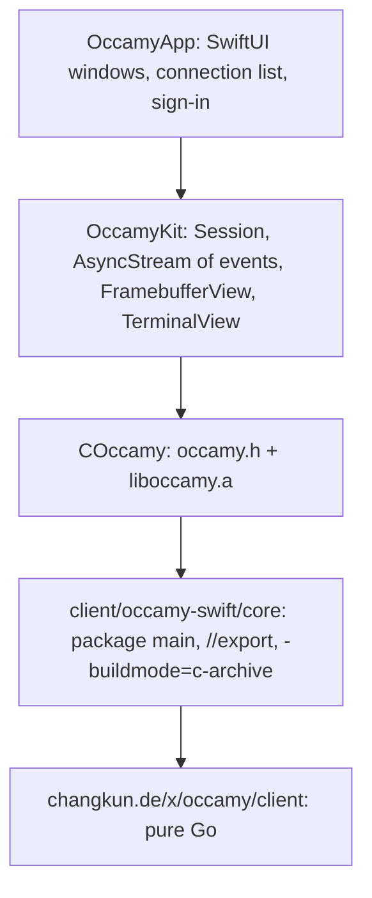

# Native Swift client on a Go core

## Overview

The native client is a SwiftUI app, starting on macOS, that links Occamy's
Go client core as a static library. Go does the protocol, decoding and
session logic, shared with the server and the tests. Swift does the UI,
input, rendering and platform integration. It replaces the Gio client
([007](007-native-gio-client.md), archived). It was first planned as a
preview by `v1.0.0-rc.1`; the owner's plan of 2026-11-03 makes it part
of `v1.0.0-beta.2` ([008](008-native-architecture.md), v1.0.0-beta.2
scope): an app as simple as VNC Viewer, which does the job, in the
style of macOS 26.

The app is also where later real-time work can go furthest
([realtime-transport](008-native-architecture/realtime-transport.md)):
a browser reaches UDP only through WebTransport, while the app may use
a transport of Occamy's own, and it can decode video in hardware
through VideoToolbox. In beta.2 it uses the WebSocket transport, as the
web client does.

## Current State

- The C export layer exists: `client/occamy-swift/core` builds the Go
  client core as `liboccamy.a`, universal, with the interface in
  `occamy.h` (Implementation notes: C export layer).
- `OccamyKit` exists: sessions, their model, the framebuffer and
  terminal views and the key mapping (Implementation notes: OccamyKit).
  The app is still to come. The Gio attempt lives on branches `gio` and `gio-client`
  (PR #51, closed unmerged).
- The Go client core exists: `changkun.de/x/occamy/client`, designed in
  [client-core](008-native-architecture/client-core.md), a pure-Go
  package with a pull-style event API (`Dial`, then `Session.Next`),
  chosen with this C ABI in mind.

## Architecture



cgo appears here by design. The export layer is a client artifact.
`occamyd` keeps building with `CGO_ENABLED=0`.

## Components

### C export layer (`client/occamy-swift/core`)

A `package main` in the main Go module, built with
`go build -buildmode=c-archive`, which produces `liboccamy.a` and
`occamy.h`. (2026-11-03: settled in a hand-written `occamy.h`; see
Implementation notes: C export layer. The sketch below is the first
draft.) ABI sketch:

```c
typedef uintptr_t occamy_session;          // runtime/cgo.Handle
int  occamy_dial(const char *url, const char *token,
                 const occamy_options *opts, occamy_session *out, char **err);
int  occamy_next(occamy_session s, int timeout_ms, occamy_event *ev); // blocking pull
void occamy_event_free(occamy_event *ev);
int  occamy_framebuffer_lock(occamy_session s, occamy_framebuffer *fb);
void occamy_framebuffer_unlock(occamy_session s);
int  occamy_key(occamy_session s, uint32_t keysym, uint16_t hid_usage, bool down);
int  occamy_text(occamy_session s, const char *utf8);
int  occamy_term_input(occamy_session s, const uint8_t *p, size_t n);
int  occamy_pointer(occamy_session s, int32_t x, int32_t y, uint32_t buttons);
int  occamy_wheel(occamy_session s, double dx, double dy, int mode);
int  occamy_resize(occamy_session s, int32_t w, int32_t h, double scale);
int  occamy_clipboard(occamy_session s, const char *mime, const uint8_t *p, size_t n);
void occamy_close(occamy_session s);
void occamy_free(void *p);                 // strings and buffers returned by the core
```

(2026-10-31: the sketch predates the `client` package, and differs
from it. The Swift work settles the ABI; these are the differences to
weigh then.

- No counterpart for `Session.View` (visibility and viewport) or
  `Session.PromptReply`, which answers the `Prompt` event; connections
  with `prompt: true` and ad-hoc targets need it.
- `occamy_resize` takes a scale, but `Session.Resize` takes a width and
  a height only; the pixel ratio is `Options.PixelRatio`, set at dial.
- `occamy_next` is `occamy_session_next` in
  [client-core](008-native-architecture/client-core.md).
- Types: `Pointer` takes `uint16` coordinates and `protocol.Buttons`,
  `Wheel` takes `int32` deltas and a `protocol.WheelMode`, and every
  input method returns the input's sequence number (`uint32`), which
  client-core says the export layer returns for latency measurement.
- Terminal sessions deliver `TermSnapshot` as well as `TermData`, so
  `TerminalView` below renders both.)

Rules:

- No Go pointers reach C.
- Every returned buffer is C-allocated and released with `occamy_free` or
  `occamy_event_free`.
- Every function is safe to call from any thread.

### Build and packaging

- One archive per slice: darwin/arm64 and darwin/amd64 (merged with
  `lipo`), then later ios/arm64 for devices and the simulator, with `CC`
  and `CGO_CFLAGS` pointing at the matching Xcode SDK through `xcrun`.
- A `make swift-core` target builds the slices and the package input
  described under Options.
- As built for beta.2: `make swift-app` builds the `Occamy` product in
  release for arm64 and x86_64, one `swift build --triple` each, since
  two `--arch` flags take Xcode's build system, which cannot find
  SwiftTerm's build plugin; merges them with `lipo` into
  `build/app/Occamy.app` with `App/Info.plist` (bundle ID
  `de.changkun.occamy`, the version from `git describe`, macOS 26 the
  oldest); and signs it with the hardened runtime and no entitlements
  (`App/Occamy.entitlements`): neither the Go runtime nor SwiftTerm
  needs an exception. The signature is `DEVELOPER_ID`'s, or ad hoc.
  `make swift-dmg` puts the bundle in a disk image with a link to
  Applications, signed with `DEVELOPER_ID` too, and `make
  swift-notarize`, which refuses to run without `DEVELOPER_ID` and
  `NOTARY_PROFILE`, submits the image with `xcrun notarytool`, staples
  the ticket and checks it with `spctl`. The app is not sandboxed: a DMG
  needs no sandbox.

### OccamyKit (Swift)

- `Session` wraps the handle. A dedicated `Thread`, not the cooperative
  pool, since `occamy_next` blocks, pulls events and yields them into an
  `AsyncStream<Event>` consumed on the main actor.
- `FramebufferView` (`NSViewRepresentable`) displays the core's
  framebuffer. It starts with a `CALayer` whose contents are a `CGImage`
  over the locked buffer, updated per dirty rectangle, and moves to
  `CAMetalLayer` if profiling demands.
- `TerminalView` renders `term-data` with SwiftTerm (MIT, macOS and iOS)
  and sends its output through `occamy_term_input`.
- Input: `NSEvent` key codes are mapped to HID usages and keysyms, with
  IME through `NSTextInputClient`. Pointer and precise scrolling go to
  `wheel` in pixel mode. Clipboard uses `NSPasteboard`.

### OccamyApp

Sign-in against API v1, the connection list (`GET /api/v1/connections`),
one window per session, full screen, and share links. Its design is
under App design.

## App design (beta.2)

The model is RealVNC's VNC Viewer: one window to find a machine, and
one window per machine. Occamy differs in one way: its connections
live on an occamyd server, so the app signs in to a server first, where
VNC Viewer dials a machine itself.

- **The main window.** A sidebar of servers, each an occamyd URL with
  its sign-in, and the connections of the selected one as a grid of
  cards: the connection's name, its protocol's symbol and a thumbnail
  of the last session the app showed, kept locally. A field in the
  toolbar searches the connections as one types; Return opens the
  match, or, where the server allows ad-hoc targets
  (`allow_adhoc_targets`), opens an address such as `vnc://host:5900`,
  `rdp://host` or `ssh://user@host` as an ad-hoc session, as VNC
  Viewer's address field does. Double-click or Return opens a card.
- **Signing in.** A server is added by its URL. The app reads
  `GET /api/v1/auth/methods` and offers a password
  (`POST /api/v1/auth/token`) or OIDC through
  `ASWebAuthenticationSession` with PKCE, whose return URL,
  `de.changkun.occamy:/oidc`, occamyd must list in
  `auth.oidc.return_urls`. occamyd accepts an app's scheme there when
  it is a domain name in reverse (RFC 8252, section 7.1), which keeps
  out the schemes a browser handles itself, such as `javascript:`; a
  loopback `http` return would not do, since the code comes back in the
  fragment, which never reaches a listener. Tokens are kept in the Keychain,
  never in preferences.
- **A session window.** One per session, titled with the connection's
  name, opening at the remote screen's size within the display. The
  picture scales to the window, or shows at one remote pixel to one
  device pixel with scrolling; full screen hides everything else. A
  bar of controls in Liquid Glass appears when the pointer reaches the
  top edge, as VNC Viewer's toolbar does: scaling, full screen, send
  Ctrl-Alt-Del, the clipboard on or off, copy a share link (viewer or
  read-only) and disconnect. A terminal session (SSH, Kubernetes) opens
  the same way with a terminal view, its font size following the
  window.
- **Input.** Keys go as USB HID usages with keysyms, from the key's
  position, so the remote's layout decides the character, as the web
  client does; Command goes as the remote's Super key, and the
  app's own shortcuts (Command-W, Command-Q, full screen) stay with the
  app unless the user turns on sending them, which takes the
  Accessibility permission. The pointer, precise scrolling in pixels,
  and the clipboard both ways (text) follow the session's role.
- **Prompts.** A connection or ad-hoc target that asks for credentials
  or a host key shows a sheet for the `Prompt` event, answered with
  `PromptReply`. Nothing is kept unless the user saves a password,
  which then goes to the Keychain.
- **Style.** SwiftUI on macOS 26: `NavigationSplitView`, toolbars and
  the session bar in the system's Liquid Glass, SF Symbols, the
  system's accent colour, light and dark. No custom chrome where the
  system has one.
- **Out of beta.2:** file transfer, audio, more than one monitor of a
  remote, a VNC Viewer-style picture quality setting (the pacer
  decides), iPadOS.

## Options

### Linking the Go archive into SwiftPM

- **A. `systemLibrary` target.** `Sources/COccamy/module.modulemap`
  declares `module COccamy [system] { header "occamy.h"; link "occamy";
  export * }`, and a generated `occamy.pc` gives SwiftPM the include and
  library paths (`pkgConfig: "occamy"`).
  - Pros: the simplest setup; `make swift-core && swift build` is the
    whole loop on macOS.
  - Cons: the library must already exist on the build machine; system
    library targets are meant for host libraries, so iOS device and
    simulator builds and distribution to other developers do not fit.
- **B. `binaryTarget` with an XCFramework.** `xcodebuild
  -create-xcframework` bundles the per-platform archives, headers and
  module map. `Package.swift` references it by path, or by URL and
  checksum for releases.
  - Pros: one artifact for every platform slice; consumers need no Go
    toolchain; the standard way to ship binary dependencies.
  - Cons: an extra packaging step, and the XCFramework must be rebuilt
    whenever the core changes during development.
- **C. Both.** A for the local development loop and B for CI and
  releases, with the same module map.

## Testing Strategy

- Go: the export layer gets `go test` coverage through a thin Go wrapper
  that calls the exported functions in-process.
- Swift: Swift Testing for `OccamyKit` against the
  [006](006-demo-stack-refresh.md) stack running v1. Open a terminal
  session and a graphical session, send input, and assert on received
  events.
- CI: a `macos-latest` job builds the archive, the package and the app.

## Decisions

Settled on 2026-10-29.

- **Order:** the app is built on protocol v1, after
  [client-core](008-native-architecture/client-core.md). It does not get
  an interim Guacamole client.
- **Platforms:** macOS 14 and later first, for the Observation framework.
  iPadOS follows once the core ships as an XCFramework. (2026-11-03:
  macOS 26 and later, since the owner asked for macOS 26's style, whose
  Liquid Glass exists only from 26, and two looks would double the
  work. A universal binary, Apple silicon and Intel, since macOS 26
  still runs on Intel Macs.)
- **Layout:** in this repository, under `client/occamy-swift/`, with one
  version and one CI.
- **Linking: C.** A `systemLibrary` target (option A) for the macOS
  development loop, and option B's XCFramework once iPadOS or binary
  releases need it, with the same module map.
- **App project:** SwiftPM only for now, an executable target plus a
  bundling step. An Xcode project waits until signing and entitlements
  matter. (2026-11-03: signing matters for beta.2, and still needs no
  Xcode project: a `make` target bundles the app, signs it with the
  hardened runtime and its entitlements, notarizes and staples it, and
  builds the DMG, with `codesign`, `xcrun notarytool` and `hdiutil`.)
- **Rendering:** a `CALayer` first. Metal only if profiling asks for it.

Open:

- **Distribution** (a notarized DMG, the Mac App Store, or TestFlight) is
  decided before the first preview build. (Proposed 2026-11-03: a DMG
  signed with a Developer ID and notarized, attached to the GitHub
  release. The owner has an Apple developer account and signs once the
  app is ready; the Mac App Store's sandbox would need the app's
  network access and Keychain use reviewed, which can come later.)
- **Gio:** the `gio` and `gio-client` branches stay.
  [guacd-bridge](008-native-architecture/guacd-bridge.md) may reuse their
  `internal/guac`. (Answered: the bridge reuses `internal/guacamole`,
  written fresh, instead.)

## Acceptance Criteria

- [x] Linking option and first platforms chosen.
- [x] `OccamyKit` opens a terminal session and a graphical session
      against the v1 stack (2026-11-03, against the demo stack; see
      Implementation notes: OccamyApp).
- [x] CI builds the core archive and the Swift package on macOS.

For beta.2 (2026-11-03):

- [x] The export layer builds as a universal archive, with Go tests
      that call it in process.
- [ ] The app signs in by password and by OIDC, lists a server's
      connections, and opens VNC, RDP, SSH and Kubernetes sessions and
      an ad-hoc address, against the demo stack.
- [ ] A session window scales, goes full screen, carries the
      clipboard both ways, copies a share link, and answers prompts.
- [ ] `make` builds the app, and with the owner's Developer ID a
      notarized DMG. (`make swift-app` and `make swift-dmg` build them,
      signed ad hoc; notarizing waits for the owner's Developer ID.)
- [x] CI builds the archive, the package and the app, signed ad hoc,
      and checks the app's architectures and its oldest macOS.

## Implementation notes: C export layer

- **What was done:** `client/occamy-swift/core`, a `package main` with
  `//go:build darwin && cgo` on every file, so Linux, Windows and
  `CGO_ENABLED=0` builds skip it and occamyd stays cgo-free.
  `make swift-core` builds `liboccamy.a` for darwin/arm64 and
  darwin/amd64 with `xcrun --sdk macosx clang`, `-trimpath` and
  `-mmacosx-version-min=26.0`, and merges them with `lipo` into
  `client/occamy-swift/build/core`. A program links it with
  `-framework CoreFoundation -framework Security -lresolv`, what the Go
  runtime and `net` need.
- **The ABI** settles the sketch's differences against the `client`
  package (#192):
  - `occamy.h` is written by hand rather than taken from cgo's generated
    header, so that it has `const`, comments and the event struct; the
    cgo preamble defines `OCCAMY_CGO` to hide its prototypes from cgo,
    and `TestHeader` runs `go tool cgo -exportheader` and checks that the
    two declare the same functions with the same types, `const` aside.
  - A session is a counter in a map, not a `runtime/cgo.Handle`: an
    unknown or released handle is refused with `OCCAMY_ERR_CLOSED`
    instead of panicking. `occamy_close` ends the session and keeps the
    handle, so that `occamy_next` still delivers `END`;
    `occamy_release` frees it once no call runs.
  - `occamy_dial` and `occamy_next` take a timeout in milliseconds,
    negative for none. A failed dial fills `occamy_dial_error`: the
    server's close code, a message, and the ID of a session the server
    made and the client refused.
  - Events are one `occamy_event` struct with the fields each kind uses,
    every pointer in it `malloc`ed and freed by `occamy_event_free`. The
    cursor's image is RGBA with straight alpha.
  - The framebuffer is not locked and handed out: `occamy_framebuffer_read`
    copies a rectangle into the caller's buffer at its own stride, as of
    the last `FRAME` delivered, and refuses a buffer whose size is not
    the screen's. No Go pointer reaches C.
  - Input takes the client's types (`uint16` pointer coordinates,
    button bits, `int32` wheel deltas and a mode, a resize of width and
    height only) and returns the input's sequence number. `occamy_view`
    and `occamy_prompt_reply` are added.
  - Results are `OCCAMY_OK`, `OCCAMY_TIMEOUT`, `OCCAMY_ERR`,
    `OCCAMY_ERR_CLOSED`, `OCCAMY_ERR_READ_ONLY` and
    `OCCAMY_ERR_NOT_OWNER`; each session keeps the error of its last
    failed call for `occamy_error`.
  - The core plugs in `client/decoders`: deflate, WebP and JPEG, checked
    against `protocol/testdata/codecs.json`. The bench still keeps its
    own copies of them, which can move to this package once the scaled
    codec branch, which edits them, has landed.
- **Tests:** Go tests call every export in process, through a bridge in
  a non-test cgo file since test files cannot use cgo, against
  `client/internal/webinterop`, occamyd's stream code in miniature: a
  graphical session to the end (frames copied out by rectangle until
  they match the desktop, key, pointer, wheel, text, clipboard echo,
  resize, prompt and its reply, view), the remote ending, a terminal
  session, dial errors, bad arguments and released handles. The interop
  desktop gains a `prompt` command for them. CI's `macos` job, on
  `macos-26`, runs them with `-race` and builds the archive.

## Implementation notes: OccamyKit

- **What was done:** `client/occamy-swift`, a SwiftPM package (tools
  6.0, macOS 26), with SwiftTerm its one dependency, pinned in
  `Package.resolved`.
  - Linking takes option A without the generated `occamy.pc`: the
    `COccamy` system library target's module map includes `occamy.h`
    through a shim and links `occamy`, and `OccamyKit` finds
    `build/core` by an `-L` from `Context.packageDirectory`. Unsafe flags
    keep the package from being another package's dependency, which
    the app in the same package does not need; option B's XCFramework
    lifts that when it comes.
  - `Session` dials on a thread and pulls events on a thread of its own,
    as planned, into an `AsyncStream<Event>`. For a graphical session the
    thread copies each frame's dirty rectangles into `Screen`, the app's
    copy of the framebuffer, before it yields the frame, since
    `occamy_framebuffer_read` reads the frame `occamy_next` last
    delivered. `Screen.image()` copies it into a `CGImage` under its
    lock, so the view never shows a frame half applied.
  - Acknowledgement: `occamy_next` acknowledges the last frame as shown,
    so while a view shows the session (`isPaced`), the thread waits
    after a frame until the model has presented it, at most a second, as
    the web client waits for an animation frame. A hidden window is not
    paced, and gets no frames once `occamy_view` hides it.
  - Input goes to the core on a serial queue: `send` keeps the order
    of the calls and never blocks the main thread on the network;
    `submit` also returns the input's sequence number.
  - `SessionModel` (`@Observable`, main actor) runs the events as the
    web client's controller does: the title (or a terminal's own), the
    owner's prompts, the viewers, the clipboard both ways, with the
    text both sides last agreed on kept so that an echo is not sent
    back, the owner's resize requests without repeats, and the end,
    which `Ending` describes as `ending.ts` does.
  - `FramebufferNSView` (and `FramebufferView` for SwiftUI) shows the
    screen in a `CALayer` scaled to fit, nearest-neighbour from one
    remote pixel to two device pixels. The pointer maps through the
    picture's frame; scrolling goes in pixels when precise, in lines
    from a wheel, with the remainder kept. The remote's pointer image
    becomes the local cursor, scaled with the picture.
  - Keys: `Keyboard.usages` maps every virtual key code of a Mac
    keyboard (Carbon's `kVK_`) to its HID usage, 119 keys, from
    Chromium's table of both; the keysym comes from the key's text, the
    unmodified text with Control or Command held, and from the key code
    for keys without text and the keypad. Modifiers come as
    `flagsChanged`, told apart by the device bits of the flags; Caps
    Lock's toggle goes as a press. Command is the remote's Super, sent
    once a key that reaches the view goes with it, or alone when it is
    released alone, so that Command-W closes the window without
    pressing Super on the remote; with `sendsShortcuts` the view takes
    the app's shortcuts too. Keys held when the window loses the
    keyboard are released. Input methods are not composed locally:
    keys go by position and the remote's layout and input method
    decide, as for the web client's ordinary typing; composing through
    `NSTextInputClient` is not done.
  - `TerminalDisplay` (and `TerminalView`) runs a terminal session in
    SwiftTerm: a snapshot resets the emulator before it is written, the
    remote's grid sets the emulator's, and the owner's window, once it
    has stayed one size for 300 ms, asks for the grid that fits. A
    viewer's grid stays the owner's.
- **Tests:** Swift Testing. The key tables are checked against Carbon's
  key codes and the backends' HID table in `internal/keymap`. The rest
  runs against the interop server, which the tests build with `go` and
  run once, serialized since its desktop records one viewer's input:
  sessions (a graphical one to the end, the remote ending, a terminal,
  dial errors), and the views with their model in an off-screen window
  (the picture the right way up, compared with the remote's screen,
  pointer and keys through `NSEvent`s, Command-W left to the app,
  the clipboard both ways without echo, a prompt answered, hiding and
  showing, and a terminal's echo and grid). The interop server stands
  in for the demo stack of the Testing Strategy, which needs containers
  that the macOS runner does not have; the app is tried against the
  demo stack. `make swift-test` runs them, and CI's `macos` job too,
  then builds the package and tests for arm64 and x86_64.

## Implementation notes: OccamyApp

- **What was done:** `client/occamy-swift/Sources/OccamyApp`, the
  `Occamy` executable of the package, in SwiftUI on `OccamyKit`, as App
  design describes it, and in OccamyKit the parts it needed: `API`, the
  API v1 client (sign-in by password, OIDC with PKCE, the connection
  list, ad-hoc sessions, shares, ending a session), `Address`, which
  reads `vnc://`, `rdp://` and `ssh://` addresses with their default
  ports, and `Keychain`.
  - The main window is a `NavigationSplitView` of servers and cards;
    the search field takes an address where the server allows ad-hoc
    targets, and an ssh address asks for the host key first, as an
    `ssh-keyscan` line or a `SHA256:` fingerprint. A card's thumbnail is
    the session's last picture, saved under
    `~/Library/Application Support/Occamy/Thumbnails`.
  - Add Server is a + in the window's toolbar, beside Refresh and the
    search field, as remote desktop clients such as Microsoft's Windows
    App have it, and in the File menu (⌘N). In the sidebar's toolbar,
    beside the window's buttons, SwiftUI moved it into an overflow menu
    once the sidebar had been hidden and shown again, and the owner
    rejected it at the sidebar's foot (2026-11-04).
  - A card's picture is the remote's whole screen, fitted into a 16:10
    frame that sets the card's size, so that every card in a row is as
    tall.
  - The icon is `App/AppIcon.icon`, an Icon Composer file that
    `make swift-app` compiles with `actool` into `Assets.car` and an
    `.icns` for older readers: the logo, `docs/occamy.png`, at three
    times its size pixel for pixel, on an indigo gradient, without
    translucency so that the pixel art stays solid. The bundle had none
    before (found by the owner, 2026-11-04).
  - A session window learns its `NSWindow` from a view in its
    background, which reports only the windows it moves into. SwiftUI
    puts a new such view in the window as it opens and as the session
    connects again, and the old one leaves after the new one has found
    the window; when leaving reported nil too, that nil came last, and
    Full Screen and fitting the window to the remote's screen had no
    window to act on (found by the owner, 2026-11-04).
  - The share menu says what a link allows: Copy Link with Control,
    to type, point and use the clipboard, and Copy View-Only Link, as
    the web client's share panel and bar do. API v1 calls the roles
    `viewer` and `read-only`, and "viewer" read as watching only.
  - Tokens, and passwords the user chooses to remember, go to the login
    keychain under `de.changkun.occamy`. occamyd's tokens last 15
    minutes and are not renewed, so with a remembered password the app
    signs in again when one runs out, and asks otherwise.
  - The session window's bar, in Liquid Glass at the top edge: scaling
    (fit, actual size with scroll bars, or, for the owner, resizing the
    remote to the window), full screen, Ctrl-Alt-Del, ⌘ shortcuts to the
    remote, the clipboard, a link with control or a view-only one for an hour, and
    End Session for the owner (Disconnect for a viewer). Closing the
    window leaves the session to the owner grace. When the session
    ends, the window says why; Connect Again opens the connection
    again, or rejoins the same session if only the stream was lost.
  - Prompts show as a sheet; Save in the Keychain answers the same
    prompt by itself the next time.
  - OIDC returns to `de.changkun.occamy:/oidc`, which occamyd accepts in
    `auth.oidc.return_urls` as a scheme that is a domain name in
    reverse (#196).
- **Deviations:** sending ⌘ shortcuts needs no Accessibility permission:
  the view takes the app's key equivalents, and shortcuts that macOS
  keeps, such as ⌘-Tab, stay with macOS. A terminal keeps its font
  size, and the owner's window asks for the grid that fits it, as
  OccamyKit's `TerminalView` does, rather than scaling the font.
- **Tested:** `APITests` checks the API client against a stub
  `URLProtocol` (routes, bodies, errors, the token's expiry, the OIDC
  login URL and outcome, PKCE against RFC 7636's vector) and
  `AddressTests` the addresses. On 2026-11-03 a scratch test drove
  OccamyKit as the app does against the demo stack, built from the
  beta.2 tree: password sign-in and the connection list; the vnc,
  vnc-none, tigervnc, desktop-vnc, rdp and desktop-rdp connections to
  their first picture; a viewer link joined as a viewer; End Session;
  the ssh terminal's echo; and an ad-hoc `vnc://vnc:5901`. The app
  launches and opens its main window. Not yet tried: the app's windows
  by hand (scaling, full screen, the clipboard through the pasteboard,
  prompts), OIDC against a provider, and a kubernetes connection, for
  which the demo stack has no cluster.
