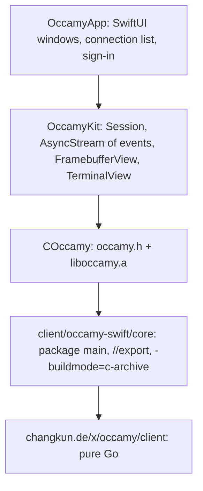

# Native Swift client on a Go core

## Overview

The native client is a SwiftUI app, starting on macOS, that links Occamy's
Go client core as a static library. Go does the protocol, decoding and
session logic, shared with the server and the tests. Swift does the UI,
input, rendering and platform integration. It replaces the Gio client
([007](007-native-gio-client.md), archived). It was first planned as a
preview by `v1.0.0-rc.1`; the owner's plan of 2026-11-03 makes it part
of `v1.0.0-beta.2` ([008](008-native-architecture.md), v1.0.0-beta.2
scope): an app as simple as VNC Viewer, which does the job, in the
style of macOS 26.

The app is also where later real-time work can go furthest
([realtime-transport](008-native-architecture/realtime-transport.md)):
a browser reaches UDP only through WebTransport, while the app may use
a transport of Occamy's own, and it can decode video in hardware
through VideoToolbox. In beta.2 it uses the WebSocket transport, as the
web client does.

## Current State

- No Swift code exists. The Gio attempt lives on branches `gio` and
  `gio-client` (PR #51, closed unmerged).
- The Go client core exists: `changkun.de/x/occamy/client`, designed in
  [client-core](008-native-architecture/client-core.md), a pure-Go
  package with a pull-style event API (`Dial`, then `Session.Next`),
  chosen with this C ABI in mind.

## Architecture



cgo appears here by design. The export layer is a client artifact.
`occamyd` keeps building with `CGO_ENABLED=0`.

## Components

### C export layer (`client/occamy-swift/core`)

A `package main` in the main Go module, built with
`go build -buildmode=c-archive`, which produces `liboccamy.a` and
`occamy.h`. ABI sketch:

```c
typedef uintptr_t occamy_session;          // runtime/cgo.Handle
int  occamy_dial(const char *url, const char *token,
                 const occamy_options *opts, occamy_session *out, char **err);
int  occamy_next(occamy_session s, int timeout_ms, occamy_event *ev); // blocking pull
void occamy_event_free(occamy_event *ev);
int  occamy_framebuffer_lock(occamy_session s, occamy_framebuffer *fb);
void occamy_framebuffer_unlock(occamy_session s);
int  occamy_key(occamy_session s, uint32_t keysym, uint16_t hid_usage, bool down);
int  occamy_text(occamy_session s, const char *utf8);
int  occamy_term_input(occamy_session s, const uint8_t *p, size_t n);
int  occamy_pointer(occamy_session s, int32_t x, int32_t y, uint32_t buttons);
int  occamy_wheel(occamy_session s, double dx, double dy, int mode);
int  occamy_resize(occamy_session s, int32_t w, int32_t h, double scale);
int  occamy_clipboard(occamy_session s, const char *mime, const uint8_t *p, size_t n);
void occamy_close(occamy_session s);
void occamy_free(void *p);                 // strings and buffers returned by the core
```

(2026-10-31: the sketch predates the `client` package, and differs
from it. The Swift work settles the ABI; these are the differences to
weigh then.

- No counterpart for `Session.View` (visibility and viewport) or
  `Session.PromptReply`, which answers the `Prompt` event; connections
  with `prompt: true` and ad-hoc targets need it.
- `occamy_resize` takes a scale, but `Session.Resize` takes a width and
  a height only; the pixel ratio is `Options.PixelRatio`, set at dial.
- `occamy_next` is `occamy_session_next` in
  [client-core](008-native-architecture/client-core.md).
- Types: `Pointer` takes `uint16` coordinates and `protocol.Buttons`,
  `Wheel` takes `int32` deltas and a `protocol.WheelMode`, and every
  input method returns the input's sequence number (`uint32`), which
  client-core says the export layer returns for latency measurement.
- Terminal sessions deliver `TermSnapshot` as well as `TermData`, so
  `TerminalView` below renders both.)

Rules:

- No Go pointers reach C.
- Every returned buffer is C-allocated and released with `occamy_free` or
  `occamy_event_free`.
- Every function is safe to call from any thread.

### Build and packaging

- One archive per slice: darwin/arm64 and darwin/amd64 (merged with
  `lipo`), then later ios/arm64 for devices and the simulator, with `CC`
  and `CGO_CFLAGS` pointing at the matching Xcode SDK through `xcrun`.
- A `make swift-core` target builds the slices and the package input
  described under Options.

### OccamyKit (Swift)

- `Session` wraps the handle. A dedicated `Thread`, not the cooperative
  pool, since `occamy_next` blocks, pulls events and yields them into an
  `AsyncStream<Event>` consumed on the main actor.
- `FramebufferView` (`NSViewRepresentable`) displays the core's
  framebuffer. It starts with a `CALayer` whose contents are a `CGImage`
  over the locked buffer, updated per dirty rectangle, and moves to
  `CAMetalLayer` if profiling demands.
- `TerminalView` renders `term-data` with SwiftTerm (MIT, macOS and iOS)
  and sends its output through `occamy_term_input`.
- Input: `NSEvent` key codes are mapped to HID usages and keysyms, with
  IME through `NSTextInputClient`. Pointer and precise scrolling go to
  `wheel` in pixel mode. Clipboard uses `NSPasteboard`.

### OccamyApp

Sign-in against API v1, the connection list (`GET /api/v1/connections`),
one window per session, full screen, and share links. Its design is
under App design.

## App design (beta.2)

The model is RealVNC's VNC Viewer: one window to find a machine, and
one window per machine. Occamy differs in one way: its connections
live on an occamyd server, so the app signs in to a server first, where
VNC Viewer dials a machine itself.

- **The main window.** A sidebar of servers, each an occamyd URL with
  its sign-in, and the connections of the selected one as a grid of
  cards: the connection's name, its protocol's symbol and a thumbnail
  of the last session the app showed, kept locally. A field in the
  toolbar searches the connections as one types; Return opens the
  match, or, where the server allows ad-hoc targets
  (`adhoc_targets`), opens an address such as `vnc://host:5900`,
  `rdp://host` or `ssh://user@host` as an ad-hoc session, as VNC
  Viewer's address field does. Double-click or Return opens a card.
- **Signing in.** A server is added by its URL. The app reads
  `GET /api/v1/auth/methods` and offers a password
  (`POST /api/v1/auth/token`) or OIDC through
  `ASWebAuthenticationSession` with PKCE, whose return URL occamyd must
  list in `auth.oidc.return_urls`. Tokens are kept in the Keychain,
  never in preferences.
- **A session window.** One per session, titled with the connection's
  name, opening at the remote screen's size within the display. The
  picture scales to the window, or shows at one remote pixel to one
  device pixel with scrolling; full screen hides everything else. A
  bar of controls in Liquid Glass appears when the pointer reaches the
  top edge, as VNC Viewer's toolbar does: scaling, full screen, send
  Ctrl-Alt-Del, the clipboard on or off, copy a share link (viewer or
  read-only) and disconnect. A terminal session (SSH, Kubernetes) opens
  the same way with a terminal view, its font size following the
  window.
- **Input.** Keys go as USB HID usages with keysyms, from the key's
  position, so the remote's layout decides the character, as the web
  client does; Command goes as the remote's Super key, and the
  app's own shortcuts (Command-W, Command-Q, full screen) stay with the
  app unless the user turns on sending them, which takes the
  Accessibility permission. The pointer, precise scrolling in pixels,
  and the clipboard both ways (text) follow the session's role.
- **Prompts.** A connection or ad-hoc target that asks for credentials
  or a host key shows a sheet for the `Prompt` event, answered with
  `PromptReply`. Nothing is kept unless the user saves a password,
  which then goes to the Keychain.
- **Style.** SwiftUI on macOS 26: `NavigationSplitView`, toolbars and
  the session bar in the system's Liquid Glass, SF Symbols, the
  system's accent colour, light and dark. No custom chrome where the
  system has one.
- **Out of beta.2:** file transfer, audio, more than one monitor of a
  remote, a VNC Viewer-style picture quality setting (the pacer
  decides), iPadOS.

## Options

### Linking the Go archive into SwiftPM

- **A. `systemLibrary` target.** `Sources/COccamy/module.modulemap`
  declares `module COccamy [system] { header "occamy.h"; link "occamy";
  export * }`, and a generated `occamy.pc` gives SwiftPM the include and
  library paths (`pkgConfig: "occamy"`).
  - Pros: the simplest setup; `make swift-core && swift build` is the
    whole loop on macOS.
  - Cons: the library must already exist on the build machine; system
    library targets are meant for host libraries, so iOS device and
    simulator builds and distribution to other developers do not fit.
- **B. `binaryTarget` with an XCFramework.** `xcodebuild
  -create-xcframework` bundles the per-platform archives, headers and
  module map. `Package.swift` references it by path, or by URL and
  checksum for releases.
  - Pros: one artifact for every platform slice; consumers need no Go
    toolchain; the standard way to ship binary dependencies.
  - Cons: an extra packaging step, and the XCFramework must be rebuilt
    whenever the core changes during development.
- **C. Both.** A for the local development loop and B for CI and
  releases, with the same module map.

## Testing Strategy

- Go: the export layer gets `go test` coverage through a thin Go wrapper
  that calls the exported functions in-process.
- Swift: Swift Testing for `OccamyKit` against the
  [006](006-demo-stack-refresh.md) stack running v1. Open a terminal
  session and a graphical session, send input, and assert on received
  events.
- CI: a `macos-latest` job builds the archive, the package and the app.

## Decisions

Settled on 2026-10-29.

- **Order:** the app is built on protocol v1, after
  [client-core](008-native-architecture/client-core.md). It does not get
  an interim Guacamole client.
- **Platforms:** macOS 14 and later first, for the Observation framework.
  iPadOS follows once the core ships as an XCFramework. (2026-11-03:
  macOS 26 and later, since the owner asked for macOS 26's style, whose
  Liquid Glass exists only from 26, and two looks would double the
  work. A universal binary, Apple silicon and Intel, since macOS 26
  still runs on Intel Macs.)
- **Layout:** in this repository, under `client/occamy-swift/`, with one
  version and one CI.
- **Linking: C.** A `systemLibrary` target (option A) for the macOS
  development loop, and option B's XCFramework once iPadOS or binary
  releases need it, with the same module map.
- **App project:** SwiftPM only for now, an executable target plus a
  bundling step. An Xcode project waits until signing and entitlements
  matter. (2026-11-03: signing matters for beta.2, and still needs no
  Xcode project: a `make` target bundles the app, signs it with the
  hardened runtime and its entitlements, notarizes and staples it, and
  builds the DMG, with `codesign`, `xcrun notarytool` and `hdiutil`.)
- **Rendering:** a `CALayer` first. Metal only if profiling asks for it.

Open:

- **Distribution** (a notarized DMG, the Mac App Store, or TestFlight) is
  decided before the first preview build. (Proposed 2026-11-03: a DMG
  signed with a Developer ID and notarized, attached to the GitHub
  release. The owner has an Apple developer account and signs once the
  app is ready; the Mac App Store's sandbox would need the app's
  network access and Keychain use reviewed, which can come later.)
- **Gio:** the `gio` and `gio-client` branches stay.
  [guacd-bridge](008-native-architecture/guacd-bridge.md) may reuse their
  `internal/guac`. (Answered: the bridge reuses `internal/guacamole`,
  written fresh, instead.)

## Acceptance Criteria

- [x] Linking option and first platforms chosen.
- [ ] `OccamyKit` opens a terminal session and a graphical session
      against the v1 stack.
- [ ] CI builds the core archive and the Swift package on macOS.

For beta.2 (2026-11-03):

- [ ] The export layer builds as a universal archive, with Go tests
      that call it in process.
- [ ] The app signs in by password and by OIDC, lists a server's
      connections, and opens VNC, RDP, SSH and Kubernetes sessions and
      an ad-hoc address, against the demo stack.
- [ ] A session window scales, goes full screen, carries the
      clipboard both ways, copies a share link, and answers prompts.
- [ ] `make` builds the app, and with the owner's Developer ID a
      notarized DMG.
- [ ] CI builds the archive, the package and the app, unsigned.
