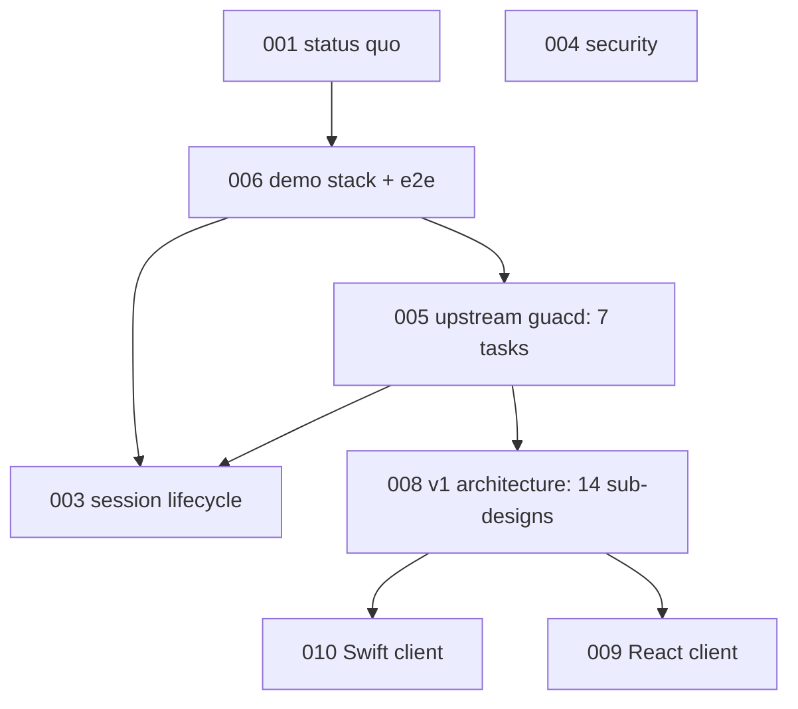

# Occamy design specs

Design specs for Occamy: what exists, what is planned, and in which order.
Each spec is a Markdown file with YAML frontmatter carrying its lifecycle
`status`, `track`, `effort`, and `depends_on` edges. Specs sit directly in
this directory; the `NNN-` prefix is reading order only, and dependency order
comes from `depends_on`.

Lifecycle: `vague` → `drafted` → `validated` → `testing` → `complete`, with
`stale` and `archived` for specs that no longer match reality or were retired.

A spec broken into children keeps them in a directory named after it
(`005-upstream-guacamole/`), unnumbered, carrying the parent's `track`. The
parent's breakdown section lists them in order.

## Status Quo

Start with [001-status-quo.md](001-status-quo.md) for the baseline restored by
the 2026 revival, how it was verified, and every known issue. Everything
shipped so far (0.x) is a proof of concept.
[005](005-upstream-guacamole.md) moved it onto upstream guacd 1.6, which
removed cgo from `occamyd` and restored RDP, and
[011](011-release-readiness.md) released it as v0.5.0. The target is
[008-native-architecture.md](008-native-architecture.md): Occamy v1, a
pure-Go server with its own protocol. `v1.0.0-beta.1` shipped on
2026-11-02 with guacd as a fallback; beta.2 removes guacd from the
product, keeping it only as the benchmark's baseline, and adds the
macOS app ([010](010-native-swift-client.md)).

| | Spec | Status |
|-|------|--------|
| ● | [001](001-status-quo.md) Status quo after the 2026 revival | complete |
| ✕ | [002](002-ssh-session-rejoin.md) SSH sessions after the first one | archived |
| ● | [003](003-session-lifecycle-hardening.md) Session lifecycle hardening | complete |
| ○ | [004](004-security-hardening.md) Security hardening | drafted |
| ● | [005](005-upstream-guacamole.md) Catch up with upstream guacamole | complete |
| ● | [006](006-demo-stack-refresh.md) Demo stack refresh and end-to-end tests | complete |
| ✕ | [007](007-native-gio-client.md) Native Gio client | archived |
| ○ | [008](008-native-architecture.md) Occamy v1 architecture | drafted |
| ◐ | [009](009-react-web-client.md) React web client | testing |
| ○ | [010](010-native-swift-client.md) Native Swift client on a Go core | validated |
| ● | [011](011-release-readiness.md) Open source release readiness | complete |

● complete · ◐ in testing · ○ not started · ✕ archived

## Tracks

### architecture

The target design of Occamy as a whole: core, backends, protocol.

| Spec | Status | Deliverable |
|------|--------|-------------|
| [008-native-architecture.md](008-native-architecture.md) | In progress: 3 of 14 sub-designs complete, 11 more validated; building beta.1 (merged: backend interface, protocol framing and messages, pacer, framebuffer, auth tokens, session core, viewer writer, guacd bridge, native SSH, terminal state, config v1, native VNC phases 1 to 4 (phase 4's check against a Mac pending), native as vnc's default with `backend: guacd` as a fallback until the benchmark shows native 10x better (owner, 2026-10-31), v0 routes, codec measurement, HTTP server, Go client core, codecs, OIDC, API sessions and streams, native RDP phases 1 and 2 (static channels, clipboard, CredSSP acceptor, DRDYNVC and Display Control; the Heartbeat PDU and auto-detect deferred to phase 4), native RDP registered as rdp's default with `backend: guacd` as a fallback (checked against xrdp, not yet Windows), native RDP phase 3's first part (GFX's channel, ZGFX, surfaces, fills, copies, planar and uncompressed) and second (RemoteFX and RemoteFX Progressive, GFX on by default with `disable_gfx`; RemoteFX Progressive verified against xrdp), scroll detection, native Kubernetes (pod exec), the benchmark's v1 series harness, whose full run waits for the graphics pipeline and native RDP, refinement, tile cache, encode cache and workers, and for the owner's go-ahead), and the comparison benchmark designed on 2026-11-02 (all six series, workloads from typing to video, networks N0 to N4, viewers, operators and server scale, collected in one resumable command and analysed with exact tests and intervals); how the series runs decided on 2026-11-01 (GFX on and off on both sides, the shipped default the verdict; 32 bits per pixel on both sides; frames stamped, G7 ending on known content, the probe's keys jittered, the affected baselines measured again), the 8-hour soak a stability gate before v1.0, the decoding budget for the whole process a gate of beta.1, done on 2026-11-01 (`limits.decode_cores`), and the signing key at `/var/lib/occamy/signing.key` with no default user; RDP spike steps 1 and 3 done against xrdp and reviewed, step 2 waits for a Windows host; the real-time transport's step 1, the frame window from the path, measured and kept on 2026-11-02, and step 2, loss, measured on 2026-11-03: 2% loss adds 3 to 8 round trips to a key during full-screen motion, so step 3 is built in two halves: 3a, BBR in place of CUBIC on today's TCP, measured and kept on 2026-11-03 (under N2 with 2% loss a key during motion shows in 149 to 163 ms instead of 360 to 471 at p95, about a round trip over no loss), and occamyd asks for BBR (`congestion_control`); 3c, a shorter wait for a lone lost packet, whose slowest keys wait three round trips and 200 ms, outlined; 3b, versioned tiles over WebTransport with WebSocket as the fallback, outlined; none of the steps gates a release, each landing in the next once measured and kept (decided 2026-11-03); the owner's plan for beta.2 (2026-11-03): no guacd, no Guacamole protocol, no v0 routes and no telnet in occamyd, guacd only as the benchmark's baseline, steps 1 and 3a and the scaled codec for tiles in motion, the essential comparison run again on its image, and the macOS app; steps 3b, 3c, 4 and 5, and native RDP's ClearCodec and bitmap cache, move to beta.3; v1.0 still waits for native 10x better than the guacd baseline | Occamy v1: beta scope, path to pure Go, 14 sub-designs including the benchmark that sets the 10x and 50 ms targets (#3, #18, #21) and real-time pacing and transport, built and measured one step at a time |

### maintenance

Build, dependencies, CI, demo environment, and documentation.

| Spec | Status | Deliverable |
|------|--------|-------------|
| [001-status-quo.md](001-status-quo.md) | Complete | Buildable baseline on current toolchains, verified and documented |
| [006-demo-stack-refresh.md](006-demo-stack-refresh.md) | Complete | Multi-arch VNC and SSH demo servers; VNC and SSH end-to-end tests in CI (pressure test in CI since 003); native VNC next to guacd's on `occamy-v1`, API v1; TigerVNC beside x11vnc for the VNC parity matrix; a real XFCE desktop over native VNC and RDP |
| [011-release-readiness.md](011-release-readiness.md) | Complete (v0.5.0) | Licensing, changelog, security policy, CI gates, attested multi-arch releases and binaries |

### server

`occamyd`, its session handling, and the Guacamole backend.

| Spec | Status | Deliverable |
|------|--------|-------------|
| [002-ssh-session-rejoin.md](002-ssh-session-rejoin.md) | Archived | Moot: guacd replaced the in-process libguac (#22 fixed by 005) |
| [003-session-lifecycle-hardening.md](003-session-lifecycle-hardening.md) | Complete | Join fallback when guacd ends a session, session table stress test, pressure test in CI, debugging docs (#18, #20) |
| [004-security-hardening.md](004-security-hardening.md) | Not started | No credentials in tokens or logs, target allowlist, safe defaults |
| [005-upstream-guacamole.md](005-upstream-guacamole.md) | Complete (v0.5.0) | Upstream guacd 1.6 as backend: RDP restored, cgo removed (#25); Windows RDP check open on #32 |

### client

Clients that speak to `occamyd`.

| Spec | Status | Deliverable |
|------|--------|-------------|
| [007-native-gio-client.md](007-native-gio-client.md) | Archived | Retired in favour of 010 |
| [009-react-web-client.md](009-react-web-client.md) | In testing: protocol client core and React shell built, served from a v1 file with `web_client`; the Vue app and `occamy.js` removed; a browser job in CI to come | A React shell on the TypeScript protocol v1 core (`src/protocol`) and API v1, replacing the Vue app and `occamy.js` |
| [010-native-swift-client.md](010-native-swift-client.md) | In progress; part of beta.2 (2026-11-03): the Go core's C export layer built (#192) | A SwiftUI app for macOS 26, as simple as VNC Viewer, linking the Go client core as a static library, on protocol v1; signed and notarized |

## Dependency graph

Edges into and out of 008 are summarized: the precise ones are on the
children, for example
[guacd-bridge](008-native-architecture/guacd-bridge.md) on 005's handshake
client and 010 on
[client-core](008-native-architecture/client-core.md).

Path from [008](008-native-architecture.md): v0.5.0, released, runs
everything through guacd with a cgo-free `occamyd` (005) →
`v1.0.0-beta.1`, released 2026-11-02, with API and protocol v1, the
guacd bridge, native SSH, and native VNC and RDP as their protocols'
defaults → beta.2 with no guacd, no Guacamole protocol, no v0 routes and
no telnet in occamyd, the real-time steps kept so far, the scaled codec,
and the macOS app → beta.3 with the remaining real-time steps and
native RDP's ClearCodec and bitmap cache → rc.1 freezes the API and
protocol; native RDP's check against Windows runs once a host is
available (#32) → v1.0 once the benchmark shows native at least 10x
better than the guacd baseline, or a justified miss (owner, 2026-11-03;
[008](008-native-architecture.md), v1.0.0-beta.2 scope). Kubernetes is
native only. guacd remains only as the benchmark's baseline.
