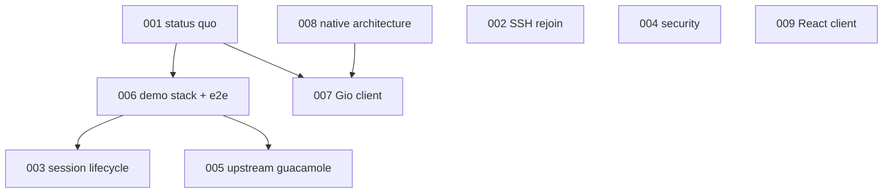

# Occamy design specs

Design specs for Occamy: what exists, what is planned, and in which order.
Each spec is a Markdown file with YAML frontmatter carrying its lifecycle
`status`, `track`, `effort`, and `depends_on` edges. Specs sit directly in
this directory; the `NNN-` prefix is reading order only, and dependency order
comes from `depends_on`.

Lifecycle: `vague` → `drafted` → `validated` → `testing` → `complete`, with
`stale` and `archived` for specs that no longer match reality or were retired.

A spec broken into children keeps them in a directory named after it
(`005-upstream-guacamole/`), unnumbered, carrying the parent's `track`. The
parent's breakdown section lists them in order.

## Status Quo

Start with [001-status-quo.md](001-status-quo.md) for the baseline restored by
the 2026 revival, how it was verified, and every known issue. The direction
from there is [008-native-architecture.md](008-native-architecture.md): a
pure-Go core with its own protocol, reached in phases that keep the current
path shipping.

| | Spec | Status |
|-|------|--------|
| ◐ | [001](001-status-quo.md) Status quo after the 2026 revival | testing |
| ○ | [002](002-ssh-session-rejoin.md) SSH sessions after the first one | drafted |
| ○ | [003](003-session-lifecycle-hardening.md) Session lifecycle hardening | drafted |
| ○ | [004](004-security-hardening.md) Security hardening | drafted |
| ○ | [005](005-upstream-guacamole.md) Catch up with upstream guacamole | validated |
| ○ | [006](006-demo-stack-refresh.md) Demo stack refresh and end-to-end tests | drafted |
| ○ | [007](007-native-gio-client.md) Native Gio client | vague |
| ○ | [008](008-native-architecture.md) Occamy native architecture | drafted |
| ○ | [009](009-react-web-client.md) React web client | vague |

● complete · ◐ in testing · ○ not started

## Tracks

### architecture

The target design of Occamy as a whole: core, backends, protocol.

| Spec | Status | Deliverable |
|------|--------|-------------|
| [008-native-architecture.md](008-native-architecture.md) | Not started | Pure-Go core, backend interface, Occamy protocol, phased migration (#3, #21) |

### maintenance

Build, dependencies, CI, demo environment, and documentation.

| Spec | Status | Deliverable |
|------|--------|-------------|
| [001-status-quo.md](001-status-quo.md) | Testing | Buildable baseline on current toolchains, verified and documented |
| [006-demo-stack-refresh.md](006-demo-stack-refresh.md) | Not started | Multi-arch demo servers and end-to-end tests in CI |

### server

`occamyd`, its session handling, and the Guacamole backend.

| Spec | Status | Deliverable |
|------|--------|-------------|
| [002-ssh-session-rejoin.md](002-ssh-session-rejoin.md) | Not started | Repeated SSH sessions in one process (#22); moot if 005 adopts guacd |
| [003-session-lifecycle-hardening.md](003-session-lifecycle-hardening.md) | Not started | Deadlock-free, race-free session table; pressure test in CI (#17, #18, #20) |
| [004-security-hardening.md](004-security-hardening.md) | Not started | No credentials in tokens or logs, target allowlist, safe defaults, gin-jwt v3 |
| [005-upstream-guacamole.md](005-upstream-guacamole.md) | Not started | Upstream guacd 1.6 as backend: RDP restored, cgo removed (#25, #32); 6 tasks |

### client

Clients that speak to `occamyd`.

| Spec | Status | Deliverable |
|------|--------|-------------|
| [007-native-gio-client.md](007-native-gio-client.md) | Not started | Decision on PR #51 and, if kept, a Gio client on the Occamy protocol |
| [009-react-web-client.md](009-react-web-client.md) | Not started | Decision on React and, if chosen, a React shell at parity |

## Dependency graph

Migration phases from [008](008-native-architecture.md): stabilize (003, 004,
006) → upstream guacd (005) → backend interface, protocol v0 and React client
(008, 009) → native SSH → native VNC → RDP strategy.
