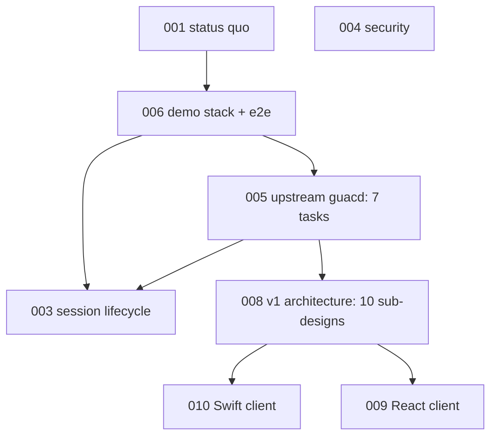

# Occamy design specs

Design specs for Occamy: what exists, what is planned, and in which order.
Each spec is a Markdown file with YAML frontmatter carrying its lifecycle
`status`, `track`, `effort`, and `depends_on` edges. Specs sit directly in
this directory; the `NNN-` prefix is reading order only, and dependency order
comes from `depends_on`.

Lifecycle: `vague` → `drafted` → `validated` → `testing` → `complete`, with
`stale` and `archived` for specs that no longer match reality or were retired.

A spec broken into children keeps them in a directory named after it
(`005-upstream-guacamole/`), unnumbered, carrying the parent's `track`. The
parent's breakdown section lists them in order.

## Status Quo

Start with [001-status-quo.md](001-status-quo.md) for the baseline restored by
the 2026 revival, how it was verified, and every known issue. Everything
shipped so far (0.x) is a proof of concept.
[005](005-upstream-guacamole.md) moved it onto upstream guacd 1.6, which
removed cgo from `occamyd` and restored RDP, and
[011](011-release-readiness.md) released it as v0.5.0. The target is
[008-native-architecture.md](008-native-architecture.md): Occamy v1, a
pure-Go server with its own protocol, aiming for a v1 beta, with guacd
replaced one protocol at a time.

| | Spec | Status |
|-|------|--------|
| ● | [001](001-status-quo.md) Status quo after the 2026 revival | complete |
| ✕ | [002](002-ssh-session-rejoin.md) SSH sessions after the first one | archived |
| ● | [003](003-session-lifecycle-hardening.md) Session lifecycle hardening | complete |
| ○ | [004](004-security-hardening.md) Security hardening | drafted |
| ● | [005](005-upstream-guacamole.md) Catch up with upstream guacamole | complete |
| ● | [006](006-demo-stack-refresh.md) Demo stack refresh and end-to-end tests | complete |
| ✕ | [007](007-native-gio-client.md) Native Gio client | archived |
| ○ | [008](008-native-architecture.md) Occamy v1 architecture | drafted |
| ○ | [009](009-react-web-client.md) React web client | vague |
| ○ | [010](010-native-swift-client.md) Native Swift client on a Go core | validated |
| ● | [011](011-release-readiness.md) Open source release readiness | complete |

● complete · ◐ in testing · ○ not started · ✕ archived

## Tracks

### architecture

The target design of Occamy as a whole: core, backends, protocol.

| Spec | Status | Deliverable |
|------|--------|-------------|
| [008-native-architecture.md](008-native-architecture.md) | In progress: 1 of 10 sub-designs complete, 8 more validated; building beta.1 (merged: backend interface, protocol framing, pacer, framebuffer) | Occamy v1: beta scope, path to pure Go, 10 sub-designs including the benchmark that sets the 10x and 50 ms targets (#3, #18, #21) |

### maintenance

Build, dependencies, CI, demo environment, and documentation.

| Spec | Status | Deliverable |
|------|--------|-------------|
| [001-status-quo.md](001-status-quo.md) | Complete | Buildable baseline on current toolchains, verified and documented |
| [006-demo-stack-refresh.md](006-demo-stack-refresh.md) | Complete | Multi-arch VNC and SSH demo servers; VNC and SSH end-to-end tests in CI (pressure test in CI since 003) |
| [011-release-readiness.md](011-release-readiness.md) | Complete (v0.5.0) | Licensing, changelog, security policy, CI gates, attested multi-arch releases and binaries |

### server

`occamyd`, its session handling, and the Guacamole backend.

| Spec | Status | Deliverable |
|------|--------|-------------|
| [002-ssh-session-rejoin.md](002-ssh-session-rejoin.md) | Archived | Moot: guacd replaced the in-process libguac (#22 fixed by 005) |
| [003-session-lifecycle-hardening.md](003-session-lifecycle-hardening.md) | Complete | Join fallback when guacd ends a session, session table stress test, pressure test in CI, debugging docs (#18, #20) |
| [004-security-hardening.md](004-security-hardening.md) | Not started | No credentials in tokens or logs, target allowlist, safe defaults |
| [005-upstream-guacamole.md](005-upstream-guacamole.md) | Complete (v0.5.0) | Upstream guacd 1.6 as backend: RDP restored, cgo removed (#25); Windows RDP check open on #32 |

### client

Clients that speak to `occamyd`.

| Spec | Status | Deliverable |
|------|--------|-------------|
| [007-native-gio-client.md](007-native-gio-client.md) | Archived | Retired in favour of 010 |
| [009-react-web-client.md](009-react-web-client.md) | Not started | Decision on React and, if chosen, a React shell, then protocol v1 |
| [010-native-swift-client.md](010-native-swift-client.md) | Not started | SwiftUI app for macOS 14+ linking the Go client core as a static library, on protocol v1 |

## Dependency graph

Edges into and out of 008 are summarized: the precise ones are on the
children, for example
[guacd-bridge](008-native-architecture/guacd-bridge.md) on 005's handshake
client and 010 on
[client-core](008-native-architecture/client-core.md).

Path from [008](008-native-architecture.md): v0.5.0, released, runs
everything through guacd with a cgo-free `occamyd` (005) →
`v1.0.0-beta.1` with API and protocol v1, the guacd bridge and native SSH
→ beta.2 with native VNC → rc.1 freezes the API and protocol → v1.0 with
guacd optional (RDP only) → native RDP in v1.x.
